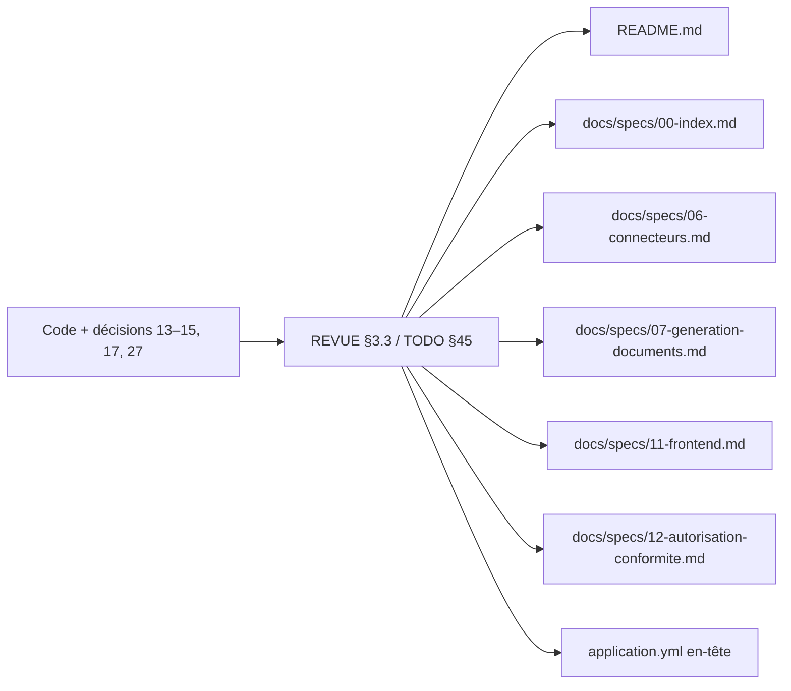

# System Design — `derive-documentaire`

> Phase 3 **reviewed**. Feature doc-only. Couverture requirements → fichiers
> 1:1. Aucun modèle de données ni API.

## Architecture Overview

Pas de nouveau composant runtime. Les docs listées sont **dérivées** du code.

## Data Models

Aucun. Pas de table, pas de DTO.

## API Design

Aucun endpoint. Contrat OpenAPI inchangé.

## Component Breakdown

| Fichier | Édition |
|---|---|
| `README.md` | § Multi-tenant ; proposition de valeur connecteurs ; BPMN/DMN ; diagrammes ; stack jsoup + stockage |
| `docs/specs/00-index.md` | Workflow sans DMN V1 ; stockage port S3 ; jsoup 1.23.1 |
| `docs/specs/06-connecteurs.md` | Catalogue : colonnes Cible / V1 |
| `docs/specs/07-generation-documents.md` | jsoup 1.23.1 |
| `docs/specs/11-frontend.md` | `context-path` = cible ops, yaml commenté |
| `docs/specs/12-autorisation-conformite.md` | WORKFLOW_ADMIN sans cockpit |
| `src/main/resources/application.yml` | Commentaire d'en-tête Flowable exclusions actuelles |

**Hors design :** `01` (`com.monapp` clos), `.java`, `.vue`, changelogs.

## Design Decisions

| ID | Question | Choix | Écarté |
|---|---|---|---|
| DD-06-SHAPE | Forme du catalogue `06` | Table existante + colonne **V1** | Réécrire le catalogue comme « seulement le livré » (perdrait la cible) |
| DD-README-DMN | DMN dans le README | Phrase « moteur DMN Flowable **non activé** en V1 » | Silence total (le diagramme ASCII a encore une case DMN — la remplacer par « DMN hors V1 ») |
| DD-STORAGE | MinIO | « Stockage objet S3-compatible (MinIO possible en local) / filesystem » | Garder MinIO comme seul nom |
| DD-CONTEXT | context-path | Clarifier cible décision 14, non actif (`application.yml` commenté) | Activer le yaml (ops, point 31) |

## Non-Functional Requirements

- Pas d'impact perf / sécu runtime (commentaire yaml seulement).
- Traçabilité : chaque success criterion a un grep de test (testing doc).
