# System Design & Architecture — `durcissement-securite-post-revue`

## Phase 3: Review Design (en cours)

Réécrit pour **D-40-ALLOW = B2** (pas le brouillon A/B1). `status: draft`.
Pas reviewed tant que DD-THYME-B2, DD-SSTI-FAIL et DD-DENYLIST ne sont
pas tranchés. Une question à la fois.

Couverture requirements : 5 goals, A-PIN-CALLERS, A-NO-SPA, hexagone.

## Architecture Overview
**What is the high-level system structure?**

Cinq durcissements **infrastructure**, aucun nouveau use case métier, aucun
changement `domain` (sauf éventuellement types déjà existants). Pas de SPA.

```mermaid
flowchart TB
  subgraph sst["§40 SSTI B2"]
    gen[generate / live preview]
    chk[ThymeleafTemplateSyntaxChecker]
    proc[ThymeleafHtmlTemplateProcessor]
    eng[TemplateEngine + StandardDialect]
    ev[IStandardVariableExpressionEvaluator — DD-THYME-B2 ouvert]
    gen --> proc --> eng --> ev
    chk --> eng
  end
  subgraph pg["§41 GRANT"]
    boot[POSTGRES_USER superuser init]
    role[LOGIN flowforge_tenant_dev]
    hikari[Hikari DB_USERNAME]
    boot -->|CREATE ROLE GRANT tenant_dev| role
    hikari --> role
  end
  subgraph ops["§42 §43"]
    act["management 127.0.0.1:8090 permitAll"]
    epp[SecretsEnvironmentPostProcessor]
  end
  subgraph ssrf["§44 pin"]
    guard[OutboundUrlGuard.resolveSafe]
    wh[WebhookRestAdapter]
    sk[HttpRestServiceConnector skeleton]
    guard --> wh
    guard --> sk
  end
```

**Stack :** Java / Spring Boot existants ; Thymeleaf déjà via
`spring-boot-starter-thymeleaf` ; pas de nouvelle dépendance si DD-THYME-B2
= E. PostgreSQL rôles dans l'init Compose. EPP Spring Boot existant
(`TenantIdEnvironmentValidator` comme voisin).

**Hexagone :** processeur / checker / garde URL / sender HTTP /
EPP restent `infrastructure`. Ports `HtmlTemplateProcessor`,
`TemplateSyntaxChecker`, `WebhookPort` inchangés.

## Data Models
**What data do we need to manage?**

Aucune table métier nouvelle. §41 : artefacts PostgreSQL dans
`docker/postgres/init/01-init-tenant-schema.sql` (volume **vide** seulement,
même contrat que l'init actuel) :

- `CREATE ROLE flowforge_tenant_dev LOGIN PASSWORD …`
- `GRANT USAGE, CREATE` + DML sur schéma `tenant_dev` uniquement
- `REVOKE` large sur `PUBLIC` / autres schémas
- Superuser conteneur `POSTGRES_USER` **≠** user JDBC app

Type infra pin (déjà ébauché) : `OutboundUrlGuard.PinnedEndpoint`
(hostname d'origine, URI IP, etc.) — pas un modèle domaine.

## API Design
**How do components communicate?**

Aucun contrat OpenAPI nouveau. Endpoints generate / preview /
webhooks / actuator **inchangés** (chemins, authz).

- Actuator : mêmes chemins `health` / `prometheus`, bind/port D-42.
- Fail-fast secrets : pas d'API, refus au **boot** (EPP).
- SSTI : même `TemplateProcessingException` / `InvalidTemplateSyntaxException`
  existants ; le mapping HTTP exact est **DD-SSTI-FAIL** (pas encore posé).

Admin webhook : `assertSafe` à l'enregistrement (A-PIN-CALLERS) — pas de
pin, pas de connect.

## Component Breakdown
**What are the major building blocks?**

| Composant | Rôle vs requirements |
|---|---|
| `ThymeleafHtmlTemplateProcessor` + `ThymeleafTemplateSyntaxChecker` | Même factory moteur (goal 1) |
| Évaluateur B2 | **DD-THYME-B2** — pas l'ébauche `${ident.prop}` seule |
| `01-init-tenant-schema.sql` + Compose `POSTGRES_USER` vs `DB_USERNAME` | D-41 A / S |
| `TenantRoleIsolationIT` | T-GRANT (SKIPPED sans Docker) |
| `application.yml` `management.server.address` / `MANAGEMENT_PORT:8090` | D-42 L |
| `application-local.yml` + EPP | D-43 F ; T-SECRETS ; A-LOCAL-DOC |
| `OutboundUrlGuard.resolveSafe` → `PinnedEndpoint` | D-44 P |
| `WebhookRestAdapter` | POST URI IP + `Host` + TLS hostname d'origine (A-PIN-CALLERS) |
| `HttpRestServiceConnector` | Même pin (skeleton, pas d'activation SERVICE) |
| Docs | T-DOCS : GETTING-STARTED, `.env.example`, `02` / `08` / `09` |

Frontend : aucun (A-NO-SPA).

## Design Decisions
**Why did we choose this approach?**

### Dérivés des D-* (pas re-tranchés)

| ID | Suit | Choix |
|---|---|---|
| DD-GRANT-LOCAL | D-41 A/S | Superuser init ≠ `DB_USERNAME=flowforge_tenant_dev` |
| DD-MGMT-BIND | D-42 L | `127.0.0.1`, surcharge `MANAGEMENT_ADDRESS` |
| DD-MGMT-PORT | D-42 L | Défaut **8090** |
| DD-MGMT-AUTH | D-42 L | `permitAll` conservé (DD-MGMT-SEC) **parce que** loopback |
| DD-PIN | D-44 P | URI IP + `Host` / SNI = hostname d'origine ; pas de 2e lookup |
| DD-PIN-REDIRECT | D-44 P | Redirects `NEVER` inchangé |
| DD-PIN-CALLERS | A-PIN-CALLERS | Webhook + skeleton SERVICE ; admin `assertSafe` sans connect |
| DD-STRICT-SHAPE | D-43 F | EPP relâché si profil `local` ou `test` ; sinon fail-fast |

### Ouverts (Phase 3)

| ID | Point | Statut |
|---|---|---|
| **DD-THYME-B2** | Mécanisme allowlist B2 (A-SSTI-ENGINE) | **posée maintenant** |
| DD-SSTI-FAIL | HTTP / exception vs texte brut (A-SSTI-FAIL) | après DD-THYME-B2 |
| DD-DENYLIST | Ensemble exact des mots de passe interdits (A-DENYLIST) | après DD-SSTI-FAIL |

### Question actuelle — DD-THYME-B2 (seule question de ce tour)

**Pourquoi ça compte :** B2 exige `#vars` / `#dates` / `#numbers` /
`#strings` / `#lists` **et** le refus de `T()` / `#beans`. L'ébauche
regex `${ident.prop}` est A/B1. Le mécanisme fixe la surface d'attaque
et les tests T-SSTI.

**Options :**

- **E** — `org.thymeleaf.TemplateEngine` + `StandardDialect` **sans**
  `SpringTemplateEngine` / SpEL. `IStandardVariableExpressionEvaluator`
  custom : chemins de propriétés du modèle ; objets d'expression
  Thymeleaf `#dates` / `#numbers` / `#strings` / `#lists` / `#vars`
  (instances `org.thymeleaf.expression.*`) avec **allowlist de méthodes**
  publiques de ces objets ; refus `T()`, `new`, `#beans`, request/servlet.
  Même factory pour processor et syntax checker. Étend l'ébauche, ne la
  livre pas telle quelle.
- **S** — garder `SpringTemplateEngine` / SpEL avec
  `SimpleEvaluationContext` (pas de `T()` / types). Surface SpEL encore
  présente ; la revue juge B « facile à rater ».
- **R** — denylist de motifs (`T(`, `#beans`) sur la chaîne brute, reste
  de SpringEL intact. Équivalent B3, écarté en requirements.

**Recommandation : E** — aligné B2, pas de SpEL sur le chemin templates,
allowlist explicite des 5 objets.

Ne pas répondre à DD-SSTI-FAIL ni DD-DENYLIST dans ce tour.

## Non-Functional Requirements
**How should the system perform?**

- T-SSTI : pas de régression `th:text="${title}"` / `th:each` (itération
  = dialecte standard, hors évaluateur de variables si déjà géré par
  Thymeleaf — à vérifier en TDD Phase 5).
- T-GRANT SKIPPED sans Docker.
- Jacoco : nouvelles classes au-dessus des seuils bundle.
- Pin TLS : **ne pas** désactiver la vérif de certificat ; vérifier le
  hostname d'origine, pas l'IP.
- JDK itération cloud 21 si besoin (`-Dmaven.compiler.release=21`) ;
  `verify` CI selon le job.

## Security Notes

- B2 coupe `T()` mais l'allowlist de méthodes sur `#strings` etc. doit
  exclure tout pont vers `Runtime` / classloading (d'où **E** + allowlist
  de méthodes, pas S/R).
- D-41 limite le blast radius SQL même si l'allowlist fuit.
- HMAC M2M reste autorisé en profil `test` (IT M2M existants).
- `HttpURLConnection` (ébauche webhook) : le JDK `HttpClient` restreint
  le header `Host` — détail d'implémentation du sender, pas un D-*.

## Requirements coverage

| Goal / critère | Design |
|---|---|
| 1 B2 generate + preview + checker | Processor + checker + DD-THYME-B2 |
| 2 GRANT + runbook + IT | init SQL, Compose, IT, T-DOCS |
| 3 actuator L | yaml bind/port, permitAll |
| 4 secrets F | EPP + profil `local` ; DD-DENYLIST ouvert |
| 5 pin P | `resolveSafe` + callers A-PIN-CALLERS |
| A-NO-SPA | aucun composant FE |
| T-SSTI fail HTTP | DD-SSTI-FAIL ouvert |
