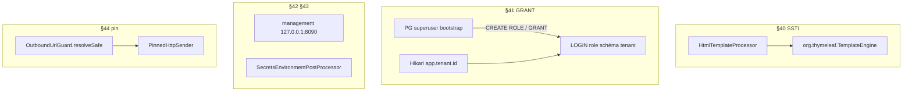

# System Design — `durcissement-securite-post-revue`

## Phase 3: Review Design

Couverture 1:1 des D-* requirements. Aucun nouveau endpoint métier.
Aucun changement SPA.

## Architecture Overview

## Data Models

Aucun nouveau table métier. §41 : rôles / GRANTs PostgreSQL dans
`docker/postgres/init/` (idempotent, volume vide seulement — même contrat
que l'init actuel).

## API Design

Aucun contrat OpenAPI nouveau. Actuator : même chemins, autre bind/port.

## Component Breakdown

| Composant | Changement |
|---|---|
| `ThymeleafHtmlTemplateProcessor` | `org.thymeleaf.TemplateEngine` + `StringTemplateResolver` HTML ; **pas** `SpringTemplateEngine` |
| `docker/postgres/init/01-init-tenant-schema.sql` | `CREATE ROLE flowforge_tenant_dev LOGIN` ; `GRANT` USAGE/CREATE/CRUD sur `tenant_dev` uniquement ; `REVOKE` large sur les autres schémas |
| `application.yml` | `DB_USERNAME` défaut `flowforge_tenant_dev` ; `management.server.address: 127.0.0.1` ; `MANAGEMENT_PORT` défaut `8090` |
| `SecretsEnvironmentPostProcessor` | Nouveau, à côté de `TenantIdEnvironmentValidator` |
| `SecurityConfig.m2mJwtDecoder` | HMAC seulement si profil `local` ou `test` ; sinon secret HMAC → fail (via EPP) |
| `OutboundUrlGuard` | `resolveSafe(url) -> PinnedEndpoint` ; `assertSafe` délègue |
| `PinnedHttpSender` / `WebhookRestAdapter` | POST vers URI IP + header `Host` ; TLS SNI + hostname verify sur le **hostname d'origine** |
| `HttpRestServiceConnector` | Même pin (skeleton) |
| Docs | `GETTING-STARTED.md`, `.env.example`, `02-multi-tenant.md` (rôle PG), `08-templates-documents.md` (pas de SpEL), `09-notifications.md` (pin), design observabilite note port 8090 |

## Design Decisions

| ID | Question | Choix | Écarté |
|---|---|---|---|
| DD-THYME | Moteur | `TemplateEngine` (dialecte standard Thymeleaf, interpolation `${var}` / `th:*`) | Garder SpringEL ; sandbox SpEL |
| DD-GRANT-LOCAL | User Compose | Superuser conteneur `POSTGRES_USER=flowforge` (init) ; app `DB_USERNAME=flowforge_tenant_dev` | App = superuser |
| DD-MGMT-BIND | Address | `127.0.0.1` défaut (surchargeable `MANAGEMENT_ADDRESS`) | 0.0.0.0 ; mTLS |
| DD-MGMT-PORT | Port | Défaut **8090** (Keycloak reste 8081) | Garder 8081 |
| DD-MGMT-AUTH | permitAll | Conservé (DD-MGMT-SEC) **parce que** bind localhost | OIDC sur actuator |
| DD-STRICT | Fail-fast | Profils actifs `local` ou `test` = relâché ; sinon refuse `DB_PASSWORD` dans denylist (`flowforge`, vide), `APP_CONNECTOR_MASTER_KEY` vide, `M2M_JWT_SECRET` non vide, `OIDC_CLIENT_SECRET` vide | Strict aussi en local |
| DD-PIN | Client | Réécrire l'URI vers l'IP déjà validée ; `Host` + SNI = hostname original | Second resolve ; proxy |
| DD-PIN-REDIRECT | Redirects | Déjà `NEVER` — inchangé (évite de re-suivre vers une IP privée) | |

## Non-Functional Requirements

- Pas de régression templates `th:text="${title}"` / `th:each`.
- Testcontainers §41 : `Assumptions.assumeTrue(isDockerAvailable())`.
- Jacoco : nouvelles classes au-dessus des seuils bundle.

## Security Notes

- Chaîne S-1+S-2 : D-40 coupe le RCE SpEL ; D-41 limite le blast radius SQL
  même si une autre RCE apparaît.
- HMAC M2M en `test` reste pour `ConnectorExecuteApiTest`.
- Pin TLS : ne **pas** désactiver la vérif de certificat ; vérifier le
  hostname d'origine, pas l'IP.
