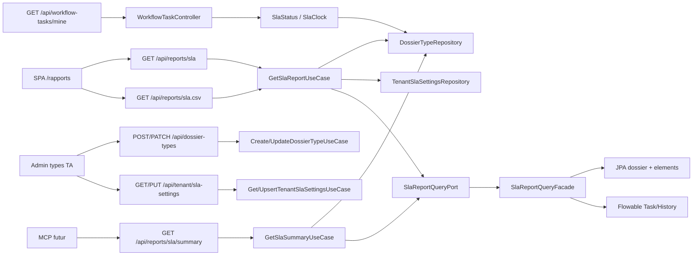

# System Design & Architecture — `reporting-sla`

Phase 3 **reviewed** (2026-08-26) contre requirements Phase 2.
Réécrit : le premier jet couvrait surtout **B** (snapshot) ; **A**
(summary + `AT_RISK`) et **A-CLEAR-HOURS** manquaient. Les D-*
stakeholder priment sur le code existant.

Workspace : `cursor/reporting-sla-9009`, no-worktree. Task tracing
indisponible (`unknown command 'task'`).

## Architecture Overview

**What is the high-level system structure?**



Stack inchangé (hexagone FlowForge) :

| Couche | Choix |
|---|---|
| Domaine | `com.flowforge.domain.reporting` pur Java |
| Persistence | PostgreSQL schéma tenant, JPA + Liquibase `016` |
| Workflow | Flowable history **infra only** |
| Web | BFF session, `@PreAuthorize` rôles |
| FE | Vue 3 `<script setup>` + TS + PrimeVue + Pinia |

Responsabilités :

- **BC `reporting`** : horloge, statut ternaire, conformité, snapshot,
  summary. Zéro Spring/JPA/Flowable.
- **BC `dossier`** : `slaTargetHours` sur `DossierType` ; ACL type VIEW
  réutilisée (pas de nouvelle ACL).
- **Infra** : `SlaReportQueryFacade` compose JPA + Flowable derrière
  `SlaReportQueryPort` (plusieurs méthodes, un câblage).
- **SPA** : `/rapports` consomme le snapshot (+ CSV). Le summary est
  BFF pour le MCP ; pas d'écran dédié V1.

## Requirements coverage

| Requirements | Design |
|---|---|
| **D-APPROACH A+B** | Snapshot `GET /api/reports/sla` + summary `GET /api/reports/sla/summary` + SPA |
| **D-SCOPE** | Champs snapshot maquette + statut summary |
| **D-AUTHZ = C** | TA/WA unrestricted ; DM `allowedTypeCodes` VIEW ; viewer/service 403 |
| **D-SLA-HOURS = B** | `Integer slaTargetHours` nullable ; pas de défaut tenant heures |
| **D-AT-RISK = A** | `SlaStatus` 80 % fixe ; clos sans `AT_RISK` |
| **D-GROUPBY = B** | Summary `groupBy=dossierTypeCode\|status` ; 400 sinon |
| **D-SLA-CLOCK = A** | `SlaClock` createdAt → closedAt / updatedAt / now |
| **D-PERIOD = A** | `SlaPeriod` 30 j / 366 j / `to` exclusif date civile |
| **D-SETTINGS = A** | `tenant_sla_settings` ; GET/PUT TA ; calcul défaut 95 |
| **D-COMPUTE = A** | Pas de table de faits ; cap 10k |
| **D-CHARTS = A** | Barres CSS, pas Chart.js |
| **D-SCHEDULE = C** | Bouton disabled SPA |
| **D-EXPORT = A** | `GET /api/reports/sla.csv` + `CsvWriter` |
| **D-TASK-SLA = A** | `slaRemainingHours` inbox |
| **D-NAV = A** | `canSeeReports` TA/WA/DM |
| **A-COMPLIANCE** | Assembleur : non-`BREACHED` / dossiers avec cible |
| **A-CLEAR-HOURS** | **DD-CLEAR-FLAG** `clearSlaTargetHours` sur PATCH |
| **A-GROUPBY-DEFAULT** | `groupBy` omis → `dossierTypeCode` |
| **A-COHORT-STATUS** | Pas de filtre statut sur `createdAt` |
| **A-INDEX / A-COHORT-CAP** | `idx_dossier_created_at` ; 400 `SLA_COHORT_TOO_LARGE` |
| Stories 1–9 | Types, settings, snapshot, DM, CSV, inbox, viewer, WA lecture, clear |
| Non-goals | Pas de mail, Grafana, seaux calendaires, métrique Prom SLA |

## Data Models

**What data do we need to manage?**

### Extension `DossierType`

`Integer slaTargetHours` nullable, `> 0` si présent. Liquibase
`016-reporting-sla.yaml` : `dossier_type.sla_target_hours INT NULL`.
Pas de `NEVER` (contrairement à la rétention).

### `TenantSlaSettings`

```java
public record TenantSlaSettings(
    String tenantId,
    int complianceTargetPercent, // 1..100
    Instant updatedAt,
    String updatedBy
) {}
```

Table PK `tenant_id`. GET 404 si absent. Le snapshot/summary utilisent
**95** sans écrire la ligne.

### `SlaStatus` (domaine)

```java
public enum SlaStatus { ON_TRACK, AT_RISK, BREACHED }

// null si slaTargetHours == null
// ouvert : ON_TRACK / AT_RISK / BREACHED (A-AT-RISK-CMP)
// clos   : ON_TRACK | BREACHED seulement
```

`SlaClock.elapsedHoursInt` = `elapsed.toMillis() / 3_600_000` (troncature
vers 0, même unité que la cible entière). `AT_RISK` ssi ouvert et
`elapsedHours * 5 >= slaTargetHours * 4` et `elapsedHours <= slaTargetHours`.

### `SlaReport` (snapshot)

Inchangé conceptuellement : `from`, `to`, `complianceTargetPercent`,
`compliancePercent` (null si dénominateur 0), `overdueCount` (=
`BREACHED`), moyennes/médiane/delta jours, `typeShares`,
`stepDurationsHours`, `managerLoads`, `types`.

`TypeBreakdown.slaPercent` null si le type n'a pas de cible (cellule « — »).

### `SlaSummary` (lot A)

```java
public record SlaSummary(
    Instant from,
    Instant to,
    String groupBy, // dossierTypeCode | status
    List<SlaSummaryBucket> buckets
) {}

public record SlaSummaryBucket(
    String key,
    String label,
    long volume,
    long onTrack,
    long atRisk,
    long breached,
    long unscored,
    Double meanDurationHours,
    Double medianDurationHours
) {}
```

`unscored` = dossiers du seau sans cible. `volume = onTrack + atRisk +
breached + unscored`. Seau `status` : clé = nom d'enum dossier
(`DRAFT`, …). Seau type : clé = `dossierTypeCode`.

### Ports out

`SlaReportQueryPort` — **plusieurs méthodes** (code actuel), pas un
seul `loadCohort` :

- `countDossiers` / `findDossiers` (filtre `createdAt ∈ [from, to]`,
  `Set<String> allowedTypeCodes` null = unrestricted)
- `countProducedDocsByType`
- `findActiveTasks`
- `findCompletedUserTaskDurations`

Façade infra **DD-FACADE** : JPA + Flowable. Le summary **réutilise**
`findDossiers` + types puis groupe en domaine (**DD-SUMMARY-REUSE**).

### Flux

Snapshot/summary : parse période → authz codes → count (cap) → load
rows + types + settings effectif → assembleur. CSV = même `SlaReport`
sérialisé.

Inbox : type du dossier lié → `SlaClock.remainingHours` (now, pas
closedAt).

### Index

`CREATE INDEX IF NOT EXISTS idx_dossier_created_at ON dossier (created_at);`

## API Design

**How do components communicate?**

Authz lecture snapshot / CSV / summary :

```
@PreAuthorize("hasAnyRole('TENANT_ADMIN','WORKFLOW_ADMIN','DOSSIER_MANAGER')")
```

Use case : TA/WA → `allowedTypeCodes = null` ; DM → codes VIEW ; vide
→ 200 corps vide (pas 403). Viewer / `API_SERVICE` : 403 filtre
Spring.

### Types

POST/PATCH/GET `slaTargetHours` (integer nullable, `> 0`).

PATCH **DD-CLEAR-FLAG** (pas JsonNullable, absent du dépôt) :

```json
{ "clearSlaTargetHours": true }
```

Règles : champ omis + `clearSlaTargetHours` absent/false → **keep**
(comportement actuel des autres champs). `slaTargetHours: N>0` → set.
`clearSlaTargetHours: true` → persist `null`. `true` + `N` ensemble →
400. FE admin : vider le champ heures en édition envoie le flag.

### Settings

```
GET  /api/tenant/sla-settings     TENANT_ADMIN  200 | 404
PUT  /api/tenant/sla-settings     TENANT_ADMIN  { complianceTargetPercent }
```

WA/DM : 403. Le % effectif voyage aussi dans le JSON snapshot pour
`/rapports`.

### Snapshot + CSV

```
GET /api/reports/sla
GET /api/reports/sla.csv
  from, to : ISO-8601 instant **ou** date civile `YYYY-MM-DD` (UTC)
  dossierTypeCode : optionnel
  200 JSON / text/csv
  400 période / > 366 j / cap 10k
  403 viewer/service
```

**DD-PERIOD-PARSE** : params `String`, parse `Instant` ou `LocalDate`
UTC. Date seule : `from` = minuit ce jour ; `to` = minuit **jour
suivant** (exclusif). Défaut si omis : `[now-30d, now]`.

CSV : `CsvWriter` anti-formule ; ligne `#` KPI puis tableau types ;
**pas** de champs dossier.

### Summary

```
GET /api/reports/sla/summary
  mêmes from/to/dossierTypeCode/authz
  groupBy=dossierTypeCode|status   (omis → dossierTypeCode)
  400 si day|week|month ou valeur inconnue
  200 application/json  SlaSummary
```

Pas consommé par `/rapports` V1. Contrat MCP / outils.

### Inbox

`WorkflowTaskResponse.slaRemainingHours: number | null`.

## Component Breakdown

**What are the major building blocks?**

### Backend

| Composant | Couche | Rôle |
|---|---|---|
| `SlaClock` / `SlaStatus` / `SlaReportAssembler` / `SlaSummaryAssembler` | domain.reporting | D-SLA-* / D-AT-RISK / A-COMPLIANCE |
| `SlaPeriod` | domain | défaut 30 j, max 366, parse date |
| `GetSlaReportUseCaseImpl` | domain | snapshot + authz + cap |
| `GetSlaSummaryUseCaseImpl` | domain | summary + groupBy |
| `Get/UpsertTenantSlaSettingsUseCaseImpl` | domain | TA gate |
| `SlaReportQueryFacade` | infra | JPA + Flowable |
| `SlaReportController` | web | snapshot + **summary** |
| `SlaReportExportController` | web | CSV |
| `TenantSlaSettingsController` | web | settings TA |
| `UpdateDossierTypeRequest.clearSlaTargetHours` | web | A-CLEAR-HOURS |
| Liquibase 016 | persistence | colonne + table + index |
| `ReportingConfig` | infra.config | beans |
| `CsvWriter` | `infrastructure.web.csv` | anti-formule (**DD-CSV-EXTRACT**, déjà fait) |

### Frontend

| Composant | Rôle |
|---|---|
| `api/slaReport.ts` | GET snapshot + CSV |
| `api/slaSettings.ts` | GET/PUT settings (TA) |
| `RapportsView.vue` | période, filtres, cartes, tables, export, bouton planifier disabled |
| `SlaKpiCards` / `SlaTypeShareList` / `SlaStepDurations` / `SlaManagerTable` / `SlaTypeTable` | CSS + PrimeVue |
| `DossierTypesAdminView` | heures SLA + `clearSlaTargetHours` + bloc objectif % |
| `AppShell` / `routes.ts` | nav `canSeeReports` |
| `MobileTasksView` | badge reste |

Pas de client summary V1 (sauf tests API).

### Écart code premier jet (Phase 5)

- Ajouter `GetSlaSummaryUseCase` + route + `SlaStatus`.
- PATCH : `clearSlaTargetHours` (aujourd'hui `null = keep` bloque l'effacement).
- Parse période date civile si pas déjà.
- OpenAPI golden : chemin summary + champ PATCH.

## Design Decisions

**Why did we choose this approach?**

| Id | Choix | Alternatives écartées |
|---|---|---|
| **DD-FACADE** | Port out multi-méthodes + façade JPA/Flowable | Un mega `loadCohort` (plus dur à mocker) ; deux ports dans le use case |
| **DD-ASSEMBLE-DOMAIN** | Stats brutes → assembleur Java | SQL `AVG`/`PERCENTILE` (H2 vs PG) |
| **DD-SUMMARY-REUSE** | Summary groupe les mêmes `DossierSlaRow` | Requête SQL `GROUP BY` dédiée V1 |
| **DD-CLEAR-FLAG** | `clearSlaTargetHours: true` | JsonNullable (nouvelle dep) ; `null` JSON = clear (Jackson absent vs null fragile ici) |
| **DD-PERIOD-PARSE** | String → Instant ou LocalDate UTC | Instant only (casse le date picker maquette) |
| **DD-CAP-10K** | 400 si cohorte > 10k | Pagination snapshot (casse les KPI) |
| **DD-NO-CHARTJS** | CSS | Chart.js |
| **DD-INBOX-LOOKUP** | Type via dossier du lien | `dueDate` Flowable |
| **DD-FLOWABLE-DEGRADE** | Steps/managers vides si Flowable down ; KPI dossiers OK | 503 global |
| **DD-SETTINGS-TA** | GET settings TA only | GET WA (inutile : % dans le snapshot) |
| **DD-CSV-EXTRACT** | `CsvWriter` package public | Dupliquer l'anti-formule |

## Non-Functional Requirements

**How should the system perform?**

- **Perf :** une liste dossiers période + counts elements + queries
  Flowable bornées. Soft : p95 snapshot < 2 s pour ≤ 2k dossiers (pas
  de bench CI). Cap 10k / 366 j.
- **Scalabilité :** une instance = un tenant ; pas de cache V1.
- **Sécurité :** pas de `fields` dossier dans JSON/CSV ; ACL type VIEW
  pour DM ; CSV anti-formule ; `API_SERVICE` 403.
- **Fiabilité :** **DD-FLOWABLE-DEGRADE**.
- **Rétrocompat :** colonne nullable ; settings absents = 95 ; inbox
  champ JSON ajouté ; summary = chemin **nouveau**.
- **Rollout :** merge + Liquibase, pas de feature flag (**A-NO-FLAG**).
- **Observabilité :** pas de jauge Micrometer SLA (**A-NO-PROM**).
