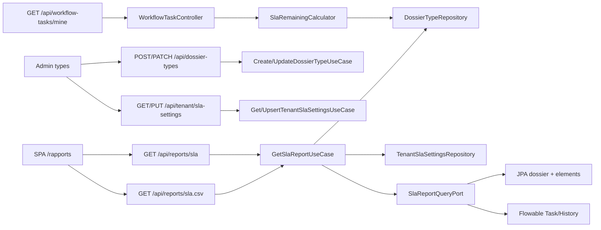

# System Design & Architecture — `reporting-sla`

> Phase 3 **reviewed**. Aligné requirements D-*. A-* figés en DD-*
> quand ils contraignent l'implémentation. **Pas d'implémentation**
> avant Phase 5.

## Architecture Overview



- **Nouveau BC domaine** `com.flowforge.domain.reporting` : modèles
  immuables, use cases, ports. **Zéro** Spring/JPA/Flowable.
- **Extension dossier** : champ `slaTargetHours` sur `DossierType`
  (même pattern que `retentionDays`).
- **Infra** : `SlaReportJpaAdapter` (agrégats SQL) +
  `FlowableSlaReportAdapter` (tâches actives + historic activities)
  derrière **un** port `SlaReportQueryPort` composé en infra
  (`SlaReportQueryFacade`) pour que le use case reste un seul appel
  (**DD-ONE-PORT**).
- **CSV** : contrôleur dédié (comme `DossierExportController`) réutilise
  `CsvWriter` (package-private → extraire en
  `infrastructure.web.csv.CsvWriter` public package **DD-CSV-EXTRACT**).

## Requirements coverage

| Requirements | Design |
|---|---|
| D-APPROACH B | BC `reporting` + snapshot BFF + SPA |
| D-SCOPE A | Champs snapshot 1:1 maquette |
| D-SLA-CLOCK A | `SlaClock.elapsed(created, closedOrNow)` |
| D-SLA-NULL A | Types `slaTargetHours == null` hors dénominateur conformité |
| D-PERIOD A | `SlaReportQuery.from/to` ; défaut 30 j ; max 366 j |
| D-AUTHZ A | Même split TA/WA vs ACL que `SearchDossiersUseCaseImpl` |
| D-CHARTS A | Composants Vue CSS, pas Chart.js |
| D-EXPORT A | CSV types + KPI ; CsvWriter |
| D-SCHEDULE C | Bouton disabled SPA |
| D-TASK-SLA A | `slaRemainingHours` sur DTO inbox |
| D-SETTINGS A | Table singleton `tenant_sla_settings` |
| D-COMPUTE A | Pas de table snapshot |
| D-NAV A | `AppShell` + route `/rapports` |
| D-INDEX A | `idx_dossier_created_at` |
| A-EMPTY / A-TREND / A-MEDIAN / A-HOURS | `SlaReportAssembler` |

## Data Models

### Extension `DossierType`

Nouveau champ `Integer slaTargetHours` (nullable). Validation :
si non null, `> 0`. `inherit(...)` passe `null`. `withUpdate` étendu.

Liquibase `016-reporting-sla.yaml` : colonne `dossier_type.sla_target_hours INT NULL`.

### `TenantSlaSettings`

```java
public record TenantSlaSettings(
    String tenantId,
    int complianceTargetPercent, // 1..100
    Instant updatedAt,
    String updatedBy
) {}
```

Table PK `tenant_id`. GET 404 si absent → le use case rapport utilise
**95** (D-SETTINGS) sans écrire la ligne.

### `SlaReport` (sortie use case)

```java
public record SlaReport(
    Instant from,
    Instant to,
    Integer complianceTargetPercent,
    Double compliancePercent,      // null si dénominateur 0
    long overdueCount,
    Double meanProcessingDays,
    Double medianProcessingDays,
    Double meanDeltaVsPreviousDays,
    List<TypeShare> typeShares,
    List<StepDuration> stepDurationsHours,
    List<ManagerLoad> managerLoads,
    List<TypeBreakdown> types
) {}
```

Sous-records : `TypeShare(code, label, volume, percent)`,
`StepDuration(name, meanHours)`,
`ManagerLoad(assigneeId, displayName, inProgress, overdue, Double slaPercent)`,
`TypeBreakdown(typeCode, typeLabel, workflowKey, volume, meanDays, Double slaPercent, producedDocCount, Double volumeTrendPercent)`.

Ligne gestionnaire `assigneeId == null` → affichage « Non assignés »,
`slaPercent == null`.

### Ports

`SlaReportQueryPort` (out) :

```java
SlaCohortStats loadCohort(SlaCohortQuery query);
```

`SlaCohortQuery` : tenantId, from, to, previousFrom, previousTo,
`Set<String> allowedTypeCodes` (null = unrestricted), optional
single type filter.

`SlaCohortStats` : liste de `DossierDurationRow` (id, typeCode,
createdAt, closedAt, status) pour la période **et** la précédente
(flag `inCurrent`) ; counts `PRODUCED_DOC` par type (période
courante) ; `ActiveTaskRow` (dossierId, assigneeId) ; `HistoricStepRow`
(activityName, durationMillis) pour userTasks terminés des process
liés aux dossiers de la cohorte courante.

Le use case assemble moyennes / médiane / parts / tendances en Java
pur (`SlaReportAssembler`) — **DD-ASSEMBLE-DOMAIN**. Volume V1
attendu ≪ pagination dossiers (A-COMPUTE-MEM : cap **10_000**
dossiers/période, au-delà 400 `SLA_COHORT_TOO_LARGE`).

### Index

`CREATE INDEX IF NOT EXISTS idx_dossier_created_at ON dossier (created_at);`

## API Design

### Types

`DossierTypeResponse` / create / update gagnent `slaTargetHours`
(integer nullable). OpenAPI régénéré.

### Settings

```
GET  /api/tenant/sla-settings     TENANT_ADMIN  200 | 404
PUT  /api/tenant/sla-settings     TENANT_ADMIN  body { complianceTargetPercent }
```

Miroir `TenantRetentionSettingsController`.

### Rapport

```
GET /api/reports/sla
  from, to : ISO-8601 instant optionnels (A-DEFAULT-PERIOD)
  dossierTypeCode : optionnel
  roles : TA, WA, DM (ACL)
  200 application/json
  400 période invalide / trop large / cohorte > 10k
  403 VIEWER, SERVICE, anonyme

GET /api/reports/sla.csv  mêmes query/authz
  Content-Disposition: attachment; filename="sla-report.csv"
```

JSON aligné `SlaReport` (camelCase Jackson). CSV colonnes tableau
types + première ligne commentaire KPI (`# compliance=94.2; target=95; overdue=148; meanDays=6.4`)
puis header RFC4180.

### Inbox

`WorkflowTaskResponse` + champ `slaRemainingHours: Double | null`.
Calcul dans l'adaptateur / assembler inbox après lookup type du
dossier lié — **pas** de dueDate Flowable (D-TASK-SLA).

## Component Breakdown

### Backend

| Composant | Couche | Rôle |
|---|---|---|
| `SlaClock` / `SlaReportAssembler` | domain.reporting | Règles D-SLA-* |
| `GetSlaReportUseCaseImpl` | domain | Authz + query + assemble |
| `Get/UpsertTenantSlaSettingsUseCaseImpl` | domain | TA gate |
| `SlaReportQueryFacade` | infra | JPA + Flowable |
| `SlaReportController` / `SlaReportExportController` | web | HTTP |
| `TenantSlaSettingsController` | web | HTTP |
| Liquibase 016 | persistence | colonnes + table + index |
| `ReportingConfig` | infra.config | beans use cases |

### Frontend

| Composant | Rôle |
|---|---|
| `frontend/src/api/slaReport.ts` | GET snapshot + CSV blob |
| `frontend/src/api/slaSettings.ts` | GET/PUT settings |
| `RapportsView.vue` | Page Pilotage |
| `SlaKpiCards.vue` | 2 cartes conformité / délai |
| `SlaTypeShareList.vue` | parts % |
| `SlaStepDurations.vue` | barres CSS heures |
| `SlaManagerTable.vue` | charge |
| `SlaTypeTable.vue` | détail + tendance |
| `DossierTypesAdminView` | champ heures SLA + bloc objectif % |
| `AppShell` / `routes.ts` | nav + `/rapports` |
| `MobileTasksView` | badge reste SLA |
| `auth` store | `isDossierManager` pour le lien nav |

Route `meta.roles` : pas de gate route stricte (le 403 API suffit) ;
lien caché si viewer.

## Design Decisions

| Id | Choix | Alternatives écartées |
|---|---|---|
| **DD-ONE-PORT** | Un port out + façade infra | Deux ports dans le use case (plus de mocks, OK aussi — moins lisible) |
| **DD-ASSEMBLE-DOMAIN** | Stats brutes → assembleur domaine | SQL `AVG`/`PERCENTILE` (H2 vs PG divergent) |
| **DD-CSV-EXTRACT** | Extraire `CsvWriter` en package `web.csv` | Dupliquer l'anti-formule |
| **DD-CAP-10K** | 400 si cohorte > 10k | Pagination du snapshot (casse les KPI globaux) |
| **DD-NO-CHARTJS** | CSS | PrimeVue Chart (dépendance) |
| **DD-INBOX-LOOKUP** | Type via dossier du lien workflow | Stocker sla sur la tâche |

## Non-Functional Requirements

- **Perf :** une requête liste dossiers période + une count elements +
  queries Flowable bornées à la cohorte. Cible p95 snapshot < 2 s
  pour ≤ 2k dossiers (soft, pas de bench CI).
- **Sécurité :** pas de `fields` dossier dans le JSON/CSV ; ACL
  identique supervision ; CSV anti-formule.
- **Fiabilité :** Flowable indisponible → stepDurations + managerLoads
  vides, KPI dossiers quand même (log WARN infra) — **DD-FLOWABLE-DEGRADE**.
- **Rétrocompat :** colonne nullable ; settings absents = 95 ; inbox
  champ JSON ajouté (non breaking pour clients inconnus).
