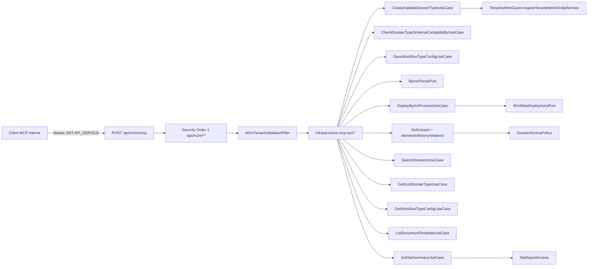

# System Design & Architecture — `serveur-mcp`

Phase 3 **reviewed** (2026-08-27) contre requirements Phase 2.
Réécrit : le jet Phase 1 contredisait **D-AUDIT = C**,
**D-SCHEMA-COMPAT = B**, **D-DEPLOY-ORDER = A**, **D-TYPE-FIELDS = A**.

Workspace : `cursor/serveur-mcp-e12d`, no-worktree. Task tracing
indisponible (`unknown command 'task'`).

## Architecture Overview

**What is the high-level system structure?**



Stack inchangé + **une** dépendance infra :

| Couche | Choix |
|---|---|
| Domaine | Use cases existants + garde élargie + check compatibilité schéma. Zéro Spring AI / MCP. |
| Infra MCP | `com.flowforge.infrastructure.mcp` |
| Transport | Streamable HTTP WebMVC, endpoint `/api/m2m/mcp` |
| Auth | Chaîne M2M Order 1 existante (JWT `API_SERVICE` + `tenant_id`) |
| SDK | **D-SDK = A** : Spring AI **2.0.0** `spring-ai-starter-mcp-server-webmvc` + BOM |
| Persistence | Liquibase **017** `created_by` / `updated_by` |
| FE | Aucun (**D-SPA = A**) |

Responsabilités :

- **Tools** : mapping arguments MCP → commandes `port.in`. Pas de logique
  métier (validation schéma / BPMN = domaine ou `BpmnParserPort`).
- **Actor factory** : JWT → `AccessContext.User(sub \| client_id, {API_SERVICE})`.
- **Security** : pas de 4ᵉ chaîne tant que le path reste sous `/api/m2m/**`.
- **dryRun** : le tool valide puis **return** sans `save` / `deploy` /
  stamp auteur.

## Requirements coverage

| Requirements | Design |
|---|---|
| D-APPROACH A | `infrastructure.mcp` dans la JVM tenant |
| D-STATS A | `QuerySlaSummaryTool` → `GetSlaSummaryUseCase` |
| D-POLICY-AS A | `API_SERVICE` unrestricted VIEW comme WA : policy **et** `SearchDossiersUseCaseImpl` **et** `ListDossierTypesUseCaseImpl` **et** `SlaReportAccess` |
| D-WRITE-GUARD A | `requireTenantAdminOrApiService` **seulement** Create/Update type. `requireTenantAdmin` inchangé |
| D-TYPE-FIELDS A | Tool schéma seul ; create = `inherit` rétention/SLA ; update conserve ; clés interdites → erreur |
| D-TRANSPORT / D-ENDPOINT A | STREAMABLE, `mcp-endpoint=/api/m2m/mcp` |
| D-CREDENTIAL A | Même JWT M2M que `/api/m2m/connectors/**` |
| D-ACTOR A | `McpAccessContextFactory` — jamais `system` / `Service` |
| D-PREVIEW A | `dryRun` défaut false, géré dans le tool |
| D-DEPLOY-ORDER A | parse/clé → upsert config → `DeployBpmnProcessUseCase` |
| D-SCHEMA-COMPAT B | Use case domaine de scan + compte ; REST PATCH non branché |
| D-AUDIT C | `createdBy`/`updatedBy` sur types dossier et workflow ; Liquibase 017 |
| D-SEARCH / D-PAGE A | `SearchDossiersQuery` / `PageQuery` tels quels |
| D-GET-SHAPE A | 4 use cases ; redactor existant ; pas d'appel `Dossier.fields()` dans le tool |
| D-SPA A | README / getting-started seulement |
| A-WF-REST-PARITY | Payload config = REST `WorkflowTypeConfigRequest` |
| A-SCHEMA-FULL | Schéma MCP complet à chaque appel |
| A-TPL-FORCE-FALSE | `includeContent` forcé false ; `true` rejeté |
| A-GET-COMPLETE | Pagination interne size 100 jusqu'à épuisement |
| A-LIST-PARITY | Listes = REST (actifs et inactifs) |
| A-NO-LLM | Pas de starter chat ; IT absence de `ChatClient` |
| Non-goals | Pas de SPA, stdio, clé API, table journal MCP, `create_dossier`, … |

## Data Models

**What data do we need to manage?**

### Extension auteur (**D-AUDIT = C**)

`DossierType` et `WorkflowTypeConfig` gagnent `createdBy` / `updatedBy`
(`String`, max 128, non null après backfill) — même sémantique que
`dossier.created_by`.

| Table | Colonnes | Changelog |
|---|---|---|
| `dossier_type` | `created_by varchar(128) not null`, `updated_by varchar(128) not null` | `017-mcp-audit-authors.yaml` |
| `workflow_type_config` | idem | même fichier, 2 changeSets |

Backfill lignes existantes : `'system'`. Rollback = drop colonnes.

Stamp :

- MCP write réel : JWT `sub` si non blank, sinon claim `client_id`, sinon
  `"api-service"`.
- REST admin types / workflow-configs : `OidcUser.getSubject()` (factory
  existante). `SaveWorkflowTypeConfigUseCase` n'a pas d'acteur
  aujourd'hui → **ajouter** `updatedBy` (et `createdBy` au create) sur
  create/update, appelé depuis le contrôleur REST **et** le tool MCP.
- `dryRun` : aucun stamp, aucun save.

`DossierType.inherit(...)` reste le défaut rétention/SLA (`null` /
`false` / `null`) ; les tests existants passent `createdBy`/`updatedBy`
via une surcharge ou `"system"` dans les fixtures.

### Pas de nouvelle table métier

Réutilisation : `FieldDefinition`, `WorkflowStatusDefinition`,
`Dossier` rédigé, éléments, `DossierWorkflowLink`, `DossierRelation`,
`SlaSummary`, `DocumentTemplate` (sans `contentHtml`), `PageQuery`.

### Scan compatibilité schéma

Nouveau port out `DossierRepository.findByDossierTypeCode(tenantId, code)`
(liste complète du type, schéma tenant déjà isolé). Pas de cap MCP
supplémentaire (le cap 10k reste le summary SLA).

Nouveau use case domaine
`CheckDossierTypeSchemaCompatibilityUseCase` :

- charge les dossiers du type ;
- `DossierFieldValidator.validate(newFields, dossier.fields(), allowUnknown)` ;
- retourne `{ incompatibleCount, sampleCodes? }` ;
- **cet** use case entre dans l'allowlist ArchUnit `Dossier.fields()`
  (seul nouveau membre). Les tools MCP **n'y sont pas**.

## API Design

**How do components communicate?**

Canal = MCP Streamable HTTP `tools/call`, **pas** de nouvel endpoint
REST métier. OpenAPI / springdoc **inchangé**.

### Configuration Spring AI

```yaml
spring:
  ai:
    mcp:
      server:
        enabled: true
        protocol: STREAMABLE
        name: flowforge
        version: 0.1.0
        type: SYNC
        tool-callback-converter: true
        capabilities:
          tool: true
          resource: false
          prompt: false
          completion: false
        annotation-scanner:
          enabled: true
        streamable-http:
          mcp-endpoint: /api/m2m/mcp
```

BOM Maven : `org.springframework.ai:spring-ai-bom:2.0.0` +
`spring-ai-starter-mcp-server-webmvc`. **Pas** de
`spring-ai-starter-openai` / model. **D-SDK = A**.

Si `./mvnw verify` (tests de contexte) révèle un `ChatClient` ou un
poids BOM inacceptable : **DD-SDK-FALLBACK** — SDK officiel
`io.modelcontextprotocol` WebMVC, **même** path et JWT. Tranché en
Phase 5 seulement si la preuve échoue ; le design cible Spring AI.

### Tools V1 (9)

| Tool | Ports | Entrée | Sortie |
|---|---|---|---|
| `define_dossier_type` | Get + CheckCompat + Create ou Update | Schéma complet + `dryRun?`. Interdit : `retentionDays`, `retentionNever`, `slaTargetHours` | type (ou payload prévu) |
| `deploy_workflow` | Parser + Save + Deploy | `processDefinitionKey`, `xml` (texte UTF-8), `label`, `statusDefinitions`, `allowedDossierStatuses`, `onStartDossierStatus?`, `observerUserIds?`, `dryRun?` | `BpmnDeploymentResult` + config |
| `get_dossier` | Get + ListElements + History + ListRelations | `id` **xor** `reference` | agrégat rédigé |
| `get_dossier_type` | GetDossierType | `code` | type (flags `sensitive` = métadonnées) |
| `list_dossier_types` | ListDossierTypes | `page?`/`size?` | page |
| `list_workflow_types` | GetWorkflowTypeConfig.list | `page?`/`size?` | page |
| `search_dossiers` | SearchDossiers | filtres D-SEARCH + page/size | `DossierPage` |
| `list_document_templates` | ListDocumentTemplate | `templateKey?`, page ; `includeContent` absent ou false | page **sans** HTML |
| `query_sla_summary` | GetSlaSummary | `from?` `to?` `dossierTypeCode?` `groupBy?` | `SlaSummary` |

Erreurs métier → résultat MCP `isError=true` + message / code
(`SLA_COHORT_TOO_LARGE`, `InvalidBpmnException`, incompatibilité
schéma avec **compte**, 404 dossier). Pas de stack trace client.

### Auth (inchangé hors path)

1. `Authorization: Bearer` ; chaîne Order 1 `securityMatcher("/api/m2m/**")`.
2. `hasAuthority("API_SERVICE")`.
3. `M2mTenantValidationFilter` : claim `tenant_id` == `app.tenant.id`.
4. Use cases : **D-POLICY-AS** / **D-WRITE-GUARD** / **D-ACTOR**.

REST `@PreAuthorize` **non modifié** (`/api/reports/**` sans
`API_SERVICE` ; types TA only ; workflow-configs TA/WA).

Si le starter **ignore** `mcp-endpoint` et n'écoute que `/mcp` :
élargir le matcher à `"/api/m2m/**", "/mcp"` (**A-M2M-PATH**), **même**
`JwtDecoder` / autorité. Pas de chaîne nouvelle par défaut.

### Contrats tool — règles précises

**`define_dossier_type`**

1. Si une clé interdite est présente (y compris extra JSON) → erreur
   (**D-TYPE-FIELDS**). Jackson : inspecter l'arbre **avant** ignore.
2. `GetDossierType` : absent → Create avec rétention/SLA inherit ;
   présent → CheckCompat puis Update en recopiant
   `existing.retentionDays/Never/slaTargetHours`.
3. Champs schéma tous requis (**A-SCHEMA-FULL**).
4. `dryRun=true` : mêmes validations, pas de `repository.save`, pas de
   stamp.

**`deploy_workflow`**

1. UTF-8 ; taille `xml.getBytes(UTF_8).length` ≤
   `spring.servlet.multipart.max-file-size` (défaut 25 MB). Au-delà →
   erreur. Pas de base64.
2. `extractProcessDefinitionKey(xml)` ; doit égaler
   `processDefinitionKey` (même règle que le draft BPMN).
3. Upsert `WorkflowTypeConfig` (create si absent) **puis**
   `DeployBpmnProcessUseCase.deploy(filename, bytes)`.
4. `filename` synthétique `{key}.bpmn20.xml`.
5. Échec deploy **après** upsert : config éventuellement à jour sans
   nouvelle version Flowable — **pas** de compensation delete
   (**A-NO-COMPENSATE**, trop risqué si la config préexistait). Parser
   d'abord évite l'upsert sur XML invalide.
6. `dryRun=true` : parse + construire l'objet config (invariants) ;
   pas de save ni deploy.

**`get_dossier`**

1. XOR `id` / `reference`.
2. `GetDossierUseCase` d'abord (policy + redactor).
3. Boucler `ListDossierElements` et `GetDossierWorkflowHistory` avec
   `PageQuery(page, 100)` jusqu'à `page+1 >= totalPages`.
4. `ListDossierRelations` une fois.
5. Sérialiser le `Dossier` **rédigé** via un DTO infra (comme
   `DossierResponse`) — **interdit** `Dossier.fields()` dans le tool.

## Component Breakdown

**What are the major building blocks?**

```
com.flowforge.infrastructure.mcp
├── McpServerConfig              # propriétés, ToolCallbackProvider des 9 tools
├── McpAccessContextFactory      # JwtAuthenticationToken → User API_SERVICE
├── McpToolExceptionMapper       # exceptions domaine → isError
└── tool
    ├── DefineDossierTypeTool
    ├── DeployWorkflowTool
    ├── GetDossierTool
    ├── GetDossierTypeTool
    ├── ListDossierTypesTool
    ├── ListWorkflowTypesTool
    ├── SearchDossiersTool
    ├── ListDocumentTemplatesTool
    └── QuerySlaSummaryTool
```

Domaine (touches minimales) :

- `DossierAccessPolicy.hasPermission` : `API_SERVICE` → true (comme WA).
- `SearchDossiersUseCaseImpl.searchForUser` : idem.
- `ListDossierTypesUseCaseImpl.listForUser` : idem.
- `SlaReportAccess.allowedTypeCodes` : `API_SERVICE` → `null`
  (unrestricted) ; `Service` et viewer inchangés.
- `TenantAdminGuard.requireTenantAdminOrApiService` ; Create/Update type
  l'utilisent. Purge / ACL / rétention / settings SLA gardent
  `requireTenantAdmin`.
- `DossierType` / `WorkflowTypeConfig` + JPA : `createdBy`/`updatedBy`.
- `SaveWorkflowTypeConfigUseCase` : signature create/update avec auteur.
- `CheckDossierTypeSchemaCompatibilityUseCase` +
  `DossierRepository.findByDossierTypeCode`.
- ArchUnit : interdire `org.springframework.ai..` et
  `io.modelcontextprotocol..` dans `domain` ; allowlist `fields()` +=
  le use case compatibilité.

Frontend : **aucun** fichier.

Persistence : `017-mcp-audit-authors.yaml` inclus dans
`db.changelog-master.yaml`.

## Design Decisions

**Why did we choose this approach?**

| Id | Choix | Écarté |
|---|---|---|
| **D-SDK = A** | Spring AI 2.0.0 WebMVC starter (Boot 4.1, STREAMABLE, `mcp-endpoint` natif) | SDK MCP seul d'emblée (plus de câblage, pas d'`@McpTool`) ; sidecar REST |
| **DD-SDK-FALLBACK** | Repli SDK officiel **si** preuve ChatClient / BOM en Phase 5 | Rester bloqué sur Spring AI |
| **DD-MONOLITH** | Adaptateur JVM tenant | Sidecar, stdio |
| **DD-M2M-PATH** | `/api/m2m/mcp` sous matcher existant | Port dédié, 4ᵉ chaîne |
| **DD-NO-ORCHESTRATOR-UC** | Orchestre deploy (parse + save + deploy) **dans le tool** | Use case domaine `DeployWorkflowFromMcp` — le parseur et le deploy existent déjà ; l'ordre est un contrat d'adaptateur |
| **DD-COMPAT-UC** | Check schéma **dans le domaine** (allowlist `fields()`) | Scanner dans le tool (casserait ArchUnit) |
| **DD-DRY-RUN-INFRA** | `dryRun` dans le tool | Flag sur chaque use case |
| **DD-NO-FIELDS-READ** | DTO / redactor existant | `Dossier.fields()` dans MCP |
| **DD-XML-UTF8** | Texte UTF-8, plafond = multipart 25 MB | Base64 (double taille JSON) |
| **DD-NO-COMPENSATE** | Pas de rollback config si deploy échoue | Delete config (casserait un upsert sur clé existante) |
| **DD-POLICY-TRIPLE** | `API_SERVICE` dans les **trois** forks TA/WA (policy, search, list types) + SLA | Un seul site — search/list **dupliquent** TA/WA aujourd'hui |

## Non-Functional Requirements

**How should the system perform?**

- **Sécurité :** JWT M2M ; CSRF off (déjà M2M) ; XML via
  `BpmnParserPort` (pas d'entités externes) ; secrets inchangés ; pas de
  `AccessContext.system` depuis MCP ; champs `sensitive` masqués
  (`API_SERVICE` ≠ TA).
- **Perf :** tools SYNC ; cap SLA 10k inchangé ; page max 100 ; scan
  schéma = tous les dossiers du type (tenant isolé).
- **Observabilité :** log ECS `mcp.tool`, `mcp.actor`, `mcp.dry_run`,
  durée ; MDC `tenantId` ; **pas** de XML / `Dossier.fields()` dans les
  logs.
- **Fiabilité :** parser avant upsert ; état partiel documenté si
  deploy rate après save.
- **Compat :** OpenAPI REST non modifié. Jacoco BUNDLE tenus. Playwright
  = régression suite actuelle.

## Open items reportés Phase 4 / 5 (pas des votes produit)

1. Preuve runtime : pas de bean `ChatClient` ; endpoint effectivement
   `/api/m2m/mcp` (sinon A-M2M-PATH).
2. Noms Java exacts des annotations Spring AI 2.0 (`@McpTool` vs
   `ToolCallback`) — vérifier contre le starter 2.0.0 en Phase 5.
3. Tests Create/Update `DossierType` existants : ajouter auteur dans les
   fixtures.

Pas de question produit ouverte. Prochain : Phase 4 planning.
