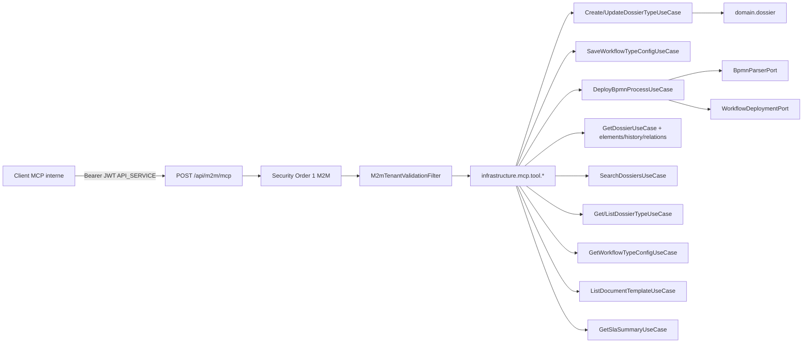

# System Design & Architecture — `serveur-mcp`

Phase 1 **draft** (2026-08-27). Ce n'est **pas** une Phase 3 reviewed.
Les D-* Phase 1 sont **votées** (voir requirements). **D-SDK** et le
pin BOM se tranchent en Phase 3.

Workspace : `cursor/serveur-mcp-e12d`, no-worktree. Task tracing
indisponible.

## Architecture Overview
**What is the high-level system structure?**



Stack inchangé + une dépendance **infra only** :

| Couche | Choix |
|---|---|
| Domaine | Use cases existants ; garde élargie `API_SERVICE` (D-POLICY-AS). Zéro Spring AI / MCP. |
| Infra MCP | `com.flowforge.infrastructure.mcp` |
| Transport | Streamable HTTP WebMVC, endpoint `/api/m2m/mcp` |
| Auth | Chaîne M2M existante (JWT `API_SERVICE` + claim `tenant_id`) |
| SDK | Spring AI 2.x `spring-ai-starter-mcp-server-webmvc` (**D-SDK**), repli SDK officiel |

Responsabilités :

- **Tools** : mapping JSON-RPC MCP → commandes `port.in` ; pas de
  logique métier (validation schéma = domaine).
- **Actor factory** : JWT → `AccessContext.User(sub, {API_SERVICE})`.
- **Security** : pas de nouvelle chaîne si l'endpoint reste sous
  `/api/m2m/**`.

## Data Models
**What data do we need to manage?**

Aucune table nouvelle (**D-AUDIT = B**). Réutilisation :

- `DossierType` / `FieldDefinition` (y compris `retention*` /
  `slaTargetHours` déjà livrés).
- `WorkflowTypeConfig` / `WorkflowStatusDefinition`.
- `Dossier` rédigé, `DossierElement`, `DossierWorkflowLink`,
  `DossierRelation`.
- `SlaSummary` / `SlaPeriod` / `SlaStatus`.
- `DocumentTemplate` (liste ; contenu HTML optionnel, défaut omis).
- `PageQuery` / `PageResult` / `DossierPage`.

Flux dry-run : parser + invariants domaine, **aucun**
`repository.save` / `WorkflowDeploymentPort.deploy`.

## API Design
**How do components communicate?**

Canal = MCP `tools/call`, pas de nouveaux endpoints REST métier.

### Tools V1

| Tool | Use cases | Entrée (essentiel) | Sortie |
|---|---|---|---|
| `define_dossier_type` | Create ou Update selon `code` | `code`, `label`, `workflowKey`, `active`, `allowUnknownFields`, `fieldDefinitions`, rétention, `slaTargetHours`, `dryRun?` | type persisté (ou payload prévu si dry-run) |
| `deploy_workflow` | SaveWorkflowTypeConfig puis DeployBpmn | `processDefinitionKey`, XML (texte), `label`, `statusDefinitions`, `allowedDossierStatuses`, `onStartDossierStatus`, `observerUserIds?`, `dryRun?` | `BpmnDeploymentResult` + config |
| `get_dossier` | Get + list elements/history/relations | `id` **xor** `reference` | agrégat rédigé |
| `get_dossier_type` | GetDossierType | `code` | type |
| `list_dossier_types` | ListDossierTypes | pagination PageQuery | page |
| `list_workflow_types` | GetWorkflowTypeConfig.list | pagination | page |
| `search_dossiers` | SearchDossiers | `status?`, `dossierTypeCode?`, `referencePrefix?`, page/size | `DossierPage` |
| `list_document_templates` | ListDocumentTemplate | `templateKey?`, page ; `includeContent=false` | page métadonnées |
| `query_sla_summary` | GetSlaSummary | `from?`, `to?`, `dossierTypeCode?`, `groupBy?` | `SlaSummary` |

Erreurs : exceptions domaine existantes → résultat MCP `isError`
avec message / code métier (`SLA_COHORT_TOO_LARGE`, clé BPMN, 404
dossier). Pas de stack trace vers le client.

### Auth

1. Bearer JWT, chaîne Order 1 `/api/m2m/**`.
2. `hasAuthority('API_SERVICE')`.
3. `M2mTenantValidationFilter` : `tenant_id` == `TenantProperties.id()`.
4. Use cases : **D-POLICY-AS**.

REST existant inchangé (`@PreAuthorize` TA/WA, D-AUTHZ reporting C
sur `/api/reports/**` pour les sessions SPA).

## Component Breakdown
**What are the major building blocks?**

```
com.flowforge.infrastructure.mcp
├── McpServerConfig          # propriétés endpoint, nom serveur
├── McpAccessContextFactory  # JWT → User API_SERVICE
├── tool
│   ├── DefineDossierTypeTool
│   ├── DeployWorkflowTool
│   ├── GetDossierTool
│   ├── GetDossierTypeTool
│   ├── ListDossierTypesTool
│   ├── ListWorkflowTypesTool
│   ├── SearchDossiersTool
│   ├── ListDocumentTemplatesTool
│   └── QuerySlaSummaryTool
└── (pas de filter auth dédié si endpoint sous /api/m2m/**)
```

Domaine (touches minimales) :

- `DossierAccessPolicy` : `user.hasRole("API_SERVICE")` → VIEW
  tenant-wide (comme WA).
- `SlaReportAccess` : idem, unrestricted (plus de 403 service si
  l'acteur est un `User` API_SERVICE).
- `TenantAdminGuard` : ajouter `requireTenantAdminOrApiService`
  utilisée **uniquement** par Create/Update dossier type.

Frontend : aucun composant (**D-SPA**).

Persistence : aucune migration.

## Design Decisions
**Why did we choose this approach?**

| Id | Choix | Écarté |
|---|---|---|
| **DD-MONOLITH** | Adaptateur dans la JVM tenant | Sidecar REST, stdio |
| **DD-M2M-PATH** | `/api/m2m/mcp` | Port dédié, `/mcp` + 4ᵉ chaîne |
| **DD-NO-ORCHESTRATOR-UC** | Orchestration deploy (save config + deploy) **dans le tool infra** | Nouveau use case domaine `DeployWorkflowFromMcp` — possible en Phase 3 si ArchUnit / testabilité le demandent |
| **DD-DRY-RUN-INFRA** | `dryRun` géré par le tool (appelle parser / validation, skip save) | Flag sur chaque use case |
| **DD-SDK-AI** | Spring AI MCP WebMVC | À reconfirmer Phase 3 si BOM trop large |
| **DD-NO-FIELDS-READ** | Réponses via DTO / toString sûr / redactor existant | `Dossier.fields()` dans le tool (interdit ArchUnit) |

### Requirements coverage (draft)

| Requirements | Design |
|---|---|
| D-APPROACH A | `infrastructure.mcp` |
| D-STATS A | `QuerySlaSummaryTool` |
| D-TRANSPORT / D-ENDPOINT | Streamable HTTP `/api/m2m/mcp` |
| D-CREDENTIAL A | JWT M2M existant |
| D-ACTOR A | `McpAccessContextFactory` |
| D-POLICY-AS A | Policy + garde type |
| D-SCHEMA-COMPAT A | Create/Update tels quels |
| D-DEPLOY-ORDER A | save config puis deploy |
| D-AUDIT B | logs ECS, pas de table |
| D-PREVIEW A | `dryRun` |
| D-SEARCH / D-PAGE | `SearchDossiersQuery` / `PageQuery` |
| D-SPA A | pas de FE |
| D-GET-SHAPE A | 4 use cases lecture dossier |

## Non-Functional Requirements
**How should the system perform?**

- **Sécurité :** JWT M2M ; pas de session ; CSRF off (déjà M2M) ;
  XML BPMN via `BpmnParserPort` (pas d'entités externes) ; secrets
  inchangés ; pas de `AccessContext.system` depuis MCP.
- **Perf :** tools synchrones ; cap SLA 10k inchangé ; page max 100.
- **Observabilité :** log ECS `mcp.tool`, `mcp.actor`, `mcp.dry_run`,
  durée ; réutiliser MDC `tenantId` existant.
- **Fiabilité :** un échec deploy après save config = config peut
  exister sans nouvelle version Flowable — documenter ; Phase 3
  tranchera compensation vs ordre inverse (parser d'abord, save, deploy).
  **Recommandation d'implémentation :** parser/valider XML **avant**
  l'upsert config pour limiter l'état partiel.
- **Compat :** OpenAPI REST non modifié (MCP n'est pas springdoc).

## Open design items (Phase 3)

1. Pin `spring-ai.version` + preuve que le starter n'enregistre pas
   de `ChatClient`.
2. Ordre exact parser → config → deploy (compensation).
3. Forme XML (texte vs base64) — reco : texte UTF-8, limite taille =
   upload BPMN admin existant.
4. Si l'auto-config Spring AI n'accepte pas `/api/m2m/mcp` : matcher
   Security `"/api/m2m/**", "/mcp"` **ou** propriété d'endpoint.
