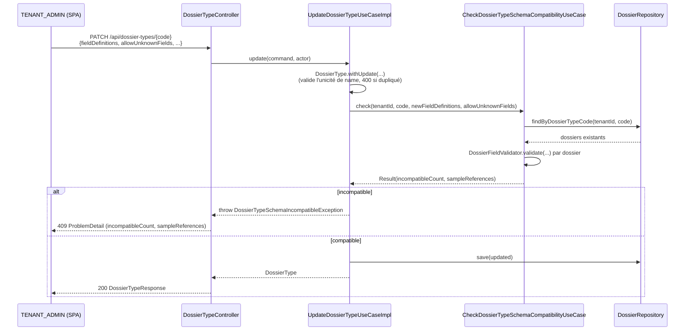

# System Design & Architecture

## Architecture Overview
**What is the high-level system structure?**

Aucune nouvelle brique d'infrastructure. Le backend (domaine, ports, persistance, contrôleur REST)
est déjà en place — cette feature branche un use case déjà écrit
(`CheckDossierTypeSchemaCompatibilityUseCase`) sur un chemin d'écriture qui ne l'invoque pas encore
(`UpdateDossierTypeUseCaseImpl`), ajoute une contrainte d'unicité au domaine, et livre l'écran
Admin → Types qui manquait.



`CreateDossierTypeUseCaseImpl` n'est **pas** modifié : un type en cours de création n'a par
construction aucun dossier existant (vérifié — `CreateDossierTypeCommand` ne référence aucun
dossier, et le MCP `DefineDossierTypeTool.defineCreate` n'appelle jamais le check non plus).

Le MCP `DefineDossierTypeTool` (déjà en prod) est simplifié en conséquence — voir Design Decisions
D-DESIGN-CHECK-PLACEMENT.

## Data Models
**What data do we need to manage?**

Aucun changement de schéma. `DossierType`/`FieldDefinition` (domain records) et
`DossierTypeJpaEntity` existent déjà avec toutes les colonnes nécessaires
(`fieldDefinitions`/`allowUnknownFields` déjà persistées en JSON). Un seul changement de modèle
domaine :

```java
// domain/dossier/model/DossierType.java — compact constructor, à côté de la validation existante
// de `code` (CODE_PATTERN)
public DossierType {
    // ... validations existantes (id, tenantId, code, label, workflowKey non null ; CODE_PATTERN) ...
    fieldDefinitions = fieldDefinitions == null ? List.of() : List.copyOf(fieldDefinitions);
    requireUniqueFieldNames(fieldDefinitions);   // NOUVEAU — D-NAME-UNIQUE
    validateRetention(retentionDays, retentionNever);
    validateSlaTargetHours(slaTargetHours);
}

private static void requireUniqueFieldNames(List<FieldDefinition> fieldDefinitions) {
    Set<String> seen = new HashSet<>();
    for (FieldDefinition def : fieldDefinitions) {
        if (!seen.add(def.name())) {
            throw new IllegalArgumentException("Duplicate fieldDefinition name: " + def.name());
        }
    }
}
```

Placé dans le compact constructor de `DossierType` (pas `DossierFieldValidator`, qui valide des
**valeurs** de dossier contre un schéma — invariant différent d'une contrainte structurelle sur le
schéma lui-même) : couvre les 3 chemins d'écriture (`CreateDossierTypeUseCaseImpl`,
`UpdateDossierTypeUseCaseImpl`, MCP `DefineDossierTypeTool`) d'un seul coup, gratuitement, puisque
les trois construisent un `DossierType`/passent par `withUpdate`. `IllegalArgumentException` (pas
une exception dédiée) — même pattern que `validateSlaTargetHours` juste en dessous dans le même
fichier, mappée en 400 par le handler générique existant (`handleBadRequest`), aucun changement
requis côté `DossierExceptionHandler` pour ce point.

## API Design
**How do components communicate?**

Aucun nouvel endpoint. `POST`/`PATCH /api/dossier-types/{code}` existent déjà, acceptent déjà
`fieldDefinitions`/`allowUnknownFields` en entrée et les renvoient dans `DossierTypeResponse` — la
surface REST ne change pas. Deux changements de **comportement** :

1. `PATCH /api/dossier-types/{code}` peut désormais répondre **409** (`ProblemDetail`) quand le
   nouveau schéma casse des dossiers existants — nouveau cas géré par `DossierExceptionHandler` :

   ```java
   @ExceptionHandler(DossierTypeSchemaIncompatibleException.class)
   ProblemDetail handleSchemaIncompatible(DossierTypeSchemaIncompatibleException ex) {
       String examples = ex.sampleReferences().isEmpty() ? "" : " (ex. " + String.join(", ", ex.sampleReferences()) + ")";
       ProblemDetail problem = problem(HttpStatus.CONFLICT, "Dossier type schema incompatible",
               "Cette modification rend " + ex.incompatibleCount() + " dossier(s) existant(s) incompatible(s) avec le nouveau schéma" + examples);
       problem.setProperty("incompatibleCount", ex.incompatibleCount());
       problem.setProperty("sampleReferences", ex.sampleReferences());
       return problem;
   }
   ```

   Handler **dédié** (pas fusionné dans `handleConflict`, qui ne prend qu'un message générique) —
   même pattern que `handleFieldValidation` (400 + propriété `errors` structurée). Le message
   `detail` embarque directement le nombre et les exemples (repris de la maquette d'interaction
   §5.3 de l'analyse) : le frontend V1 se contente d'afficher `toProblemDetail(err).detail`, comme
   partout ailleurs dans `DossierTypesAdminView.vue` — pas de nouveau champ TypeScript sur
   `ProblemDetail` nécessaire. Les propriétés structurées (`incompatibleCount`/`sampleReferences`)
   restent posées sur le `ProblemDetail` pour tout consommateur futur (cohérent avec le pattern
   `errors` déjà en place), sans usage frontend V1 obligatoire.
2. `PATCH /api/dossier-types/{code}` avec un `fieldDefinitions` contenant un `name` dupliqué répond
   **400** (`IllegalArgumentException` → `handleBadRequest`, déjà générique, aucun changement de
   handler).

**Golden OpenAPI (`openapi/openapi.yaml`) : pas de régénération attendue.** Vérifié — aucun DTO
(`UpdateDossierTypeRequest`, `CreateDossierTypeRequest`, `DossierTypeResponse`) ne change de forme ;
springdoc ne documente pas les réponses d'erreur par `@ExceptionHandler` dans ce dépôt (vérifié :
aucun autre point de conflit existant, ex. `DossierConflictException`, n'apparaît en 409 dans le
golden actuel). À confirmer en Phase 5 par `./mvnw verify` (le job golden échoue sur tout diff
inattendu — filet de sécurité déjà en place).

## Component Breakdown
**What are the major building blocks?**

Backend (modifications, pas de nouvelle classe de port/adaptateur) :

| Fichier | Changement |
|---|---|
| `domain/dossier/model/DossierType.java` | Ajoute `requireUniqueFieldNames` au compact constructor (D-NAME-UNIQUE) |
| `domain/dossier/usecase/UpdateDossierTypeUseCaseImpl.java` | Injecte `CheckDossierTypeSchemaCompatibilityUseCase`, bloque avant `repository.save` (D-UI-SCHEMA-COMPAT, D-DESIGN-CHECK-PLACEMENT) |
| `infrastructure/web/dossier/DossierExceptionHandler.java` | Nouveau `@ExceptionHandler(DossierTypeSchemaIncompatibleException.class)` → 409 |
| `infrastructure/mcp/tool/DefineDossierTypeTool.java` | `defineUpdate()` simplifié : plus d'appel explicite au check sur le chemin réel (l'exception remonte déjà depuis `update()`) ; le chemin `dryRun` garde son appel explicite (ne doit jamais appeler `update()`) |
| `infrastructure/config/DossierConfig.java` | Bean `updateDossierTypeUseCase` : ajoute le paramètre `CheckDossierTypeSchemaCompatibilityUseCase` (résolution par type, ordre des `@Bean` sans importance pour Spring) |

Frontend (un nouveau composant, extension de l'écran existant — aucune nouvelle route) :

| Fichier | Changement |
|---|---|
| `frontend/src/components/dossier/FieldDefinitionDefsEditor.vue` | **Nouveau.** Éditeur de liste `FieldDefinition[]` : ajout/suppression/réordonnancement de lignes, un sous-formulaire par ligne (`name`, `label`, `type`, `required`, `defaultValue`, `options` si `SELECT`, `group`, `sensitive`). Émet `update:modelValue` (liste complète), même contrat `v-model` que `DynamicFields.vue`/`DossierFieldsEditor.vue`. Validation de forme avant tout `submit` parent (§5.4 de l'analyse : `name` non vide + unique dans la liste locale, `label` non vide, `options` non vide si `SELECT`, `defaultValue` cohérente avec `type`). HTML natif + scoped CSS + `data-testid`, pas de composant PrimeVue isolé — aligné sur la contrainte déjà actée en requirements. |
| `frontend/src/views/admin/DossierTypesAdminView.vue` | Formulaire de création : ajoute la case `allowUnknownFields` + `<FieldDefinitionDefsEditor v-model="form.fieldDefinitions" />` (remplace le `fieldDefinitions: []` en dur). Table des types : nouvelle action « Modifier les champs » par ligne, qui bascule un panneau d'édition (même composant, pré-rempli via `getDossierType(code)` déjà exposé par l'API, pas de nouvel appel réseau à créer) avec Enregistrer/Annuler ; l'appel `updateDossierType(code, { fieldDefinitions, allowUnknownFields })` affiche l'erreur 409 via le pattern `toProblemDetail(err).detail` déjà utilisé partout dans ce composant (`saveRetention`, `saveSla`, `clearTypeSla`). |

Aucun changement à `frontend/src/api/dossierTypes.ts` ni `frontend/src/api/types.ts` — signatures et
types déjà complets (vérifié ci-dessus).

## Design Decisions
**Why did we choose this approach?**

- **D-UI-SCHEMA-COMPAT = bloquer par défaut** (requirements, 2026-08-28) — implémenté en branchant
  `CheckDossierTypeSchemaCompatibilityUseCase`, déjà écrit et déjà testé côté MCP, directement dans
  `UpdateDossierTypeUseCaseImpl`. Alternative écartée : nouvel endpoint de préflight
  (`POST .../schema-compatibility`) — inutile une fois le blocage strict retenu (pas de mode
  "avertir puis confirmer" à servir en V1), aurait ajouté une route sans réutilisateur.
- **D-DESIGN-CHECK-PLACEMENT = centralisé dans le use case** (décidé 2026-08-28 via
  `AskUserQuestion`, option recommandée) — `UpdateDossierTypeUseCaseImpl` devient la source de
  vérité unique du blocage ; `DefineDossierTypeTool.defineUpdate()` perd son appel explicite au
  check sur le chemin d'écriture réel (redondant, coûtait une requête `findByDossierTypeCode`
  supplémentaire à chaque appel MCP réel) et ne garde cet appel que pour le chemin `dryRun` (qui ne
  doit jamais persister, donc ne peut pas passer par `update()`). Alternative écartée : dupliquer
  l'appel côté contrôleur REST plutôt que dans le use case — remise en cause car elle aurait ajouté
  un **troisième** point d'appel du même couple check+throw au lieu de le factoriser, contraire au
  principe de réutilisation déjà appliqué ailleurs dans ce dépôt (ex. TODO §36, §38).
- **D-NAME-UNIQUE = garde-fou domaine dans `DossierType`, pas `DossierFieldValidator`** (requirements,
  2026-08-28) — `DossierFieldValidator` valide des *valeurs* de dossier contre un schéma ;
  l'unicité de `name` est un invariant du schéma lui-même, donc porté par le compact constructor de
  `DossierType`, au même endroit que la validation de `code`. Couvre gratuitement les 3 chemins
  d'écriture (REST create, REST update, MCP) puisqu'ils construisent tous un `DossierType`.
- **D-ALLOW-UNKNOWN-SCOPE = inclus** (requirements, 2026-08-28) — simple ajout de case à cocher,
  aucun changement backend (déjà exposé par l'API), un seul composant `<input type="checkbox">`
  supplémentaire dans le formulaire de création et le panneau d'édition.
- **Composant frontend dédié (`FieldDefinitionDefsEditor.vue`)** — pas de réutilisation directe de
  `DynamicFields.vue` (édite des *valeurs*, pas des *définitions* — contexte différent, confirmé
  par l'analyse §7) ; pas de diff/patch minimal type `diffDossierFields.ts` (remplacement intégral
  retenu, cf. requirements Constraints) ; suit le pattern HTML natif + scoped CSS déjà en place sur
  l'écran qu'il étend, malgré [11-frontend.md](../../specs/11-frontend.md) qui retient
  PrimeVue comme cible globale (contrainte déjà actée en requirements, pas rouverte ici).
- **Panneau d'édition inline (pas de modale)** — cohérent avec l'absence de bibliothèque de modale
  dans ce dépôt (aucun composant `Dialog`/`Modal` existant en dehors de `LinkDossierDialog.vue`,
  qui n'est pas un pattern PrimeVue) ; réutilise le même composant que la création, juste
  pré-rempli, réduit la surface de code par rapport à un écran séparé.

Écarts explicitement **non** retenus (hors périmètre V1, déjà actés en requirements) : passage en
force d'une modification bloquée, migration/réaffectation des valeurs existantes lors d'un
changement de type de champ, versionnement de schéma.

## Non-Functional Requirements
**How should the system perform?**

- **Performance** — `CheckDossierTypeSchemaCompatibilityUseCase.check` relit **tous** les dossiers
  du type (`findByDossierTypeCode`, pas de pagination) et rejoue la validation en mémoire pour
  chacun ; déjà le comportement en prod aujourd'hui via le MCP, pas une régression introduite par
  cette feature. Pas de nouvelle charge : le déplacement du check dans `UpdateDossierTypeUseCaseImpl`
  supprime même une requête dupliquée sur le chemin MCP réel (D-DESIGN-CHECK-PLACEMENT). Aucune
  limite de volumétrie connue à ce jour justifiant une pagination du check — à surveiller si un
  tenant atteint un volume de dossiers par type nécessitant un traitement asynchrone (hors scope
  V1, pas un besoin actuel).
- **Sécurité/autorisation** — aucun changement de rôle ; `POST`/`PATCH /api/dossier-types` restent
  `TENANT_ADMIN` uniquement (`@PreAuthorize` déjà en place, vérifié dans `DossierTypeController`).
  Le check de compatibilité ne fait que **lire** `Dossier.fields()` via
  `CheckDossierTypeSchemaCompatibilityUseCaseImpl`, déjà présent dans la liste blanche ArchUnit
  `DOSSIER_FIELDS_READ_ALLOWLIST` (`ArchitectureRulesTest.java`) — aucun changement à cette règle,
  aucun nouvel appelant de `Dossier.fields()`/`FieldDefinition.defaultValue()` introduit par cette
  feature (le composant frontend et `UpdateDossierTypeUseCaseImpl` ne touchent qu'aux
  *définitions*, jamais aux *valeurs* d'un dossier).
- **Fiabilité** — `requireUniqueFieldNames` peut faire échouer une fixture de test existante si
  l'une des 15 classes de test utilisant `new FieldDefinition(...)` construit par accident deux
  définitions du même `name` sur le même `DossierType` (aucune ne semble légitimement le faire,
  non vérifié exhaustivement en design) — risque signalé, à confirmer par `./mvnw verify` dès la
  première tâche TDD qui touche `DossierType`, corrigé immédiatement si un cas apparaît (pas un
  gap qui bloque le design).
- **Compatibilité ascendante** — `DossierTypeSchemaIncompatibleException` existe déjà et est déjà
  levée par le MCP en production ; cette feature ne change pas sa forme (constructeur,
  `incompatibleCount()`, `sampleReferences()` inchangés), seulement ses appelants et son mapping
  HTTP (nouveau, jusqu'ici non mappé = 500 par défaut Spring — cette feature **corrige** un gap
  latent plutôt que d'en introduire un).
