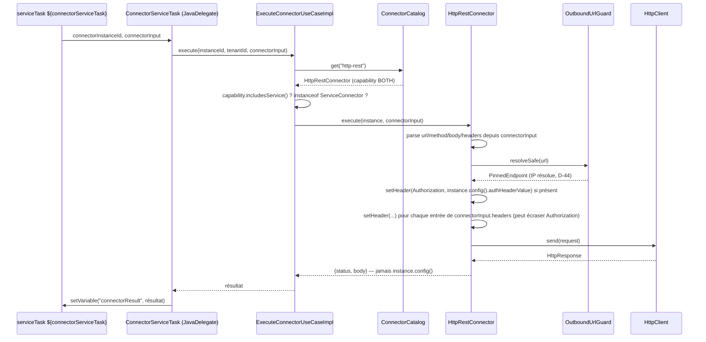

# System Design & Architecture

## Architecture Overview
**What is the high-level system structure?**

Aucune nouvelle brique d'infrastructure ni nouveau port. Toute la chaîne de consommation SERVICE
(`ConnectorServiceTask`, `ConnectorExecuteController`, `M2mConnectorExecuteController`,
`ExecuteConnectorUseCaseImpl`) existe déjà et n'est pas modifiée — cette feature active un type de
connecteur sur cette chaîne déjà en place, exactement comme `flowable-signal` le fait aujourd'hui.
Le changement se concentre sur une seule classe (`HttpRestTriggerConnector`, renommée
`HttpRestConnector` — D-HTTP-NAMING) et sa configuration Spring.



Le même chemin sert `POST /api/connectors/{instanceId}/execute` (BFF et M2M) — les deux contrôleurs
appellent le même `ExecuteConnectorUseCase`, non modifié.

## Data Models
**What data do we need to manage?**

Aucun changement de schéma de persistance (`ConnectorInstanceJpaEntity`/`ConnectorInstanceData`
inchangés — `config` reste une `Map<String, Object>` JSONB opaque). Un seul changement : un nouveau
champ optionnel dans `getConfigSchema()`.

```java
// infrastructure/connector/builtin/HttpRestConnector.java (renommé)
@Override
public List<ConfigField> getConfigSchema() {
    return List.of(
            // ... 4 champs TRIGGER existants (webhookAuthType, webhookSecret, processKey,
            // dossierTypeCode) inchangés ...
            new ConfigField(
                    "authHeaderValue",           // D-HTTP-CONFIG
                    "Authorization header value",
                    ConfigFieldType.PASSWORD,
                    false,                        // optionnel — D-HTTP-AUTH-SHAPE : valeur brute
                    null,
                    List.of(),
                    "Sent verbatim as the Authorization header on SERVICE calls, "
                            + "e.g. 'Bearer xxx' or 'Basic yyy'. Leave empty for no auth header."));
}
```

`authHeaderValue` est chiffré au repos par le mécanisme déjà en place
(`ConnectorSecretCipher`/`ConnectorInstanceJpaAdapter`) — même chemin que `webhookSecret`, aucune
évolution de ce mécanisme nécessaire (tout champ `PASSWORD` du schéma est déjà chiffré
générique­ment, pas de liste blanche par nom de champ à mettre à jour).

**Contrat `connectorInput` étendu** (pas un schéma persistant — juste la forme attendue par
`execute()`, déjà partiellement documentée dans `GUIDE-CONCEPTION-BPMN.md` §7) :

| Clé | Type | Obligatoire | Notes |
|---|---|---|---|
| `url` | `String` | oui | Inchangé — validé par `OutboundUrlGuard.resolveSafe` |
| `method` | `String` | non (défaut `GET`) | **Nouveau.** `GET`\|`POST`\|`PUT`, insensible à la casse ; toute autre valeur → `IllegalArgumentException` |
| `body` | `Object` | non | **Nouveau.** Ignoré/rejeté si `method=GET` (`IllegalArgumentException`) ; sérialisé en JSON via `ObjectMapper` sauf si déjà une `String` (envoyée telle quelle) |
| `headers` | `Map<String, Object>` | non | **Nouveau.** Appliqué après l'en-tête `Authorization` issu de la config — D-HTTP-CONTENT-TYPE : peut inclure `Content-Type` ou tout autre en-tête, y compris un `Authorization` qui écraserait celui de la config ; `headers` présent mais pas une `Map` → `IllegalArgumentException` |

## API Design
**How do components communicate?**

Aucun nouvel endpoint REST, aucun changement de contrat OpenAPI côté admin
(`POST`/`GET /api/connector-definitions`, `POST`/`PATCH /api/connectors` inchangés — le schéma
`getConfigSchema()` n'est de toute façon pas exposé/consommé par le frontend, voir Design Decisions
D-FRONTEND-GAP). Deux surfaces déjà existantes deviennent utilisables pour `http-rest` sans
modification de leur code :

- `POST /api/connectors/{instanceId}/execute` (`ConnectorExecuteController`, session BFF).
- `POST /api/connectors/{instanceId}/execute` (`M2mConnectorExecuteController`, JWT M2M
  `API_SERVICE`).

Avant cette feature, les deux répondent `500` (`UnsupportedOperationException` non mappée
spécifiquement) sur une instance `http-rest`. Après : `200` avec `{status, body}` comme pour
`flowable-signal` aujourd'hui — **aucun nouveau cas d'erreur à mapper** dans les contrôleurs REST,
les erreurs de validation de `connectorInput` (`url`/`method`/`headers` invalides) remontent déjà en
`400` via le gestionnaire générique existant (`IllegalArgumentException` → `handleBadRequest`, même
mécanisme que pour `flowable-signal`).

**Golden OpenAPI : pas de régénération attendue** — aucun DTO REST ne change de forme (vérifier en
Phase 5 par `./mvnw verify`, filet de sécurité déjà en place, même raisonnement que
`schema-champs-dynamiques`).

## Component Breakdown
**What are the major building blocks?**

Backend uniquement (feature confirmée backend-only, requirements Phase 2) :

| Fichier | Changement |
|---|---|
| `infrastructure/connector/builtin/HttpRestTriggerConnector.java` | **Renommé** `HttpRestConnector.java` (D-HTTP-NAMING). Implémente désormais aussi `ServiceConnector` ; `getCapability()` → `BOTH`. Constructeur gagne `OutboundUrlGuard`, `HttpClient`, `ObjectMapper`. `getConfigSchema()` gagne `authHeaderValue`. Nouvelle méthode `execute(...)` reprenant/étendant la logique de `HttpRestServiceConnector` (méthode/corps/headers dynamiques, en-tête auth conditionnel) |
| `infrastructure/connector/builtin/HttpRestServiceConnector.java` | **Supprimé** — logique fusionnée dans `HttpRestConnector` |
| `infrastructure/config/ConnectorConfig.java` | Nouveau `@Bean HttpClient` (aucun bean `HttpClient` n'existe aujourd'hui dans le dépôt — le skeleton n'était jamais construit par Spring) ; injection dans le bean `HttpRestConnector` (actuellement construit implicitement via `@Component`, le `@Bean` explicite n'est nécessaire que pour `HttpClient`) |
| `infrastructure/config/ConnectorProperties.java` | Nouveau sous-record `Http(Duration connectTimeout, Duration requestTimeout)`, défauts 5 s/5 s — même valeurs que `NotificationProperties.Webhook` (convention déjà établie pour un appel HTTP sortant applicatif) |
| `test/.../builtin/HttpRestTriggerConnectorTest.java` + `HttpRestServiceConnectorTest.java` | **Fusionnés** en `HttpRestConnectorTest.java` (D-HTTP-TESTS). Tests TRIGGER existants inchangés ; tests SERVICE hérités du skeleton inchangés côté comportement (SSRF, anti-fuite) ; `connector_doesNotImplementConnectorDefinition`/`connector_isNotASpringBean` inversés en `connector_implementsConnectorDefinitionAndServiceConnector`/`connector_isASpringBean` ; nouveaux tests POST/PUT+corps, headers custom, `authHeaderValue`→`Authorization`, override par `headers` explicite, méthode non supportée rejetée, corps sur GET rejeté |
| `docs/specs/06-connecteurs.md` | Tableau catalogue : colonne « V1 livré » pour `http-rest` passe de « TRIGGER seulement... skeleton SERVICE non enregistré » à « TRIGGER + SERVICE » |
| `README.md` | § Système de connecteurs : retire la mention « TRIGGER seulement » pour `http-rest` |

Aucun fichier `frontend/**` touché (confirmé requirements Phase 2 — `ConnectorsAdminView.vue` est un
JSON brut agnostique de tout schéma, `authHeaderValue` saisissable sans changement d'écran).

## Design Decisions
**Why did we choose this approach?**

- **D-CAPABILITY-SCOPE = fusion au niveau du type** (requirements, 2026-08-31) — implémenté en
  faisant porter `ServiceConnector` par la même classe que `ConnectorDefinition`/`TriggerConnector`.
  Alternative écartée : capacité par instance (nouveau champ de config limitant le rôle) — aurait
  demandé un changement de modèle sur `ConnectorCapability` (aujourd'hui propriété du *type*, pas de
  l'*instance*) sans aucun précédent dans le dépôt ; hors périmètre de cette feature.
- **D-HTTP-METHODS = GET+POST/PUT dynamiques** (requirements) — aucun nouveau `ConfigField` ; la
  méthode/le corps viennent de `connectorInput` à chaque appel, cohérent avec le fonctionnement déjà
  en place de `url`. `DELETE` explicitement exclu de cette V1 (pas demandé, pas d'usage identifié) —
  facile à ajouter plus tard (`HttpRequest.Builder.method("DELETE", ...)`) sans rupture si besoin.
- **D-HTTP-CONFIG = `authHeaderValue` brut** (requirements + D-HTTP-AUTH-SHAPE, design) — un seul
  champ `PASSWORD` contenant la valeur complète de l'en-tête, pas de composition `authType`+`authValue`
  côté connecteur. Alternative écartée : paire structurée — aurait ajouté un `ConfigFieldType` SELECT
  supplémentaire et de la logique de composition dans `execute()` pour un gain marginal (l'admin
  compose déjà `webhookSecret` manuellement dans le même JSON brut aujourd'hui, cf. D-FRONTEND-GAP).
- **D-HTTP-CONTENT-TYPE = fourni dynamiquement par `connectorInput.headers`** (design) — pas de
  `Content-Type` par défaut imposé par le connecteur ; un `serviceTask` qui envoie un corps doit
  explicitement fournir `headers: {"Content-Type": "application/json"}` s'il en a besoin. Cohérent
  avec le principe « tout dynamique par appel » déjà retenu pour `method`/`body` (D-HTTP-METHODS) ;
  généralise au passage un mécanisme d'en-têtes arbitraires (pas seulement `Content-Type`), utile
  aussi pour un futur besoin d'en-tête custom sans nouvelle décision.
- **Précédence auth config vs. headers par appel** (design, pas dans les requirements) — l'en-tête
  `Authorization` issu de `authHeaderValue` est posé **avant** les `headers` de `connectorInput`
  (`HttpRequest.Builder.setHeader`, pas `.header`, pour éviter un doublon d'en-tête) : un appel
  explicite peut donc écraser l'auth de l'instance s'il fournit son propre `Authorization`. Alternative
  écartée : interdire l'override — inutile à interdire, aucun risque de sécurité (le caller est déjà
  authentifié pour atteindre `ExecuteConnectorUseCase`), et plus flexible pour un cas d'usage
  multi-comptes sur une même instance.
- **Nouveau `@Bean HttpClient`** (design) — aucun bean de ce type n'existe dans le dépôt (le
  skeleton n'était jamais construit par Spring). Timeouts configurables
  (`ConnectorProperties.Http`, défauts 5 s/5 s) plutôt qu'un `HttpClient.newHttpClient()` sans limite
  — même rationale que `NotificationProperties.Webhook` pour les webhooks sortants de notification
  (déjà 5 s/5 s), évite qu'un `serviceTask` reste bloqué indéfiniment sur un tiers qui ne répond pas.
- **D-FRONTEND-GAP (noté, hors périmètre)** — `GUIDE-CONCEPTION-BPMN.md` §4 décrit un formulaire de
  config généré depuis `getConfigSchema()` ; le code réel (`ConnectorsAdminView.vue`) est un JSON
  brut. Écart documentaire préexistant, sans impact sur cette feature (le JSON brut fonctionne pour
  n'importe quel champ, y compris `authHeaderValue`) — correction de la doc mise en tâche séparée
  (hors scope), pas traitée ici pour ne pas élargir cette feature à un fichier sans rapport avec le
  connecteur `http-rest`.

Écarts explicitement **non** retenus (hors périmètre V1, déjà actés en requirements) : capacité par
instance, authentification OAuth2 sortante, retry/backoff dédié, parsing structuré de la réponse.

## Non-Functional Requirements
**How should the system perform?**

- **Performance** — nouveau `HttpClient` avec timeouts (5 s connect/request par défaut,
  configurables) : borne le temps qu'un `serviceTask` peut passer bloqué sur un appel `http-rest`
  SERVICE qui ne répond pas, absent du skeleton actuel (`HttpClient.send` sans délai explicite avant
  cette feature — un `serviceTask` synchrone bloqué indéfiniment serait une régression latente non
  couverte jusqu'ici puisque le chemin n'était pas activable). Amélioration, pas une régression.
- **Sécurité** — hardening SSRF (`OutboundUrlGuard`, pin IP D-44) strictement inchangé, exercé pour
  **toute** méthode HTTP (pas seulement GET) puisque `resolveSafe(url)` est appelé avant toute
  construction de requête, indépendamment de `method`/`body`/`headers`. Anti-fuite de secrets
  inchangé (`instance.config()` — dont `authHeaderValue` — jamais renvoyé dans le résultat, prouvé
  par test existant + nouveaux tests pour les champs ajoutés). `authHeaderValue` chiffré au repos par
  le mécanisme `PASSWORD` générique déjà en place, aucune nouvelle voie de fuite créée par les
  `headers` arbitraires de `connectorInput` (ils ne sont jamais relus depuis `instance.config()`,
  fournis à chaque appel par le caller déjà authentifié). Connexion HTTPS vers l'IP pinnée plutôt que
  le nom d'hôte original : comportement **déjà présent dans le skeleton actuel** (test
  `execute_pinsResolvedIpWithoutSecondLookup`), non modifié par cette feature.
- **Fiabilité** — pas de retry ; une erreur réseau ou un timeout remonte en
  `IllegalStateException` à l'appelant (`ConnectorServiceTask`/contrôleurs), comportement inchangé
  du skeleton, cohérent avec l'absence de retry générique sur `ExecuteConnectorUseCase` aujourd'hui
  (`flowable-signal` compris).
- **Compatibilité ascendante** — `connectorType` stocké en base reste la chaîne `"http-rest"`,
  indépendante du renommage de classe Java (D-HTTP-NAMING). Toute instance `http-rest` existante
  (créée quand la capability était `TRIGGER` seule) devient utilisable en SERVICE sans migration de
  données — `capability` est une propriété du type (code), pas de l'instance (base). Aucun champ de
  config existant renommé/supprimé — `authHeaderValue` est additif et optionnel, une instance sans
  ce champ continue de fonctionner en TRIGGER exactement comme avant.
