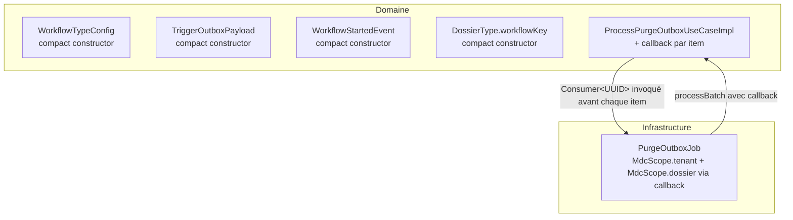

# System Design & Architecture

> Première passe (Phase 1), à affiner en Phase 3 (`dev-design`) — notamment la forme exacte du
> callback MDC et la preuve retenue pour `D-PERSISTABLE-CONFIRM`.

## Architecture Overview
**What is the high-level system structure?**

- Aucun nouveau composant : la feature ajoute des gardes dans des records domaine existants et un
  point d'extension (callback) sur un use case existant.
- Le domaine reste exempt de toute dépendance `org.slf4j`/MDC — le callback est un simple
  `Consumer<UUID>` (type JDK), pas un type infra.

## Data Models
**What data do we need to manage?**

- Aucune donnée persistée nouvelle. Les 4 records domaine ciblés gagnent une validation
  supplémentaire dans leur compact constructor, sans changement de champ.
- `ProcessPurgeOutboxUseCase.processBatch` gagne un paramètre callback (signature à confirmer en
  Phase 3) — pas de changement de schéma DB.

## API Design
**How do components communicate?**

- Aucun endpoint REST/MCP nouveau ou modifié. Les DTOs REST/MCP existants (`WorkflowApiDtos`,
  `DossierApiDtos`, `McpArgs`) continuent de rejeter en amont via `required()`/`requireString()` —
  inchangés par cette feature.
- Port `ProcessPurgeOutboxUseCase` (interface domaine, `port.in`) : changement de signature interne
  au module, aucun contrat externe exposé.

## Component Breakdown
**What are the major building blocks?**

- `WorkflowTypeConfig`, `TriggerOutboxPayload`, `WorkflowStartedEvent`, `DossierType` (compact
  constructors) — ajout d'une garde blank sur le modèle `DossierType.code`/`CODE_PATTERN`.
- `ProcessPurgeOutboxUseCaseImpl` — ajout d'un paramètre callback invoqué avant chaque item de
  `purgeDossier(record)`.
- `PurgeOutboxJob` — fournit le callback qui ouvre/ferme `MdcScope.dossier(record.dossierId())`
  autour de l'appel.
- `DEFERRED-FEATURES.md` — nettoyage documentaire (2 lignes retirées, 2 lignes fermées avec
  référence à cette feature).

## Design Decisions
**Why did we choose this approach?**

- **D-BLANK-VALIDATION-SCOPE** : défense en profondeur dans le domaine plutôt que fermeture sans
  code — réutilise le patron `IllegalArgumentException` déjà établi (`DossierType.code`,
  `observerUserIds`), cohérence de style plutôt qu'un nouveau mécanisme.
- **D-MDC-DOSSIER-MECHANISM** : callback (option a) plutôt que retour enrichi (option b) — préserve
  le log au moment exact de l'échec (y compris crash mi-batch), au prix d'un léger couplage
  supplémentaire entre le use case et l'appelant (accepté, cohérent avec le principe hexagonal :
  le domaine expose un point d'extension neutre, l'infra décide quoi en faire).
- **D-PERSISTABLE-CONFIRM** : à trancher explicitement en Phase 3 avec preuve documentée (lecture de
  `SimpleJpaRepository.save()`/`@Version`, éventuellement un test JPA ciblé) plutôt que d'assumer la
  redondance depuis l'analyse seule.

## Non-Functional Requirements
**How should the system perform?**

- Aucun impact performance attendu (garde blank = comparaison de chaîne ; callback MDC = un
  `MdcScope` ouvert/fermé par item, déjà du même ordre de grandeur que le `MdcScope.tenant` existant
  par batch).
- Sécurité : aucun changement de surface (pas de nouvel endpoint, pas de nouvelle donnée sensible).
- Fiabilité : `ArchitectureRulesTest.domain_has_no_framework_dependency` doit rester vert — critère
  de non-régression explicite pour cette feature.
