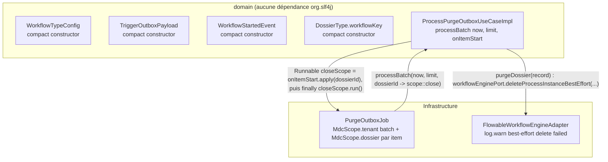

# System Design & Architecture

> Phase 3 (`dev-design`) close — décisions confirmées via `AskUserQuestion` le 2026-09-01, sur la
> base d'une investigation de code complémentaire (voir Design Decisions).

## Architecture Overview
**What is the high-level system structure?**

- Aucun nouveau composant : la feature ajoute des gardes dans des records domaine existants et un
  point d'extension (callback) sur un use case existant.
- Le domaine reste exempt de toute dépendance `org.slf4j`/MDC — le callback est typé
  `Function<UUID, Runnable>` (types JDK uniquement), pas un type infra.
- **Trace concrète de la valeur diagnostique** (trouvée en Phase 3, absente de l'analyse initiale) :
  aucun log par item n'existe dans `ProcessPurgeOutboxUseCaseImpl`/`PurgeOutboxJob` aujourd'hui
  (l'échec est seulement persisté en DB via `markFailed`). Mais un vrai `log.warn` par item existe
  plus profond dans l'appel : `FlowableWorkflowEngineAdapter.deleteProcessInstanceBestEffort()`
  (invoqué depuis `purgeDossier(record)` → `workflowEnginePort.deleteProcessInstanceBestEffort(...)`)
  fait `log.warn("Best-effort process instance delete failed for {}: {}", processInstanceId, ...)`
  sans `dossierId` en MDC — c'est ce log-là que le callback rend enfin corrélable à un dossier.

## Data Models
**What data do we need to manage?**

- Aucune donnée persistée nouvelle. Les 4 records domaine ciblés gagnent une validation
  supplémentaire dans leur compact constructor, sans changement de champ.
- `ProcessPurgeOutboxUseCase.processBatch` gagne un paramètre callback :
  `int processBatch(Instant now, int limit, Function<UUID, Runnable> onItemStart)` — pas de
  changement de schéma DB. `onItemStart.apply(dossierId)` retourne le « fermeur » de scope
  (`Runnable`, jamais d'exception checked) à appeler en `finally` après le traitement de l'item — voir
  Component Breakdown pour la justification de cette forme précise plutôt qu'un simple
  `Consumer<UUID>`.

## API Design
**How do components communicate?**

- Aucun endpoint REST/MCP nouveau ou modifié. Les DTOs REST/MCP existants (`WorkflowApiDtos`,
  `DossierApiDtos`, `McpArgs`) continuent de rejeter en amont via `required()`/`requireString()` —
  inchangés par cette feature.
- Port `ProcessPurgeOutboxUseCase` (interface domaine, `port.in`) : changement de signature interne
  au module — 1 seul appelant de production (`PurgeOutboxJob`), 1 seule implémentation
  (`ProcessPurgeOutboxUseCaseImpl`), aucun contrat externe exposé. **Confirmé en Phase 3** : 3
  fichiers de test appellent/mockent `processBatch(Instant, int)` en 2 arguments et devront être mis
  à jour vers la signature à 3 arguments — `ProcessPurgeOutboxUseCaseImplTest` (appel direct sur
  l'implémentation), `PurgeOutboxJobTest` (mock du port), `PurgeOutboxApiTest` (ligne 142, appel
  direct `processPurgeOutboxUseCase.processBatch(Instant.now(), 2000)` dans un test d'API HTTP qui
  déclenche la purge synchroneusement).

## Component Breakdown
**What are the major building blocks?**

- `WorkflowTypeConfig`, `TriggerOutboxPayload`, `WorkflowStartedEvent`, `DossierType` (compact
  constructors) — ajout d'une garde blank sur le modèle `DossierType.code`/`CODE_PATTERN`.
- `ProcessPurgeOutboxUseCase`/`ProcessPurgeOutboxUseCaseImpl` — `processBatch` prend un 3e paramètre
  `Function<UUID, Runnable> onItemStart`. Dans la boucle : `Runnable closeScope =
  onItemStart.apply(record.dossierId())` juste avant `purgeDossier(record)`, puis `closeScope.run()`
  dans un bloc `finally` englobant tout le traitement de l'item (le `try`/`catch (RuntimeException
  ex)` existant qui appelle `markFailed` reste inchangé, le `finally` s'ajoute autour). Forme précise
  choisie plutôt qu'un simple `Consumer<UUID>` « avant » : un `MdcScope` doit être fermé
  symétriquement après l'item pour ne pas fuiter le `dossierId` sur l'item suivant — un `Consumer`
  fire-and-forget n'offre pas de point de fermeture. `Runnable` (pas `AutoCloseable`) est retenu
  comme type de retour car `MdcScope.close()` ne déclare aucune exception checked (vérifié dans
  `MdcScope.java`), donc `scope::close` s'y convertit directement sans complexifier la gestion
  d'exceptions du use case avec un `try-with-resources` sur un type qui déclare `throws Exception`.
- `PurgeOutboxJob` — implémente le callback : `dossierId -> { MdcScope scope =
  MdcScope.dossier(dossierId); return scope::close; }`.
- `DEFERRED-FEATURES.md` — nettoyage documentaire (2 lignes retirées, 2 lignes fermées avec
  référence à cette feature, dont `Persistable`/`isNew()` fermé par preuve documentée).

## Design Decisions
**Why did we choose this approach?**

- **D-BLANK-VALIDATION-SCOPE** (confirmé) : défense en profondeur dans le domaine — réutilise le
  patron `IllegalArgumentException` déjà établi (`DossierType.code`, `observerUserIds`), cohérence
  de style plutôt qu'un nouveau mécanisme. Périmètre : `WorkflowTypeConfig.workflowKey`,
  `TriggerOutboxPayload.processKey`, `WorkflowStartedEvent.processKey`, `DossierType.workflowKey`.
- **D-MDC-DOSSIER-MECHANISM — portée = tout `purgeDossier(record)`** (confirmé 2026-09-01) :
  le callback doit envelopper l'appel complet à `purgeDossier(record)`, pas seulement le bloc
  `catch`/`markFailed` — parce que le `log.warn` réel identifié
  (`FlowableWorkflowEngineAdapter.deleteProcessInstanceBestEffort`) se produit **sans** lever
  d'exception remontée jusqu'à `processBatch` (il catch, logue, et continue) : un scope limité au
  `catch` raterait ce warn.
- **D-MDC-DOSSIER-MECHANISM — forme = `Function<UUID, Runnable>` (affinement JDK d'un `Consumer<UUID>`
  simple)** (confirmé 2026-09-01, forme précise affinée en Phase 3) : pas de nouvelle interface
  nommée (`PurgeItemListener` écarté) — un seul appelant, une seule implémentation, aucun précédent
  de ce patron dans le dépôt ; cohérent avec la convention du projet de ne pas introduire
  d'abstraction pour un point d'utilisation unique. Un `Consumer<UUID>` fire-and-forget (option
  initialement présentée) ne fournit pas de point de fermeture symétrique du `MdcScope` après
  l'item — `Function<UUID, Runnable>` reste un type JDK pur tout en gardant l'ouverture/fermeture
  correcte (voir Component Breakdown).
- **D-PERSISTABLE-CONFIRM — fermé par preuve documentée, sans nouveau test** (confirmé 2026-09-01) :
  `DossierJpaEntity.version` est un `@Version private long` **primitif** (pas un wrapper), et
  `SpringDataDossierRepository extends JpaRepository<DossierJpaEntity, UUID>` sans implémenter
  `Persistable`. C'est exactement le cas documenté par Spring Data JPA où
  `JpaMetamodelEntityInformation.isNew()` se base sur la valeur « non sauvegardée » par défaut d'un
  champ de version primitif (`0` = entité neuve) pour distinguer persist/merge, y compris quand
  l'`@Id` (UUID) est assigné côté application avant le premier `save()` — c'est précisément le cas ici
  (`DossierJpaEntity(UUID id, ...)`, id généré en Java). Écrire un test reviendrait à re-tester une
  garantie du framework, pas du code applicatif — écarté (convention du projet : pas de test pour un
  comportement garanti par le framework).

## Non-Functional Requirements
**How should the system perform?**

- Aucun impact performance attendu (garde blank = comparaison de chaîne ; callback MDC = un
  `MdcScope` ouvert/fermé par item, déjà du même ordre de grandeur que le `MdcScope.tenant` existant
  par batch).
- Sécurité : aucun changement de surface (pas de nouvel endpoint, pas de nouvelle donnée sensible).
- Fiabilité : `ArchitectureRulesTest.domain_has_no_framework_dependency` doit rester vert — critère
  de non-régression explicite pour cette feature.

## Requirements Coverage (Phase 3 cross-check)

| Requirement (doc requirements) | Couverture design |
|---|---|
| D-BLANK-VALIDATION-SCOPE (4 records) | §Component Breakdown — compact constructors |
| D-MDC-DOSSIER-MECHANISM (callback, sans dépendance domaine) | §Architecture Overview, §Design Decisions — trace concrète du `log.warn` réel identifiée |
| D-PERSISTABLE-CONFIRM | §Design Decisions — fermé par preuve documentée |
| Nettoyage `DEFERRED-FEATURES.md` (2 lignes déjà closes) | §Component Breakdown |
| Non-régression `ArchitectureRulesTest.domain_has_no_framework_dependency` | §Non-Functional Requirements |
| Backend seul, aucun fichier `frontend/**` | Confirmé — aucun composant frontend dans Component Breakdown |

Aucun goal/user story/contrainte des requirements sans couverture design identifiée.
