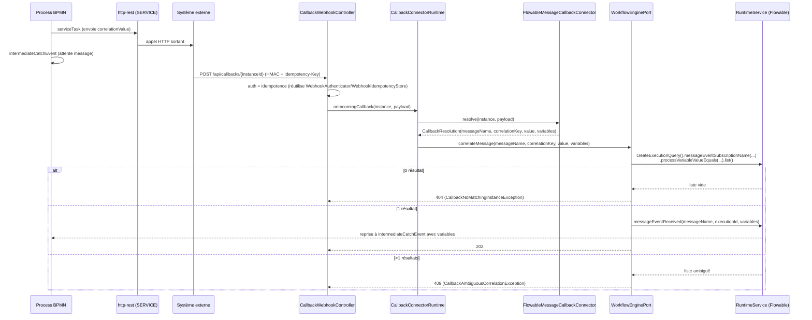

# System Design & Architecture

> Statut : **Phase 3 (Review Design) close (2026-09-02)**. Toutes les décisions d'architecture
> sont tranchées ou explicitement reportées à une phase ultérieure sans impact sur ce design.
> **Correction majeure faite en Phase 3** : le mécanisme proposé dans l'analyse d'origine
> (`analysis doc/21-correlation-callback-async.md`) — `RuntimeService.createMessageCorrelation(...)`
> — **n'existe pas** dans la version réelle de Flowable utilisée par le dépôt (8.0.0 Community).
> Vérifié en extrayant et lisant les sources réelles
> (`flowable-engine-8.0.0-sources.jar`, `org/flowable/engine/RuntimeService.java` /
> `org/flowable/engine/runtime/ExecutionQuery.java`), pas supposé, pas recopié de la doc en ligne.
> Le mécanisme correct pour cette version est détaillé ci-dessous ; `analysis doc/21-...md` et
> `TODO.md` §51 sont corrigés en conséquence dans le même commit.

## Architecture Overview
**What is the high-level system structure?**



- **Composants clés** :
  - `FlowableMessageCallbackConnector` (nouveau, infra) : résout le payload entrant en
    `CallbackResolution` (messageName fixe + clé/valeur de corrélation + variables à injecter).
  - `CallbackConnectorRuntime` (nouveau, domain use case) : orchestre résolution + appel au port
    moteur — **pas** de passage par `ConnectorTriggerRuntimeImpl` (sémantique différente : jamais
    de création/résolution de dossier).
  - `WorkflowEnginePort.correlateMessage(...)` (nouvelle méthode) : implémentée dans
    `FlowableWorkflowEngineAdapter`, cf. mécanisme Flowable réel ci-dessous.
  - `CallbackWebhookController` (nouveau, infra web, `/api/callbacks/{instanceId}`) : endpoint HTTP
    entrant séparé de `/api/webhooks/{instanceId}` (sémantique différente), réutilisant
    l'authentification, le rate limiting et l'idempotence existants tels quels.
- **Stack** : rien de nouveau — Flowable 8.0.0 Community (`RuntimeService`, déjà injecté), Spring
  Boot, JSONPath minimal existant (`SimpleJsonPathMapper`). Aucune nouvelle dépendance.

### Mécanisme Flowable réel (corrigé en Phase 3, vérifié contre les sources 8.0.0)

`RuntimeService` **n'expose pas** `createMessageCorrelation(...)` dans cette version (confirmé par
`javap` sur `flowable-engine-8.0.0.jar` : absent de l'interface). Le mécanisme réellement
disponible, vérifié dans `org/flowable/engine/runtime/ExecutionQuery.java` et
`org/flowable/engine/RuntimeService.java` (sources téléchargées et lues, pas deviné) :

1. **Recherche des exécutions en attente** — `ExecutionQuery` :
   ```java
   List<Execution> matches = runtimeService.createExecutionQuery()
           .messageEventSubscriptionName(messageName)
           .processVariableValueEquals(correlationKey, correlationValue)
           .list();
   ```
   `messageEventSubscriptionName(String)` : sélectionne les exécutions abonnées à ce message BPMN
   (javadoc : nom spécifié par l'attribut `name` de l'élément `message` dans le XML BPMN 2.0).
   **`processVariableValueEquals` (pas `variableValueEquals`)** — distinction vérifiée dans le
   javadoc source : `variableValueEquals` ne matche que les **variables locales** de l'exécution
   (celle du point d'attente, souvent une sous-exécution technique), alors que
   `processVariableValueEquals` matche « les exécutions faisant partie d'un process qui a une
   variable [de niveau process] avec cette valeur » — c'est le bon scope, puisque la clé de
   corrélation est typiquement posée par un `serviceTask` antérieur comme variable de process, pas
   comme variable locale du point d'attente.
2. **Décision explicite par la taille de la liste** (notre propre logique, pas une exception
   Flowable à intercepter) :
   - `matches.isEmpty()` → `CallbackNoMatchingInstanceException` (→ 404).
   - `matches.size() > 1` → `CallbackAmbiguousCorrelationException` (→ 409).
   - exactement 1 → étape 3.
3. **Reprise de l'exécution unique** :
   ```java
   runtimeService.messageEventReceived(messageName, matches.get(0).getId(), variables);
   ```
   Signature confirmée dans les sources (`RuntimeService.java` ligne 1357) :
   `void messageEventReceived(String messageName, String executionId, Map<String, Object> processVariables)`.
   Javadoc : lève `FlowableException` « if the execution has not subscribed to the signal » — filet
   de sécurité pour la race entre notre `list()` et cet appel (ex. deux callbacks concurrents sur la
   même valeur) ; à traiter comme `CallbackNoMatchingInstanceException` si elle survient malgré la
   vérification préalable (pas une 500 non gérée).

Ce mécanisme est **plus simple à maîtriser** que celui initialement envisagé : ambiguïté et absence
de correspondance sont détectées par notre propre code sur une liste concrète, jamais en
interprétant un type d'exception Flowable interne non documenté publiquement.

## Data Models
**What data do we need to manage?**

- **Aucune nouvelle table.** Réutilisation à l'identique :
  - `connector_instance` (config JSON existant) pour la configuration du connecteur callback
    (mêmes colonnes que tout connecteur : `webhookAuthType`, `webhookSecret`, + champs propres au
    type `messageName`, `correlationVariableName`, `correlationValuePath`, `mapping.variables`).
  - `webhook_idempotency` (`JpaWebhookIdempotencyStoreAdapter`) pour la déduplication des retries —
    déjà générique par `(instanceId, idempotencyKey)`, aucune dépendance à la sémantique TRIGGER.
- **Nouveaux types domaine (Java, pas de persistance)** :
  ```java
  public interface CallbackConnector {
      CallbackResolution resolve(ConnectorInstanceData instance, Object rawPayload);
  }

  public record CallbackResolution(
          String messageName,
          String correlationVariableName,
          Object correlationValue,
          Map<String, Object> variables) { }
  ```
- **Flux de données** : payload JSON entrant → `SimpleJsonPathMapper` extrait
  `correlationValuePath` (valeur) et les chemins de `mapping.variables` (variables à injecter) →
  `CallbackResolution` → `ExecutionQuery` (recherche) → `messageEventReceived(...)` (reprise).

## API Design
**How do components communicate?**

- **Nouvel endpoint externe** : `POST /api/callbacks/{instanceId}`
  - Auth : identique à `/api/webhooks/{instanceId}` (`HmacWebhookAuthenticator` /
    `SharedSecretTokenAuthenticator` selon `webhookAuthType` de l'instance).
  - Idempotence : header `Idempotency-Key` requis, même contrat que `WebhookController` (200/202
    déjà connu renvoyé tel quel sur rejeu, `WebhookIdempotencyInFlightException` sur concurrence).
  - Réponses nouvelles côté domaine (pas de contrat webhook existant à casser) :
    - `202 Accepted` : corrélation réussie.
    - `404 Not Found` : aucune exécution en attente sur cette valeur de corrélation
      (`CallbackNoMatchingInstanceException`) — le système externe doit retenter (D-CALLBACK-RACE).
    - `409 Conflict` : plusieurs exécutions en attente correspondent
      (`CallbackAmbiguousCorrelationException`) — erreur de modélisation BPMN, loguée en ERROR,
      jamais masquée.
  - Même limites que l'existant : `maxBodyBytes`, `rateLimitPerMinute`
    (`ConnectorProperties.webhook()`).
  - **Placement confirmé** : `CallbackWebhookController` dans le package
    `com.flowforge.infrastructure.web.connector` (même package que `WebhookController`) — le
    `@RestControllerAdvice(basePackages = "com.flowforge.infrastructure.web.connector")` existant
    (`ConnectorExceptionHandler`) s'applique alors automatiquement ; il suffit d'y ajouter 2
    `@ExceptionHandler` (404/409), pattern déjà utilisé pour les 6 exceptions connecteur
    existantes. Pas de nouveau `@RestControllerAdvice`.
- **Port interne (application → domain)** :
  ```java
  public interface CallbackConnectorRuntime {
      void onIncomingCallback(ConnectorInstanceData instance, Object rawPayload);
  }
  ```
- **Port interne (domain → infrastructure)**, extension de `WorkflowEnginePort` :
  ```java
  void correlateMessage(
          String messageName, String correlationKey, Object correlationValue,
          Map<String, Object> variables);
  ```

## Component Breakdown
**What are the major building blocks?**

- **Backend uniquement** (confirmé en Phase 2 : écran Admin → Connecteurs déjà générique) :
  - `domain/connector/model/CallbackConnector.java` (interface)
  - `domain/connector/model/CallbackResolution.java` (record)
  - `domain/connector/model/CallbackNoMatchingInstanceException.java`
  - `domain/connector/model/CallbackAmbiguousCorrelationException.java`
  - `domain/connector/model/ConnectorCapability.java` (+ valeur `CALLBACK`)
  - `domain/connector/port/in/CallbackConnectorRuntime.java` (port in)
  - `domain/connector/usecase/CallbackConnectorRuntimeImpl.java` (implémentation)
  - `domain/workflow/port/out/WorkflowEnginePort.java` (méthode `correlateMessage` ajoutée)
  - `infrastructure/flowable/FlowableWorkflowEngineAdapter.java` (implémentation
    `ExecutionQuery` + `messageEventReceived`, cf. mécanisme ci-dessus)
  - `infrastructure/connector/builtin/FlowableMessageCallbackConnector.java` (nouveau type de
    connecteur, `ConnectorCapability.CALLBACK`)
  - `infrastructure/web/connector/CallbackWebhookController.java` (nouvel endpoint, réutilise
    `WebhookAuthenticator`, `WebhookRequestRateLimiter`, `WebhookIdempotencyStore` existants par
    injection, comme `WebhookController`)
  - `infrastructure/web/connector/ConnectorExceptionHandler.java` (2 `@ExceptionHandler` ajoutés :
    `CallbackNoMatchingInstanceException` → 404, `CallbackAmbiguousCorrelationException` → 409)
- **Frontend** : **zéro changement** — confirmé en Phase 2 contre le code réel
  (`ConnectorsAdminView.vue` : dropdown de types + config JSON brute, aucun rendu dynamique de
  `getConfigSchema()`). Un nouveau `connectorType` callback apparaît automatiquement.
- **BPMN** : éventuellement un process d'exemple avec `intermediateCatchEvent` à message dans
  `src/main/resources/processes/`, décision de granularité reportée en Phase 4 (planning) — sans
  impact sur ce design (le déploiement est générique, cf. Non-Functional Requirements).

## Design Decisions
**Why did we choose this approach?**

- **`ConnectorCapability.CALLBACK` (nouvelle valeur d'enum), tranché en Phase 3** — la sémantique
  est fondamentalement différente (reprendre une exécution existante vs créer/attacher un
  dossier) ; un sous-type de `TRIGGER` obligerait `ConnectorTriggerRuntimeImpl` (ou son appelant
  `WebhookController`) à faire une branche conditionnelle sur le sous-type, exactement le couplage
  que la décision de portée V1 (connecteur générique indépendant) exclut. Alternative écartée :
  réutiliser `BOTH` avec un connecteur implémentant à la fois `TriggerConnector` et
  `CallbackConnector` — écartée par la même décision de portée (pas de couplage avec un connecteur
  SERVICE existant).
- **`ExecutionQuery` + `messageEventReceived` plutôt que `createMessageCorrelation`** — correction
  factuelle de Phase 3 : la méthode `createMessageCorrelation` n'existe pas sur `RuntimeService` en
  Flowable 8.0.0 Community (vérifié par extraction et lecture des sources réelles, pas supposé).
  Le remplacement retenu n'est pas un pis-aller : il donne un contrôle **explicite** sur les cas
  0/1/plusieurs résultats (une liste concrète à tester), alors que le mécanisme initialement
  envisagé aurait obligé à intercepter et distinguer des types d'exception internes Flowable non
  documentés publiquement pour la même distinction.
- **`processVariableValueEquals` plutôt que `variableValueEquals`** — la clé de corrélation est une
  variable de process posée par un `serviceTask` antérieur (portée process), pas une variable
  locale de l'exécution en attente du point de message ; `variableValueEquals` ne matche que le
  scope local et aurait silencieusement raté toute correspondance légitime.
- **Endpoint séparé `/api/callbacks/**` plutôt qu'extension de `/api/webhooks/**`** — même
  authentification/idempotence réutilisées par composition (injection des mêmes beans), mais le
  routage vers `ConnectorTriggerRuntime.onIncomingEvent` dans `WebhookController` est câblé en dur
  sur la sémantique dossier ; séparer les deux évite un `if` sur le type de connecteur dans un
  contrôleur partagé et garde chaque contrôleur avec une seule responsabilité.
- **Gestion d'erreurs dans `ConnectorExceptionHandler` existant** (pas un nouveau
  `@RestControllerAdvice`) — confirmé en Phase 3 : son `basePackages` couvre déjà
  `com.flowforge.infrastructure.web.connector`, où vivra `CallbackWebhookController`.
- **Réutilisation intégrale de `webhook_idempotency`** — le store est déjà générique
  (`(instanceId, idempotencyKey)`, TTL configurable), aucune dépendance à la sémantique
  TRIGGER dans son contrat (`WebhookIdempotencyStore`). Pas de nouvelle table.
- **Ambiguïté toujours remontée en erreur (409), jamais un fallback silencieux** — cf. requirements,
  D-CALLBACK-MULTI-MATCH ; implémenté nativement par `matches.size() > 1`, pas par un
  `correlateAll()` qui n'existe d'ailleurs pas non plus dans cette API.
- **D-CALLBACK-TYPE (trouvé en Phase 7) — `correlationValue` normalisée en `String` par
  `FlowableMessageCallbackConnector`** — vérifié empiriquement contre le vrai moteur :
  `ExecutionQuery.processVariableValueEquals("k", 123)` (Integer) ne matche **jamais** une variable
  de process stockée comme `String "123"`, même valeur logique. Un payload JSON externe porte
  souvent un identifiant sous forme de nombre (`{"orderId": 12345}`) alors que la variable de
  process posée par le `serviceTask` sortant est typiquement une `String` (référence dossier, UUID).
  Sans normalisation, ce mésappariement de type aurait produit un 404 silencieux et systématique
  pour toute intégration où l'identifiant est numérique côté système externe. Le connecteur
  convertit donc `correlationValue` en `String` avant de construire `CallbackResolution` — ne
  résout que la moitié du problème (le concepteur BPMN doit aussi poser `correlationVariableName`
  comme variable `String`, documenté sur le champ de config correspondant), mais c'est la seule
  moitié que ce connecteur contrôle.
- **Alternative écartée** : étendre `TriggerConnector.onEvent()` pour qu'il retourne un nouveau
  type d'événement « resume ». Écartée car `ConnectorTriggerRuntimeImpl.onIncomingEvent` boucle sur
  une liste de `WorkflowTriggerEvent` et appelle systématiquement `resolveOrCreateDossier` —
  changer cette sémantique pour un cas qui ne doit jamais créer de dossier est plus risqué qu'un
  chemin d'exécution neuf et isolé.

## Non-Functional Requirements
**How should the system perform?**

- **Sécurité** : aucune nouvelle surface — même authentification HMAC/shared-token par instance
  que `WebhookController`, secrets déjà chiffrés au repos (pattern connecteur existant), pas de
  nouvel appel sortant (donc pas de nouvelle surface SSRF).
- **Multi-tenant** : instance résolue via `tenantProperties.id()` comme `WebhookController` — une
  instance Spring Boot = un tenant, aucun changement de modèle.
- **Fiabilité** : pas de garantie de livraison si le callback arrive avant le point d'attente
  (rejet 404 assumé, cf. décision de portée V1) — le système externe est responsable du retry,
  documenté dans le contrat API. Race résiduelle entre `list()` et `messageEventReceived(...)`
  (deux callbacks concurrents visant la même exécution) **[implémenté en Phase 7]** :
  `FlowableWorkflowEngineAdapter.correlateMessage` capture le `FlowableException` levé par
  `messageEventReceived` si l'exécution a été consommée entre-temps et le traduit en
  `CallbackNoMatchingInstanceException` (404) — cette traduction n'existait pas encore quand ce
  paragraphe a été écrit en Phase 3 (design vs implémentation vérifié explicitement en Phase 7,
  écart trouvé et corrigé, pas juste supposé aligné).
- **Performance** : `ExecutionQuery.list()` + `messageEventReceived(...)` sont des appels
  synchrones sur le moteur Flowable dans la même requête HTTP entrante (comme `completeTask` l'est
  déjà pour d'autres flux) — pas de nouveau goulot identifié, même ordre de grandeur que les
  endpoints webhook existants.
- **[Résolu en Phase 3]** Déploiement d'un process contenant un `receiveTask`/
  `intermediateCatchEvent` à message : vérifié contre le code réel de
  `FlowableWorkflowDeploymentAdapter.deploy(...)` — appel générique
  `repositoryService.createDeployment().addBytes(...).deploy()`, aucune restriction ni liste
  blanche d'éléments BPMN. `DeployBpmnProcessUseCaseImpl.deploy(...)` ajoute uniquement une
  vérification de `WorkflowTypeConfig` existant et la purge du brouillon — rien qui inspecte les
  éléments internes du process. Aucun changement de code nécessaire sur le chemin de déploiement.
- **[Résolu en Phase 3]** Type d'exception Flowable sur absence/ambiguïté : devenu sans objet — le
  design ne dépend plus d'un type d'exception Flowable interne (cf. Design Decisions), la
  distinction 404/409 est faite par notre propre code sur le résultat de `ExecutionQuery.list()`.
