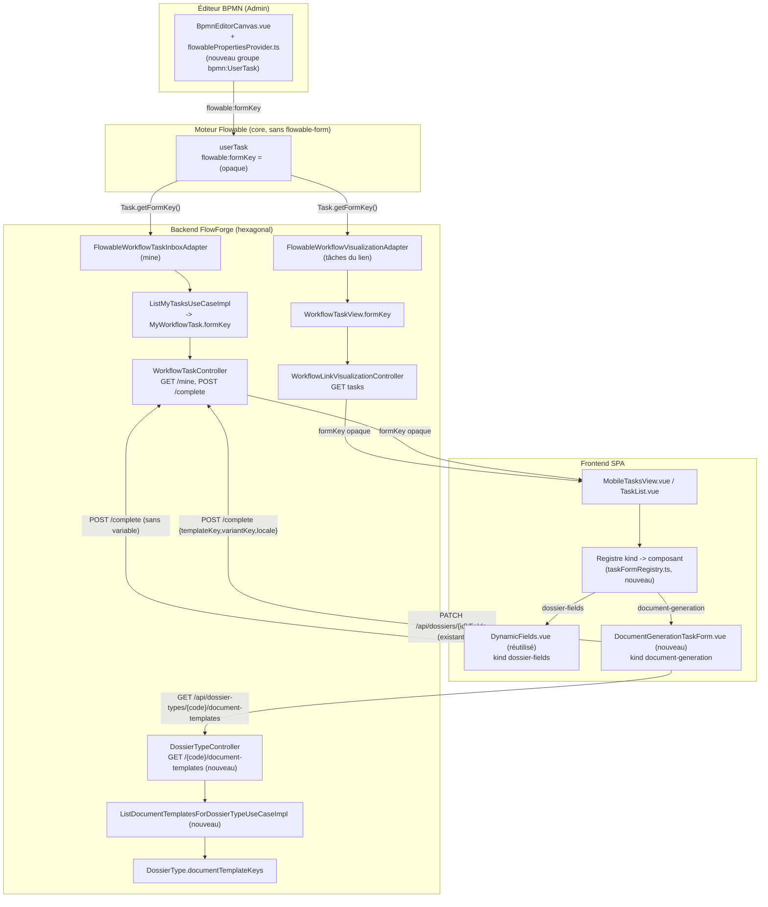

# System Design & Architecture — `formulaires-dynamiques-taches`

> Référence requirements :
> [2026-09-03-feature-formulaires-dynamiques-taches.md](../requirements/2026-09-03-feature-formulaires-dynamiques-taches.md).
> Toutes les décisions produit y sont tranchées ; ce document couvre l'architecture technique et
> corrige/précise 2 points vérifiés contre le code réel en Phase 3 (voir § « Écarts trouvés en
> design »).

## Architecture Overview
**What is the high-level system structure?**



- **Backend** : le `formKey` est lu une seule fois par adaptateur Flowable (`Task.getFormKey()`,
  API core `TaskService`/`Task`), transporté comme `String` opaque nullable à travers les ports et
  DTOs REST existants. Aucune interprétation du contenu du `formKey` côté serveur.
- **Frontend** : un unique point de décision (`taskFormRegistry.ts`) mappe le préfixe de `formKey`
  vers un composant Vue. `MobileTasksView.vue`/`TaskList.vue` délèguent l'affichage du bouton
  « Compléter » à ce registre au lieu d'un bouton unique câblé en dur.
- **Flowable reste headless** : aucune dépendance `flowable-form` ajoutée, `flowable:formKey` est
  un attribut BPMN standard du moteur cœur (confirmé Phase 1, à revérifier par test d'intégration
  réel en Phase 5).

## Écarts trouvés en design (vérifiés contre le code réel, pas supposés)

1. **`GET /api/document-templates` est `@PreAuthorize("hasRole('TENANT_ADMIN')")` au niveau
   classe** (`DocumentTemplateController.java:36`) — inutilisable tel quel par un porteur de tâche
   `DOSSIER_MANAGER` pour peupler le picker `document-generation`. Corrigé par un **nouvel
   endpoint** `GET /api/dossier-types/{code}/document-templates` sur `DossierTypeController`
   (classe sans `@PreAuthorize`, cohérent avec `GET /api/dossier-types`/`GET /{code}` déjà
   accessibles à tout utilisateur authentifié) qui renvoie uniquement
   `{templateKey, variantKey, locale, label}` — jamais `htmlContent` (`TemplateResponse` l'expose
   toujours, y compris `includeContent=false`, ce champ n'est donc pas réutilisable tel quel pour
   un rôle non admin). Filtré côté serveur par `DossierType.documentTemplateKeys` et
   `status=ACTIVE` — jamais de liste complète du catalogue exposée à un non-admin.
2. **Rôle de l'écran Admin → Types** : les endpoints d'écriture `DossierTypeController.create/update`
   sont `@PreAuthorize("hasRole('TENANT_ADMIN')")` **seul** (pas `WORKFLOW_ADMIN`, contrairement à
   `WorkflowTypeConfigController`/`BpmnDraftController` qui acceptent les deux). La nouvelle section
   `documentTemplateKeys` de l'écran Types hérite donc de **`TENANT_ADMIN` uniquement** — pas de
   nouvelle règle d'autorisation introduite, alignement sur le comportement existant de cet écran.
   Corrige le libellé « administrateur workflow » du requirements (user story), qui visait en
   réalité ce rôle précis.

## Data Models
**What data do we need to manage?**

### `DossierType` (domaine, `com.flowforge.domain.dossier.model`)

Nouveau champ, même patron que `fieldDefinitions` (liste immuable, `List.copyOf` dans le
constructeur canonique) :

```java
public record DossierType(
        UUID id, String tenantId, String code, String label, String workflowKey,
        boolean active, boolean allowUnknownFields, List<FieldDefinition> fieldDefinitions,
        Integer retentionDays, boolean retentionNever, Integer slaTargetHours,
        List<String> documentTemplateKeys,   // NOUVEAU — vide par défaut = aucun template disponible
        String createdBy, String updatedBy) { ... }
```

- Persistée en JSON (`@JdbcTypeCode(SqlTypes.JSON)`, colonne `document_template_keys`), même
  mécanisme que `field_definitions` sur `DossierTypeJpaEntity`.
- `inherit(...)` et `withUpdate(...)` (factories statiques existantes) gagnent le paramètre ;
  `inherit(...)` par défaut à `List.of()`.
- Pas de validation structurelle nouvelle : une clé absente du catalogue de templates actifs au
  moment de la sauvegarde n'est **pas** bloquée à l'écriture (le template peut être créé/activé
  après coup) — seul le filtrage à la lecture (`document-generation`) applique
  `status=ACTIVE ∩ documentTemplateKeys`. Cohérent avec le fait que `DossierType`/`DocumentTemplate`
  ne se référencent pas structurellement ailleurs dans le modèle (pas de FK).

### Migration Liquibase (`019-dossier-type-document-template-keys.yaml`, suite de `018-...`)

Même patron que `007-workflow-viz-columns.yaml` (`observer_user_ids`) :

```yaml
databaseChangeLog:
  - changeSet:
      id: 019-dossier-type-document-template-keys
      author: flowforge
      changes:
        - addColumn:
            tableName: dossier_type
            columns:
              - column:
                  name: document_template_keys
                  type: json
                  constraints:
                    nullable: true
        - update:
            tableName: dossier_type
            columns:
              - column:
                  name: document_template_keys
                  value: '[]'
        - addNotNullConstraint:
            tableName: dossier_type
            columnName: document_template_keys
            columnDataType: json
      rollback:
        - dropColumn:
            tableName: dossier_type
            columnName: document_template_keys
```

### `MyWorkflowTask` / `WorkflowTaskView` / `ActiveTaskSnapshot` (domaine)

Chacun gagne un champ `formKey: String` **nullable** (pas de `Objects.requireNonNull`, contrairement
aux autres champs — une tâche sans `formKey` est le cas nominal existant) :

- `WorkflowTaskInboxPort.ActiveTaskSnapshot` (`port/out`) — rempli par
  `FlowableWorkflowTaskInboxAdapter` via `task.getFormKey()`.
- `MyWorkflowTask` (modèle domaine) — rempli par `ListMyTasksUseCaseImpl` en propageant
  `ActiveTaskSnapshot.formKey()` tel quel (aucune transformation).
- `WorkflowTaskView` (modèle domaine, tâches d'un lien) — rempli par
  `FlowableWorkflowVisualizationAdapter.toTaskView(Task)` via `task.getFormKey()`.

Aucun changement de table : `formKey` n'est jamais persisté côté FlowForge, seulement lu depuis
Flowable à chaque requête (source de vérité = le process instance en cours).

### Convention `flowable:formKey`

Chaîne opaque interprétée uniquement côté frontend. Format `<kind>` (V1, 2 valeurs) :
- `dossier-fields`
- `document-generation`

Pas de paramètre encodé dans le `formKey` (cohérent avec D-FORM-DOSSIER-FIELDS-PARTIAL = schéma
complet, pas de sous-ensemble).

## API Design
**How do components communicate?**

| Endpoint | Changement | Détail |
|---|---|---|
| `GET /api/workflow-tasks/mine` | `MyWorkflowTaskResponse` gagne `formKey: string \| null` | Aucun changement de pagination/tri. |
| `GET /api/workflow-links/{id}/tasks` (`WorkflowLinkVisualizationController.tasks`) | `WorkflowTaskView` gagne `formKey: string \| null` | Réponse directe (pas de DTO wrapper dédié). |
| `POST /api/workflow-tasks/{taskId}/complete` | **Inchangé** | Porte déjà `variables` — le formulaire `document-generation` y écrit `templateKey`/`variantKey`/`locale`. |
| `PATCH /api/dossiers/{id}/fields` | **Inchangé** | Réutilisé tel quel par le kind `dossier-fields`. |
| `POST /api/dossier-types` / `PATCH /api/dossier-types/{code}` | Request/Response gagnent `documentTemplateKeys: string[]` | Même patron que `fieldDefinitions` (`null` en `PATCH` = ne pas modifier, `[]` explicite = vider). |
| **`GET /api/dossier-types/{code}/document-templates`** (nouveau) | Nouvel endpoint, soumis à la même vérification `VIEW` que `GET /api/dossier-types/{code}` (`DossierAccessPolicy`, pas seulement « authentifié » — **précisé en Phase 5**, voir implementation § M3) | Retourne `{templateKey, variantKey, locale, label}[]` filtré par `documentTemplateKeys` du type + `status=ACTIVE`. Liste vide si `documentTemplateKeys` vide (comportement décidé). Pas de pagination (volumes attendus faibles — quelques templates par type). |

### Nouveau port/use case backend

```java
// domain/document/port/out/DocumentTemplateRepository — nouvelle méthode
List<DocumentTemplate> findActiveByTemplateKeysIn(String tenantId, List<String> templateKeys);

// domain/document/port/in — nouveau use case
public interface ListDocumentTemplatesForDossierTypeUseCase {
    List<DocumentTemplate> list(String tenantId, String dossierTypeCode);
}
// Impl : charge DossierType par code (DossierTypeRepository.findByCode), retourne List.of() si
// documentTemplateKeys vide, sinon délègue à findActiveByTemplateKeysIn.
```

`JpaDocumentTemplateRepositoryAdapter` implémente `findActiveByTemplateKeysIn` via une requête
dérivée/JPQL (`templateKey IN :keys AND status = 'ACTIVE' AND tenantId = :tenantId`), même patron
que les autres méthodes de recherche du repository existant.

## Component Breakdown
**What are the major building blocks?**

### Backend (nouveau/modifié)

- `DossierType` (modifié), migration `019-...yaml`, `DossierTypeJpaEntity`/mapper (modifié).
- `CreateDossierTypeUseCase`/`UpdateDossierTypeUseCase` (Command records +1 champ),
  `DossierTypeController`/`DossierApiDtos` (+1 champ request/response, +1 nouvel endpoint GET).
- `MyWorkflowTask`, `WorkflowTaskView`, `WorkflowTaskInboxPort.ActiveTaskSnapshot` (+1 champ nullable
  chacun) ; `FlowableWorkflowTaskInboxAdapter`, `FlowableWorkflowVisualizationAdapter`,
  `ListMyTasksUseCaseImpl` (propagation) ; `WorkflowTaskController.MyWorkflowTaskResponse`,
  `WorkflowLinkVisualizationController` (exposition REST).
- `DocumentTemplateRepository` (port, +1 méthode), `JpaDocumentTemplateRepositoryAdapter` (impl),
  `ListDocumentTemplatesForDossierTypeUseCase`/`Impl` (nouveau), nouvelle route
  `DossierTypeController.documentTemplates(code)`.

### Frontend (nouveau/modifié)

- `flowablePropertiesProvider.ts` — nouveau groupe pour `bpmn:UserTask` avec une entrée
  `flowable:formKey` (patron `textFieldEntry`, identique à `delegateExpression`/`expression`).
- `frontend/src/components/workflow/task-forms/taskFormRegistry.ts` (nouveau) — `Record<string,
  Component>` exportant `resolveTaskFormComponent(formKey: string | null): Component | null`,
  parsant le préfixe `<kind>` et retournant `null` si absent/inconnu (dégradation vers le bouton
  actuel, décision tranchée).
- `frontend/src/components/workflow/task-forms/DossierFieldsTaskForm.vue` (nouveau, fin) — wrapper
  fin autour de `DynamicFields.vue` + appel `PATCH /api/dossiers/{id}/fields` + complétion.
- `frontend/src/components/workflow/task-forms/DocumentGenerationTaskForm.vue` (nouveau) —
  sélection `templateKey`/`variantKey`/`locale` via le nouvel endpoint, complétion avec ces 3
  variables.
- `MobileTasksView.vue`/`TaskList.vue` — résolution via le registre avant d'afficher le bouton
  « Compléter » ; si un composant est résolu, il remplace le bouton par le formulaire + son propre
  bouton de soumission.
- `frontend/src/components/dossier/DocumentTemplateKeysEditor.vue` (nouveau) — liste à cocher des
  `templateKey` distincts parmi les templates `ACTIVE` du tenant (réutilise
  `GET /api/document-templates?includeContent=false` déjà admin-scopé, déduplique côté client par
  `templateKey`), intégrée dans l'écran Admin → Types (`DossierTypesAdminView.vue`), patron
  `FieldDefinitionDefsEditor.vue`.
- `frontend/src/api/types.ts` — `MyWorkflowTask.formKey`, `WorkflowTaskView.formKey`,
  `DossierType.documentTemplateKeys`, nouveau type `AllowedDocumentTemplate`.
- `frontend/src/api/*` — nouvelle fonction `listDossierTypeDocumentTemplates(code)`.

## Design Decisions
**Why did we choose this approach?**

- **`formKey` opaque de bout en bout côté backend** (D-FORM-KIND-SCOPE = extensible) : le seul
  endroit qui connaît la liste des kinds valides est `taskFormRegistry.ts`. Ajouter un 3ᵉ kind plus
  tard = ajouter une entrée au registre + un composant Vue, zéro changement backend. Alternative
  écartée : `enum FormKind` côté domaine — rejetée, contredit directement la décision utilisateur
  d'extensibilité (chaque nouveau kind demanderait un déploiement backend).
- **Nouvel endpoint `GET /api/dossier-types/{code}/document-templates`** plutôt que d'élargir
  `GET /api/document-templates` : évite de toucher à la posture de sécurité d'un contrôleur
  entièrement admin (`DocumentTemplateController`, CRUD complet sur les templates) juste pour un
  besoin de lecture restreinte ; le nouvel endpoint ne renvoie qu'un sous-ensemble de champs non
  sensibles (jamais `htmlContent`).
- **Pas de FK SQL `document_template_keys` → `document_template`** : cohérent avec le modèle
  existant (`13-modele-physique.md` documente déjà que la plupart des relations sont logiques, pas
  contraintes en DB) ; une clé de template supprimée/désactivée après association dégrade
  silencieusement vers « non proposé au picker », pas une erreur d'intégrité.
- **`documentTemplateKeys` vide = aucun template disponible** (pas de fallback « tous les
  templates ») : décision utilisateur explicite (2026-09-03), priorise la sûreté de configuration
  sur la rétrocompatibilité automatique — tous les `DossierType` existants doivent être configurés
  explicitement avant que `document-generation` devienne utilisable dessus (à documenter dans
  `GUIDE-UTILISATEUR.md`).
- **`TENANT_ADMIN` uniquement pour la nouvelle section admin** (pas `WORKFLOW_ADMIN`) : alignement
  sur la posture de sécurité déjà en place pour `DossierTypeController` (§ Écarts trouvés).

## Non-Functional Requirements
**How should the system perform?**

- **Sécurité** : le nouvel endpoint `document-templates` ne fuit jamais `htmlContent` ni le
  catalogue complet des templates à un rôle non admin — seulement les clés déjà explicitement
  autorisées par un `TENANT_ADMIN` sur ce `DossierType`. Aucune nouvelle route non authentifiée.
- **Rétrocompatibilité** : une tâche sans `formKey` (100 % des process actuellement déployés) n'est
  strictement pas affectée — aucune migration de diagramme BPMN requise. Confirmé par les tests
  e2e existants sur `MobileTasksView.vue`/`TaskList.vue`, qui doivent continuer à passer sans
  modification de mocks pour ce cas.
- **Performance** : `documentTemplateKeys` attendu petit (quelques clés par type de dossier) —
  pas de pagination sur le nouvel endpoint, requête `IN` bornée par la taille de cette liste.
- **Couverture** : Jacoco LINE ≥85 %/BRANCH ≥75 % tenus (seuils existants) ; Vitest **et**
  Playwright obligatoires (feature touchant `frontend/**`, pas de dérogation possible).
- **Doc à jour** : `GUIDE-UTILISATEUR.md` (nouvelle section admin Types, tableau de rôles §0 —
  `TENANT_ADMIN` déjà listé, pas de nouveau rôle) et `GUIDE-CONCEPTION-BPMN.md` (nouvel attribut
  `flowable:formKey` documenté pour les auteurs de process) avant clôture de la feature.
