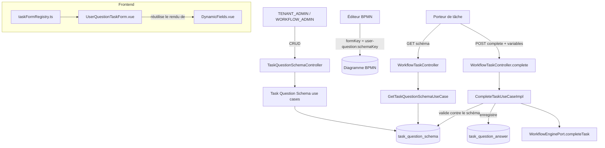

# System Design & Architecture

> Feature `questions-utilisateur-taches`. S'appuie sur le mécanisme `formKey`/`taskFormRegistry.ts`
> livré par TODO §52 — voir [22-formulaires-dynamiques-taches.md](../../specs/22-formulaires-dynamiques-taches.md)
> et [23-questions-utilisateur-taches.md](../../specs/23-questions-utilisateur-taches.md).
> Décisions de cadrage actées dans le
> [document requirements](../requirements/2026-09-05-feature-questions-utilisateur-taches.md).

## Architecture Overview



**Composants clés**

- **`TaskQuestionSchema`** (nouveau, `domain.workflow.model`) — schéma admin réutilisable, porté
  par une liste de `FieldDefinition` (`domain.dossier.model`, réutilisé tel quel — D-USERQ-FIELD-REUSE).
- **`TaskQuestionAnswer`** (nouveau, `domain.workflow.model`) — un enregistrement de traçabilité
  par complétion de tâche utilisant ce kind.
- **`taskFormRegistry.ts`** (existant, TODO §52) — gagne une 3ᵉ entrée `user-question` →
  `UserQuestionTaskForm.vue`, zéro changement à son mécanisme (toujours un `Record<string,
  Component>` gardé par `Object.create(null)`).
- **`CompleteTaskUseCaseImpl`** (existant) — gagne une validation dédiée à ce kind, même
  emplacement que `assertDocumentTypeAllowed` pour `document-generation`.

Aucune nouvelle dépendance Maven/npm ; aucun changement au moteur Flowable (le mécanisme
`formKey` est déjà en place).

## Data Models

### `TaskQuestionSchema` (domaine, `record` immuable)

```java
record TaskQuestionSchema(
    UUID id,
    String tenantId,
    String schemaKey,       // identifiant stable, unique par tenant, référencé par formKey
    String label,           // titre affiché au porteur de tâche
    List<FieldDefinition> fields,
    String createdBy,
    String updatedBy
)
```

Réutilise `FieldDefinition(name, label, type, required, defaultValue, options, group, sensitive)`
et `FieldType { STRING, NUMBER, DATE, BOOLEAN, SELECT, FILE }` tels quels
(`domain.dossier.model`). `FILE` reste dans l'énumération partagée mais **exclu de l'UI admin**
pour ce schéma (non-goal — aucun mécanisme d'upload indépendant du dossier n'existe/n'est demandé
ici) ; le backend le rejette explicitement à la sauvegarde d'un `TaskQuestionSchema` plutôt que de
laisser un champ silencieusement non fonctionnel.

**Persistance** (`TaskQuestionSchemaJpaEntity`) : même pattern que `DossierTypeJpaEntity` —
colonne `fields` en `@JdbcTypeCode(SqlTypes.JSON)` portant `List<FieldDefinition>` (le mapping
Jackson est déjà éprouvé, aucun nouveau (dé)sérialiseur). Contrainte unique `(tenant_id,
schema_key)`.

### `TaskQuestionAnswer` (domaine, `record` immuable — traçabilité)

```java
record TaskQuestionAnswer(
    UUID id,
    String tenantId,
    UUID dossierId,
    String taskId,
    String processInstanceId,
    String schemaKey,
    Map<String, Object> answers,   // clé = FieldDefinition.name
    String submittedBy,
    Instant submittedAt
)
```

Écrit par `CompleteTaskUseCaseImpl` dans la **même transaction** que la complétion de tâche —
si `workflowEnginePort.completeTask(...)` échoue, l'écriture de traçabilité est annulée avec elle
(cohérence transactionnelle, pas d'écriture orpheline). Portée volontairement minimale
(D-USERQ-TRACE-SCOPE) : réponses brutes, pas d'agrégation ni de lien reporting/SLA.

### Contrainte de nommage des champs (D-USERQ-VAR-COLLISION)

À la création/modification d'un `TaskQuestionSchema`, chaque `FieldDefinition.name` est validé
contre un ensemble de noms réservés/connus : les 4 clés de `WorkflowVariables.RESERVED`
(`dossierId`, `dossierWorkflowLinkId`, `tenantId`, `dossierFields`) **et** les noms de variables
métier déjà utilisés par d'autres kinds (`documentType`, `documentVariant`, `documentLocale` —
`WorkflowVariables.DOCUMENT_TYPE` et futures constantes sœurs). Rejeté avec un message explicite
si collision — voir « Design Decisions » pour l'implémentation.

## API Design

Toutes les routes suivent le pattern REST existant (`/api/...`, BFF session, `@PreAuthorize`).

| Méthode | Route | Rôle | Usage |
|---|---|---|---|
| `POST` | `/api/task-question-schemas` | `TENANT_ADMIN`,`WORKFLOW_ADMIN` | Créer un schéma |
| `GET` | `/api/task-question-schemas` | `TENANT_ADMIN`,`WORKFLOW_ADMIN` | Lister les schémas du tenant |
| `GET` | `/api/task-question-schemas/{schemaKey}` | `TENANT_ADMIN`,`WORKFLOW_ADMIN` | Détail (édition admin) |
| `PUT` | `/api/task-question-schemas/{schemaKey}` | `TENANT_ADMIN`,`WORKFLOW_ADMIN` | Modifier — pas de concurrence optimiste (aligné sur `DossierType`, qui n'en a pas non plus : entité de référence admin, écriture peu concurrente, dernier écrivain gagne ; contrairement à `Dossier.fields()` édité par plusieurs acteurs concurrents, qui justifie `expectedVersion`) |
| `DELETE` | `/api/task-question-schemas/{schemaKey}` | `TENANT_ADMIN`,`WORKFLOW_ADMIN` | Supprimer |
| `GET` | `/api/task-question-schemas/{schemaKey}/runtime?taskId=...` | tout rôle capable de compléter une tâche | Lecture par le porteur de tâche — **jamais** les métadonnées d'audit (`createdBy`/`updatedBy`), même principe que `GET /api/dossier-types/{code}/document-templates` (endpoint runtime distinct de l'endpoint admin, TODO §52 Phase 3). **D-USERQ-RUNTIME-SCOPE (Phase 2)** : `taskId` obligatoire — vérifie via `WorkflowEnginePort`/`TaskService.getFormKey()` que la tâche référence bien `formKey = "user-question:<schemaKey>"` avant de servir le schéma (pas de `DossierType`/permission `VIEW` disponible ici, ce contrôle est le seul rempart contre un balayage de tous les `schemaKey` par un utilisateur authentifié quelconque) |

**Complétion** : aucune nouvelle route — réutilise `POST /api/workflow-tasks/{taskId}/complete`
existant (`{ variables: {...} }`). La validation contre le schéma (champs requis, valeur dans
`options` pour un `SELECT`) est ajoutée **dans** `CompleteTaskUseCaseImpl`, pas un nouvel endpoint,
même emplacement que `assertDocumentTypeAllowed`.

## Component Breakdown

### Backend

- `domain.workflow.model.TaskQuestionSchema`, `TaskQuestionAnswer`, `UnknownTaskQuestionSchemaException`
  (pattern `UnknownWorkflowKeyException`), `TaskQuestionSchemaValidationException` (nom de champ
  réservé, doublon).
- `domain.workflow.port.out.TaskQuestionSchemaRepository`, `TaskQuestionAnswerRepository`.
- `domain.workflow.port.in` : `CreateTaskQuestionSchemaUseCase`, `UpdateTaskQuestionSchemaUseCase`,
  `DeleteTaskQuestionSchemaUseCase`, `ListTaskQuestionSchemasUseCase`,
  `GetTaskQuestionSchemaUseCase` (admin — détail complet, `createdBy`/`updatedBy` inclus),
  `GetTaskQuestionSchemaForTaskUseCase` (runtime — même style de nommage que
  `ListDocumentTemplatesForDossierTypeUseCase` : prend `taskId`, vérifie via
  `WorkflowEnginePort.findFormKeyByTaskId` que le `formKey` référence bien le `schemaKey` demandé,
  audit exclu de la réponse) (+ impls).
- **`WorkflowEnginePort` gagne une méthode `Optional<String> findFormKeyByTaskId(String taskId)`**
  (nouveau port, même famille que `findProcessInstanceIdByTaskId`/`findDossierIdVariable`) —
  nécessaire à la fois pour `GetTaskQuestionSchemaForTaskUseCase` et pour
  `CompleteTaskUseCaseImpl` ci-dessous. Voir D-USERQ-FORMKEY-PARSING.
- `CompleteTaskUseCaseImpl` — nouvelle méthode privée `assertAndRecordUserQuestionAnswers`, appelée
  quand `findFormKeyByTaskId(taskId)` renvoie un `formKey` du kind `user-question` — lit le
  `schemaKey` depuis ce `formKey` (jamais depuis les variables soumises par le client, pour ne pas
  réintroduire la faille D-TASK-FORM-DOCTYPE-SCOPE déjà corrigée sur `document-generation`, TODO
  §52 Phase 9).
- **`CompleteTaskUseCase.complete(...)` (port existant, `domain.workflow.port.in`) change de
  signature** pour recevoir l'identité de l'appelant (D-USERQ-SUBMITTED-BY, Phase 2) — trouvé en
  revue requirements : `WorkflowTaskController.complete()` reçoit déjà `Authentication` mais ne la
  transmet à aucun use case aujourd'hui. Port interne (pas d'API publique), impact limité à
  `CompleteTaskUseCaseImpl` et ses tests existants (`assertDocumentTypeAllowed` non affecté par le
  nouveau paramètre).
- `infrastructure.persistence.workflow.TaskQuestionSchemaJpaEntity`/`TaskQuestionAnswerJpaEntity` +
  adaptateurs JPA + `SpringData*Repository`.
- `infrastructure.web.workflow.TaskQuestionSchemaController` (CRUD admin + lecture runtime).
- Migration Liquibase : `task_question_schema`, `task_question_answer`.

### Frontend

- Nouvel écran admin `TaskQuestionSchemasAdminView.vue` (liste + panneau d'édition inline), même
  famille que `DossierTypesAdminView.vue`.
- Réutilise `FieldDefinitionDefsEditor.vue` pour éditer `fields` (même composant que pour
  `DossierType`, `FILE` retiré des types proposés dans ce contexte).
- Nouveau composant `UserQuestionTaskForm.vue` (`frontend/src/components/workflow/task-forms/`) —
  charge le schéma via `GET .../runtime`, rend les champs en réutilisant le moteur de rendu de
  `DynamicFields.vue` (pas son binding dossier), `emit('ready', variables)`.
- Entrée `'user-question': UserQuestionTaskForm` dans `taskFormRegistry.ts`.
- Optionnel (ergonomie) : champ de sélection `schemaKey` dans `flowablePropertiesProvider.ts` (liste
  déroulante des schémas existants plutôt que saisie libre du `formKey`) — à confirmer en
  planification, pas structurant.

## Design Decisions

- **D-USERQ-FIELD-REUSE (acté)** : réutilisation de `FieldDefinition`/`FieldType`
  (`domain.dossier.model`) — la dépendance `domain.workflow` → `domain.dossier.model` **existe
  déjà** en pratique (`CompleteTaskUseCaseImpl` importe `Dossier`/`DossierType`), donc pas une
  nouvelle violation de frontière ArchUnit, seulement une extension du même couplage déjà accepté.
- **D-USERQ-VAR-COLLISION (acté)** : implémenté comme une validation à la sauvegarde (`create`/
  `update`), pas un `@PreAuthorize`/garde runtime — erreur détectée le plus tôt possible, avant tout
  déploiement BPMN référençant ce schéma. Nécessite une liste centralisée des noms « connus »
  (au-delà des 4 réservés de `WorkflowVariables`) — proposé : étendre `WorkflowVariables` avec un
  second ensemble `KNOWN_BUSINESS_KEYS` (non bloquant comme `RESERVED`, mais vérifié par ce
  nouveau use case), à confirmer en planification.
- **D-USERQ-SCHEMA-VERSIONING (acté)** : pas de version — `GetTaskQuestionSchemaUseCase` lit
  toujours la dernière version en base. Suppression d'un `schemaKey` encore référencé par un
  process en cours dégrade comme un `formKey` inconnu (`D-FORM-BACKWARD-COMPAT`, TODO §52) : bouton
  « Compléter » aveugle, pas d'erreur bloquante.
- **D-USERQ-TRACE-SCOPE (acté)** : `TaskQuestionAnswer` est une table de faits simple, sans API de
  consultation dédiée dans le périmètre V1 (à trancher en planification : un endpoint de lecture
  minimal `GET /api/dossiers/{id}/task-question-answers` est-il nécessaire dès cette itération, ou
  la table reste-t-elle interne/SQL direct pour l'instant ?).
- **D-USERQ-RBAC-ADMIN (acté)** : `hasAnyRole('TENANT_ADMIN','WORKFLOW_ADMIN')`, identique à
  `WorkflowTypeConfigController`/`WorkflowBpmnDeploymentController`.
- **D-USERQ-SUBMITTED-BY (acté, Phase 2)** : `CompleteTaskUseCase.complete(...)` gagne un
  paramètre `actor`/`userId`, alimenté depuis `Authentication` au niveau du contrôleur — gap réel
  trouvé en revue requirements, pas anticipé par l'analyse initiale.
- **D-USERQ-RUNTIME-SCOPE (acté, Phase 2)** : l'endpoint runtime exige `taskId` et vérifie que le
  `formKey` de cette tâche référence le `schemaKey` demandé, faute de `DossierType`/`VIEW`
  applicable à ce concept indépendant du dossier — gap réel trouvé en revue requirements.
- **D-USERQ-FORMKEY-PARSING (acté, Phase 3)** : le backend lit `formKey` côté serveur
  (`WorkflowEnginePort.findFormKeyByTaskId`) et reconnaît explicitement le préfixe
  `"user-question:"` — **exception documentée et bornée** au principe « `formKey` opaque côté
  backend » hérité de TODO §52 (D-FORM-KIND-SCOPE, qui portait sur le *choix du composant frontend
  à afficher*, pas sur la résolution serveur d'un schéma de validation). Alternative écartée :
  dupliquer `schemaKey` dans une variable/config locale de tâche lue séparément — rejetée, deux
  sources de vérité pouvant diverger, exactement le type de bug déjà trouvé en Phase 9 de TODO §52
  (mismatch de noms entre 2 côtés testés isolément). Jamais utilisé pour choisir un rendu ou une
  logique métier plus large que la résolution du schéma à valider.
- **D-USERQ-SCHEMA-CONCURRENCY (acté, Phase 3)** : pas de concurrence optimiste sur
  `TaskQuestionSchema` (pas de `version`/`expectedVersion`) — aligné sur `DossierType`, le
  précédent le plus proche (entité de référence admin), plutôt que sur `Dossier.fields()` (édité
  par plusieurs acteurs concurrents, ce qui justifie `expectedVersion` là-bas mais pas ici).
- **Formulaire runtime hors dossier** : `UserQuestionTaskForm.vue` reçoit `dossierId` (contrat
  commun à tous les composants du registre) mais s'en sert **uniquement** pour la traçabilité
  (`TaskQuestionAnswer.dossierId`), jamais pour lire/écrire un champ dossier — à couvrir par un
  test qui échoue si le composant appelle `PATCH .../fields` (garantie architecturale, pas
  seulement une convention documentée).

## Non-Functional Requirements

- **Sécurité** : validation serveur systématique à la complétion (jamais confiance au frontend
  seul) — même standard que `assertDocumentTypeAllowed`. Écran admin scopé tenant (pas de fuite
  cross-tenant, même pattern `DossierTypeRepository.findByCode(tenantId, ...)`).
- **Compatibilité ascendante** : un `userTask` sans `formKey`, ou avec un `formKey` d'un kind
  existant, n'est strictement pas affecté — `taskFormRegistry.ts` reste un registre additif.
- **Performance** : lecture du schéma runtime est un simple `GET` par clé, pas de préoccupation de
  performance particulière (même ordre de grandeur que `document-generation`).
- **Fiabilité** : écriture de `TaskQuestionAnswer` et complétion Flowable dans la même transaction
  — pas d'incohérence entre "tâche complétée" et "réponse tracée" en cas d'échec partiel.
