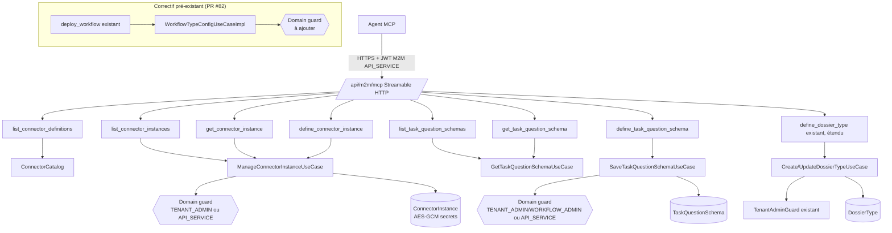

# System Design & Architecture — `extension-mcp-flux-metier`

> Brouillon Phase 1, à valider en Phase 3 (`dev-design`). S'appuie sur
> [docs/ai/requirements/2026-09-06-feature-extension-mcp-flux-metier.md](../requirements/2026-09-06-feature-extension-mcp-flux-metier.md)
> et sur le code réel exploré pendant la Phase 1 (pas seulement sur l'analyse initiale).

## Architecture Overview

Même pattern que `serveur-mcp` (PR #82) : adaptateurs entrants fins dans `infrastructure.mcp.tool`,
zéro logique métier propre, appel direct aux use cases/ports domaine existants.

**Composants clés**

- 7 nouveaux tools `infrastructure.mcp.tool.*`, même famille que les 9 existants
  (`DefineDossierTypeTool`, `DeployWorkflowTool`, etc.).
- Aucune nouvelle entité domaine : `ConnectorInstanceData`, `ConnectorDefinition`,
  `TaskQuestionSchema` existent déjà (livrés respectivement par `serveur-mcp`/connecteurs et TODO
  §55) — cette feature les expose au MCP, elle ne les invente pas.
- Un garde-fou domaine à généraliser (voir « Design Decisions ») — actuellement seul
  `domain.dossier.TenantAdminGuard` existe, réservé au bounded context `dossier`.

## Data Models

Aucun nouveau modèle domaine. Réutilisation stricte de l'existant :

| Type | Fichier | Champs pertinents pour le MCP |
|---|---|---|
| `ConnectorDefinition` | `domain.connector.model.ConnectorDefinition` | `getType()`, `getConfigSchema()`, `getCapability()` — catalogue statique, pas de persistance |
| `ConnectorInstanceData` | `domain.connector.model.ConnectorInstanceData` | `id`, `tenantId`, `name`, `connectorType`, `enabled`, `config` (secrets chiffrés au repos, déchiffrés en mémoire par l'adaptateur JPA) |
| `TaskQuestionSchema` | `domain.workflow.model.TaskQuestionSchema` | `schemaKey`, liste de `FieldDefinition` (réutilisé de `domain.dossier.model`) |
| `DossierType` | `domain.dossier.model.DossierType` | `documentTemplateKeys` (déjà existant, simplement rendu accessible en écriture MCP) |

## API Design

### Nouveaux tools MCP

| Tool | Use case / port réutilisé | Écriture ? | `dryRun` |
|---|---|---|---|
| `list_connector_definitions` | `ConnectorCatalog.listAll()` (port.out, pas de use case — même source que `ConnectorDefinitionController`) | non | — |
| `list_connector_instances` | `ManageConnectorInstanceUseCase.list` | non | — |
| `get_connector_instance` | `ManageConnectorInstanceUseCase.get` | non | — |
| `define_connector_instance` | `ManageConnectorInstanceUseCase.create`/`update` | oui | oui |
| `list_task_question_schemas` | `GetTaskQuestionSchemaUseCase` (lister — à vérifier si un `list` existe ou s'il faut l'ajouter, voir « Points ouverts ») | non | — |
| `get_task_question_schema` | `GetTaskQuestionSchemaUseCase.get` | non | — |
| `define_task_question_schema` | `SaveTaskQuestionSchemaUseCase.save` | oui | oui |

### `define_dossier_type` (étendu)

Ajout d'un paramètre optionnel `documentTemplateKeys: List<String>` — absent ou `null` = ne
touche pas la valeur existante en update, `[]` explicite en création (comportement actuel
inchangé pour tout appelant qui ne fournit pas ce champ).

### Authentification / autorisation

Inchangé au niveau transport : JWT M2M existant → `AccessContext.User` avec rôle `API_SERVICE`
(`McpAccessContextFactory`, inchangé). **Ce qui change : chaque use case domaine touché doit
désormais vérifier ce rôle lui-même**, voir « Design Decisions ».

## Component Breakdown

**Backend — nouveau**

- `infrastructure/mcp/tool/ListConnectorDefinitionsTool.java`
- `infrastructure/mcp/tool/ListConnectorInstancesTool.java`
- `infrastructure/mcp/tool/GetConnectorInstanceTool.java`
- `infrastructure/mcp/tool/DefineConnectorInstanceTool.java`
- `infrastructure/mcp/tool/ListTaskQuestionSchemasTool.java`
- `infrastructure/mcp/tool/GetTaskQuestionSchemaTool.java`
- `infrastructure/mcp/tool/DefineTaskQuestionSchemaTool.java`

**Backend — modifié**

- `infrastructure/mcp/tool/DefineDossierTypeTool.java` (+`documentTemplateKeys`)
- `domain/connector/port/in/ManageConnectorInstanceUseCase.java` (+ paramètre acteur sur
  `create`/`update`, potentiellement `get`/`list`/`softDelete` selon la décision de conception)
- `domain/connector/usecase/ManageConnectorInstanceUseCaseImpl.java` (+ garde-fou)
- `domain/workflow/port/in/SaveTaskQuestionSchemaUseCase.java` /
  `DeleteTaskQuestionSchemaUseCase.java` (+ paramètre acteur)
- `domain/workflow/usecase/TaskQuestionSchemaUseCaseImpl.java` (+ garde-fou)
- `domain/workflow/port/in/SaveWorkflowTypeConfigUseCase.java` (+ paramètre acteur — **correctif
  sur du code déjà livré en PR #82**)
- `domain/workflow/usecase/WorkflowTypeConfigUseCaseImpl.java` (+ garde-fou)
- Tous les appelants REST de ces use cases (`ConnectorAdminController`,
  `TaskQuestionSchemaController`, `WorkflowBpmnDeploymentController`/écran admin workflow-types) —
  doivent désormais passer l'acteur déjà disponible via `Authentication`, cohérent avec le
  pattern déjà utilisé par `DossierController`/`CreateDossierTypeUseCaseImpl`.

**Backend — inchangé, réutilisé tel quel**

- `ConnectorSecretCipher` (chiffrement AES-GCM) — pas de nouveau mécanisme de secret.
- `ManageConnectorInstanceUseCaseImpl.mergeConfig`/`isBlankOrMask` (préservation du secret sur
  update sans le repasser).

**Frontend**

- Aucun changement attendu (feature backend-only, comme `serveur-mcp`) — à reconfirmer en Phase 2
  (dev-requirements review) une fois le composant `list`/`get` de `TaskQuestionSchema` confirmé.

## Design Decisions

### D1 — Garde-fou domaine : nouvelle interface de paramètre acteur (breaking, assumé)

Constat vérifié dans le code (Phase 1) : ni `ManageConnectorInstanceUseCase`, ni
`SaveTaskQuestionSchemaUseCase`/`DeleteTaskQuestionSchemaUseCase`, ni `SaveWorkflowTypeConfigUseCase`
n'acceptent aujourd'hui un `AccessContext.User` en paramètre — contrairement à
`CreateDossierTypeUseCase`/`UpdateDossierTypeUseCase`, qui le font déjà et embarquent
`TenantAdminGuard`. Ajouter un garde-fou domaine (décision D-MCP-EXT-RBAC-GUARD, requirements)
implique donc de **changer la signature de ces 4 interfaces `port.in`** pour y ajouter l'acteur,
et de mettre à jour tous leurs appelants REST existants (qui ont déjà l'acteur via
`Authentication`, juste pas transmis aujourd'hui).

C'est un changement plus large que le périmètre visible depuis l'analyse initiale — assumé
explicitement par l'utilisateur (choix « Ajouter le garde-fou domaine partout », requirements),
documenté ici pour ne pas être découvert en Phase 5.

### D2 — Emplacement du garde-fou partagé (point ouvert)

`TenantAdminGuard` vit dans `domain.dossier` — recopier son usage tel quel pour
`ConnectorInstance` (bounded context `connector`) ou `TaskQuestionSchema` (bounded context
`workflow`) introduirait une dépendance `connector`/`workflow` → `dossier` uniquement pour un
garde-fou générique, sans lien métier réel. Options à trancher en Phase 3 :

- **(a)** Dupliquer un petit guard par bounded context (`ConnectorAdminGuard`,
  `WorkflowAdminGuard`) — cohérent avec la règle d'architecture hexagonale (pas de couplage entre
  bounded contexts), léger duplicat de 5 lignes.
- **(b)** Déplacer un guard générique dans un package neutre partagé (ex. `domain.shared` ou
  `domain.access`) réutilisable par tous les bounded contexts.
- **(c)** Étendre `TenantAdminGuard` avec une méthode `requireTenantOrWorkflowAdminOrApiService`
  et le laisser dans `domain.dossier`, accepté comme dépendance transverse pragmatique (le
  `AccessContext`/`AccessDeniedException` qu'il utilise sont déjà dans `domain.dossier.model`,
  partagés de fait par tout le domaine).

Recommandation à date (à confirmer Phase 3) : **(b)**, la classe ne contient aucune logique
spécifique aux dossiers — c'est un contrôle de rôle générique mal rangé.

### D3 — Secrets connecteurs sur le canal MCP

Décision actée (requirements, D-MCP-EXT-SECRET) : même flux que l'admin REST — secret en clair
dans l'appel `define_connector_instance`, chiffré à l'écriture (`ConnectorSecretCipher`,
inchangé), masqué (`SECRET_MASK = "********"`) sur toute lecture MCP
(`list_connector_instances`/`get_connector_instance`), miroir de
`ConnectorResponseSecretMaskingTest`.

### D4 — `list_task_question_schemas` : use case manquant ?

`GetTaskQuestionSchemaUseCase`/`SaveTaskQuestionSchemaUseCase`/`DeleteTaskQuestionSchemaUseCase`
sont les 3 ports `in` identifiés côté `TaskQuestionSchema` — aucun ne semble porter de `list`
paginé (à vérifier précisément en Phase 3 : `TaskQuestionSchemaController` expose bien un
`GET` collection, donc soit un port `list` existe déjà et n'a pas été vu en Phase 1, soit le
contrôleur REST liste directement via le repository). Si aucun port `list` réutilisable n'existe,
il faudra soit l'ajouter au use case existant, soit appeler le repository directement (à trancher
selon le pattern déjà utilisé par `list_dossier_types`/`list_workflow_types`, qui semblent appeler
le repository directement plutôt qu'un use case dédié).

## Non-Functional Requirements

- **Sécurité** : aucun secret en clair au repos ni dans les logs (`ConnectorSecretCipher`
  inchangé) ; garde-fou domaine testé par un cas où un acteur sans rôle admin/`API_SERVICE` est
  rejeté par le use case lui-même, pas seulement par un `@PreAuthorize` REST contournable par un
  appelant qui invoque le use case directement (c'est exactement le trou que cette feature comble).
- **Compatibilité** : les 9 tools existants et les endpoints REST déjà couverts
  (`ConnectorAdminController`, `TaskQuestionSchemaController`,
  `WorkflowBpmnDeploymentController`/écran admin) ne doivent subir aucune régression de
  comportement — seul le paramètre acteur est ajouté en interne, le comportement pour un acteur
  déjà autorisé (`TENANT_ADMIN` REST, `API_SERVICE` MCP) reste identique.
- **Performance** : aucune, ces tools sont des opérations CRUD ponctuelles sur des tables déjà
  indexées (pas de nouveau chemin chaud).
- **Couverture** : Jacoco LINE ≥ 85 % / BRANCH ≥ 75 % (seuils actuels du dépôt), zéro régression.
