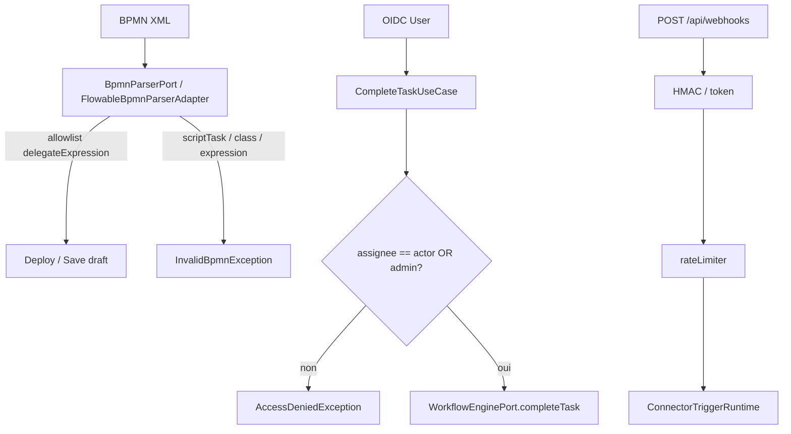

# System Design & Architecture — `revue-adversariale-securite`

Phase 3 revalidée après Q1–Q12 = A. Couverture requirements : chaque H/M a un
composant. Écart accepté (Q8) : M12 dans `DocumentGenerationController`, pas le
use case (préserve `documentGenerationTask` BPMN).

## Architecture Overview

Pas de nouveau bounded context. Gardes ajoutées **aux frontières déjà existantes**
(parser BPMN, use cases workflow, mapper OIDC, clients HTTP, validate connecteur,
webhooks, SMTP, templates).

## Data Models

- Aucune table nouvelle.
- HMAC wire : payload signé `timestamp + "." + idempotencyKey + "." + body`.
- Shared-secret replay : cache mémoire JVM `(instanceId, sha256(body))` TTL 5 min
  (même classe de limite que le rate-limiter V1, S-7).
- `ConnectorProperties.Http.maxResponseBytes` (défaut 5_242_880).

## API Design

- Contrats URL inchangés. **Rupture HMAC** : l'`Idempotency-Key` entre dans la signature
  (documentée, comme F6).
- `/api/documents/generate` : 403 si DM n'a pas VIEW sur un type qui liste le template.
- `/api/task-question-schemas/{key}/runtime` : 403 si non assignee / non admin.
- Preview HTML : header `Content-Security-Policy: default-src 'none'; sandbox`.
- Deploy/save BPMN : 400 `InvalidBpmnException` sur payload interdit.

## Component Breakdown

| Finding | Composant |
|---|---|
| H1 | `FlowableBpmnParserAdapter` + allowlist constante domaine `AllowedBpmnDelegates` (noms beans, pas d'import Spring) |
| H2 / M8 | `WorkflowEnginePort.findAssigneeByTaskId` ; `CompleteTaskUseCase` gagne `AccessContext.User` ; runtime schema idem |
| M1 | `RealmAccessAuthoritiesMapper` allowlist |
| M2 | `application.yml` `app.storage.s3` |
| M3 | `HttpRestConnector` Host + TLS hostname via `HttpURLConnection` (pas le JDK `HttpClient`) |
| M4 | `OutboundUrlGuard.isBlockedIpv4Literal` |
| M5 | `ManageConnectorInstanceUseCaseImpl.assertKnownConfigKeys` + `mapping` au schéma |
| M6 | ordre Webhook/Callback controllers |
| M7 | `HmacWebhookAuthenticator` + `SharedSecretReplayCache` |
| M9 | `CallbackConnectorRuntimeImpl` + `ConnectorServiceTask` |
| M10 | `SmtpConnector` |
| M11 | Http response limiter + document-storage |
| M12 | `DocumentGenerationController.assertCanGenerate` (pas le use case, Q8) |
| M13 | `ThymeleafTemplateSyntaxChecker` + header preview |

Allowlist H1 (noms `@Component`) :

`connectorServiceTask`, `documentGenerationTask`, `attachGeneratedDocumentTask`,
`notificationDispatchTask`, `createChildDossierTask`, `updateDossierStatusTask`,
`updateWorkflowLinkStatusTask`.

`flowable:delegateExpression` vide / absent sur un `serviceTask` : **rejet** (un
serviceTask sans delegate est inutile et `flowable:class` serait le repli Flowable).

`userTask` / `startEvent` / `exclusiveGateway` : pas de `flowable:expression` non plus
si présent (même API XML). Les expressions d'assignation `flowable:assignee` restent
autorisées (chaîne, pas EL moteur).

## Design Decisions

Actées stakeholder `OK tous` (Q1–Q12 = A).

| ID | Choix | Alternatives écartées |
|---|---|---|
| D-H1 / Q2 | Allowlist parse-time | Script engine seul ; WA ne déploie plus |
| D-H2 / Q3 | Assignee **ou** TA/WA ; unassigned → EDIT | Assignee only ; statu quo EDIT |
| D-M1 / Q4 | Filtre OIDC, policy MCP inchangée | Retirer API_SERVICE de la policy |
| D-M5 / Q7 | Reject unknown + déclarer `mapping` | Strip ; heuristique `*token` |
| D-M6 / Q10 | Auth puis rate-limit | Bucket anonyme séparé ; statu quo |
| D-M7 / Q5–Q6 | HMAC idempotency + cache body shared-secret | Dual-accept ; timestamp shared-secret |
| D-M12 / Q8 | DM si un type VIEW liste la clé ; garde contrôleur | Retirer DM de `@PreAuthorize` |
| D-M13 / Q11 | Interdire `utext` + CSP preview | CSP seul ; utext sans CSP |
| D-SPA / Q9 | Pas de chantier FE | Masquer le champ bpmn-js |
| D-LOW / Q12 | L1–L7 hors cycle | Scopes M2M ; fail-fast actuator |

## Non-Functional Requirements

- Pas de nouvelle I/O distante. Cache replay shared-secret : borné par rate-limit
  (120/min) × TTL 5 min, Map concurrente avec eviction.
- Tests d'exploit unitaires (payloads BPMN, HMAC, CGNAT) — pas de pentest dynamique.
