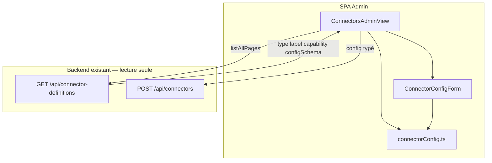

# System Design & Architecture

## Architecture Overview
**What is the high-level system structure?**

Feature 100 % frontend. Aucun nouveau port, use case, table, ni endpoint. Le SPA consomme
enfin `configSchema` déjà sérialisé par `ConnectorDefinitionResponse.from(definition)`.



```mermaid
sequenceDiagram
  participant Admin as TENANT_ADMIN
  participant View as ConnectorsAdminView
  participant Form as ConnectorConfigForm
  participant API as ConnectorDefinitionController
  participant Create as POST /api/connectors

  Admin->>View: ouvre /admin/connectors
  View->>API: GET /api/connector-definitions
  API-->>View: items + configSchema
  Admin->>View: choisit type http-rest
  View->>Form: schema du type + v-model values
  Form-->>Admin: SELECT / PASSWORD / STRING…
  Admin->>View: Créer
  View->>View: configFromFormValues(schema, values)
  View->>Create: {name, connectorType, enabled, config}
```

Vue = surface d’orchestration (liste, pager, create). Le rendu des champs et la coercition
sont extraits (vue-best-practices : view thin, feature folder).

## Data Models

Types frontend alignés sur OpenAPI `ConfigField` / `ConnectorDefinitionResponse` :

```ts
export type ConfigFieldType = 'STRING' | 'PASSWORD' | 'URL' | 'INTEGER' | 'BOOLEAN' | 'SELECT'

export interface ConfigField {
  name: string
  label: string
  type: ConfigFieldType
  required: boolean
  defaultValue?: string | null
  options?: string[]
  helpText?: string | null
}

export interface ConnectorDefinition {
  type: string
  label?: string
  capability?: string
  configSchema?: ConfigField[]
}
```

`listConnectorDefinitions()` retourne `ConnectorDefinition[]` (plus `{ type, label, [key: string]: unknown }`).

Valeurs de formulaire : `Record<string, string | number | boolean>`.
Payload `config` : mêmes clés, INTEGER number, BOOLEAN boolean, strings ; clés optionnelles
vides **absentes** (D-COERCE).

Defaults : `defaultValue` du schéma, sinon `false` pour BOOLEAN, première `options[0]` pour
SELECT requis, sinon `''`.

## API Design

Aucun changement de contrat HTTP.

- `GET /api/connector-definitions` — déjà `PageResponse<ConnectorDefinitionResponse>` avec
  `configSchema`. Le client paginait déjà via `listAllPages`.
- `POST /api/connectors` — body existant `{ name, connectorType, enabled?, config? }`.
  Le FE envoie `config` objet, plus une string JSON.

Authz inchangée (`TENANT_ADMIN`). Erreurs serveur (`ConnectorValidationException` → ProblemDetail)
affichées dans `error` existant.

## Component Breakdown

| Composant | Responsabilité | Props / emits |
|---|---|---|
| `ConnectorsAdminView.vue` | Liste, pager, create, toggle, delete | — |
| `ConnectorConfigForm.vue` | Rendu d’un schéma | `schema`, `v-model` values |
| `connectorConfig.ts` | Purs : `defaultsFromSchema`, `configFromFormValues`, `schemaOf` | — |

Layout :

```
frontend/src/components/connectors/
  ConnectorConfigForm.vue
  ConnectorConfigForm.spec.ts
  connectorConfig.ts
  connectorConfig.spec.ts
```

Mapping widgets :

| ConfigFieldType | Contrôle |
|---|---|
| STRING | `input type=text` |
| PASSWORD | `input type=password autocomplete=new-password` |
| URL | `input type=url` |
| INTEGER | `input type=number` |
| BOOLEAN | `input type=checkbox` |
| SELECT | `<select>` + `options` |

`required` HTML si `required === true` (pas sur BOOLEAN, toujours envoyé). `helpText` sous
le champ.

Intégration vue :

- `computed` `activeSchema` = `schemaOf(definitions, form.connectorType)`.
- `watch(connectorType)` → `configValues = defaultsFromSchema(activeSchema)` (D-SWITCH-TYPE).
- Submit : `configFromFormValues(activeSchema, configValues)` puis `createConnector`.
- Schéma vide : paragraphe « Aucune configuration d'instance pour ce type » ; pas de
  `ConnectorConfigForm` champs.
- `definitions.length === 0` : textarea JSON (D-FALLBACK-NO-DEFS).

**Ne pas** réutiliser `DynamicFields.vue` (D-NO-DYNAMICFIELDS).

## Design Decisions

| ID | Décision | Alternatives | Pourquoi |
|---|---|---|---|
| **D-DESIGN-SPLIT** | Feature folder `components/connectors/` + utils purs | Tout dans `ConnectorsAdminView.vue` | View actuelle mélange déjà liste + form ; vue-best-practices exige le split |
| **D-DESIGN-DEFINE-MODEL** | `defineModel` sur le form enfant | Props + emit manuel | Contrat v-model Vue 3.4+, déjà le style du dépôt (`FieldDefinitionDefsEditor`) |
| **D-DESIGN-INTEGER** | `Number(value)` ; `NaN` / vide sur requis → ne pas poster, laisser HTML `required` | String | `validate()` / JSON backend attendent un nombre |
| **D-DESIGN-OMIT-BLANK** | Optionnel `''` omis | Envoyer `""` | Secrets optionnels (`authHeaderValue`) : string vide peut échouer des gardes |
| **D-DESIGN-NO-JSON-EDITOR** | `mapping` = STRING | Textarea multiligne JSON | Hors brief ; une ligne + `helpText` suffit |
| **D-DESIGN-E2E-MOCK** | Mocks Playwright `connector-definitions` portent un `configSchema` réel (http-rest + smtp) | Mock `[]` inchangé | FILE-ATTENTE : e2e connecteurs ; le mock actuel `envelope([])` ne permet pas le chemin nominal |

## Non-Functional Requirements

- **Sécurité :** PASSWORD jamais en clair dans la liste (inchangé, `secretConfigured`). Pas de
  `v-html` sur `helpText` (texte). Pas de log des valeurs.
- **A11y :** `<label>` par champ (label schéma), `required` natif.
- **Perf :** catalogue petit (6 types), `listAllPages` déjà en place.
- **Parallélisme :** ne pas modifier `frontend/**` hors A2 ; ne pas toucher
  `SecurityConfig` / MCP / Compose (A1/A3/A4).
- **Rollback :** revert FE ; aucun Liquibase.

## Couverture requirements → design

| Requirement | Design |
|---|---|
| Remplacer textarea (D-REPLACE-TEXTAREA) | `ConnectorConfigForm` + submit typé |
| 6 ConfigFieldType | table widgets |
| Switch type (D-SWITCH-TYPE) | watch + `defaultsFromSchema` |
| Schéma vide (D-EMPTY-SCHEMA) | message + `{}` |
| Fallback catalogue vide | textarea existant |
| Create only (D-SCOPE-CREATE) | liste inchangée (toggle/delete) |
| GUIDE §4 | M7 planning |
| Pas de backend | ce document |
