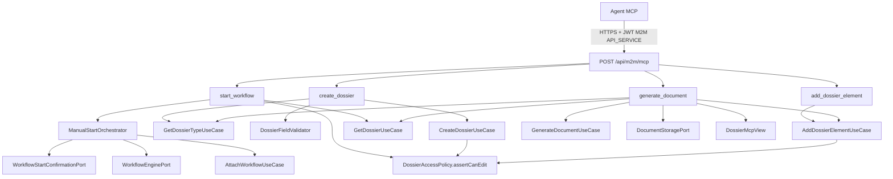

# System Design & Architecture — `mcp-ecritures-metier`

> Phase 3 (`dev-design`). S'appuie sur
> [docs/ai/requirements/2026-09-08-feature-mcp-ecritures-metier.md](../requirements/2026-09-08-feature-mcp-ecritures-metier.md)
> et le code réel (`DossierController`, `DossierWorkflowController`,
> `DocumentGenerationTask` / `AttachGeneratedDocumentTask`, tools MCP existants).

## Architecture Overview

Même pattern que `serveur-mcp` / `extension-mcp-flux-metier` : adaptateurs entrants
fins dans `infrastructure.mcp.tool`, zéro logique métier propre.

**Composants nouveaux (package `infrastructure.mcp.tool` uniquement) :**

| Classe | Tool | Délègue à |
|---|---|---|
| `CreateDossierTool` | `create_dossier` | `CreateDossierUseCase` ; dryRun = `GetDossierTypeUseCase` + `DossierFieldValidator` |
| `AddDossierElementTool` | `add_dossier_element` | `AddDossierElementUseCase` |
| `StartWorkflowTool` | `start_workflow` | `GetDossierUseCase` + `DossierAccessPolicy` + `ManualStartOrchestrator` |
| `GenerateDocumentTool` | `generate_document` | `GetDossierUseCase` + `GetDossierTypeUseCase` + `GenerateDocumentUseCase` + `DocumentStoragePort` + `AddDossierElementUseCase` |

Aucune nouvelle table, migration, bean Security, ni modification de
`CreateDossierUseCaseImpl`.

## Data Models

Aucun nouveau modèle domaine. Vues de sortie réutilisées :

- `DossierMcpView.from(dossier)` — create (et variables template via `.fields()`,
  seule classe allowlistée à lire `Dossier.fields()` dans ce package).
- `DossierElementView.from(element)` — add + generate (jamais `storageRef`).
- Record local `StartWorkflowTool.Result` : `linkId`, `dossierId`,
  `processInstanceId`, `processDefinitionKey`, `sequence`, `status`, `replay`
  (pas le DTO package-private `WorkflowLinkResponse` du web).

## API Design (tools)

Auth inchangée : chaîne M2M `/api/m2m/**`, JWT `API_SERVICE` + `tenant_id`.
Les `@McpToolParam` existent pour le JSON Schema généré ; les valeurs métier
sont lues depuis ces paramètres typés (pas besoin du raw `CallToolRequest`
sauf s'il faut rejeter des clés extra — aucun champ interdit ici).

### `create_dossier`

| Param | Requis | Notes |
|---|---|---|
| `dossierTypeCode` | oui | Type du tenant courant |
| `label` | oui | |
| `fields` | non | Map ; défaut `{}` ; validation `DossierFieldValidator` |
| `dryRun` | non | Défaut false |

Sortie succès : `DossierMcpView` (ou `{dryRun:true, valid:true, dossierTypeCode, label}`).
Type inactif / champs invalides / ACL : exceptions domaine existantes.

`createdBy` = `actor.userId()` (sujet JWT). `tenantId` = `TenantProperties.id`.
Statut créé = `DRAFT` (comportement `CreateDossierUseCaseImpl` inchangé).

### `add_dossier_element`

| Param | Requis | Notes |
|---|---|---|
| `dossierId` | oui | UUID |
| `type` | oui | `NOTE` \| `LINK` \| `INFORMATION` — autres → `IllegalArgumentException` (parité REST) |
| `label` | oui | |
| `metadata` | selon type | `NOTE` → `text` ; `LINK` → `url` absente ; `INFORMATION` → map non vide |
| `dryRun` | non | Charge le dossier (VIEW) puis `assertCanEdit` ; n'appelle pas `add` |

Sortie : `DossierElementView`. `addedBy` = acteur JWT. `storageRef` toujours `null`.
`workflowStepId` toujours `null` (pas un delegate Flowable).

### `start_workflow`

| Param | Requis | Notes |
|---|---|---|
| `dossierId` | oui | UUID |
| `processDefinitionKey` | oui | Même champ que REST (pas d'inférence silencieuse depuis le type) |
| `idempotencyKey` | oui | Équivalent header `Idempotency-Key` |
| `variables` | non | Défaut `{}` ; `WorkflowVariables.assertNoReservedKeys` |
| `dryRun` | non | VIEW + EDIT + clés réservées ; **n'appelle pas** l'orchestrateur |

Sortie : `StartWorkflowTool.Result` (`replay=true` si idempotence hit).
ACL : `GetDossierUseCase.get` (VIEW) puis `DossierAccessPolicy.assertCanEdit`
— `ManualStartOrchestrator` n'a pas de garde ACL (c'est le contrôleur REST qui
l'applique aujourd'hui).

### `generate_document`

| Param | Requis | Notes |
|---|---|---|
| `dossierId` | oui | UUID |
| `templateKey` | oui | Doit figurer dans `DossierType.documentTemplateKeys` du dossier |
| `variantKey` | non | |
| `locale` | non | |
| `variables` | non | Overlay par-dessus `DossierMcpView.from(dossier).fields()` ; clés réservées rejetées |
| `dryRun` | non | VIEW + type liste le template ; pas de generate/store/add |

Flux réel :

1. `GetDossierUseCase.get` + `assertCanEdit` (attache = mutation d'éléments).
2. `GetDossierTypeUseCase.getByCode` ; si `templateKey` absent de
   `documentTemplateKeys` → `AccessDeniedException` (« Dossier type does not list this document template »).
3. Variables = champs dossier (via `DossierMcpView`) puis overlay.
4. `GenerateDocumentUseCase.generate`.
5. `DocumentStoragePort.store(tenantId, "application/pdf", pdf)`.
6. `AddDossierElementUseCase.add` type `PRODUCED_DOC`, label
   `Document généré — {templateKey}`, metadata `{templateKey, contentType, variantKey?, locale?}`,
   `addedBy` = acteur (pas `"system"` — l'appel MCP est attribuable).

Sortie : `DossierElementView` (`downloadable=true`, pas de `storageRef`).

## Component Breakdown

- Backend only. Spring AI `@McpTool` auto-scan : aucun registre manuel à toucher
  (les beans `@Component` du package sont déjà découverts).
- `McpArgs` gagne `requireUuid` / `optionalMap` (helpers partagés, tests unitaires).
- `McpEndpointApiTest.EXPECTED_TOOLS` : +4 noms.
- IT `McpToolCallIntegrationTest` : create + add NOTE au minimum (persistance réelle).

## Design Decisions

| ID | Alternatives | Retenu |
|---|---|---|
| D-START-ORCH | (a) `AttachWorkflowUseCase.reserve` seul — incomplet vs REST ; (b) dupliquer l'orchestrateur dans le tool ; (c) injecter `ManualStartOrchestrator` | **(c)** — infrastructure → application déjà autorisé ArchUnit |
| D-GENERATE-ATTACH | (a) Base64 PDF ; (b) store sans attache ; (c) store + `PRODUCED_DOC` | **(c)** — écriture métier durable, parité BPMN, pas de binaire MCP |
| D-GENERATE-TEMPLATE | (a) n'importe quel template (bypass TA/WA) ; (b) n'importe quel type VIEW du tenant (D-M12 REST) ; (c) type **du dossier** | **(c)** — l'outil est dossier-centré |
| D-DRY-RUN-START | (a) dryRun appelle `reserve` puis abort ; (b) gardes seulement | **(b)** — pas d'effet de bord Flowable / lien RESERVED |
| D-FIELDS-READ | (a) `dossier.fields()` dans `GenerateDocumentTool` + étendre l'allowlist ArchUnit ; (b) `DossierMcpView` | **(b)** — pas d'écriture hors `mcp/**` |

## Non-Functional Requirements

- Sécurité : mêmes gardes domaine que REST ; pas de `AccessContext.system` ; pas
  de `storageRef` dans les réponses MCP.
- Perf : génération PDF synchrone comme REST ; pas de nouveau job.
- Fiabilité : idempotence start = store existant ; generate n'est **pas**
  idempotent (chaque appel crée un élément) — documenté, aligné sur REST
  `/generate` (chaque POST produit un PDF).
- Rollback : aucune migration. Revert = retirer les 4 `@Component`.

## Coverage requirements → design

| Requirement | Design |
|---|---|
| 4 tools un cycle | 4 classes `@McpTool` |
| Réutiliser REST | ports + `ManualStartOrchestrator` |
| Pas d'upload | D-ELEMENT-TYPES |
| dryRun | D-DRY-RUN / D-DRY-RUN-START |
| generate pour un dossier | D-GENERATE-ATTACH + D-GENERATE-TEMPLATE |
| Surface exclusive | aucun fichier hors `mcp` + docs + GETTING-STARTED compteur |
| ArchUnit fields() | D-FIELDS-READ |

Aucun goal requirements sans couverture. Prochain : Phase 4 planning.
