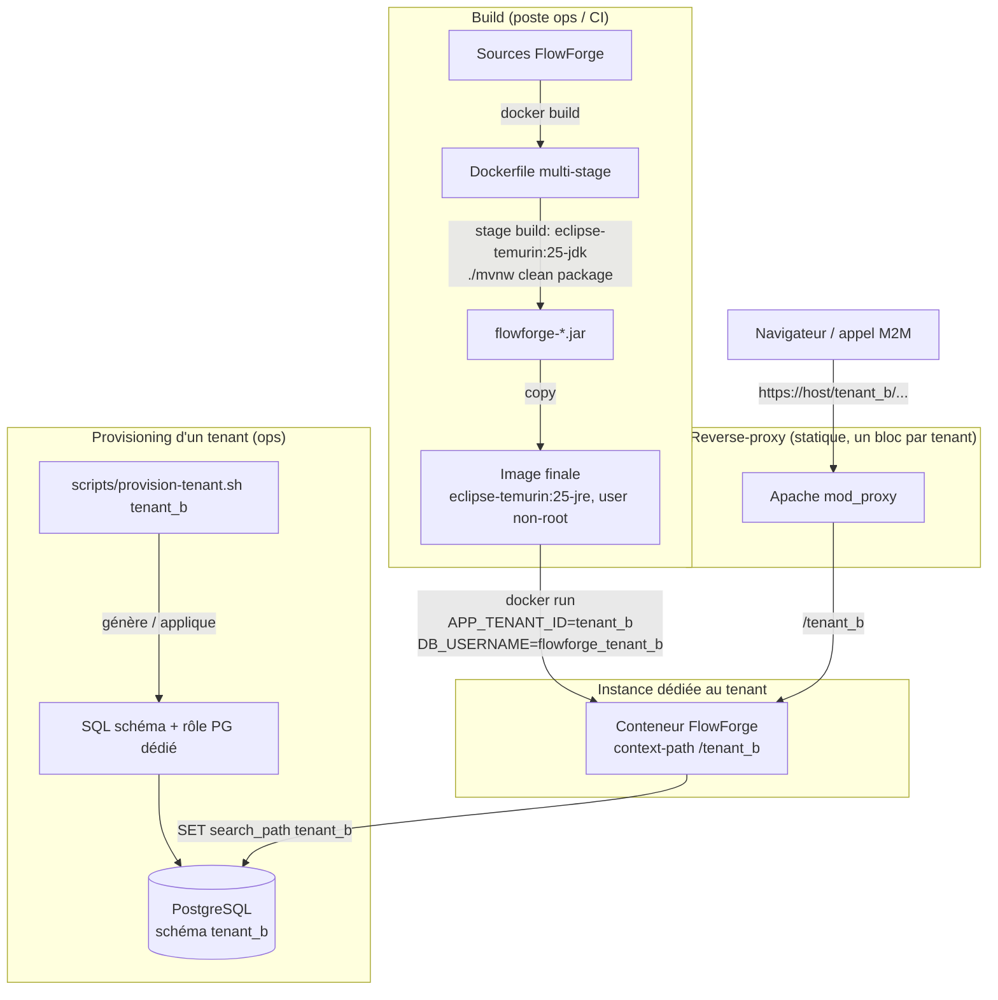

# System Design & Architecture — `provisioning-tenant` (lot A1)

## Architecture Overview
**What is the high-level system structure?**



- **`Dockerfile`** (nouveau) : construit l'image exécutable du jar Spring Boot, en 2 stages
  (build → runtime), avec les 3 décisions actées en requirements (image `eclipse-temurin:25-jre`,
  utilisateur non-root, heap `-XX:MaxRAMPercentage`).
- **`scripts/provision-tenant.sh`** (nouveau) : génère (et applique en option) le SQL de création
  du schéma + rôle PostgreSQL dédié pour un nouveau tenant, à partir du gabarit existant
  `docker/postgres/init/01-init-tenant-schema.sql`.
- **`application.yml` / `application-local.yml`** : active réellement `server.servlet.context-path`
  pour toute instance déployée, tout en préservant le comportement actuel (racine `/`) en profil
  `local`.
- Aucun nouveau composant applicatif Java : ce lot est un lot **ops/outillage**, pas une feature
  métier — pas de nouveau port/use case/entité.

## Data Models
**What data do we need to manage?**

Pas de nouveau modèle de données applicatif. Le seul « modèle » concerné est déjà décrit par
`docker/postgres/init/01-init-tenant-schema.sql` (un schéma PostgreSQL + un rôle `LOGIN` par
tenant, gabarit repris et paramétré par `scripts/provision-tenant.sh`) :

| Objet PG | Nommage | Généré par |
|---|---|---|
| Schéma | `<tenant_id>` | script (paramètre positionnel) |
| Rôle LOGIN | `flowforge_<tenant_id>` | script (mot de passe fourni par l'opérateur via variable d'environnement, jamais en argument shell ni codé en dur) |

## API Design
**How do components communicate?**

Pas d'API HTTP nouvelle (hors scope — pas de use case/endpoint applicatif). Deux « interfaces »
opérateur :

- **CLI shell** : `scripts/provision-tenant.sh <tenant_id> [--apply]`
  - Sans `--apply` : imprime le SQL généré sur stdout (ou `-o <fichier>` pour l'écrire) — permet une
    revue avant exécution, cohérent avec la prudence attendue pour un script qui touche à la
    sécurité (rôles/permissions PG).
  - Avec `--apply` : se connecte à PostgreSQL avec les variables d'environnement standard `psql`
    (`PGHOST`, `PGPORT`, `PGDATABASE`, `PGUSER`, `PGPASSWORD` — le superuser du provisioning, cf.
    DEPLOIEMENT.md §4), vérifie que le schéma n'existe **pas déjà** (`information_schema.schemata`),
    puis applique le SQL. Échec explicite (exit ≠ 0, message clair) si le schéma existe déjà — pas
    d'écrasement silencieux (Success Criteria requirements).
  - Le mot de passe du rôle applicatif est lu depuis la variable d'environnement
    `TENANT_DB_PASSWORD` (jamais un argument positionnel visible dans `ps`/l'historique shell) ;
    le script échoue explicitement si elle est absente.
  - Validation de `<tenant_id>` **avant toute génération SQL** : doit matcher
    `^[a-z][a-z0-9_]{2,52}$` (3 à 53 caractères — le rôle généré préfixe `flowforge_`, 10
    caractères, et doit lui aussi rester ≤ 63 octets, la limite NAMEDATALEN PostgreSQL pour un
    identifiant non cité) — rejet immédiat sinon,
    pour ne jamais interpoler une entrée non maîtrisée dans du SQL généré par concaténation de
    chaîne (le script ne prend aucune entrée libre dans le corps SQL, seul l'identifiant validé y
    est interpolé).
- **`docker run` / `docker-compose`** : `APP_TENANT_ID` (env, relaxed-binding Spring Boot standard
  vers `app.tenant.id`), `DB_USERNAME`/`DB_PASSWORD` (déjà existants), pas de nouvelle variable pour
  le tenant lui-même — uniquement documentation de l'existant.

## Component Breakdown
**What are the major building blocks?**

- **`Dockerfile`** (racine du dépôt, nouveau) + **`.dockerignore`** (nouveau, exclut `target/`,
  `frontend/node_modules`, `frontend/dist`, `.git`, `.worktrees`, artefacts locaux) :
  - Stage `build` : `FROM eclipse-temurin:25-jdk AS build`, copie `pom.xml`, `mvnw`, `.mvn/` puis
    `src/`, `frontend/` (le plugin `frontend-maven-plugin` build le SPA pendant
    `generate-resources`, comme en local — DEPLOIEMENT.md §1), exécute
    `./mvnw -B clean package -DskipTests` (les tests tournent en CI, pas dans le build d'image).
  - Stage `runtime` : `FROM eclipse-temurin:25-jre`, crée un groupe/utilisateur applicatif dédié
    (UID/GID fixes, ex. 10001), copie uniquement le jar exécutable depuis le stage `build`, `USER`
    non-root avant `ENTRYPOINT`. `ENTRYPOINT` en forme shell pour permettre un override
    `JAVA_OPTS` sans reconstruire l'image : `java -XX:MaxRAMPercentage=75.0 $JAVA_OPTS -jar app.jar`.
  - `EXPOSE 8080` (port applicatif par défaut, `server.port`), pas le port management (bind
    `127.0.0.1` uniquement par design D-42, ne doit pas être exposé hors du conteneur/hôte).
- **`scripts/provision-tenant.sh`** (nouveau, `bash`, cohérent avec les scripts existants
  `scripts/setup-mcp.sh`/`scripts/vendor-ai-devkit-skills.sh`) : génère/applique le SQL de
  provisioning d'un tenant, décrit ci-dessus.
- **`application.yml`** : décommente
  ```yaml
  server:
    servlet:
      context-path: /${app.tenant.id}
  ```
  activé par défaut pour **toute** instance déployée (aucun profil actif, ou tout profil autre que
  `local`) — c'est le comportement cible du modèle multi-tenant (décision n°14).
- **`application-local.yml`** : ajoute
  ```yaml
  server:
    servlet:
      context-path: ""
  ```
  pour que le profil `local` (dev sur poste, activé par défaut via `.env.example`
  `SPRING_PROFILES_ACTIVE=local`) continue de servir l'application à la racine `/`, **sans
  régression** du parcours `GETTING-STARTED.md` actuel (frontend dev proxy, Playwright preview
  server, habitudes `curl http://localhost:8080/...`).
  Le profil `test` (`src/test/resources/application.properties`,
  `spring.profiles.active=test`) n'a **pas** cette surcharge : le context-path reste actif pendant
  `./mvnw verify`, ce qui exerce réellement le mécanisme plutôt que de le laisser non testé — voir
  « Design Decisions » pour l'analyse de non-régression associée.
- **`DEPLOIEMENT.md`** : remplace le runbook manuel §4 par les commandes du nouvel outillage
  (`docker build`, `scripts/provision-tenant.sh`, `docker run -e APP_TENANT_ID=...`), documente les
  3 décisions Dockerfile actées, retire les mentions « aucun Dockerfile / aucune CLI n'existe ».
- **`GETTING-STARTED.md`** : mention factuelle que `context-path` est actif par défaut en dehors du
  profil `local` (contexte, pas un changement du parcours dev local documenté).
- **`.env.example`** : ajoute `APP_TENANT_ID` (optionnel, documente le défaut `tenant_dev` hérité de
  `application.yml`, et son rôle pour un déploiement réel).
- **`docker-compose.yml`** : pas de service applicatif FlowForge ajouté (ce fichier reste dédié à
  l'infra jetable de dev local — Postgres/Keycloak/stockage objet, cf. commentaire en tête de
  fichier) ; seul un commentaire renvoyant vers `Dockerfile`/`scripts/provision-tenant.sh` est ajouté
  si pertinent pour l'orientation, sans changer son comportement de dev local.

## Design Decisions
**Why did we choose this approach?**

- **Activer `context-path` sans casser le profil `local`.** La demande initiale (Phase 1) était de
  « décommenter dans `application.yml` ». Une décomamentation brute et inconditionnelle aurait
  changé le comportement par défaut de **tous** les profils, y compris `local` — ce qui contredit la
  contrainte « parcours dev local inchangé par défaut » déjà actée dans les requirements. Solution
  retenue : activer dans `application.yml` (comportement par défaut, celui des instances déployées
  réelles) et neutraliser explicitement dans `application-local.yml` (pattern déjà utilisé dans ce
  fichier pour `app.security.cookie.secure`) — le mécanisme est réellement actif et testable
  (profil `test`), sans régression du poste de dev.
  Alternative écartée : introduire une nouvelle variable d'environnement dédiée
  (`SERVER_CONTEXT_PATH`) découplée de `app.tenant.id`. Écartée pour rester fidèle à la convention
  déjà documentée par décision n°14 et `DEPLOIEMENT.md` §3 (`/${app.tenant.id}`, contexte = tenant,
  pas une valeur libre) — introduire un second axe de configuration aurait ajouté une complexité non
  demandée.
- **Script shell plutôt qu'un outil packagé.** Cohérent avec `scripts/` existant du dépôt (aucune
  CLI Java/Node compilée dans ce projet à ce jour) et avec le principe « pas de dépendance
  d'infrastructure hors stack figée ».
- **`--apply` optionnel, dry-run par défaut.** Le script touche des permissions PostgreSQL — la
  valeur par défaut la plus sûre est d'imprimer le SQL pour revue plutôt que de l'appliquer
  aveuglément ; cohérent avec la posture sécurité déjà stricte du projet (revues adversariales
  répétées, TODO §57/§58).
- **Pas d'automatisation du démarrage d'instance ni du bloc reverse-proxy.** Resterait un script
  fragile (dépend fortement de l'environnement cible — systemd/Docker/bare metal, Apache/nginx) pour
  un bénéfice marginal par rapport à une commande documentée copiable ; le lot A1 privilégie
  l'outillage du point le plus mécanique et le plus répétitif (SQL) plutôt qu'une fausse
  automatisation de bout en bout non demandée explicitement par FILE-ATTENTE.md.
- **Tests skippés sans Docker restent skippés.** `TenantRoleIsolationIT` (TODO §41) est déjà
  `SKIPPED` sans Docker — ce lot ne change pas ce comportement, il ajoute un script qui **produit**
  le même SQL que ce que l'IT vérifie manuellement, sans dépendre de Testcontainers.

## Non-Functional Requirements
**How should the system perform?**

- **Sécurité** : aucun secret en dur dans `Dockerfile`/script (mot de passe rôle PG lu depuis
  l'environnement, jamais un argument positionnel) ; utilisateur non-root dans l'image ; validation
  stricte de l'identifiant de tenant avant toute interpolation SQL (pas d'injection possible via un
  identifiant de tenant malformé) ; le script `--apply` échoue explicitement plutôt que d'écraser un
  tenant existant.
- **Portabilité** : Dockerfile et script doivent fonctionner avec `docker` et `podman` (déjà une
  contrainte du projet pour `docker-compose.yml`, cf. son en-tête).
- **Non-régression** : `./mvnw verify` (profil `test`, context-path actif) doit rester vert ; le
  profil `local` (dev poste) ne doit constater aucun changement de comportement observable.
- **Reproductibilité** : le build d'image doit être déterministe pour un même commit (pas de
  `latest` non pinné pour l'image de base — tag de version explicite `eclipse-temurin:25-jdk` /
  `eclipse-temurin:25-jre`).
- **Performance** : pas d'exigence chiffrée nouvelle : `-XX:MaxRAMPercentage=75.0` est un défaut
  raisonnable et documenté, ajustable sans rebuild via `JAVA_OPTS`.
