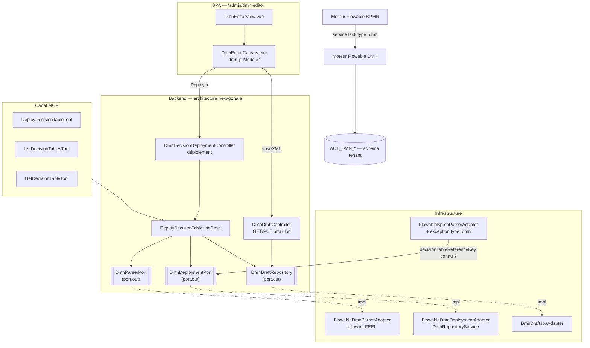

# System Design & Architecture — `introduction-dmn`

> Rejoue les 4 points techniques laissés ouverts par
> [requirements](../requirements/2026-09-11-feature-introduction-dmn.md) « Questions & Open
> Items ». Un 5ᵉ point, non anticipé en Phase 1, a été trouvé en investiguant Flowable 8 : le
> **mécanisme d'invocation DMN réel** n'est pas celui supposé dans l'analyse initiale — voir
> « Design Decisions » D1, tranché avec l'utilisateur via `AskUserQuestion`.

## Architecture Overview

### Mécanisme d'invocation DMN (D1 — correction majeure)

Investigation du code source Flowable 8 (`flowable/flowable-engine`) et de sa documentation
officielle, faite ici plutôt que supposée : **`<businessRuleTask>` est câblé sur Drools**
(`BusinessRuleTaskActivityBehavior`), un moteur de règles indépendant absent du classpath
FlowForge (`pom.xml` ne déclare que `flowable-spring-boot-starter`). Son rejet actuel
(`FlowableBpmnParserAdapter`, TODO §58 H1-bis) reste donc justifié **tel quel** — Drools n'a jamais
eu de garde-fou FlowForge et n'a aucun rapport avec DMN.

Le vrai mécanisme est un **`<serviceTask flowable:type="dmn">`** :

```xml
<serviceTask id="checkEligibility" flowable:type="dmn">
    <extensionElements>
        <flowable:field name="decisionTableReferenceKey">
            <flowable:string><![CDATA[eligibilite-grille]]></flowable:string>
        </flowable:field>
    </extensionElements>
</serviceTask>
```

Cette forme est **déjà bloquée aujourd'hui**, mais par `assertSafeServiceTask` (L91-109) — une
règle plus large que H1-bis qui rejette **tout** `serviceTask` à type intégré Flowable (`mail`,
`camel`, `http`, `shell`, `mule`, `dmn`...), pour ne garder que `delegateExpression` vers
l'allowlist `AllowedBpmnDelegates`. C'est le gate réel à ouvrir.

### Vue d'ensemble



### Composants et responsabilités

- **`FlowableBpmnParserAdapter`** (modifié, pas remplacé) : ajoute une branche dans
  `assertSafeServiceTask` — un `serviceTask` avec `type="dmn"` est accepté **seulement** si (a)
  aucun autre attribut d'implémentation n'est posé, (b) `extensionElements` contient exactement un
  `flowable:field name="decisionTableReferenceKey"` en `flowable:string` (jamais
  `flowable:expression` — même principe que `assertLiteralAssigneeValue`), (c) tout autre `type`
  intégré reste rejeté comme aujourd'hui. La vérification que la clé référence une table
  **déployée** se fait à l'usage (`DeployBpmnProcessUseCaseImpl`, miroir
  `UnknownWorkflowKeyException`), pas au parsing (le parsing seul ne connaît pas encore les tables
  disponibles).
- **`DmnParserPort` / `FlowableDmnParserAdapter`** (nouveau, miroir `BpmnParserPort`) : parse et
  valide un document DMN 1.3, extrait la clé de la décision (`id` de l'élément `decision`), et
  **porte l'allowlist FEEL** (voir « Non-Functional Requirements » § Sécurité — grammaire non
  finalisée dans ce document, investigation dédiée nécessaire avant implémentation).
- **`DmnDeploymentPort` / `FlowableDmnDeploymentAdapter`** (nouveau, miroir `WorkflowDeploymentPort`)
  : déploie via `DmnRepositoryService` (`org.flowable.dmn.api`), lit le XML déployé, résout une clé
  de décision vers ses métadonnées de déploiement.
- **`DeployDecisionTableUseCase` / `Impl`** (nouveau domaine, miroir `DeployBpmnProcessUseCase`) :
  parse → déploie → supprime le brouillon associé (même cycle de vie que `D-DESIGN-DRAFT-LIFECYCLE`
  côté BPMN).
- **`DmnDraftRepository` / `DmnDraftJpaEntity`** (nouveau, miroir `BpmnDraftRepository`/
  `BpmnDraftJpaEntity`) : brouillon persisté, clé composite `(tenant_id, decision_key)`.
- **`DmnEditorCanvas.vue`** (nouveau, miroir `BpmnEditorCanvas.vue`) : `dmn-js` Modeler — voir D2.
- **Tools MCP** (`DeployDecisionTableTool`, `ListDecisionTablesTool`, `GetDecisionTableTool`,
  miroir `DeployWorkflowTool`/`ListWorkflowTypesTool`) — voir D3.

## Data Models

### Domaine (records, `com.flowforge.domain.workflow.model`)

```java
// Miroir BpmnDeploymentResult
public record DecisionTableDeploymentResult(String decisionKey, int deployedVersion, String deploymentId) {}

// Miroir ProcessDeploymentInfo (forme exacte à confirmer en planning selon ce que
// DmnRepositoryService expose réellement — non garanti symétrique à RepositoryService BPMN)
public record DecisionTableDeploymentInfo(String decisionKey, String name, int version, Instant deployedAt) {}

// Miroir BpmnDraft
public record DmnDraft(String tenantId, String decisionKey, String xml, Instant updatedAt, String updatedBy) {}
```

### Persistance — brouillon (miroir `bpmn_draft`)

Nouvelle table `dmn_draft`, migration Liquibase (contexte tenant, comme `013-bpmn-draft-tables.yaml`) :

| Colonne | Type | Notes |
|---|---|---|
| `tenant_id` | varchar(64) | PK composite |
| `decision_key` | varchar(255) | PK composite |
| `xml` | text | contenu `.dmn` |
| `updated_at` | timestamp | |
| `updated_by` | varchar(128) | |

Pas de nouvelle table pour les déploiements eux-mêmes — comme pour BPMN, Flowable gère ses propres
tables (`ACT_DMN_DECISION`, `ACT_DMN_DEPLOYMENT`, ...) dans le schéma du tenant courant
(`search_path`, décision n° 13 inchangée).

### Résultat de décision → variable(s) de process

Le résultat d'une évaluation `serviceTask type="dmn"` s'écrit en variable(s) de process (mapping
géré nativement par le moteur DMN de Flowable, pas de code FlowForge à écrire pour ça). Contrainte
héritée des requirements : toute valeur potentiellement sensible produite doit transiter par
`SendNotificationUseCaseImpl` (masquage) avant toute écriture outbox — à vérifier en planning que le
mécanisme actuel de masquage s'applique bien aux variables issues d'un `serviceTask`, pas seulement
de `dossierFields`/`user-question` (points d'origine actuels).

## API Design

### REST (admin, `TENANT_ADMIN`/`WORKFLOW_ADMIN`, miroir `WorkflowBpmnDeploymentController`)

| Méthode | Chemin | Rôle |
|---|---|---|
| `GET` | `/api/dmn-decision-deployments/info?decisionKey=` | métadonnées du dernier déploiement |
| `GET` | `/api/dmn-decision-deployments/{decisionKey}/xml` | XML déployé (édition d'une table existante) |
| `POST` | `/api/dmn-decision-deployments` (multipart, miroir upload BPMN — même si D-DMN-DEPLOY retient l'éditeur intégré dès ce cycle, l'endpoint de déploiement reste le même que celui appelé par le bouton « Déployer » de l'éditeur, pas un chemin séparé) | déploie |
| `GET`/`PUT` | `/api/dmn-decision-drafts/{decisionKey}` | brouillon (miroir `/api/workflow-bpmn-drafts/{key}`) |

### MCP (voir D3)

| Tool | Use case | Portée |
|---|---|---|
| `deploy_decision_table` | `DeployDecisionTableUseCase` | écriture, `dryRun` supporté (cohérence `deploy_workflow`) |
| `list_decision_tables` | `DmnDeploymentPort` (lecture) | lecture |
| `get_decision_table` | idem, par clé | lecture |

RBAC : même garde domaine que `deploy_workflow` (`TenantAdminGuard`), pas de raccourci
`API_SERVICE` = admin de facto sans le durcissement déjà acté (TODO §56/§60).

## Component Breakdown

- **Frontend** : `DmnEditorView.vue` (route `/admin/dmn-editor`, `decisionKey` en query param
  optionnel, miroir `BpmnEditorView.vue`) ; `DmnEditorCanvas.vue` (`dmn-js` Modeler) ;
  `useDmnDraft.ts`/`useDmnDeployment.ts` (composables, miroir `useBpmnDraft`/`useBpmnDeployment`).
  Extension de l'éditeur BPMN existant : `flowablePropertiesProvider.ts` (`D-EDIT-SCOPE`) gagne un
  nouveau champ pour poser `flowable:type="dmn"` + `decisionTableReferenceKey` (en lecture d'une
  liste des tables déployées, pas en saisie libre) sur un `serviceTask` — sans ce complément, un
  concepteur BPMN ne peut pas référencer une table DMN depuis l'éditeur déjà en production.
- **Backend domaine** : `com.flowforge.domain.workflow.{model,port.in,port.out,usecase}` — mêmes
  packages que BPMN, pas de nouveau bounded context (une table de décision est un artefact du même
  domaine `workflow`, pas un concept séparé).
- **Backend infrastructure** : `com.flowforge.infrastructure.{flowable,web.workflow,persistence.workflow,mcp.tool}`.
- **Storage** : PostgreSQL, schéma tenant (inchangé) ; nouvelle table `dmn_draft` uniquement.
- **Intégrations tierces** : `dmn-js` (nouvelle dépendance frontend, licence vérifiée en Phase 1 —
  MIT + clause filigrane, identique à `bpmn-js` déjà en prod) ; moteur DMN Flowable (déjà sur le
  classpath, seulement désactivé par auto-config).

## Design Decisions

### D1 — Mécanisme d'invocation : exception native `type="dmn"` (tranché avec l'utilisateur)

Deux options présentées : (a) exception native `serviceTask type="dmn"` explicitement validée dans
`assertSafeServiceTask`, réutilisant le comportement natif du moteur (hit policy, mapping variables
gérés par Flowable) ; (b) un delegate custom (`decisionTableServiceTask`, ajouté à
`AllowedBpmnDelegates`) qui réimplémente la sémantique DMN à la main. **Retenu : (a).** Réutilise
l'invariant de sécurité existant (« un seul type de `serviceTask` intégré autorisé, celui-là
explicitement ») plutôt que d'ajouter une exception à la règle "`delegateExpression` uniquement" —
et évite de dupliquer une logique (hit policy, résolution de variables) que le moteur DMN gère déjà
correctement.

### D2 — Éditeur `dmn-js` : périmètre du provider custom (technique, résolu par investigation)

Question laissée ouverte en Phase 1 (D-DMN-EDITOR-SCOPE) : le DMN de Flowable a-t-il des attributs
`flowable:*` propres nécessitant un provider custom (miroir `flowablePropertiesProvider.ts`) ?
**Réponse, à confirmer en planning par lecture du schéma DMN réellement produit par Flowable** :
le fichier `.dmn` lui-même (la table de décision — inputs, outputs, règles, hit policy) est du DMN
1.3 **standard**, sans extension Flowable — c'est l'élément **BPMN** qui référence la table
(`serviceTask type="dmn"` + `decisionTableReferenceKey`, voir D1) qui porte l'extension `flowable:*`
concernée, **côté éditeur BPMN existant**, pas côté éditeur DMN. Donc : `dmn-js` Modeler **seul**,
sans provider custom, pour l'édition de la table elle-même ; le complément nécessaire est sur
`flowablePropertiesProvider.ts` (voir « Component Breakdown »), pas sur `dmn-js`.

### D3 — Noms des tools MCP (technique, alignement convention)

`deploy_decision_table`/`list_decision_tables`/`get_decision_table` — alignés sur le pattern
`deploy_workflow`/`list_workflow_types`/`get_dossier_type` déjà en place (verbe + nom métier au
singulier pour get/deploy, pluriel pour list).

### D4 — Clé de brouillon éditeur (technique, résolu par analogie)

Composite `(tenant_id, decision_key)` via `@IdClass`, identique au pattern déjà utilisé deux fois
(`BpmnDraftJpaEntity`, `WorkflowIdempotencyJpaEntity`) — pas d'UUID généré + contrainte unique.

### D5 — Non-goals reconduits de `edition-bpmn` (assumption confirmée)

Pas de simulation depuis l'éditeur, pas de collaboration temps réel, un seul slot de brouillon par
clé (écrasé à chaque sauvegarde), pas d'autosave — aucune raison technique de diverger trouvée en
design pour justifier un comportement différent de BPMN sur ces points.

## Non-Functional Requirements

### Sécurité — allowlist FEEL (risque dominant, non résolu dans ce document)

**À dire clairement plutôt que présenter comme réglé :** ce document fixe l'architecture (où vit le
garde-fou — `DmnParserPort`/`FlowableDmnParserAdapter`, au parsing du `.dmn`, avant tout
déploiement) mais **pas la grammaire FEEL exacte de l'allowlist**. Contrairement à
`assertSafeConditionExpression` (UEL, une expression déjà connue et bornée par l'usage réel du
dépôt), le FEEL des cellules d'une table DMN est un langage distinct avec sa propre syntaxe
(intervalles `[100..500]`, listes de valeurs `"gold","platinum"`, opérateur `-` pour « n'importe »)
— une grammaire d'allowlist calquée sur celle des gateways ne s'appliquerait pas telle quelle.
**Reste à faire avant l'implémentation** (planning ou un sous-cycle dédié, à trancher) :
investiguer si le moteur FEEL de Flowable DMN offre un mode restreint (désactivation de
l'invocation de fonction externe / navigation de contexte arbitraire) plutôt que de tout valider au
niveau texte XML comme pour UEL — et si non, construire l'allowlist à partir des besoins réels de
la grille d'éligibilité (D-DMN-SCOPE), avec preuve par **exécution réelle** contre le moteur (pas
seulement lecture statique), même exigence que H1-bis.

### Multi-tenant

Inchangé — une instance = un tenant (décision n° 13), `ACT_DMN_*` suit le même schéma PostgreSQL
par tenant que `ACT_RU_*`/`ACT_HI_*`.

### Architecture hexagonale / ArchUnit

Nouveaux ports dans `domain.workflow.port.{in,out}`, adaptateurs dans `infrastructure.flowable`/
`infrastructure.web.workflow`/`infrastructure.persistence.workflow` — mêmes règles ArchUnit
existantes (domaine pur, dépendance unidirectionnelle infrastructure → domaine) s'appliquent sans
modification.

### Performance / fiabilité

Pas d'exigence nouvelle — même volumétrie et même modèle de déploiement (à froid, admin) que BPMN.

### Licence

`dmn-js` : MIT + clause de filigrane bpmn.io obligatoire, vérifiée identique à `bpmn-js` (Phase 1).
Pas de masquage du filigrane à prévoir.

## Points restants pour la planification (Phase 4)

1. Grammaire FEEL exacte de l'allowlist (voir Sécurité ci-dessus) — **bloquant avant
   implémentation du parsing DMN**, à traiter comme un jalon à part entière plutôt que découvert en
   cours d'implémentation.
2. Forme exacte de `DecisionTableDeploymentInfo` — dépend de ce que `DmnRepositoryService` expose
   réellement (à vérifier par lecture de l'API Flowable DMN, pas supposé symétrique à
   `RepositoryService` BPMN).
3. Détail du complément à `flowablePropertiesProvider.ts` (liste déroulante des tables déployées
   pour `decisionTableReferenceKey`, source de données pour l'alimenter côté éditeur BPMN).
4. Migration Liquibase `dmn_draft` — numéro de fichier à réserver dans la séquence existante.
