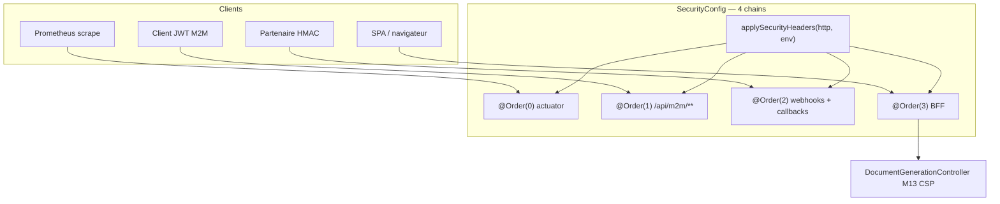

# System Design & Architecture — `headers-http-globaux` (lot A4)

> **Statut :** ébauche Phase 1. Revue design = **Phase 3**. Ne pas
> implémenter avant que Phase 3 ait tranché D-CSP-STRING et
> D-MECHANISM.

## Architecture Overview

Les en-têtes sont une préoccupation **infrastructure.security**, pas
domaine. Les 4 `SecurityFilterChain` existent déjà ; A4 n’ajoute pas
de chaîne.



- **Helper unique** (D-HEADERS-CHAINS = B) : une nouvelle chaîne ne
  peut pas « oublier » les en-têtes (leçon F0 callbacks).
- **Kill switch** : `SecurityCookieProperties` a déjà le pattern
  record + `application.yml`. Nouveau
  `app.security.headers.enabled` (défaut `true`) lu de la même façon.
- **HSTS** : si profil `local` ou `test` → ne pas enregistrer le
  writer HSTS. Sinon HSTS Spring (`max-age` 31536000,
  `includeSubDomains`, pas `preload`) qui n’émet que sur requête
  secure (A-HSTS-SECURE).
- **Preview M13** : inchangé dans `DocumentGenerationController`.
  CSP globale + M13 = AND navigateur (A-PREVIEW).

## Data Models

Pas de table, pas de migration Liquibase.

```text
app.security.headers.enabled: ${APP_SECURITY_HEADERS_ENABLED:true}
```

Profil `local` : **ne pas** mettre `enabled: false` (D-LOCAL-HEADERS).
HSTS est coupé par détection de profil, pas par ce booléen.

## API Design

Aucun nouvel endpoint. En-têtes de **réponse** uniquement.

| En-tête | Valeur visée (Phase 1) | Notes |
|---|---|---|
| `Content-Security-Policy` | Propose Phase 3, intent : `default-src 'self'` + `script-src 'self'` + `style-src 'self' 'unsafe-inline'` + `img-src 'self' data: blob:` + `font-src 'self' data:` + `connect-src 'self'` + `worker-src 'self' blob:` + `frame-ancestors 'none'` + `object-src 'none'` + `base-uri 'self'` | À valider contre bpmn-js / dmn-js / PrimeVue |
| `X-Frame-Options` | `DENY` | A-FRAME |
| `X-Content-Type-Options` | `nosniff` | |
| `Referrer-Policy` | `strict-origin-when-cross-origin` | A-REFERRER |
| `Strict-Transport-Security` | `max-age=31536000; includeSubDomains` | absent local/test |

Preview HTML : `Content-Security-Policy: default-src 'none'; sandbox`
inchangé.

## Component Breakdown

| Composant | Rôle |
|---|---|
| `SecurityConfig` | Appelle le helper sur les 4 `@Bean` filter chains |
| Record properties headers | Bind `app.security.headers.enabled` |
| `application.yml` / `application-local.yml` | Défaut true ; local ne coupe pas le kill switch |
| Tests `*SecurityTest` | Assertions d’en-têtes par chaîne |
| Frontend e2e | Non-régression CSP (éditeur BPMN ou DMN + preview) |
| `.env.example`, GETTING-STARTED, DEPLOIEMENT | Variable + note HSTS |

Pas de nouveau composant Vue.

## Design Decisions

Tranchées en requirements (ne pas rejouer) : D-HEADERS-SCOPE,
D-HEADERS-CHAINS, D-CSP-POLICY, D-HSTS, D-CONFIG, D-LOCAL-HEADERS.

### À trancher en Phase 3

| ID | Question | Options à explorer |
|---|---|---|
| **D-MECHANISM** | Helper `http.headers(Customizer)` vs filtre servlet | Reco probable : `headers()` Spring, un private method `applySecurityHeaders` |
| **D-CSP-STRING** | Directives exactes après lecture/exécution bpmn-js, dmn-js, PrimeVue | Intent Phase 1 ci-dessus ; ajouter `unsafe-eval` **seulement** si un E2E réel le prouve |
| **D-SWITCH-OFF** | Kill switch `false` : laisser les défauts Spring ou `headers.disable()` | Reco à calibrer : ne pas surprendre, documenter |

### Alternatives écartées (Phase 1)

- Headers uniquement au reverse-proxy (D-HSTS = C) — S-9 est
  applicatif ; FILE-ATTENTE pointe `SecurityConfig`.
- CSP Report-Only (D-CSP-POLICY = C) — ne ferme pas S-9.
- Permissions-Policy (D-HEADERS-SCOPE = C) — hors lot.
- `preload` HSTS — engagement registre, refusé.

## Non-Functional Requirements

- **Sécurité :** défense en profondeur navigateur ; ne pas affaiblir
  M13 ; ne pas rouvrir S-8.
- **Fiabilité :** kill switch pour rollback config sans rebuild.
- **Perf :** HeaderWriter, coût négligeable.
- **Compat :** Playwright + Vitest régression ; Jacoco inchangé sur
  le domaine (lot infra).
