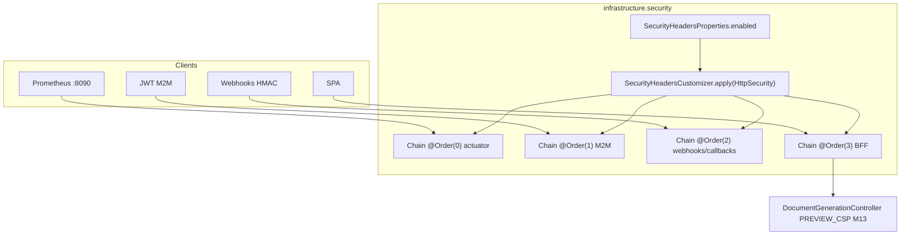
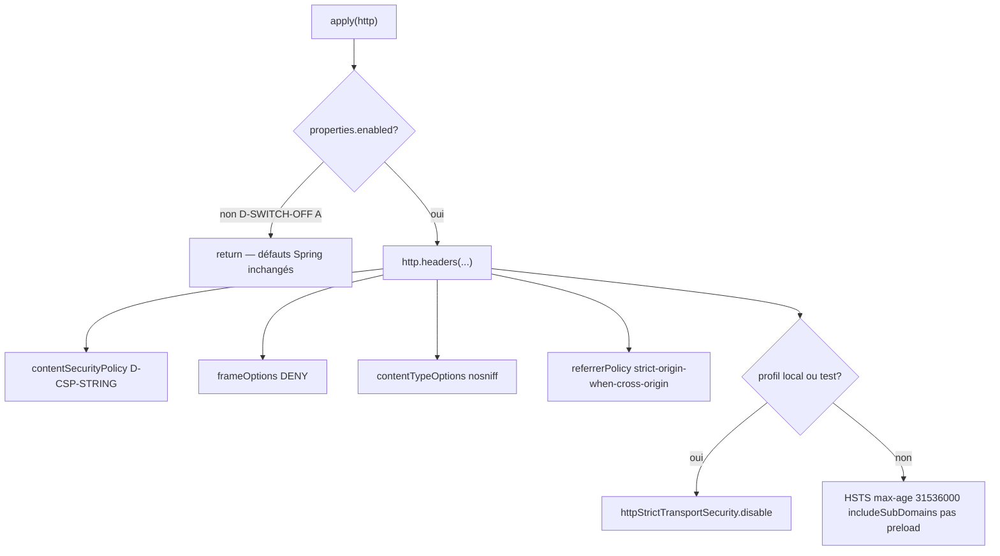

# System Design & Architecture — `headers-http-globaux` (lot A4)

## Phase 3: Review design

Revue 2026-09-20. Requirements Phase 2 relu avant édition. Couverture
goals / stories / contraintes : complète (table § Couverture
requirements). Trois décisions design tranchées une par une :
**D-MECHANISM = B**, **D-CSP-STRING = A**, **D-SWITCH-OFF = A**.
Aucune question design ouverte. Implémentation = Phase 5, après
Phase 4 planning.

Preuves code (pas supposées) :

- 4 `SecurityFilterChain` dans `SecurityConfig` ; actuator
  `EndpointRequest` sur le **port management** (`8090`) — un filtre
  servlet du port 8080 ne s’y applique pas.
- Preview HTML : `srcdoc` + `sandbox=""` ;
  preview PDF : `iframe :src="pdfUrl"` avec `URL.createObjectURL`
  → **`frame-src blob:`** obligatoire.
- PrimeVue Aura (`@primevue/themes/aura`) injecte des `<style>` →
  `style-src 'unsafe-inline'`.
- SSE `EventSource` same-origin → `connect-src 'self'`.
- Aucun `new Worker` dans `frontend/src` ; `worker-src blob:` conservé
  par prudence diagram-js, pas `unsafe-eval` (non prouvé bpmn-js 18 /
  dmn-js 17).
- Pattern properties existant : `SecurityCookieProperties` record +
  `@DefaultValue` + test `Binder`.

## Architecture Overview

Lot 100 % `infrastructure.security` / config. Pas de port domaine, pas
de table, pas de composant Vue.



Flux du customizer :



## Data Models

Pas d’entité métier.

```java
@ConfigurationProperties(prefix = "app.security.headers")
public record SecurityHeadersProperties(@DefaultValue("true") boolean enabled) {}
```

`application.yml` (à côté de `app.security.cookie`) :

```yaml
app:
  security:
    headers:
      enabled: ${APP_SECURITY_HEADERS_ENABLED:true}
```

`application-local.yml` : **ne pas** forcer `enabled: false`
(D-LOCAL-HEADERS). HSTS est coupé par profil dans le customizer.

Pas de Liquibase.

## API Design

Aucun endpoint nouveau. En-têtes de **réponse** uniquement.

Constante unique (source de vérité tests + customizer), D-CSP-STRING = A :

```
default-src 'self'; script-src 'self'; style-src 'self' 'unsafe-inline'; img-src 'self' data: blob:; font-src 'self' data:; connect-src 'self'; frame-src 'self' blob:; worker-src 'self' blob:; frame-ancestors 'none'; object-src 'none'; base-uri 'self'
```

| En-tête | Valeur | Quand |
|---|---|---|
| `Content-Security-Policy` | constante ci-dessus | `enabled=true` |
| `X-Frame-Options` | `DENY` | `enabled=true` |
| `X-Content-Type-Options` | `nosniff` | `enabled=true` |
| `Referrer-Policy` | `strict-origin-when-cross-origin` | `enabled=true` |
| `Strict-Transport-Security` | `max-age=31536000; includeSubDomains` | `enabled=true` **et** profil ∉ {`local`,`test`} **et** requête secure (writer Spring) |
| Preview HTML `Content-Security-Policy` | `default-src 'none'; sandbox` | inchangé (M13). AND navigateur avec la CSP globale (A-PREVIEW) |

Kill switch `enabled=false` : le customizer ne touche pas `http.headers()`
(D-SWITCH-OFF = A). Les défauts Spring (s’ils s’appliquent) restent.

## Component Breakdown

| Composant | Rôle |
|---|---|
| `SecurityHeadersProperties` | Bind kill switch, miroir `SecurityCookieProperties` |
| `SecurityHeadersCustomizer` | `apply(HttpSecurity)` : writers A4 + HSTS conditionnel profil |
| `SecurityConfig` | Injecte le customizer dans **les 4** `@Bean` filter chains ; `@EnableConfigurationProperties` étendu |
| `DocumentGenerationController` | **Inchangé** (M13) |
| Tests | `SecurityHeadersPropertiesTest` (Binder) ; MockMvc vraie chaîne sur BFF / M2M / webhook / callback / actuator ; `headers.enabled=false` ; preview M13 |
| Frontend | Aucun fichier Vue. E2E Playwright : SPA + preview PDF/HTML |
| Docs ops | `.env.example`, GETTING-STARTED (une variable), DEPLOIEMENT (HSTS applicatif) |

Pas de changement `domain/**`. ArchUnit : customizer dans
`infrastructure.security` — conforme.

API Spring à utiliser (HeadersConfigurer 6/7, à vérifier à la
compilation Phase 5 — pas d’API maison) :

- `headers.contentSecurityPolicy(csp -> csp.policyDirectives(POLICY))`
- `headers.frameOptions(frame -> frame.deny())`
- `headers.contentTypeOptions(Customizer.withDefaults())`
- `headers.referrerPolicy(r -> r.policy(STRICT_ORIGIN_WHEN_CROSS_ORIGIN))`
- `headers.httpStrictTransportSecurity(...)` ou `.disable()`

## Design Decisions

### Produit (Phase 1, ne pas rejouer)

D-HEADERS-SCOPE = B, D-HEADERS-CHAINS = B, D-CSP-POLICY = B,
D-HSTS = B, D-CONFIG = C, D-LOCAL-HEADERS = A.
A-FRAME, A-REFERRER, A-PREVIEW, A-HSTS-SECURE, A-NO-META, A-NO-GUIDE-UI.

### Design (Phase 3)

| ID | Choix | Pourquoi | Écarté |
|---|---|---|---|
| **D-MECHANISM** | **B** — `SecurityHeadersCustomizer` appelé par chaque chain | Testable ; couvre port 8080 **et** management 8090 ; FILE-ATTENTE = SecurityConfig | A : méthode privée, 4 signatures alourdies, plus dur à tester. C : `OncePerRequestFilter` global **rate** l’actuator 8090 |
| **D-CSP-STRING** | **A** — politique listée § API | Preuves SPA (styles inline PrimeVue, iframe PDF blob, SSE self). Pas d’`unsafe-eval` tant qu’un E2E ne le prouve | B : `unsafe-eval` préventif. C : sans `frame-src blob:` casse le preview PDF |
| **D-SWITCH-OFF** | **A** — no-op customizer | Kill switch = retirer le **paquet A4**, pas détruire les défauts Spring (XFO/nosniff) | B : `headers.disable()`. C : menu partiel, plus de code, pas demandé |

Si Playwright révèle une violation CSP réelle (ex. `eval` bpmn-js) :
élargir D-CSP-STRING **dans ce cycle** avec preuve E2E, pas basculer
en Report-Only (contredit D-CSP-POLICY = B).

## Couverture requirements

| Requirement | Design |
|---|---|
| 4 chaînes, helper partagé | Customizer × 4 beans |
| CSP enforce SPA | D-CSP-STRING constante unique |
| M13 preview non affaiblie | Contrôleur inchangé ; AND CSP |
| HSTS hors local/test, 1 an, includeSubDomains, pas preload | Branche profil dans le customizer |
| Kill switch défaut true, pas false en local | Properties + pas d’override local |
| Playwright CSP | E2E-HDR-1/2 ; `frame-src blob:` pour PDF |
| `.env.example` / GETTING-STARTED | `APP_SECURITY_HEADERS_ENABLED` |
| Pas CSRF, Compose, context-path, GUIDE-UI | Hors composants |

## Non-Functional Requirements

- **Sécurité :** défense navigateur ; ne pas rouvrir S-8 ; ne pas
  affaiblir M13 ; pas de `preload` HSTS.
- **Rollback :** `APP_SECURITY_HEADERS_ENABLED=false` sans rebuild.
- **Perf :** HeaderWriter, négligeable.
- **Observabilité :** pas de nouveau log (en-têtes silencieux).
- **Tests :** MockMvc vraie chaîne (doctrine F0) ; Jacoco classes du
  lot ; Vitest régression ; Playwright obligatoire.
