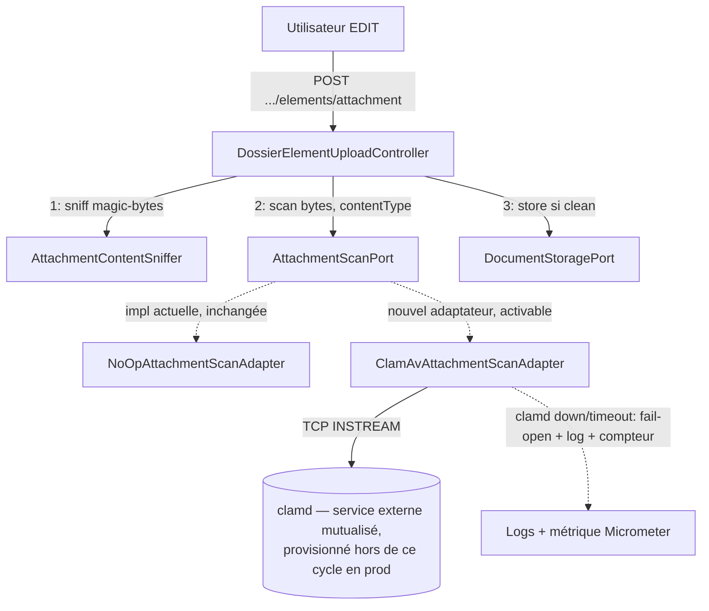

# System Design & Architecture — `scan-antivirus-clamav` (lot C)

> Brouillon issu des Phases 1-2 (requirements + review) — à valider/affiner en Phase 3
> (Review Design). Ne remplace pas une revue design formelle, sert de base à celle-ci.

## Architecture Overview

**What is the high-level system structure?**

- **Aucun nouveau composant côté domaine.** `AttachmentScanPort` et `AttachmentScanResult`
  restent inchangés — c'est la contrainte de départ de ce cycle.
- `ClamAvAttachmentScanAdapter` (nouveau, `infrastructure.dossier`) implémente le port existant,
  au même niveau que `NoOpAttachmentScanAdapter`. Un seul bean actif à la fois, sélectionné par
  configuration (`DossierConfig`).
- `clamd` est un service externe mutualisé (D-AV-CLAMAV-TOPO), pas une nouvelle brique
  applicative FlowForge — géré comme les autres dépendances d'infra locale
  (`docker-compose.yml`, nouveau profil `clamav`).

## Data Models

**What data do we need to manage?**

- Aucun nouveau modèle domaine ni table. Réutilisation stricte de `AttachmentScanResult(boolean
  clean, String reason)` existant.
- Aucune persistance du résultat de scan au-delà du log d'appel (pas d'historique de scan en
  base — cohérent avec le scope actuel, à rouvrir seulement si un futur besoin d'audit AV émerge
  explicitement).

## API Design

**How do components communicate?**

- **Aucune API externe nouvelle.** `POST /api/dossiers/{id}/elements/attachment` garde exactement
  son contrat actuel (mêmes codes de statut, même corps d'erreur `InvalidDossierElementException`
  en cas de rejet).
- **Interne clamd :** protocole texte `INSTREAM` de `clamd` en TCP brut (D-AV-CLAMAV-PROTO) —
  connexion socket, envoi de la commande `zINSTREAM\0`, puis le contenu découpé en chunks
  préfixés par leur taille (4 octets big-endian), terminé par un chunk de taille zéro ; lecture de
  la réponse (`stream: OK`, `stream: <signature> FOUND`, ou erreur). Pas de couche
  authentification/TLS sur ce canal (réseau Compose interne, cohérent avec PostgreSQL/Kafka
  aujourd'hui).
- **Nouvelle configuration** (`@ConfigurationProperties`, nom exact à confirmer en Phase 3, ex.
  `app.dossier.attachment-scan.clamav`) : `enabled` (bool, défaut `false` — D-AV-CLAMAV-DEFAULT),
  `host`, `port`, `timeoutMs`.

## Component Breakdown

**What are the major building blocks?**

- **Backend — nouveau**
  - `infrastructure.dossier.ClamAvAttachmentScanAdapter` (implémente `AttachmentScanPort`).
  - Classe de configuration `@ConfigurationProperties` dédiée (propriétés `clamd` : host/port/
    timeout/enabled).
  - Bean conditionnel dans `DossierConfig.attachmentScanPort()` : `ClamAvAttachmentScanAdapter`
    si `enabled=true`, sinon `NoOpAttachmentScanAdapter` (comportement par défaut inchangé).
- **Backend — inchangé**
  - `AttachmentScanPort`, `AttachmentScanResult`, `NoOpAttachmentScanAdapter`,
    `DossierElementUploadController` (aucune ligne modifiée dans le flux d'appel).
- **Backend — nouveau (Phase 2)**
  - Compteur Micrometer `clamav.scan.fail_open` (ou nom équivalent affiné en Phase 3),
    incrémenté à chaque bascule fail-open, exposé via `/actuator/prometheus` (réutilise
    l'instrumentation déjà livrée par `observabilite`, PR #59) — D-AV-CLAMAV-HEALTH.
- **Ops**
  - `docker-compose.yml` : service `clamav` (profil dédié `clamav`, image `clamav/clamav`,
    volume pour la base de signatures, healthcheck attendant que `freshclam` ait chargé les
    définitions) — **local/démo uniquement**, pas le mécanisme de déploiement prod.
  - `.env.example` / `DEPLOIEMENT.md` / `GETTING-STARTED.md` : variable d'activation + host/port
    + note sur le dimensionnement mémoire de `clamd` (~1,5-2 Go). En production, `clamd` est
    documenté comme service externe déjà provisionné (D-AV-CLAMAV-PROD-TOPO, même modèle que
    PostgreSQL/Keycloak, `DEPLOIEMENT.md` §4/§5) — pas d'outillage de provisioning `clamd` livré
    dans ce cycle.
- **Frontend**
  - **Aucun impact.** Pas de nouvel écran, pas de champ de configuration exposé en UI
    (l'activation reste une variable d'environnement, comme le kill switch headers de la PR
    #128) — pas de contrat SPA modifié.

## Design Decisions

**Why did we choose this approach?**

Décisions actées en Phases 1-2 (détail et alternatives écartées dans le document requirements
associé) :

| ID | Phase | Choix retenu | Alternative écartée |
|---|---|---|---|
| D-AV-CLAMAV-PROTO | 1 | TCP natif `INSTREAM` | Bibliothèque cliente tierce (dépendance externe pour un protocole simple) |
| D-AV-CLAMAV-FAILMODE | 1 | Fail-open (log, upload accepté) | Fail-closed (rejet systématique si `clamd` down — écarté pour ne pas faire de `clamd` un point de blocage total des uploads) |
| D-AV-CLAMAV-TOPO | 1 | `clamd` mutualisé entre tenants | Sidecar `clamd` par instance tenant (coût mémoire multiplié sans bénéfice d'isolation, `clamd` étant stateless) |
| D-AV-CLAMAV-DEFAULT | 1 | Opt-in, désactivé par défaut | Activé par défaut hors `local`/`test` (risquerait de casser un déploiement existant qui n'a pas encore provisionné `clamd`, compte tenu du fail-open qui suppose que l'app tolère `clamd` absent — mais autant garder le comportement actuel tant que ce n'est pas explicitement activé) |
| D-AV-CLAMAV-TEST-SCOPE | 1 | IT Testcontainers isolée (tag/profil dédié) | Incluse dans `./mvnw verify` standard (démarrage `clamd` ~1-2 min, alourdirait chaque run local) |
| D-AV-CLAMAV-HEALTH | 2 | Compteur Micrometer dédié sur chaque fail-open, exigé dans ce cycle | Log seul, métrique différée (proposition Phase 1, écartée en review : un fail-open sans signal actif rendrait une panne `clamd` prolongée indétectable autrement qu'en scrutant les logs) |
| D-AV-CLAMAV-PROD-TOPO | 2 | `clamd` = service externe déjà provisionné en prod (config `host`/`port` seulement) | Ce cycle livre aussi l'outillage de provisioning prod (écarté : hors du périmètre borné en Phase 1, élargirait significativement le lot) |

Principe transversal (déjà acté avant ce cycle, D-AV d'origine PR #62, confirmé ici) : le port
`AttachmentScanPort` reste le seul point de contact entre le domaine et un moteur AV — ClamAV en
est l'implémentation de référence, pas la seule possible ; un futur changement de moteur AV
n'ajoute qu'un nouvel adaptateur, sans toucher au port ni à l'appelant.

## Non-Functional Requirements

**How should the system perform?**

- **Sécurité :** le fail-open est un compromis assumé et documenté (log exploitable en cas
  d'incident `clamd`), pas un point aveugle — à mentionner explicitement dans
  `REVUE-ALIGNEMENT-SECURITE.md`/`FILE-ATTENTE.md` à la clôture, comme les autres reliquats
  sécurité assumés du dépôt (S-6 à S-9).
- **Performance :** latence ajoutée à l'upload = aller-retour TCP + temps de scan `clamd`, bornée
  par le timeout configuré (valeur à fixer en Phase 3) ; au-delà, fail-open immédiat plutôt
  qu'attente indéfinie.
- **Fiabilité :** `clamd` mutualisé = composant partagé, mais son indisponibilité ne doit
  jamais empêcher un upload (fail-open) — pas de dégradation en cascade sur les autres flux
  (stockage, workflow).
- **Observabilité :** chaque fail-open loggé avec contexte exploitable (tenant, dossier, raison
  technique) **et** incrémente un compteur Micrometer dédié (D-AV-CLAMAV-HEALTH, exigé pour ce
  cycle depuis la Phase 2) — sans ce signal actif, une panne `clamd` prolongée désactiverait le
  scan silencieusement sans qu'un opérateur puisse le détecter autrement qu'en scrutant les logs
  requête par requête.
