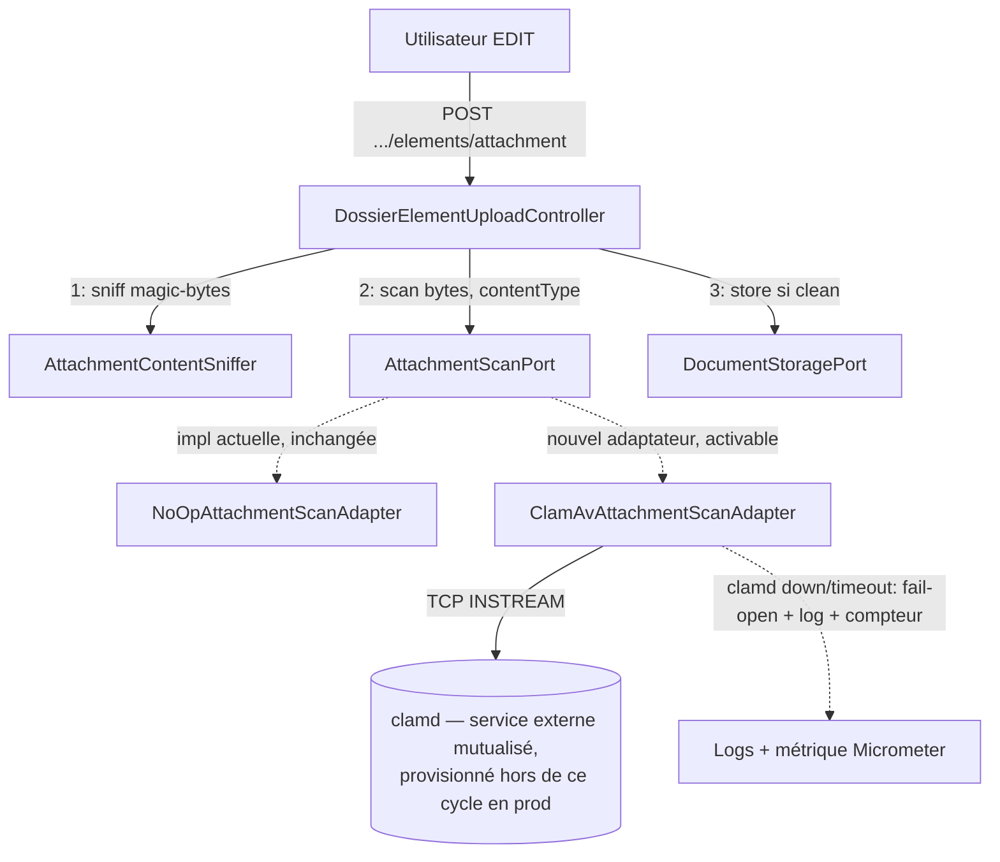

# System Design & Architecture — `scan-antivirus-clamav` (lot C)

> Phase 3 (review design) close. Les 5 points explicitement laissés ouverts par le document
> requirements ont été tranchés ci-dessous **en alignant sur des patterns déjà établis dans le
> dépôt** (pas de nouveau choix arbitraire) — voir § Design Decisions.

## Architecture Overview

**What is the high-level system structure?**

- **Aucun nouveau composant côté domaine.** `AttachmentScanPort` et `AttachmentScanResult`
  restent inchangés — c'est la contrainte de départ de ce cycle.
- `ClamAvAttachmentScanAdapter` (nouveau, `infrastructure.dossier`) implémente le port existant,
  au même niveau que `NoOpAttachmentScanAdapter`. Un seul bean actif à la fois, sélectionné par
  configuration (`DossierConfig`).
- `clamd` est un service externe mutualisé (D-AV-CLAMAV-TOPO), pas une nouvelle brique
  applicative FlowForge — géré comme les autres dépendances d'infra locale
  (`docker-compose.yml`, nouveau profil `clamav`).

## Data Models

**What data do we need to manage?**

- Aucun nouveau modèle domaine ni table. Réutilisation stricte de `AttachmentScanResult(boolean
  clean, String reason)` existant.
- Aucune persistance du résultat de scan au-delà du log d'appel (pas d'historique de scan en
  base — cohérent avec le scope actuel, à rouvrir seulement si un futur besoin d'audit AV émerge
  explicitement).

## API Design

**How do components communicate?**

- **Aucune API externe nouvelle.** `POST /api/dossiers/{id}/elements/attachment` garde exactement
  son contrat actuel (mêmes codes de statut, même corps d'erreur `InvalidDossierElementException`
  en cas de rejet).
- **Interne clamd :** protocole texte `INSTREAM` de `clamd` en TCP brut (D-AV-CLAMAV-PROTO) —
  connexion socket, envoi de la commande `zINSTREAM\0`, puis le contenu découpé en chunks
  préfixés par leur taille (4 octets big-endian), terminé par un chunk de taille zéro ; lecture de
  la réponse (`stream: OK`, `stream: <signature> FOUND`, ou erreur). Pas de couche
  authentification/TLS sur ce canal (réseau Compose interne, cohérent avec PostgreSQL/Kafka
  aujourd'hui). Timeouts connexion et lecture **5 s chacun** (D-AV-CLAMAV-TIMEOUT, Phase 3) —
  au-delà, fail-open — alignés sur la valeur déjà utilisée pour tout appel réseau sortant du
  dépôt (`ConnectorProperties.Http` `connect-timeout`/`request-timeout` = 5s,
  `NotificationProperties.Webhook` = 5s ; seul le SFTP `SshjSftpClientAdapter` diverge à 10s,
  non repris ici faute de justification spécifique à `clamd`, un appel local/réseau interne).
- **Configuration** (`@ConfigurationProperties`, package `infrastructure.config`, même
  emplacement que `AttachmentUploadProperties`/`StorageProperties`) : `app.dossier.attachment.
  scan.type` = `noop` (défaut) | `clamav`, plus `app.dossier.attachment.scan.clamav.{host,
  port,connect-timeout,read-timeout}` sous cette même branche. **Sélecteur `type`, pas un
  booléen `enabled`** (révision de la Phase 1 en Phase 3) — mêmes sémantique et comportement par
  défaut que D-AV-CLAMAV-DEFAULT (opt-in, `NoOp` tant que non activé explicitement), mais en
  réutilisant l'idiome déjà établi par `app.storage.type` (`filesystem`/`s3`,
  `StorageConfig`/`@ConditionalOnProperty(..., matchIfMissing = true)`) plutôt qu'en inventant un
  nouveau nom de propriété booléen pour ce même besoin.

## Component Breakdown

**What are the major building blocks?**

- **Backend — nouveau**
  - `infrastructure.dossier.ClamAvAttachmentScanAdapter` (implémente `AttachmentScanPort`,
    constructeur injecté avec les propriétés `clamav` + `MeterRegistry`, sur le modèle exact de
    `FlyingSaucerPdfAdapter` qui injecte déjà `MeterRegistry` pour son `Timer` `flowforge.pdf.
    render`).
  - `infrastructure.config.AttachmentScanProperties` (`@ConfigurationProperties`, même
    emplacement que `AttachmentUploadProperties`/`StorageProperties`) : `type`
    (`noop`/`clamav`), sous-record `clamav` avec `host`, `port`, `connectTimeout`,
    `readTimeout` (défauts `Duration.ofSeconds(5)`, mêmes valeurs par défaut que
    `ConnectorProperties.Http`/`NotificationProperties.Webhook`).
  - Deux beans conditionnels dans `DossierConfig` (remplace le bean unique actuel), sur le
    modèle exact de `StorageConfig.filesystemDocumentStoragePort`/`s3DocumentStoragePort` :
    `@ConditionalOnProperty(name = "app.dossier.attachment.scan.type", havingValue = "noop",
    matchIfMissing = true)` → `NoOpAttachmentScanAdapter` (comportement par défaut inchangé,
    D-AV-CLAMAV-DEFAULT) ; `havingValue = "clamav"` → `ClamAvAttachmentScanAdapter`.
- **Backend — inchangé**
  - `AttachmentScanPort`, `AttachmentScanResult`, `NoOpAttachmentScanAdapter`,
    `DossierElementUploadController` (aucune ligne modifiée dans le flux d'appel).
- **Backend — observabilité (D-AV-CLAMAV-HEALTH)**
  - `Counter` Micrometer `flowforge.attachment.scan.fail_open` (nom aligné sur la convention du
    dépôt `flowforge.<bc>.<sujet>.<événement>` — cf. `flowforge.pdf.render`,
    `flowforge.notification.webhook.dead` — pas `clamav.scan.fail_open` comme envisagé en
    Phase 1/2), construit et enregistré dans le constructeur de `ClamAvAttachmentScanAdapter` et
    incrémenté (`.increment()`) à chaque bascule fail-open. **`Counter` construit et incrémenté
    inline, pas un `MeterBinder`** : les `MeterBinder` existants du dépôt
    (`FlowableJobMetricsBinder`, `NotificationDlqMeterBinder`, `OutboxAgeMeterBinder`)
    re-interrogent un repository à chaque scrape pour exposer un état courant (`Gauge`) — notre
    besoin est de compter des événements ponctuels au fil de l'eau, exactement le cas d'usage du
    `Timer` déjà injecté dans `FlyingSaucerPdfAdapter`, donc même mécanique (constructeur +
    `MeterRegistry` + `.register(...)`), avec un `Counter` au lieu d'un `Timer`. Exposé via
    `/actuator/prometheus` sans changement d'infra (déjà câblé par `observabilite`, PR #59).
- **Ops**
  - `docker-compose.yml` : service `clamav` (profil dédié `clamav`, image **`clamav/clamav:1.4`
    épinglée** — D-AV-CLAMAV-IMAGE, Phase 3, cohérent avec `postgres:17-alpine`,
    `keycloak:26.7.1`, `apache/kafka:3.8.0` ; `minio`/`rustfs`/`seaweedfs` restent sur `latest`
    dans ce fichier mais ce sont des backends de stockage interchangeables et non
    sécurité-critiques, pas le même arbitrage), volume pour la base de signatures, healthcheck
    attendant que `freshclam` ait chargé les définitions — **local/démo uniquement**, pas le
    mécanisme de déploiement prod.
  - **Mise à jour des signatures (D-AV-CLAMAV-FRESHCLAM, Phase 3) :** aucun nouveau composant —
    l'image officielle `clamav/clamav` exécute `freshclam` au démarrage et périodiquement en
    tâche de fond (variable d'environnement `FRESHCLAM_CHECKS`, native à l'image). Pas de job
    Compose séparé, pas de cron applicatif.
  - **Alignement taille (D-AV-CLAMAV-SIZE-ALIGN, Phase 3) :** `clamd.conf` `StreamMaxLength`
    fixé à la même valeur que `spring.servlet.multipart.max-file-size`
    (`APP_DOSSIER_ATTACHMENT_MAX_SIZE_MB`, défaut 25 Mo — les deux défauts coïncident déjà
    aujourd'hui). Documenté explicitement dans `DEPLOIEMENT.md`/le service Compose : si l'un est
    relevé sans l'autre, un fichier légitime dans la nouvelle plage haute franchit `clamd` en
    fail-open (D-AV-CLAMAV-FAILMODE) sans être réellement scanné — comportement couvert par la
    politique déjà actée, mais qui doit rester une dérive **documentée**, pas silencieuse.
  - `.env.example` / `DEPLOIEMENT.md` / `GETTING-STARTED.md` : variable d'activation + host/port
    + note sur le dimensionnement mémoire de `clamd` (~1,5-2 Go). En production, `clamd` est
    documenté comme service externe déjà provisionné (D-AV-CLAMAV-PROD-TOPO, même modèle que
    PostgreSQL/Keycloak, `DEPLOIEMENT.md` §4/§5) — pas d'outillage de provisioning `clamd` livré
    dans ce cycle.
- **Frontend**
  - **Aucun impact.** Pas de nouvel écran, pas de champ de configuration exposé en UI
    (l'activation reste une variable d'environnement, comme le kill switch headers de la PR
    #128) — pas de contrat SPA modifié.

**Couverture des non-goals requirements (Phase 3, vérification croisée) :** aucun élément
ci-dessus n'introduit de système à plugins multi-moteurs, de politique AV par tenant, de
quarantaine/rescan rétroactif, de scan des `PRODUCED_DOC`, ni d'écran d'administration — cohérent
avec les non-goals actés en Phase 1.

## Design Decisions

**Why did we choose this approach?**

Décisions actées en Phases 1-3 (détail et alternatives écartées dans le document requirements
associé pour les Phases 1-2 ; Phase 3 documentée ici) :

| ID | Phase | Choix retenu | Alternative écartée |
|---|---|---|---|
| D-AV-CLAMAV-PROTO | 1 | TCP natif `INSTREAM` | Bibliothèque cliente tierce (dépendance externe pour un protocole simple) |
| D-AV-CLAMAV-FAILMODE | 1 | Fail-open (log, upload accepté) | Fail-closed (rejet systématique si `clamd` down — écarté pour ne pas faire de `clamd` un point de blocage total des uploads) |
| D-AV-CLAMAV-TOPO | 1 | `clamd` mutualisé entre tenants | Sidecar `clamd` par instance tenant (coût mémoire multiplié sans bénéfice d'isolation, `clamd` étant stateless) |
| D-AV-CLAMAV-DEFAULT | 1 | Opt-in, désactivé par défaut | Activé par défaut hors `local`/`test` (risquerait de casser un déploiement existant qui n'a pas encore provisionné `clamd`, compte tenu du fail-open qui suppose que l'app tolère `clamd` absent — mais autant garder le comportement actuel tant que ce n'est pas explicitement activé) |
| D-AV-CLAMAV-TEST-SCOPE | 1 | IT Testcontainers isolée (tag/profil dédié) | Incluse dans `./mvnw verify` standard (démarrage `clamd` ~1-2 min, alourdirait chaque run local) |
| D-AV-CLAMAV-HEALTH | 2 | Compteur Micrometer dédié sur chaque fail-open, exigé dans ce cycle | Log seul, métrique différée (proposition Phase 1, écartée en review : un fail-open sans signal actif rendrait une panne `clamd` prolongée indétectable autrement qu'en scrutant les logs) |
| D-AV-CLAMAV-PROD-TOPO | 2 | `clamd` = service externe déjà provisionné en prod (config `host`/`port` seulement) | Ce cycle livre aussi l'outillage de provisioning prod (écarté : hors du périmètre borné en Phase 1, élargirait significativement le lot) |
| D-AV-CLAMAV-TIMEOUT | 3 | Connexion + lecture `clamd` : **5 s chacun**, configurables | 10 s (valeur `SshjSftpClientAdapter`, écartée : appel SFTP externe distant, pas comparable à `clamd` sur réseau interne) ; sans borne (écarté d'emblée, contredit le budget latence upload) |
| D-AV-CLAMAV-IMAGE | 3 | `clamav/clamav:1.4` épinglé | `latest`/`stable` flottant (écarté : mêmes raisons que le pinning `postgres:17-alpine`/`keycloak:26.7.1`/`apache/kafka:3.8.0`, reproductibilité et non-surprise sur un composant sécurité-critique) |
| D-AV-CLAMAV-FRESHCLAM | 3 | Mécanisme `freshclam` natif de l'image officielle (`FRESHCLAM_CHECKS`) | Job Compose/cron séparé (écarté : nouveau composant à opérer sans bénéfice, l'image le fait déjà) |
| D-AV-CLAMAV-SIZE-ALIGN | 3 | `clamd.conf` `StreamMaxLength` aligné sur `APP_DOSSIER_ATTACHMENT_MAX_SIZE_MB`, documenté explicitement | Ignorer l'écart (écarté : un relèvement futur de la taille max applicative désynchroniserait silencieusement `clamd`, gros fichiers légitimes fail-open sans que ce soit voulu) |
| D-AV-CLAMAV-CONFIG-SELECTOR | 3 | Propriété `app.dossier.attachment.scan.type` (`noop`/`clamav`), calquée sur `app.storage.type` | Booléen `enabled` proposé en Phase 1/2 (écarté : le dépôt a déjà un idiome établi — `StorageConfig`/`app.storage.type` — pour ce cas exact de sélection d'un adaptateur unique parmi plusieurs, inutile d'en réinventer un second différent pour le même besoin) |

Principe transversal (déjà acté avant ce cycle, D-AV d'origine PR #62, confirmé ici) : le port
`AttachmentScanPort` reste le seul point de contact entre le domaine et un moteur AV — ClamAV en
est l'implémentation de référence, pas la seule possible ; un futur changement de moteur AV
n'ajoute qu'un nouvel adaptateur, sans toucher au port ni à l'appelant.

## Non-Functional Requirements

**How should the system perform?**

- **Sécurité :** le fail-open est un compromis assumé et documenté (log exploitable en cas
  d'incident `clamd`), pas un point aveugle — à mentionner explicitement dans
  `REVUE-ALIGNEMENT-SECURITE.md`/`FILE-ATTENTE.md` à la clôture, comme les autres reliquats
  sécurité assumés du dépôt (S-6 à S-9).
- **Performance :** latence ajoutée à l'upload = aller-retour TCP + temps de scan `clamd`, bornée
  par les timeouts configurés (5 s connexion + 5 s lecture, D-AV-CLAMAV-TIMEOUT) ; au-delà,
  fail-open immédiat plutôt qu'attente indéfinie.
- **Fiabilité :** `clamd` mutualisé = composant partagé, mais son indisponibilité ne doit
  jamais empêcher un upload (fail-open) — pas de dégradation en cascade sur les autres flux
  (stockage, workflow).
- **Observabilité :** chaque fail-open loggé avec contexte exploitable (tenant, dossier, raison
  technique) **et** incrémente un compteur Micrometer dédié (D-AV-CLAMAV-HEALTH, exigé pour ce
  cycle depuis la Phase 2) — sans ce signal actif, une panne `clamd` prolongée désactiverait le
  scan silencieusement sans qu'un opérateur puisse le détecter autrement qu'en scrutant les logs
  requête par requête.
