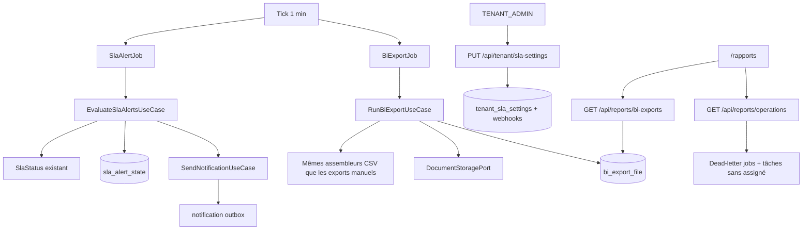

# System Design & Architecture — `enrichissement-reporting`

## Phase 3: Review design

Revue 2026-09-21 contre les exigences. Chaque story et critère de succès
a un composant ci-dessous. Aucun **D-*** produit rouvert.

Alternatives écartées avant d’accepter ce dessin :

- Vue JDBC en lecture seule : écarte le masquage applicatif et ouvre le
  schéma tenant (D-BI-MECHANISM).
- Nouveau canal de notification : `SendNotificationUseCase` couvre déjà
  les trois canaux (D-ALERT-CHANNEL).
- Lister le bucket : `DocumentStoragePort` n’a pas de list ; une table
  `bi_export_file` est le catalogue.
- `@Scheduled` calé sur l’intervalle tenant : l’intervalle est en base,
  donc un tick fixe d’une minute (**A-POLL**) et un use case qui décide
  si l’échéance est due.
- Un seul CSV dossiers toutes colonnes fixes : contredit D-BI-DOSSIER-SHAPE.

## Architecture Overview



Le domaine reste sans Spring, JPA ni Flowable. Les requêtes Flowable
(dead-letter, tâches) vivent dans des adaptateurs d’infrastructure
derrière des ports.

## Data Models

### Extension `tenant_sla_settings`

Colonnes ajoutées (défauts = feature éteinte) :

| Colonne | Type | Règle |
|---|---|---|
| `alerting_enabled` | boolean | défaut false |
| `alert_interval_minutes` | int | défaut 60, bornes 15–10080 |
| `alert_emails` | texte JSON, liste de chaînes | max 20, format e-mail simple |
| `bi_export_enabled` | boolean | défaut false |
| `bi_interval_hours` | int | défaut 24, bornes 1–720 |
| `bi_retention_days` | int | défaut 30, bornes 1–365 |
| `alerting_enabled_at` | timestamptz nullable | posé à l’activation |
| `last_alert_scan_at` | timestamptz nullable | |
| `last_bi_export_at` | timestamptz nullable | n’avance qu’en succès complet |

Table `tenant_sla_alert_webhook` (`tenant_id`, `webhook_id`), clé
primaire composée. Chaque `webhook_id` doit exister, appartenir au
tenant et être activé **au moment de l’enregistrement**. Maximum 20.

Le pourcentage de conformité existant ne change pas de sémantique.

### `sla_alert_state`

`tenant_id`, `dossier_id` (PK), `last_status` (`ON_TRACK` / `AT_RISK` /
`BREACHED`), `updated_at`.

À l’activation (transition false → true), dans la même transaction que
le flag : une ligne par dossier **scoré** (`slaTargetHours` non null),
statut courant, **sans** appel à `SendNotificationUseCase`. Réactivation
après coupure : nouveau snapshot, même règle.

Scan suivant : statut calculé via `SlaStatus.of` (horloge déjà utilisée
par le rapport). Écart :

| Dernier état mémorisé | État courant | Action |
|---|---|---|
| identique | identique | rien |
| autre ou absent | `AT_RISK` | une alerte `AT_RISK`, puis mémoriser |
| autre ou absent | `BREACHED` | une alerte `BREACHED` seulement (**A-MISSED-WINDOW**), puis mémoriser |
| `AT_RISK` ou `BREACHED` | `ON_TRACK` | mémoriser, pas d’alerte |
| absent et non scoré | — | pas de ligne, pas d’alerte |

Pas de ligne « absent » après snapshot : l’absence n’arrive qu’pour un
dossier créé ou devenu scoré **après** l’activation. Ce premier statut
`AT_RISK` ou `BREACHED` est un vrai franchissement et part.

### `bi_export_file`

`id`, `tenant_id`, `kind` (`DOSSIERS` / `SLA`), `dossier_type_code`
(null si SLA), `storage_ref`, `file_name`, `created_at`, `size_bytes`.

Nom de fichier horodaté, par exemple
`dossiers-{code}-{instant}.csv` et `sla-report-{instant}.csv`.

Rétention : après un export réussi, supprimer storage (idempotent) puis
lignes dont `created_at` est plus vieux que `bi_retention_days`.

## API Design

Authn inchangée (session BFF). Pas de chaîne publique nouvelle.

### `GET` / `PUT /api/tenant/sla-settings`

`TENANT_ADMIN` seulement, comme aujourd’hui. Le corps gagne les champs
du tableau ci-dessus plus `webhookIds: uuid[]`. `complianceTargetPercent`
reste obligatoire et validé 1–100.

Activer l’alerting (`alertingEnabled: true` alors qu’il était false)
déclenche le snapshot. Activer le BI exige un intervalle et une
rétention dans les bornes (ils ont déjà des défauts valides : activer
sans les envoyer réécrit les défauts).

### `GET /api/reports/operations`

Rôles `TENANT_ADMIN`, `WORKFLOW_ADMIN`, `DOSSIER_MANAGER`.

```json
{ "deadLetterJobCount": 0, "unassignedOpenTaskCount": 0 }
```

Comptages tenant courant. Indépendants des deux interrupteurs.

### `GET /api/reports/bi-exports`

Mêmes rôles. Page `PageResponse`. Chaque élément : `id`, `kind`,
`dossierTypeCode`, `fileName`, `createdAt`, `sizeBytes`.

Filtre : CSV SLA visible pour ces rôles ; CSV `DOSSIERS` visible
seulement si `DossierAccessPolicy.canViewType` pour l’acteur. Un
`DOSSIER_MANAGER` sans `VIEW` sur un type ne voit pas ce fichier.

### `GET /api/reports/bi-exports/{id}`

Même contrôle que la liste, sinon 404 (pas de 403 qui confirmerait
l’existence). Corps `text/csv`, `Content-Disposition` du `fileName`.
Lecteur du storage via `DocumentStoragePort.retrieve`.

## Component Breakdown

### Alerting

- `EvaluateSlaAlertsUseCase` (domaine) : si désactivé, retour immédiat.
  Si `now` < `last_alert_scan_at` + intervalle, retour immédiat (sauf
  le snapshot, qui est dans l’upsert des réglages, pas dans le job).
  Sinon compare, envoie, met à jour `last_alert_scan_at` même s’il n’y
  a aucun franchissement (l’intervalle compte les scans, pas les envois).
- Fan-out par franchissement : un `NotificationEvent` EMAIL par adresse,
  un WEBHOOK par webhook encore activé, un BROWSER par `userId` distinct
  retourné par `WorkflowParticipantPort` sur les liens du dossier.
  Sujet / corps / payload : référence, code de type, statut. Aucune
  valeur de champ de dossier.
- Payload BROWSER : `type=SLA_THRESHOLD_CROSSED`, `title`, `body`,
  `createdAt`, pour le tiroir existant (`notifications.ts` lit `title`
  et `body`).
- `SlaAlertJob` : `@Scheduled(fixedDelay = 1 min)`, MDC tenant, appelle
  le use case. Échec d’un envoi : ne pas avancer l’état de **ce**
  dossier (réessai au tick suivant, sans doublon une fois l’état écrit
  dans la même transaction que les outbox).

### Widgets

- Port `OperationalCountsPort` : `deadLetterJobCount()`,
  `unassignedOpenTaskCount()`.
- Adaptateur Flowable : `ManagementService.createDeadLetterJobQuery`
  (déjà utilisé par `FlowableJobMetricsBinder`) et
  `TaskService` tâches actives dont l’assignee est null, filtrées par
  tenant Flowable (`app.tenant.id`).

### Export BI

- `RunBiExportUseCase` : si désactivé, ou si `now` < dernière réussite
  + `bi_interval_hours`, retour. Sinon :
  1. Pour chaque type de dossier du tenant, produire les octets CSV
     comme `DossierExportController` (colonnes fixes + champs du type,
     masquage sensible, garde anti-formule). Pas d’`AccessContext`
     utilisateur : le job est le tenant. Le droit est réappliqué au
     téléchargement.
  2. Produire le CSV SLA comme `SlaReportExportController` sans
     `from` / `to` / `dossierTypeCode` (`SlaPeriod` 30 jours).
  3. `DocumentStoragePort.store` pour chaque fichier.
  4. Insérer les lignes et poser `last_bi_export_at` dans une
     transaction. Si l’insertion échoue, `delete` best-effort des
     `storageRef` de la tentative et ne pas avancer l’horloge.
  5. Purger la rétention.
- La purge de rétention tourne aussi quand l’export est **désactivé**
  (tick, lecture des jours enregistrés) : couper l’interrupteur n’a pas
  pour effet de garder les fichiers indéfiniment. Elle ne crée pas de
  fichier et n’avance pas `last_bi_export_at`.
- `BiExportJob` : même tick d’une minute.

### Frontend

- `DossierTypesAdminView.vue` : le formulaire SLA gagne interrupteur
  alerting, intervalle, e-mails, multi-sélection des webhooks activés,
  interrupteur BI, intervalle, rétention. `slaSettings.ts` aligné sur
  le nouveau contrat.
- `RapportsView.vue` : deux compteurs ; liste paginée des exports avec
  téléchargement. Visible pour les rôles qui ont déjà la page.
- Vitest des vues et clients API. Playwright sur le formulaire admin,
  les compteurs et la liste (mocks réseau alignés).

### Documentation

- `GUIDE-UTILISATEUR.md` : champs du formulaire admin et liste
  `/rapports`.
- Golden OpenAPI régénéré pour les contrats touchés.
- Pas de variable d’environnement nouvelle (tout est en réglages
  tenant). `.env.example` inchangé.

## Design Decisions

- Snapshot dans l’upsert, pas dans le premier tick : sinon un tick
  entre l’activation et le snapshot enverrait le passé.
- 404 sur téléchargement interdit : pas d’oracle d’existence.
- Dead-letter non filtré par une table métier : le compteur Flowable
  est déjà la définition « instance en erreur » du dépôt
  (`FlowableJobMetricsBinder`). Le filtre tenant est celui des jobs
  Flowable du schéma d’instance (une instance = un tenant).
- Tâche sans assigné : `taskUnassigned()` + `active()` + tenant id.
  Les tâches terminées ne comptent pas.

## Non-Functional Requirements

- Un scan et un export ne chargent pas tous les binaires dossier en
  mémoire au-delà d’un CSV à la fois.
- Pas de secret webhook dans les CSV ni dans les payloads d’alerte.
- Le tick d’une minute ne fait qu’une lecture de réglages quand les
  deux features sont éteintes.
- Jacoco du dépôt inchangé (LINE 85 %, BRANCH 75 %).
