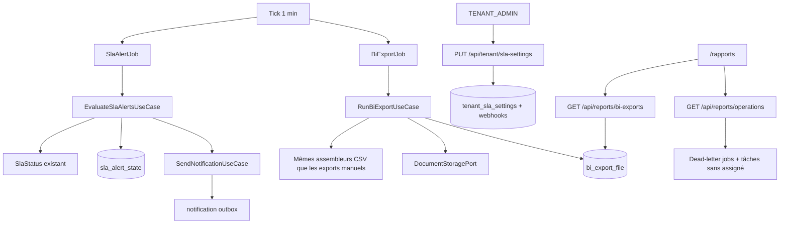

# System Design & Architecture — `enrichissement-reporting`

## Phase 3: Review design

Revue 2026-09-21, recoupée avec le code de `main` (pas seulement avec le
premier jet). Chaque story et critère de succès a un composant
ci-dessous. Aucun **D-*** produit rouvert. Quatre écarts du premier jet
sont corrigés dans ce document :

1. **Population d’alerte.** `SlaReportQueryPort.findDossiers` filtre
   `createdAt` sur la période du rapport (30 jours par défaut). Un
   dossier plus ancien peut franchir un seuil aujourd’hui. Le scan
   utilise un port dédié, tous les dossiers scorés, hors période.
2. **Masquage du CSV stocké.** `DossierFieldRedactor` ne masque pas
   `AccessContext.System`, et `ExportDossiersUseCase` avec ce contexte
   passerait aussi l’ACL. Le fichier BI est partagé entre rôles : il
   retire toujours les clés sensibles. L’export manuel admin, lui,
   reste en clair pour `TENANT_ADMIN`.
3. **Échéance BI.** `last_bi_export_at` null ne veut pas dire « dû
   tout de suite ». D-BI-SCHEDULE ancre l’intervalle sur l’activation.
   Colonne `bi_enabled_at`.
4. **Tiroir SSE.** `SseNotificationAdapter` émet l’événement nommé
   `notification`. Le store n’écoute que `onmessage`, et le relais
   envoie `{id, payload, at}`, pas `title` à la racine. Le store écoute
   l’événement nommé et lit `payload.title` / `payload.body`.

Alternatives écartées :

- Vue JDBC : ouvre le schéma tenant (D-BI-MECHANISM).
- Nouveau canal de notification : `SendNotificationUseCase` suffit, un
  événement par destinataire (le use case valide tous les canaux du
  même événement avant d’écrire).
- Lister le bucket : le port ne liste pas.
- Réutiliser la requête du rapport SLA pour l’alerting : fenêtre de
  création, faux négatifs.
- Générer le CSV avec `AccessContext.System` : fuite des champs
  sensibles vers un `DOSSIER_MANAGER` qui télécharge le même objet.
- Geler `last_alert_scan_at` tant qu’un dossier échoue : un destinataire
  empoisonné transformerait le tick d’une minute en boucle. L’horloge
  avance ; le dossier en échec garde son ancien statut et sera repris
  à l’intervalle suivant.

## Architecture Overview



Le domaine reste sans Spring, JPA ni Flowable. Les requêtes Flowable
(dead-letter, tâches) vivent dans des adaptateurs d’infrastructure
derrière des ports.

## Data Models

### Extension `tenant_sla_settings`

Colonnes ajoutées (défauts = feature éteinte) :

| Colonne | Type | Règle |
|---|---|---|
| `alerting_enabled` | boolean | défaut false |
| `alert_interval_minutes` | int | défaut 60, bornes 15–10080 |
| `alert_emails` | texte JSON, liste de chaînes | max 20, format e-mail simple |
| `bi_export_enabled` | boolean | défaut false |
| `bi_interval_hours` | int | défaut 24, bornes 1–720 |
| `bi_retention_days` | int | défaut 30, bornes 1–365 |
| `alerting_enabled_at` | timestamptz nullable | posé à chaque activation |
| `last_alert_scan_at` | timestamptz nullable | null = premier scan dû tout de suite |
| `bi_enabled_at` | timestamptz nullable | posé à chaque activation de l’export |
| `last_bi_export_at` | timestamptz nullable | n’avance qu’en succès complet |

Table `tenant_sla_alert_webhook` (`tenant_id`, `webhook_id`), clé
primaire composée. Chaque `webhook_id` doit exister, appartenir au
tenant et être activé **au moment de l’enregistrement**. Maximum 20.

Le pourcentage de conformité existant ne change pas de sémantique.

### `sla_alert_state`

`tenant_id`, `dossier_id` (PK), `last_status` (`ON_TRACK` / `AT_RISK` /
`BREACHED`), `updated_at`.

À l’activation (transition false → true), dans la même transaction que
le flag : **remplacement** des lignes du tenant (les anciennes sont
supprimées) par une ligne par dossier scoré (`slaTargetHours` non
null), statut courant via `SlaClock` + `SlaStatus`, **sans** appel à
`SendNotificationUseCase`. `last_alert_scan_at` n’est pas posé ici : le
prochain tick compare le snapshot et n’envoie rien si le statut n’a pas
bougé. Réactivation après coupure : même remplacement.

Scan suivant : statut calculé via `SlaStatus.of` (horloge déjà utilisée
par le rapport). Écart :

| Dernier état mémorisé | État courant | Action |
|---|---|---|
| identique | identique | rien |
| autre ou absent | `AT_RISK` | une alerte `AT_RISK`, puis mémoriser |
| autre ou absent | `BREACHED` | une alerte `BREACHED` seulement (**A-MISSED-WINDOW**), puis mémoriser |
| `AT_RISK` ou `BREACHED` | `ON_TRACK` | mémoriser, pas d’alerte |
| absent et non scoré | — | pas de ligne, pas d’alerte |

Pas de ligne « absent » après snapshot : l’absence n’arrive qu’pour un
dossier créé ou devenu scoré **après** l’activation. Ce premier statut
`AT_RISK` ou `BREACHED` est un vrai franchissement et part.

### `bi_export_file`

`id`, `tenant_id`, `kind` (`DOSSIERS` / `SLA`), `dossier_type_code`
(null si SLA), `storage_ref`, `file_name`, `created_at`, `size_bytes`.

Nom de fichier horodaté, par exemple
`dossiers-{code}-{instant}.csv` et `sla-report-{instant}.csv`.

Rétention : supprimer storage (idempotent) puis les lignes dont
`created_at` est plus vieux que `bi_retention_days`. La purge tourne
aussi quand l’export est désactivé.

## API Design

Authn inchangée (session BFF). Pas de chaîne publique nouvelle.

### `GET` / `PUT /api/tenant/sla-settings`

`TENANT_ADMIN` seulement, comme aujourd’hui. Le corps gagne les champs
du tableau ci-dessus plus `webhookIds: uuid[]`. `complianceTargetPercent`
reste obligatoire et validé 1–100.

Activer l’alerting (`alertingEnabled: true` alors qu’il était false)
déclenche le snapshot et pose `alerting_enabled_at`. Activer le BI pose
`bi_enabled_at`. Intervalle et rétention ont des défauts déjà valides :
les omettre à l’écriture réapplique ces défauts, pas une valeur hors
bornes.

### `GET /api/reports/operations`

Rôles `TENANT_ADMIN`, `WORKFLOW_ADMIN`, `DOSSIER_MANAGER`.

```json
{ "deadLetterJobCount": 0, "unassignedOpenTaskCount": 0 }
```

Comptages tenant courant. Indépendants des deux interrupteurs.

### `GET /api/reports/bi-exports`

Mêmes rôles. Page `PageResponse`. Chaque élément : `id`, `kind`,
`dossierTypeCode`, `fileName`, `createdAt`, `sizeBytes`.

Filtre : CSV SLA visible pour ces rôles ; CSV `DOSSIERS` visible
seulement si `DossierAccessPolicy.canViewType` pour l’acteur. Un
`DOSSIER_MANAGER` sans `VIEW` sur un type ne voit pas ce fichier.

### `GET /api/reports/bi-exports/{id}`

Même contrôle que la liste, sinon 404 (pas de 403 qui confirmerait
l’existence). Corps `text/csv`, `Content-Disposition` du `fileName`.
Lecteur du storage via `DocumentStoragePort.retrieve`.

## Component Breakdown

### Alerting

- Horloge injectée (`Clock`), la même que l’upsert des réglages. Pas
  d’`Instant.now()` dans le use case d’alerte.
- Pas de ligne de réglages (`TenantSlaSettingsNotFoundException`
  aujourd’hui si l’admin n’a jamais enregistré) : le job sort sans
  erreur.
- `EvaluateSlaAlertsUseCase` : si désactivé, retour immédiat. Si
  `last_alert_scan_at` est non null et `now` est avant cette horloge
  plus l’intervalle, retour immédiat. Sinon il charge les candidats.
- Port `SlaAlertCandidatePort` : tous les dossiers du tenant dont le
  type a un `slaTargetHours` non null, ouverts ou clos. Champs utiles :
  id, référence, code de type, `createdAt`, `closedAt`, `updatedAt`,
  clos, cible. Pas les champs métier. Pas la requête périodée du
  rapport.
- Statut = `SlaStatus.of(SlaClock.elapsed(...), cible, clos)`.
- Fan-out par franchissement, **un** `NotificationEvent` par
  destinataire. `send` valide tous les canaux du même événement et
  exige `to` pour EMAIL, `webhookConfigId` pour WEBHOOK, `userId` pour
  BROWSER : un événement mixte est invalide. Les webhooks désactivés
  sont retirés **avant** `send` (`send` lève si le webhook est éteint).
  Participants : union de `WorkflowParticipantPort` sur
  `findByDossierIdOrderBySequence`. Sujet, corps et payload : référence,
  code de type, statut, id de dossier. Aucune valeur de champ.
- Payload interne BROWSER : `type=SLA_THRESHOLD_CROSSED`, `title`,
  `body`. Le relais l’enveloppe déjà en `{id, payload, at}` et l’émet
  sous le nom d’événement `notification`.
- Transaction **par dossier** : les `send` de ce franchissement et la
  mise à jour de `sla_alert_state` committent ensemble. Un échec
  rollback les outbox de ce dossier et laisse l’ancien statut.
  `last_alert_scan_at` avance à la fin du parcours, même si un dossier
  a échoué : le rejeu de ce dossier attend le prochain intervalle, pas
  la minute suivante.
- `SlaAlertJob` : `@Scheduled(fixedDelay = 1 min)`, MDC tenant.

### Widgets

- Port `OperationalCountsPort` : `deadLetterJobCount()`,
  `unassignedOpenTaskCount()`.
- Adaptateur Flowable : `ManagementService.createDeadLetterJobQuery`
  (déjà utilisé par `FlowableJobMetricsBinder`) et
  `TaskService` tâches actives dont l’assignee est null, filtrées par
  tenant Flowable (`app.tenant.id`).

### Export BI

- Ancre d’échéance : `bi_enabled_at` à chaque activation. Référence =
  `last_bi_export_at` s’il est non null et pas avant `bi_enabled_at`,
  sinon `bi_enabled_at`. Dû quand `now` atteint cette référence plus
  `bi_interval_hours`. Une réactivation repousse le prochain fichier
  d’un intervalle entier. Un `last_bi_export_at` null ne rend pas
  l’export immédiat.
- `RunBiExportUseCase`, si désactivé : pas de fichier, horloge
  d’export inchangée, puis purge de rétention si une ligne de réglages
  existe. Si activé mais pas encore dû : purge seulement. Si dû :
  1. Pour chaque type, colonnes fixes de `DossierExportController` plus
     les champs du type, dans le même ordre. Les valeurs passent par
     une suppression **inconditionnelle** des clés sensibles
     (`DossierFieldRedactor` tel quel ne le fait pas pour
     `AccessContext.System`). Garde anti-formule : `CsvWriter` existant.
     Le job n’appelle pas `ExportDossiersUseCase` avec `System`.
  2. CSV SLA via `GetSlaReportUseCase` avec `AccessContext.System`
     (déjà autorisé par `SlaReportAccess`, et ce CSV n’a pas de champs
     de dossier), sans `from` / `to` / type (`SlaPeriod` 30 jours).
  3. `DocumentStoragePort.store` pour chaque fichier.
  4. Insérer les lignes et poser `last_bi_export_at` dans une
     transaction. Si l’insertion échoue, `delete` best-effort des
     `storageRef` de la tentative et ne pas avancer l’horloge.
  5. Purger la rétention.
- `BiExportJob` : même tick d’une minute. Pas de ligne de réglages :
  sortie silencieuse.

### Frontend

- `DossierTypesAdminView.vue` : le formulaire SLA gagne interrupteur
  alerting, intervalle, e-mails, multi-sélection des webhooks activés,
  interrupteur BI, intervalle, rétention. `slaSettings.ts` aligné sur
  le nouveau contrat.
- `RapportsView.vue` : deux compteurs ; liste paginée des exports avec
  téléchargement. Visible pour les rôles qui ont déjà la page.
- `notifications.ts` : écouter l’événement SSE `notification` (pas
  seulement `onmessage`). Titre et corps lus dans `payload.title` et
  `payload.body`, avec le repli actuel si absents. Les notifications
  de workflow sans titre restent sur le libellé de repli.
- Vitest des vues, du store et des clients API. Playwright sur le
  formulaire admin, les compteurs et la liste (mocks réseau alignés).

### Documentation

- `GUIDE-UTILISATEUR.md` : champs du formulaire admin et liste
  `/rapports`.
- Golden OpenAPI régénéré pour les contrats touchés.
- Pas de variable d’environnement nouvelle (tout est en réglages
  tenant). `.env.example` inchangé.

## Design Decisions

- Snapshot dans l’upsert, pas dans le premier tick : sinon un tick
  entre l’activation et le snapshot enverrait le passé.
- Fichier BI dossiers toujours masqué, même pour un admin qui le
  télécharge. Le clair reste l’export manuel, qui dépend de l’acteur.
- Pagination BI : le filtre `VIEW` est dans la requête (types autorisés
  ou CSV SLA), pas un filtrage mémoire après coup, pour que le total
  de page reste juste. `TENANT_ADMIN` et `WORKFLOW_ADMIN` voient tous
  les types (`SlaReportAccess` leur donne déjà un filtre null).
- 404 sur téléchargement interdit : pas d’oracle d’existence.
- Dead-letter non filtré par une table métier : le compteur Flowable
  est déjà la définition « instance en erreur » du dépôt
  (`FlowableJobMetricsBinder`). Le filtre tenant est celui des jobs
  Flowable du schéma d’instance (une instance = un tenant).
- Tâche sans assigné : `taskUnassigned()` + `active()` + tenant id.
  Les tâches terminées ne comptent pas.

## Non-Functional Requirements

- Un scan et un export ne chargent pas tous les binaires dossier en
  mémoire au-delà d’un CSV à la fois.
- Pas de secret webhook dans les CSV ni dans les payloads d’alerte.
- Le tick d’une minute ne fait qu’une lecture de réglages quand les
  deux features sont éteintes.
- Jacoco du dépôt inchangé (LINE 85 %, BRANCH 75 %).
