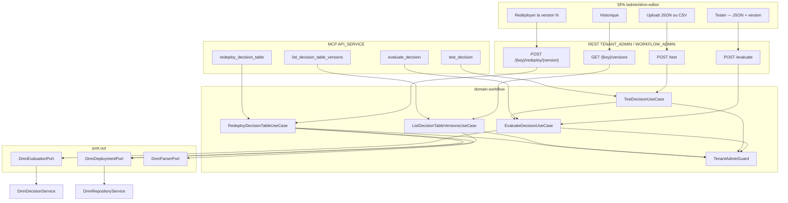

# System Design & Architecture — `outillage-dmn`

## Phase 3: Review design

Revue 2026-09-23, recoupée avec le code de la branche et l’API publique
Flowable DMN 8.0.0 (`DmnDecisionQuery.decisionVersion`,
`ExecuteDecisionBuilder` sans paramètre de version,
`alwaysLookupLatestDefinitionVersion` à `false` par défaut,
`DmnDeployment.getDeploymentTime()`).

Chaque story et critère de succès des requirements a un composant
ci-dessous. Aucun **D-DMN-*** produit rouvert. Les **D-TECH-*** sont
tranchées une par une.

| ID | Décision |
|---|---|
| D-TECH-EVAL-PORT | **A** — `DmnEvaluationPort` dédié ; `DmnDeploymentPort` étendu (versions, XML par version) |
| D-TECH-NO-DRAFT-EVAL | Figé par le non-goal requirements |
| D-TECH-TEST-EQ | **B** — match partiel des clés attendues |
| D-TECH-TEST-LIST-MATCH | **A** — même longueur, dans l’ordre |
| D-TECH-ROLLBACK-SAME | **A** — 409 si N est déjà la version courante |
| D-TECH-MCP-NAMES | **C** — `evaluate_decision`, `test_decision`, `list_decision_table_versions`, `redeploy_decision_table` |
| D-TECH-CSV-SHAPE | **A** — colonnes `input.<nom>` / `expected.<nom>` |
| D-TECH-CSV-META | **A** — `decisionKey` et `version` hors du fichier |
| D-TECH-CSV-COERCE | **A** — littéral CSV nombre ou booléen converti vers le type réel |
| D-TECH-TEST-CAP | **A** — 100 cas, au-delà 400 |
| D-TECH-VERSIONED-EVAL | **A** — query de la version puis `parentDeploymentId` |
| D-TECH-EVAL-SHAPE | **C** — toujours une liste de lignes |
| D-TECH-NO-HIT | **A** — liste vide, HTTP 200 |
| D-TECH-REST-CONTRACT | **A** — un `POST /test`, `Content-Type` json ou csv |
| D-TECH-TESTER-INPUT | **A** — zone JSON + sélecteur de version |
| D-TECH-REDEPLOY-PARSE | **A** — `DmnParserPort` avant `deploy` |
| D-TECH-RBAC-GUARD | **A** — `TenantAdminGuard` sur les quatre nouveaux use cases |

Hypothèses nommées (pas des **D-TECH-***) :

| ID | Hypothèse |
|---|---|
| A-VERSION-ORDER | Historique trié par numéro de version croissant |
| A-HIST-UNKNOWN | Clé inconnue sur la liste → 404, comme l’évaluation |
| A-CSV-PARSE-INFRA | Le CSV est parsé en infrastructure ; le domaine reçoit `List<DecisionTestCase>` |
| A-HTTP-STATUS | 400 validation ou échec moteur, 404 clé/version absente, 409 redéploiement de la courante, 403 rôle. Pas de 422 : le dépôt mappe déjà la validation en 400 |
| A-VERSION-META | `version`, `deploymentId`, `deployedAt` (`DmnDeployment.getDeploymentTime()`) |
| A-SIZE-CAP | Taille de corps bornée par la limite multipart déjà configurée, en plus des 100 cas |

## Architecture Overview



Le domaine reste sans Spring, JPA, Flowable ni parseur CSV.

### Composants

| Composant | Rôle |
|---|---|
| `EvaluateDecisionUseCase` | `decisionKey`, `inputs`, `version?` → liste de lignes. Version omise = dernière |
| `TestDecisionUseCase` | Boucle sur l’évaluation, au plus 100 cas, rapport ordonné |
| `ListDecisionTableVersionsUseCase` | Toutes les versions de la clé, ordre croissant |
| `RedeployDecisionTableUseCase` | XML de N, allowlist, `deploy`. 409 si N est déjà la courante |
| `DmnEvaluationPort` | Résout la décision (`decisionKey` + version + tenant) et exécute via `parentDeploymentId` |
| `DmnDeploymentPort` | Ajoute `findAllVersions` et `findDeployedXml(tenant, key, version)` |

`DeployDecisionTableUseCaseImpl` n’est pas modifié.

## Data Models

```java
public record DecisionEvaluationResult(
    String decisionKey, int version, List<Map<String, Object>> rows) {}

public record DecisionTestCase(
    Map<String, Object> inputs, List<Map<String, Object>> expectedRows) {}

public record DecisionTestCaseResult(
    int index, boolean passed, List<Map<String, Object>> actualRows, String failureMessage) {}

public record DecisionTestReport(
    String decisionKey, int version, List<DecisionTestCaseResult> results) {}

public record DecisionTableVersionInfo(
    String decisionKey, int version, String deploymentId, Instant deployedAt) {}
```

`expectedRows` est une liste pour coller à D-TECH-EVAL-SHAPE = C.
`UNIQUE` / `FIRST` sont une liste d’un élément. Aucune règle : liste vide.

Comparaison d’un cas : même nombre de lignes, dans l’ordre. Pour chaque
ligne, chaque clé attendue est égale à la valeur réelle après
normalisation des scalaires JSON. Les clés réelles en plus ne font pas
échouer. Une cellule CSV `1000`, `1000.5`, `true` ou `false` est
convertie vers le type de la valeur réelle avant comparaison. Le JSON
garde ses types.

Aucune table Liquibase. Le brouillon `dmn_draft` n’est pas évalué.

### CSV

En-tête RFC 4180 : `input.<nom>`, `expected.<nom>`. Une ligne de fichier
est un cas à une ligne attendue. Un cas à plusieurs lignes attendues
(`COLLECT`) passe par le JSON, pas par le CSV. `decisionKey` et
`version` sont des paramètres d’appel, absents du fichier.

## API Design

### REST

`@PreAuthorize("hasAnyRole('TENANT_ADMIN','WORKFLOW_ADMIN')")`, même
contrôleur que les déploiements DMN. CSRF session inchangé.

| Méthode | Chemin | Corps |
|---|---|---|
| `POST` | `/api/dmn-decision-deployments/evaluate?decisionKey=&version=` | `{ "inputs": { } }` |
| `POST` | `/api/dmn-decision-deployments/test?decisionKey=&version=` | JSON `{ "cases": [ { "inputs", "expectedRows" } ] }` ou `text/csv` |
| `GET` | `/api/dmn-decision-deployments/{decisionKey}/versions` | liste `DecisionTableVersionInfo` |
| `POST` | `/api/dmn-decision-deployments/{decisionKey}/redeploy/{version}` | vide |

`version` omis = dernière déployée. Réponses : 200 (y compris lignes
vides), 400, 403, 404, 409.

### MCP

Catalogue 23 → 27 tools. Description de `redeploy_decision_table` :
redéploiement d’une version antérieure, pas une suppression. Pas de
dialogue de confirmation côté MCP (A-MCP-CONFIRM).

| Tool | Arguments |
|---|---|
| `evaluate_decision` | `decisionKey`, `inputs`, `version?` |
| `test_decision` | `decisionKey`, `version?`, `format` = `json` \| `csv`, `payload` |
| `list_decision_table_versions` | `decisionKey` |
| `redeploy_decision_table` | `decisionKey`, `version` |

### Frontend

`/admin/dmn-editor` :

- Tester : zone JSON (un objet d’inputs), sélecteur de version (défaut
  = courante), affichage de la liste de lignes ou du message 400.
- Jeux de tests : upload `.json` ou `.csv`, rapport par cas.
- Historique : versions croissantes, bouton **Redéployer la version N**,
  confirmation obligatoire. Annuler n’appelle pas l’API.

## Design Decisions

Les alternatives écartées sont dans le tableau de revue en tête de
document. Points d’appui code :

- `ExecuteDecisionBuilder` ne porte pas de numéro de version. L’adaptateur
  charge la `DmnDecision` (`decisionKey`, `decisionVersion`, tenant) et
  passe `parentDeploymentId` = `deploymentId` de cette décision.
- Un test d’intégration déploie deux versions aux résultats différents
  et vérifie que `version=1` ne renvoie pas le résultat de la courante.
- Le redéploiement relit `findDeployedXml(version)`, appelle
  `DmnParserPort`, puis le `deploy` existant.
- `TenantAdminGuard.requireTenantOrWorkflowAdminOrApiService` sur les
  quatre use cases. L’acteur REST est l’utilisateur de session ; l’acteur
  MCP est `API_SERVICE`.

## Non-Functional Requirements

- **Sécurité.** Évaluation limitée aux tables déployées. Le redéploiement
  repasse l’allowlist JUEL. IT : une version ancienne refusée par
  l’allowlist courante ne devient pas la version courante. L’évaluation
  ne déploie pas de XML.
- **Perf.** 100 cas maximum par requête. Au-delà : 400.
- **Fiabilité.** 409 si la version demandée est déjà la courante : pas
  de nouvelle version au XML identique.
- **Observabilité.** Log structuré `decisionKey` + `version`. Pas de
  métrique nouvelle.
