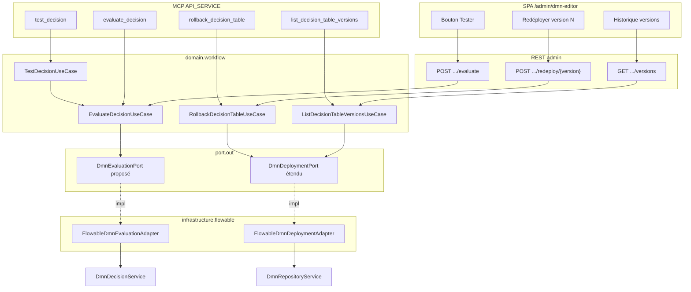

# System Design & Architecture — `outillage-dmn`

> **Statut : brouillon Phase 1.** À revoir en Phase 3 contre le code
> Flowable 8 réel (`DmnRepositoryService` / `DmnDecisionService`) et les
> points techniques listés en fin de requirements. Les décisions
> **produit** D-DMN-* sont figées ; les **D-TECH-*** ci-dessous sont des
> propositions à confirmer ou corriger en Phase 3.

## Architecture Overview



### Composants

| Composant | Rôle |
|---|---|
| `EvaluateDecisionUseCase` | Évalue une table déployée (`decisionKey`, `inputs`, `version?`) → outputs |
| `TestDecisionUseCase` | Applique N cas JSON via `EvaluateDecisionUseCase` ; agrège pass/fail |
| `ListDecisionTableVersionsUseCase` | Liste toutes les versions d’une clé |
| `RollbackDecisionTableUseCase` | Lit le XML de la version N, redéploie (nouvelle version courante) |
| `DmnEvaluationPort` (**D-TECH-EVAL-PORT** proposé) | Encapsulation de `DmnDecisionService` ; évite de gonfler `DmnDeploymentPort` |
| Extension `DmnDeploymentPort` | `findAllVersions`, `findDeployedXml(version)`, éventuellement déjà `deploy` |

## Data Models

### Domaine (records proposés)

```java
public record DecisionEvaluationResult(
    String decisionKey,
    int version,
    Map<String, Object> outputs
) {}

public record DecisionTestCase(Map<String, Object> inputs, Map<String, Object> expectedOutputs) {}

public record DecisionTestCaseResult(
    int index,
    boolean passed,
    Map<String, Object> actualOutputs,
    String failureMessage // null si passed
) {}

public record DecisionTestReport(
    String decisionKey,
    int version,
    List<DecisionTestCaseResult> results
) {}

// Extension éventuelle de DecisionTableDeploymentInfo ou record dédié :
public record DecisionTableVersionInfo(
    String decisionKey,
    int version,
    Instant deployedAt // si exposé par le moteur ; sinon nullable
) {}
```

### Persistance

- **Aucune** nouvelle table Liquibase applicative pour l’historique
  (A-NO-APP-HISTORY-TABLE, D-DMN-HISTORY-RETENTION).
- Brouillon `dmn_draft` inchangé ; l’évaluation ne lit **pas** le brouillon
  (A-EVAL-DEPLOYED-ONLY).

### Format jeu de tests (D-DMN-TEST-FORMAT = C)

**JSON :**

```json
{
  "decisionKey": "grilleEligibilite",
  "version": 2,
  "cases": [
    {
      "inputs": { "montant": 1000, "statut": "ACTIF" },
      "expectedOutputs": { "eligible": true }
    }
  ]
}
```

**CSV :** même sémantique (une ligne = un cas). Forme exacte des
en-têtes (**A-CSV-SHAPE**) à figer en Phase 3 — proposition de travail :
colonnes `input.<nom>` / `expected.<nom>` (échappement RFC 4180).

Comparaison `expectedOutputs` : égalité stricte clé à clé après
normalisation des scalaires (détail Phase 3 : nombres, booléens).

## API Design

### REST (`TENANT_ADMIN` / `WORKFLOW_ADMIN`)

Propositions de chemins (à figer en Phase 3, cohérents avec
`/api/dmn-decision-deployments`) :

| Méthode | Chemin | Rôle |
|---|---|---|
| `POST` | `/api/dmn-decision-deployments/evaluate` | Corps : `decisionKey`, `inputs`, `version?` |
| `POST` | `/api/dmn-decision-deployments/test` | JSON : `decisionKey`, `version?`, `cases[]` |
| `POST` | `/api/dmn-decision-deployments/test.csv` | multipart/texte CSV (même sémantique) |
| `GET` | `/api/dmn-decision-deployments/{decisionKey}/versions` | Liste historique |
| `POST` | `/api/dmn-decision-deployments/{decisionKey}/redeploy/{version}` | Redéploiement confirmé |

Pas de CSRF exemption : chaîne session BFF existante.

### MCP (`API_SERVICE`)

| Tool | Args | Notes |
|---|---|---|
| `evaluate_decision` | `decisionKey`, `inputs` (objet), `version?` | Miroir REST evaluate |
| `test_decision` | `decisionKey`, `version?`, `format`=`json`\|`csv`, `payload` | Rapport agrégé ; détail args Phase 3 |
| `list_decision_table_versions` | `decisionKey` | Toutes versions |
| `rollback_decision_table` | `decisionKey`, `version` | Redéploie ; description MCP clarifie la sémantique |

Catalogue MCP : 23 → **27** tools après livraison.

### Frontend

- `DmnEditorView.vue` : panneau **Tester** (cas unitaire) + upload
  **JSON/CSV** de jeux de tests (D-DMN-TEST-SURFACE = C) + panneau
  **Historique** avec **Redéployer la version N** + dialogue de
  confirmation (D-DMN-ROLLBACK-UX).
- Composable `useDmnEvaluation` / extension `useDmnDeployment`.
- Client API pour evaluate / test / versions / redeploy.

## Component Breakdown

- **Backend domaine** : 4 use cases + records ; garde RBAC miroir des
  use cases DMN existants (`TenantAdminGuard` /
  `requireTenantOrWorkflowAdminOrApiService` selon le précédent MCP).
- **Infrastructure** : extension adaptateur déploiement + nouvel
  adaptateur évaluation ; tools MCP ; contrôleur REST.
- **Frontend** : Vue éditeur + Vitest + Playwright (E2E Tester +
  redéploiement).
- **Docs** : `GUIDE-UTILISATEUR.md`, golden OpenAPI, `CHANGELOG.md` à
  l’ouverture de PR d’implémentation.

## Design Decisions

| ID | Proposition Phase 1 | Alternatives | À confirmer Phase 3 |
|---|---|---|---|
| **D-TECH-EVAL-PORT** | Port `DmnEvaluationPort` séparé | Étendre seulement `DmnDeploymentPort` | Oui — lisibilité vs surface port |
| **D-TECH-NO-DRAFT-EVAL** | Refus d’évaluer un XML brouillon non déployé | Parse+allowlist à la volée du brouillon | Aligné A-EVAL-DEPLOYED-ONLY ; si UX « tester avant déployer » demandée plus tard = autre cycle |
| **D-TECH-TEST-EQ** | Égalité Map stricte sur `expectedOutputs` | Match partiel / tolérance numérique | Oui |
| **D-TECH-ROLLBACK-SAME** | Si N = courante : redéployer quand même (nouvelle version) ou 409 | No-op 204 | Vérifier API Flowable |
| **D-TECH-MCP-NAMES** | Noms provisoires ci-dessus | Préfixe `dmn_` | Cohérence catalogue existant (`deploy_decision_table` sans préfixe) |

## Non-Functional Requirements

- **Sécurité** : pas d’exécution d’expression hors tables déjà
  allowlistées ; reconfirmer en Phase 3 (smoke IT miroir
  `DmnJuelSecuritySmokeIT` sur le chemin evaluate).
- **Perf** : jeu de tests borné (ex. max 100 cas / requête) — borne
  exacte en Phase 3.
- **Fiabilité** : rollback = même chemin `deploy` que l’UI Déployer
  (parse allowlist au redéploiement du XML historique — défense en
  profondeur si une ancienne version prédate un durcissement).
- **Observabilité** : pas de nouvelle métrique exigée en V1 ; logs
  structurés `decisionKey` + `version` suffisent.
