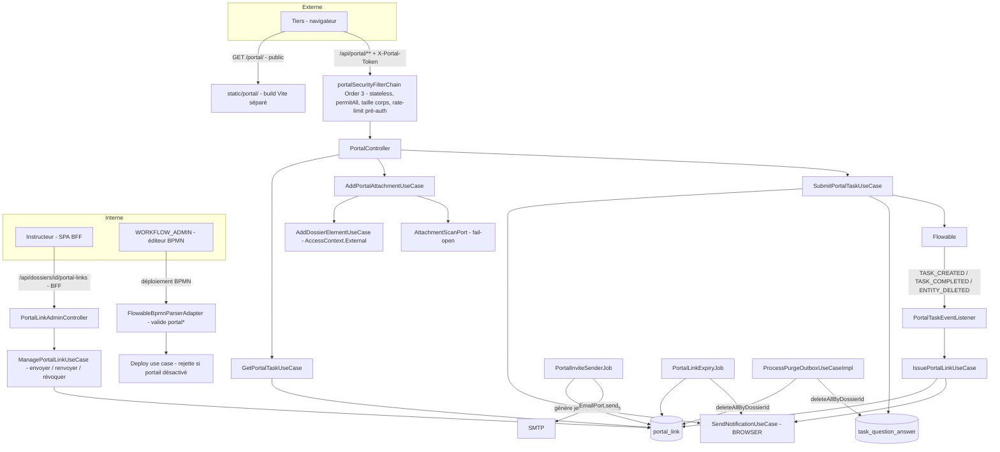
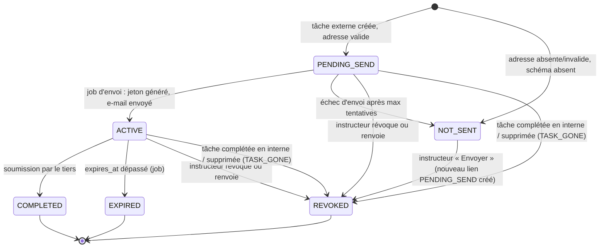

# System Design & Architecture — `portail-externe`

> TODO §68. Requirements (Phases 1–2 closes, `status: reviewed`) :
> [2026-09-23-feature-portail-externe.md](../requirements/2026-09-23-feature-portail-externe.md).
> **Phase 3 close le 2026-09-23** : 4 décisions d'architecture tranchées par l'utilisateur
> (`AskUserQuestion`), les autres tranchées par alignement sur des patrons déjà établis dans le
> dépôt (justification ligne par ligne dans « Design Decisions »). Constats de code vérifiés sur
> `main` @ `b3f03f9` et dans les sources `flowable-engine`/`flowable-bpmn-converter` 8.0.0.

## Architecture Overview

**Principes :**

- Tout le métier est dans `com.flowforge.domain.workflow.portal` (nouveau sous-paquet du BC
  `workflow`, puisqu'un lien portail est attaché à une tâche) : modèles `record`, ports `in`/`out`,
  use cases `*UseCaseImpl` sans annotation Spring (ArchUnit).
- Le portail est une **fonctionnalité conditionnelle** : tous les beans d'infrastructure portail
  (chaîne de sécurité, contrôleur public, jobs, listener) sont conditionnés par
  `app.portal.enabled=true` (`@ConditionalOnProperty`), à l'exception du validateur BPMN et de la
  purge, qui fonctionnent toujours (D-PORTAL-ACTIVATION, D-PORTAL-PURGE).
- Le chemin **interne** existant (`CompleteTaskUseCaseImpl`, `DossierElementUploadController`) n'est
  pas modifié dans son comportement : le portail a ses propres use cases qui réutilisent les
  briques partagées (validation des réponses `user-question`, `AddDossierElementUseCase`,
  `AttachmentScanPort`).

## Data Models

### Table `portal_link` (migration `025-portal-link.yaml`)

| Colonne | Type | Notes |
|---|---|---|
| `id` | `uuid` PK | identifiant stable du lien ; sert d'identité externe `portal:<id>` |
| `tenant_id` | `varchar(64)` not null | même convention que les autres tables |
| `dossier_id` | `uuid` not null, indexé | rattachement dossier (purge, écran instructeur) |
| `task_id` | `varchar(64)` not null | tâche Flowable |
| `process_instance_id` | `varchar(64)` not null | |
| `schema_key` | `varchar(128)` not null | extrait du `formKey` `user-question:<schemaKey>` au moment de l'émission |
| `recipient_email` | `varchar(320)` null | **donnée personnelle** — null si adresse absente/invalide |
| `token_hash` | `char(64)` null, **unique** | SHA-256 hex du jeton ; null tant que non envoyé |
| `status` | `varchar(16)` not null | voir machine à états |
| `status_reason` | `varchar(32)` null | `NO_ADDRESS`, `INVALID_ADDRESS`, `SCHEMA_MISSING`, `SEND_FAILED`, `TASK_GONE` |
| `ttl_days` | `int` not null | durée effective (défaut, surcharge BPMN, bornée par le plafond tenant) |
| `expires_at` | `timestamptz` null | fixée à l'envoi effectif (`sent_at + ttl_days`) |
| `send_attempts` | `int` not null default 0 | retries du job d'envoi |
| `created_at`, `sent_at`, `last_accessed_at`, `completed_at`, `revoked_at` | `timestamptz` | |
| `created_by` | `varchar(128)` not null | `flowable-task-created` ou `userId` de l'instructeur |
| `revoked_by` | `varchar(128)` null | |
| `version` | `bigint` | verrou optimiste (double soumission, renvoi concurrent) |

**Index :**

- `ux_portal_link_token_hash` unique sur `token_hash` (lookup O(1) du jeton).
- `ux_portal_link_task_live` **unique partiel** sur `task_id` où
  `status IN ('PENDING_SEND','ACTIVE','NOT_SENT')` — exigence H2 « un seul lien vivant par tâche ».
  Même technique que `002-dossier-workflow-link-active-index` : fichier SQL PostgreSQL (index
  partiel) + variante H2 (colonne calculée), sélectionnés par `dbms`.
- `idx_portal_link_dossier` sur `dossier_id` ; `idx_portal_link_status_expires` sur
  `(status, expires_at)` pour le job d'expiration.

### Machine à états d'un lien

- Un **renvoi** = révocation du lien vivant + création d'un nouveau lien `PENDING_SEND` (nouveau
  `id`, nouveau jeton) dans la même transaction — l'index unique partiel garantit l'invariant H2.
- Seul `ACTIVE` avec `expires_at > now` et tâche existante donne accès au portail.

### Domaine

- `PortalLink` (record) + `PortalLinkStatus` (enum) + `PortalRecipientSource` (record parsé depuis
  l'attribut BPMN : `DOSSIER_FIELD` | `PROCESS_VARIABLE`, nom).
- `PortalTaskDefinition` (record) : `schemaKey`, `recipientSource`, `ttlDays` (nullable) — extrait
  du BPMN par le parser.
- `AccessContext.External(UUID linkId)` : **nouvelle variante** de l'interface scellée
  (D-PORTAL-ACTOR). `DossierAccessPolicy`, `SearchDossiersUseCaseImpl`,
  `ListDossierTypesUseCaseImpl`, `SlaReportAccess` : `case External -> refus`, sauf
  `AddDossierElementUseCaseImpl` qui l'accepte uniquement avec un contrôle portail préalable
  (voir « Components »). `DossierFieldRedactor` : `External` est traité comme non privilégié
  (redaction), par défense en profondeur même si aucun champ ne lui est renvoyé.
- `TaskQuestionAnswer.submittedBy` et `DossierElement.addedBy` = `portal:<linkId>` (chaîne,
  colonnes existantes, aucune migration). L'UI interne affiche « Tiers externe
  (a***@domaine.fr) » en résolvant le lien.

## API Design

### API publique du portail (chaîne dédiée, sans session)

Jeton transmis dans l'en-tête **`X-Portal-Token`** (jamais en query string, jamais en cookie —
D-PORTAL-CSRF-SESSION). Toute erreur d'authentification (jeton absent, inconnu, expiré, révoqué,
consommé, tâche disparue) renvoie **la même réponse** : `404` avec un corps problème générique
identique (pas d'oracle — critère de succès).

| Méthode & chemin | Rôle | Réponse |
|---|---|---|
| `GET /api/portal/task` | Contexte de la tâche | `{ dossierReference, taskName, instructions, schema, expiresAt, attachments: [ {id, label, fileName, size, addedAt} ] }` — **uniquement** les pièces `addedBy = portal:<linkId>` (D-PORTAL-DATA) |
| `POST /api/portal/task/attachments` (multipart `file`, `label`) | Dépôt de pièce | `201` + la pièce ; mêmes contrôles que l'interne (types autorisés, magic bytes, taille multipart, statut du dossier) ; scan fail-open (D-PORTAL-SCAN) |
| `POST /api/portal/task/submit` `{ answers: {...} }` | Soumission | `204` ; valide les réponses contre le schéma `user-question`, trace `TaskQuestionAnswer`, complète la tâche, passe le lien `COMPLETED` |

`instructions` = `documentation` de la `userTask` (texte, rendu échappé côté front). `taskName`
= nom de la tâche. **Aucun** autre attribut du dossier n'est renvoyé.

### API interne instructeur (chaîne BFF existante, `@Order(4)`)

| Méthode & chemin | Rôle | Droits |
|---|---|---|
| `GET /api/dossiers/{id}/portal-links` | Liens du dossier (historique compris) : tâche, destinataire, statut, raison, dates | VIEW sur le type |
| `POST /api/dossiers/{id}/portal-links/{taskId}/send` | Envoyer / renvoyer : révoque le lien vivant, relit la source d'adresse, crée un lien `PENDING_SEND` (ou `NOT_SENT` si l'adresse est toujours invalide, avec `409` explicite) | H6 : même garde que la réassignation (EDIT sur le type) |
| `POST /api/dossiers/{id}/portal-links/{linkId}/revoke` | Révoquer | H6 |

Contrat ajouté au golden OpenAPI, sauf le multipart portail (`@Hidden`, même convention D-SPEC que
l'upload interne).

## Components

### Backend — domaine (`com.flowforge.domain.workflow.portal`)

| Composant | Responsabilité |
|---|---|
| `IssuePortalLinkUseCaseImpl` | Appelé à la création d'une tâche externe : résout l'adresse via `PortalRecipientResolverPort`, valide le format e-mail, vérifie que le schéma existe, crée `PENDING_SEND` ou `NOT_SENT` + notification BROWSER `PORTAL_LINK_NOT_SENT` aux participants (D-PORTAL-NO-ADDRESS) |
| `ManagePortalLinkUseCaseImpl` | Envoyer / renvoyer / révoquer (instructeur) |
| `SendPortalInvitesUseCaseImpl` | Pour chaque `PENDING_SEND` : génère le jeton (`PortalTokenPort`), enregistre le hash + `expires_at` + `ACTIVE`, **puis** envoie l'e-mail (`EmailPort`) ; échec → retry, au-delà de `max-send-attempts` → `NOT_SENT/SEND_FAILED` + notification. Le jeton n'est jamais persisté en clair (D-PORTAL-INVITE-DELIVERY) |
| `ExpirePortalLinksUseCaseImpl` | `ACTIVE` et `expires_at <= now` → `EXPIRED` + notification BROWSER `PORTAL_LINK_EXPIRED` (D-PORTAL-EXPIRY) |
| `ResolvePortalAccessUseCaseImpl` | Jeton → hash → lien `ACTIVE`, non expiré, tâche encore ouverte ; met à jour `last_accessed_at` ; sinon exception unique `PortalAccessDeniedException` |
| `GetPortalTaskUseCaseImpl` | Construit la vue minimale (D-PORTAL-DATA) |
| `AddPortalAttachmentUseCaseImpl` | Résout l'accès puis délègue à `AddDossierElementUseCase` avec `AccessContext.External` |
| `SubmitPortalTaskUseCaseImpl` | Résout l'accès, valide les réponses (même validateur que l'interne, extrait de `CompleteTaskUseCaseImpl` dans une classe partagée `UserQuestionAnswerRecorder`), trace, complète la tâche, `ACTIVE → COMPLETED` (verrou optimiste : la 2ᵉ soumission échoue en `404` neutre), notifie `PORTAL_TASK_SUBMITTED` |
| `InvalidatePortalLinksForTaskUseCaseImpl` | Tâche complétée en interne ou supprimée (process annulé, purge) → liens vivants `REVOKED/TASK_GONE` |

**Ports `out` nouveaux :** `PortalLinkRepository`, `PortalTokenPort` (génération 32 octets
`SecureRandom` → base64url 43 caractères, hash SHA-256), `PortalRecipientResolverPort` (lecture du
champ dossier ou de la variable de process **par nom littéral**, `runtimeService.getVariable`,
jamais d'évaluation UEL), `PortalInviteMessagePort` (rendu sujet/corps). Réutilisés : `EmailPort`,
`SendNotificationUseCase`, `WorkflowEnginePort`, `WorkflowParticipantPort`,
`TaskQuestionSchemaRepository`, `TaskQuestionAnswerRepository`, `AddDossierElementUseCase`.

### Backend — infrastructure

| Composant | Responsabilité |
|---|---|
| `FlowableBpmnParserAdapter` (modifié) | Pour toute `userTask` portant `flowable:portalRecipient` : `formKey` de la forme `user-question:<schemaKey>` (le caractère littéral est déjà garanti pour tout le document par TODO §69) ; `portalRecipient` = `dossierField:<clé>` ou `variable:<nom>` (identifiant `[A-Za-z_][A-Za-z0-9_]*`) ; `portalLinkTtlDays` entier ∈ [1, plafond] ; pas d'`assignee`/`candidate*` (une tâche externe n'est pas assignée en interne). Nouvelle méthode `BpmnParserPort.extractPortalTasks(bpmn)` |
| `DeployBpmnProcessUseCaseImpl` (modifié) | Rejette un BPMN contenant une tâche externe si le portail est désactivé (`InvalidBpmnException` explicite), via un port `PortalAvailabilityPort` (le domaine ne lit pas la config Spring). Couvre l'écran admin **et** MCP `deploy_workflow`, qui passe par le même use case (`DeployWorkflowTool`). Le brouillon (`SaveBpmnDraftUseCaseImpl`) reste permissif |
| `PortalTaskEventListener` | Listener Flowable **global** (patron de `FlowableSignalEventListener`) sur `TASK_CREATED`, `TASK_COMPLETED`, `ENTITY_DELETED` (tâches) : lit les attributs `portal*` de l'élément BPMN via `RepositoryService.getBpmnModel` (mis en cache par définition), appelle `IssuePortalLinkUseCase` / `InvalidatePortalLinksForTaskUseCase`. S'exécute dans la transaction du moteur : pas de lien orphelin si la transaction échoue |
| `PortalInviteSenderJob`, `PortalLinkExpiryJob` | `@Scheduled` (patron `WorkflowRetentionJob`), `app.portal.send.poll-delay` (10 s), `app.portal.expiry.poll-delay` (15 min) |
| `PortalSecurityConfig` | Chaîne `@Order(3)` (les chaînes webhook et BFF sont décalées de 1) : `securityMatcher("/portal/**", "/api/portal/**")`, stateless, CSRF désactivé (pas de cookie), `permitAll`, `PortalBodySizeLimitFilter` avant bufférisation, `SecurityHeadersCustomizer` appliqué (CSP enforce A4). Bean absent si portail désactivé → `/portal/**` retombe dans la chaîne BFF (login exigé), l'API n'existe pas |
| `PortalController` | Les 3 endpoints publics ; lit `X-Portal-Token` ; applique le rate-limit ; ne journalise jamais le jeton |
| `PortalPreAuthRateLimiter` | `SlidingWindowRateLimiter` par IP cliente (`app.portal.rate-limit.per-ip-per-minute`, 30) **avant** tout lookup base ; échecs d'accès journalisés (IP, empreinte tronquée du hash, jamais le jeton) + compteur `flowforge.portal.access.denied` (leçons F5–F8, TODO §54) |
| `PortalLinkAdminController` | API instructeur (chaîne BFF) |
| `SpaFallbackConfig` (modifié) | `/portal/**` introuvable → `static/portal/index.html` (et non le `index.html` du SPA interne) |
| `JpaPortalLinkAdapter`, `PortalLinkJpaEntity` | Persistance (décision n° 17) |
| `ProcessPurgeOutboxUseCaseImpl` (modifié) | `portalLinkRepository.deleteAllByDossierId` + `taskQuestionAnswerRepository.deleteAllByDossierId` (D-PORTAL-PURGE, corrige l'écart préexistant) |
| Logs | `recipient_email` masqué (`a***@domaine.fr`) partout où il est journalisé ; le jeton n'apparaît dans aucun log ni MDC |

### Frontend

| Composant | Responsabilité |
|---|---|
| `frontend/portal/` + `vite.portal.config.ts` (nouveau) | **Build Vite séparé** (D-PORTAL-UI-BUILD) : entrée `portal/index.html`, sortie `src/main/resources/static/portal/`, `base: './'`. Vue 3 + quelques composants PrimeVue ; **aucun** import de `@/stores/auth`, du routeur interne ni des écrans admin (règle ESLint `no-restricted-imports` sur `frontend/portal/**`) |
| `PortalApp.vue` | Au chargement : lit le jeton dans `location.hash`, le garde en mémoire, **efface le fragment** (`history.replaceState`) ; `GET /api/portal/task` ; affiche contexte, formulaire, dépôts, bouton « Envoyer ma réponse » ; écran neutre unique pour tout refus |
| Rendu du formulaire | Réutilise le composant de rendu `user-question` existant (`task-forms/taskFormRegistry.ts`) **s'il n'a aucune dépendance au store d'auth** ; sinon composant portail dédié partageant les types du schéma — à vérifier au planning |
| `npm run build` | Enchaîne les deux builds ; le plugin Maven existant n'a pas à changer de commande |
| Détail dossier (SPA interne) | Panneau « Tiers externes » : liste `GET /portal-links`, statut, destinataire, expiration, actions Envoyer/Renvoyer/Révoquer selon droits |
| `flowablePropertiesProvider.ts` | 2 champs texte sur `bpmn:UserTask` : `flowable:portalRecipient`, `flowable:portalLinkTtlDays` (même générateur `textFieldEntry` que `formKey`) |
| Inbox (PR #135) | 4 nouveaux types de payload : `PORTAL_TASK_SUBMITTED`, `PORTAL_LINK_EXPIRED`, `PORTAL_LINK_NOT_SENT`, avec lien vers le dossier |

### Configuration (`app.portal.*`)

| Propriété | Variable d'environnement | Défaut |
|---|---|---|
| `enabled` | `APP_PORTAL_ENABLED` | `false` |
| `public-base-url` | `APP_PORTAL_PUBLIC_BASE_URL` | vide — **obligatoire si activé** (démarrage refusé sinon, patron « secrets fail-fast » TODO §43). URL publique incluant le chemin de l'instance derrière le reverse-proxy |
| `default-link-ttl` | `APP_PORTAL_DEFAULT_LINK_TTL` | `7d` |
| `max-link-ttl` | `APP_PORTAL_MAX_LINK_TTL` | `30d` (plafond tenant, D-PORTAL-TTL) |
| `send.poll-delay` / `send.max-attempts` | — | `10s` / `5` |
| `expiry.poll-delay` | — | `15m` |
| `rate-limit.per-ip-per-minute` | — | `30` |
| `max-body-bytes` (hors multipart) | — | `64KB` |

L'e-mail d'invitation : sujet et corps texte **fixes en français** (pas de template configurable
dans ce lot), contenant nom de la tâche, référence du dossier, date d'expiration et le lien
`{public-base-url}/portal/#<jeton>`. Expéditeur : celui du canal SMTP existant.

## Design Decisions

### Tranchées par l'utilisateur (Phase 3, 2026-09-23)

| ID | Décision | Alternatives écartées | Raison |
|---|---|---|---|
| **D-PORTAL-UI-BUILD** | Build Vite **séparé** sous `/portal/` | Multi-page Vite (chunks partagés dans `/assets` à rendre publics) ; route dans le SPA (tout le SPA public + contournement du bootstrap d'auth) | Seul `/portal/**` devient public ; aucun code du SPA interne exposé |
| **D-PORTAL-BPMN-MARKER** | `formKey` = `user-question:<schéma>` inchangé + attributs `flowable:portalRecipient` (présence = tâche externe) et `flowable:portalLinkTtlDays` optionnel | Préfixe de `formKey` `portal-question:` | Flowable conserve ces attributs sans les évaluer (vérifié : `BpmnXMLUtil.addCustomAttributes`, sources 8.0.0) ; la tâche reste rendable par le formulaire interne en secours |
| **D-PORTAL-INVITE-DELIVERY** | Jeton **généré au moment de l'envoi** par un job dédié, envoi direct via `EmailPort`, retries | Canal EMAIL de l'outbox + effacement (jeton en clair en base jusqu'à l'envoi, indéfiniment en dead-letter) | Tenir D-PORTAL-AUTH : le jeton n'existe jamais en clair en base |
| **D-PORTAL-ACTOR** | Nouvelle variante scellée `AccessContext.External(linkId)` | `AccessContext.system("portal")` (pleins droits) | Le compilateur force chaque politique à décider ; refus par défaut |

### Tranchées par alignement sur l'existant (pas de nouvelle question produit)

| ID | Décision | Précédent / raison |
|---|---|---|
| D-PORTAL-HOOK | Listener Flowable global `TASK_CREATED`/`TASK_COMPLETED`/`ENTITY_DELETED`, pas de `taskListener` dans le BPMN | `FlowableSignalEventListener` ; aucun listener à déclarer par le concepteur, pas de nouvelle surface dans l'allowlist |
| D-PORTAL-TOKEN-FORMAT | 32 octets `SecureRandom`, base64url ; stockage SHA-256 hex non salé ; lookup par index unique | Entropie 256 bits : un sel n'apporte rien contre la force brute ; le lookup par hash évite toute comparaison applicative à temps variable |
| D-PORTAL-TOKEN-HEADER | En-tête `X-Portal-Token` | Pas `Authorization: Bearer` pour ne pas croiser la chaîne resource-server M2M |
| D-PORTAL-CHAIN-ORDER | Nouvelle chaîne `@Order(3)`, conditionnelle ; webhook → 4, BFF → 5 (commentaires `@Order(4)` de `SecurityConfig` et `security/package-info.java` mis à jour) | Chaînes publiques avant la chaîne BFF `anyRequest().authenticated()` (leçon D-CALLBACK-ROUTE, TODO §51) ; matchers disjoints, l'ordre entre chaînes publiques est indifférent |
| D-PORTAL-EXPIRY-JOB | Job planifié + contrôle paresseux à chaque accès | Le contrôle paresseux garantit la sécurité à la seconde ; le job ne sert qu'à notifier (D-PORTAL-EXPIRY) |
| D-PORTAL-NO-ASSIGNEE | Tâche externe sans `assignee`/`candidate*` (rejet au parser) | Évite qu'un interne la voie comme « sa » tâche ; reste complétable en interne par un admin (`TaskAssignmentGuard` : non assignée = EDIT) |
| D-PORTAL-EMAIL-TEMPLATE | Texte fixe en français | Non-goal « personnalisation » ; les templates documents servent aux PDF, pas aux e-mails système |
| D-PORTAL-PUBLIC-URL | `public-base-url` obligatoire si activé | Le serveur ne connaît pas l'URL publique derrière le reverse-proxy (routage par chemin, décision n° 14) ; pas de reconstruction depuis `Host` (en-tête contrôlable par le client) |

### Constat de sécurité (Phase 3) — corrigé avant la Phase 4 (TODO §69)

La lecture des sources Flowable 8.0.0 a montré que `UserTaskActivityBehavior` évalue en UEL
`formKey`, `name`, `documentation`, `dueDate`, `priority`, `category`, `owner`, etc., hors de
l'allowlist H1-bis. Prouvé sur le vrai moteur puis **corrigé le 2026-09-24** (TODO §69) par une
allowlist générique (`BpmnExpressionSurfaceScanner`) : plus aucune expression n'est acceptée dans
un BPMN hors `delegateExpression` allowlistée et `conditionExpression` sûre. Conséquence pour ce
lot : la règle « `formKey` littéral » n'est plus spécifique aux tâches externes, le parser portail
ne vérifie que la **forme** `user-question:<schemaKey>`.

### Écarts constatés à l'implémentation (Phase 5, 2026-09-24)

| Écart | Raison |
|---|---|
| **Envoi puis activation** (pas « hash + ACTIVE puis envoi ») dans `SendPortalInvitesUseCaseImpl` | Activer d'abord laissait, en cas d'échec SMTP, un lien `ACTIVE` dont personne n'a le jeton. Contrepartie acceptée : si l'activation perd une course (lien révoqué entre-temps), l'e-mail parti porte un jeton jamais valide |
| **H6 = EDIT sur le type** (pas « garde de réassignation ») | Contradiction trouvée : la réassignation exige TENANT_ADMIN/WORKFLOW_ADMIN. Tranché par l'utilisateur |
| Page portail en **HTML natif + CSS** (pas PrimeVue) | Bundle public minimal (70 Ko), aucun style injecté à l'exécution ; rien de PrimeVue n'était nécessaire |
| **`DynamicFieldInput.vue` extrait** de `DynamicFields.vue` (au lieu de réutiliser `DynamicFields.vue`) | `DynamicFields` importe `SensitiveValue.vue`, qui dépend du store d'authentification : le réutiliser aurait fait entrer le store et axios dans le bundle public |
| **`UserQuestionAnswers`** (validation + trace) extrait de `CompleteTaskUseCaseImpl` | Une seule règle de validation `user-question` pour l'interne et le portail ; comportement interne inchangé (suite existante verte) |
| Tâche externe **sans flowable:assignee** vérifiée au parser (`portalDefinition`) et plafond tenant vérifié au **déploiement** | Le parser ne connaît pas la configuration (constructeur sans argument) |
| `OpenApiContractIT` démarre avec le portail **activé** | L'API publique est conditionnelle : sans cela, elle serait absente du contrat |
| Limiteur par IP **borné** (éviction des fenêtres passées au-delà de 10 000 entrées) | Les limiteurs existants (webhook, CSP) gardent une entrée par clé sans jamais purger (même classe que F5, §54) |
| `DossierFieldRedactor` : `External` masqué | Défense en profondeur explicite (le switch scellé force la décision) |

## Non-Functional Requirements

**Sécurité**

- Jeton : 256 bits, haché en base, fragment d'URL (hors logs proxy/`Referer`), effacé de la barre
  d'adresse au chargement, en-tête dédié, jamais journalisé.
- Anti-oracle : réponse `404` identique pour tout refus ; rate-limit par IP avant lookup ;
  journalisation et compteur des échecs.
- IDOR : aucun identifiant de dossier/tâche/pièce n'est accepté en entrée côté portail — tout est
  dérivé du lien résolu ; les pièces listées sont filtrées sur `addedBy = portal:<linkId>`.
- CSP enforce A4 appliquée ; aucun `unsafe-eval` ni `unsafe-inline` ; `Referrer-Policy` existante.
- Surface fermée quand le portail est désactivé (beans conditionnels + rejet au déploiement).
- Risques acceptés : R-SCAN-FAIL-OPEN, R-LINK-LEAK (requirements).

**Performance** : lookup par index unique ; jobs par lots (`batch-size` 50) ; aucun impact sur
les chemins internes existants hors d'une lecture `getBpmnModel` mise en cache par
`TASK_CREATED`.

**Exploitabilité** : compteurs Micrometer `flowforge.portal.link.issued|sent|send_failed|expired|
submitted`, `flowforge.portal.access.denied` ; `DEPLOIEMENT.md` : exposer `/portal/**` et
`/api/portal/**` au reverse-proxy, recommandation forte d'activer ClamAV (R-SCAN-FAIL-OPEN).

**Mono-réplique** : rate-limit JVM-local (S-7 assumé, décision n° 13).

## Couverture des requirements

| Requirement | Couvert par |
|---|---|
| US-1 parcours tiers | `PortalApp.vue`, `GET /api/portal/task`, attachments, submit |
| US-2 revenir plus tard (D-PORTAL-REUSE) | Lien `ACTIVE` réutilisable jusqu'à `COMPLETED/EXPIRED/REVOKED` |
| US-3 message neutre | `PortalAccessDeniedException` → `404` unique ; écran neutre unique |
| US-4 concepteur BPMN | Attributs `portal*`, validation parser, rejet si désactivé, panneau de propriétés |
| US-5 instructeur | `PortalLinkAdminController` + panneau détail dossier |
| US-6 notifications | `PORTAL_TASK_SUBMITTED`, `PORTAL_LINK_EXPIRED`, `PORTAL_LINK_NOT_SENT` |
| US-7 audit | `submittedBy`/`addedBy` = `portal:<linkId>`, table `portal_link` |
| D-PORTAL-SCOPE/DATA/FORM | Vue minimale ; `formKey` `user-question` imposé au parser |
| D-PORTAL-AUTH/CSRF-SESSION | Jeton haché, fragment, en-tête, chaîne stateless |
| D-PORTAL-ISSUE/TTL | Listener + job d'envoi ; `ttl_days` borné par `max-link-ttl` |
| D-PORTAL-ACTIVATION | Beans conditionnels + rejet au déploiement |
| D-PORTAL-SCAN | `AttachmentScanPort` inchangé (fail-open) |
| D-PORTAL-EXPIRY | Job d'expiration + notification |
| D-PORTAL-NO-ADDRESS | Statut `NOT_SENT` + notification + action « Envoyer » |
| D-PORTAL-PURGE | Purge étendue (`portal_link` + `task_question_answer`) |
| H2 un lien vivant | Index unique partiel + renvoi transactionnel |
| H4 limites d'upload | Mêmes `AttachmentUploadProperties`, magic bytes, taille multipart |
| H5 aucun rôle | `AccessContext.External` sans rôle |
| H6 droits instructeur | Garde de réassignation réutilisée |

Aucun requirement non couvert. Points à confirmer en Phase 4 (planning, pas des décisions
ouvertes) : réutilisabilité du composant de rendu `user-question` dans le build portail ; liste
exacte des sites `switch` sur `AccessContext` touchés par la nouvelle variante (le compilateur la
donnera).
