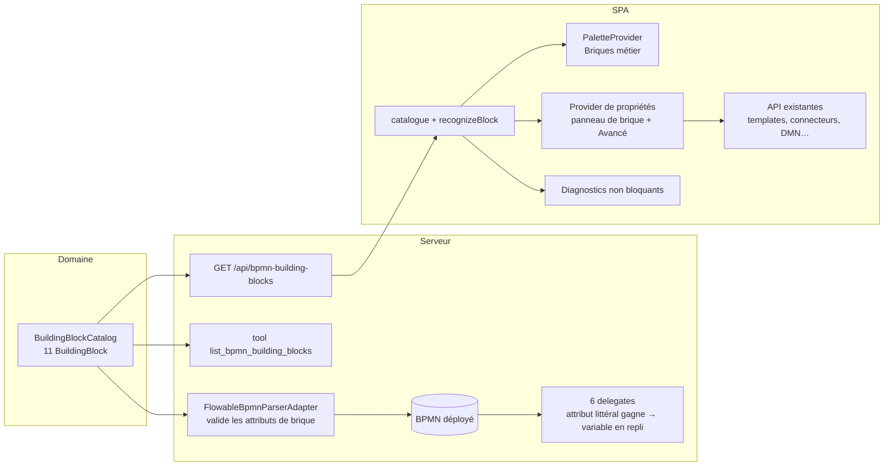

# System Design & Architecture — `palette-metier-bpmn` (LC1)

> Dérivé des [requirements](../requirements/2026-09-29-feature-palette-metier-bpmn.md) (`reviewed`). Les décisions
> D-PALETTE-* sont celles tranchées par l'utilisateur. **Phase 3 (revue du design) close le 2026-09-29** : faits
> vérifiés dans le code, corrections et 2 décisions supplémentaires — voir « Revue Phase 3 ».

## Constats du code qui orientent le design

- `AllowedBpmnDelegates` : 8 noms (dont `signatureRequestTask`) ; `FlowableBpmnParserAdapter` + `BpmnExpressionSurfaceScanner`
  valident au déploiement ; le modèle `signatureDefinition(...)` montre le patron **attributs `flowable:*` littéraux relus
  dans le BPMN déployé** (`SignatureRequestTask` via `ProcessDefinitionUtil.getBpmnModel`).
- Six delegates lisent des **variables de process** seulement : `documentType`/`documentVariant`/`documentLocale`,
  `connectorInstanceId`/`connectorInput`, `notification*`, `child*`/`workflowProcessKey`/`relationType`,
  `targetDossierStatus`, `targetWorkflowStatus`.
- Frontend : `flowablePropertiesProvider.ts` (280 lignes) expose déjà `async`, `delegateExpression`, `expression`,
  `type`, `decisionTableReferenceKey`, `formKey`, `portalRecipient`, `portalLinkTtlDays`, et les attributs de signature.
  `taskFormRegistry.ts` porte la convention `formKey`.
- Endpoints de lecture existants : `/api/document-templates`, `/api/connectors`, `/api/connector-definitions`,
  `/api/workflow-type-configs`, `/api/dmn-decision-deployments`, `/api/task-question-schemas`, `/api/dossier-types`,
  `/api/notification-webhooks` (droits et tenant appliqués par chacun).

## Architecture Overview



**Principe.** Le catalogue est un artefact du domaine, **source unique** : il pilote (1) l'UI (palette, panneau,
reconnaissance), (2) la validation au déploiement (attributs autorisés par delegate, formes attendues), (3) le MCP. Un
test de conformité génère un XML par brique et vérifie qu'il est accepté par le parseur (US-8).

## Data Models

**Domaine** (`com.flowforge.domain.workflow.palette`, sans dépendance framework — règle ArchUnit `..domain..`) :

```java
record BuildingBlock(String id, String label, String description, BlockCategory category,
                     BlockElement element, BlockMarker marker, List<BlockParameter> parameters) {}
enum BlockCategory { DOSSIER, DOCUMENT, INTEGRATION, DECISION, HUMAN, SIGNATURE }
enum BlockElement { SERVICE_TASK, USER_TASK }
/** Motif XML reconnaissant la brique et valeurs posées à la création. */
record BlockMarker(String delegateExpression, String serviceTaskType, String formKeyPrefix,
                   boolean requiresPortalRecipient) {}
record BlockParameter(String name, String label, ParameterType type, ParameterBinding binding, boolean required,
                      String valueSource, List<String> enumValues, int maxLength, Integer min, Integer max, String help) {}
enum ParameterType { TEXT, ENUM, ENUM_MULTI, INTEGER, REFERENCE, SOURCE_REF, SIGNERS }
/** Comment la valeur s'écrit dans le XML (les briques existantes n'utilisent pas toutes un attribut simple). */
enum ParameterBinding {
  ATTRIBUTE,        // flowable:<name>="valeur"                 (nouveaux paramètres des six delegates ; signature)
  FIELD_ELEMENT,    // <flowable:field name=…><flowable:string> (DMN decisionTableReferenceKey)
  FORM_KEY_SUFFIX,  // flowable:formKey="user-question:<valeur>" (préfixe fixe + clé de schéma)
  SIGNER_ELEMENTS   // <flowable:signer source= kind= required= name=/> répétés (signature)
}
```

`SOURCE_REF` = valeur `dossierField:<nom>` ou `variable:<nom>` (type de source + nom, composé par le panneau). `REFERENCE` = clé/UUID d'une ressource du tenant, de format précisé par la source (`UUID`, `KEY`, `CODE`). `maxLength` borne tout texte (défaut 200 ; `notificationBody` 4000). `valueSource` **nomme** une source (`documentTemplates`, `connectorInstances`, `notificationWebhooks`, `dossierTypes`,
`workflowTypes`, `workflowStatuses`, `dmnTables`, `questionSchemas`) ; **aucune donnée du tenant** dans le catalogue.

**Catalogue (11 briques, tranche 1)** — `attribut` = `flowable:<attribut>` littéral ; variable = repli/surcharge :

| # | Brique (`id`) | Élément / marqueur | Paramètres (attribut ⇒ variable) |
|---|---|---|---|
| 1 | Générer un document (`generate-document`) | `serviceTask` `${documentGenerationTask}` | `documentType`\* (`documentTemplates`), `documentVariant`, `documentLocale` |
| 2 | Joindre le document (`attach-document`) | `serviceTask` `${attachGeneratedDocumentTask}` | — |
| 3 | Appeler un connecteur (`call-connector`) | `serviceTask` `${connectorServiceTask}` | `connectorInstanceId`\* (`connectorInstances`, rôle SERVICE) ; `connectorInput` reste variable |
| 4 | Notifier (`notify`) | `serviceTask` `${notificationDispatchTask}` | `notificationChannels`\* (ENUM_MULTI), `notificationTo`, `notificationSubject`, `notificationBody`, `notificationUserId`, `notificationWebhookConfigId` (`notificationWebhooks`) ; `notificationPayload` reste variable |
| 5 | Créer un dossier enfant (`create-child-dossier`) | `serviceTask` `${createChildDossierTask}` | `childDossierTypeCode`\* (`dossierTypes`), `childDossierLabel`\*, `workflowProcessKey`\* (`workflowTypes`), `relationType`\* (`PARENT_CHILD`/`SUBSEQUENT`) ; `childDossierFields`, `childWorkflowVariables` restent variables |
| 6 | Changer le statut du dossier (`set-dossier-status`) | `serviceTask` `${updateDossierStatusTask}` | `targetDossierStatus`\* (ENUM `DossierStatus`) |
| 7 | Changer le statut du workflow (`set-workflow-status`) | `serviceTask` `${updateWorkflowLinkStatusTask}` | `targetWorkflowStatus`\* (`workflowStatuses`) |
| 8 | Décision DMN (`dmn-decision`) | `serviceTask` `flowable:type="dmn"` | `decisionTableReferenceKey`\* (`dmnTables`, binding `FIELD_ELEMENT`) — mécanisme **existant** |
| 9 | Question utilisateur (`user-question`) | `userTask` `formKey="user-question:<clé>"` | `schemaKey`\* (`questionSchemas`, binding `FORM_KEY_SUFFIX`) — existant |
| 10 | Tâche externe (`external-task`) | `userTask` `portalRecipient` | `portalRecipient`\* (`SOURCE_REF`), `schemaKey`\* (`FORM_KEY_SUFFIX`), `portalLinkTtlDays` (INTEGER 1–365) — existant |
| 11 | Demander une signature (`request-signature`) | `serviceTask` `${signatureRequestTask}` | `signatureDocument`\* (`SOURCE_REF`), `signatureMode` (ENUM), `signatureDeadlineDays` (INTEGER 1–365), signataires (`SIGNER_ELEMENTS`) — existant (§72) |

\* obligatoire. Les briques 8–11 n'exigent **aucun** changement d'exécution (attributs déjà lus) ; les briques 1, 3–7
exigent la lecture d'attributs par les delegates (D-PALETTE-PARAMS). Pour 4 et 5, les champs structurés restent des variables.

**Lecture des paramètres à l'exécution** (`DeployedActivityParameters`, infrastructure Flowable) :
`get(execution, "targetDossierStatus")` → (1) **variable de process non nulle et non vide** (D-PALETTE-PRECEDENCE ; une variable vide
retombe sur l'attribut), sinon (2) attribut `flowable:targetDossierStatus` de l'activité courante — lu via
`execution.getCurrentFlowElement()` (élément du BPMN **déployé**, pas de recherche de modèle), sinon (3) absent (erreur actuelle
« … est requis »). Aucune évaluation UEL de l'attribut. Le nom d'attribut est **le nom de la variable** (`flowable:documentType`…).

## API Design

- `GET /api/bpmn-building-blocks` — chaîne BFF authentifiée, mêmes droits que l'éditeur BPMN (`TENANT_ADMIN`,
  `WORKFLOW_ADMIN`) ; réponse `{ version, blocks: [BuildingBlock…] }` ; **statique**, cachable côté client.
- Tool MCP `list_bpmn_building_blocks` (lecture) : même use case, même DTO, sans paramètre.
- `GET /api/bpmn-building-blocks/references/{source}` — sources `documentTemplates`, `connectorInstances` (rôle SERVICE), `notificationWebhooks` ;
  rôles `TENANT_ADMIN` et `WORKFLOW_ADMIN` ; réponse `[{ value, label }]`, tenant courant seulement, **sans configuration ni secret ni contenu**
  (D-PALETTE-REFERENCES). Les cinq autres sources sont lues via leurs API existantes.
- Aucune modification des endpoints de lecture existants ; aucune nouvelle écriture.
- **Validation au déploiement, en deux temps** (D-PALETTE-DEPLOY-REFERENCES) :
  1. **Parseur** (forme) — `BuildingBlockAttributeValidator`, appelé par `assertSafeElement` : pour un `serviceTask` portant l'un des six
     delegates, chaque attribut `flowable:<nom>` du catalogue de ce delegate est validé (littéral sans `${`/`#{`, longueur, UUID,
     énumération, entier borné) ; un attribut de brique posé sur une activité qui n'est pas de ce delegate, ou une valeur invalide →
     `InvalidBpmnException`. Attributs inconnus hors catalogue : traitement actuel inchangé (préservés).
  2. **Use case de déploiement** (existence) — `BlockReferenceVerifier`, appelé par `DeployBpmnProcessUseCaseImpl` à côté du contrôle
     des clés DMN : template actif (`documentType`), instance de connecteur du tenant de rôle SERVICE (`connectorInstanceId`), type de
     dossier (`childDossierTypeCode`), configuration de workflow (`workflowProcessKey`, ou le process en cours de déploiement),
     webhook (`notificationWebhookConfigId`), statut déclaré dans la **configuration de ce process** (`targetWorkflowStatus`).
     Échec → `UnknownBlockReferenceException` (activité, attribut, valeur), mappée 404 comme `UnknownDecisionKeyException`.
     Les constructions déjà existantes (`formKey`, `portalRecipient`, signature) **ne changent pas** de contrôle (pas de régression).
- **Parité `dryRun`** : `DeployBpmnProcessUseCase` gagne `validate(bpmnXml, Optional<WorkflowTypeConfig> effectiveConfig)` (tous les contrôles
  de déploiement sans déployer) ; `deploy` l'appelle ; `DeployWorkflowTool` en `dryRun` l'appelle avec la configuration **soumise**. Aujourd'hui
  le `dryRun` ne joue que la validation du parseur (clé, sûreté) et **saute** les contrôles du use case (DMN, portail, signature) : correction
  incluse, sinon l'agent (P4) ne pourrait pas se vérifier seul.

## Reconnaissance d'une brique (D-PALETTE-RECOGNITION)

Règles **ordonnées** appliquées à un élément importé ; la première qui correspond gagne, sinon mode brut :

| Ordre | Condition | Brique |
|---|---|---|
| 1 | `serviceTask` `delegateExpression` = `${signatureRequestTask}` | `request-signature` |
| 2 | `serviceTask` `flowable:type="dmn"` | `dmn-decision` |
| 3 | `serviceTask` `delegateExpression` = un des six delegates ci-dessus | brique du delegate (1–7) |
| 4 | `userTask` avec `flowable:portalRecipient` | `external-task` |
| 5 | `userTask` avec `formKey` commençant par `user-question:` | `user-question` |
| — | tout le reste (dont `formKey` `dossier-fields` / `document-generation`) | brut |

## Component Breakdown

**Backend**
- Domaine : `BuildingBlockCatalog` (11 blocs, constantes), `ListBuildingBlocksUseCase` (+ impl).
- Web : `BuildingBlockController` (`/api/bpmn-building-blocks`, `/references/{source}`) ; use case `ListBlockReferencesUseCase` (réutilise les ports de lecture des templates, instances de connecteurs et webhooks) ; MCP : `ListBpmnBuildingBlocksTool`.
- Domaine (ports) : `BlockReferenceLookupPort` (existence d'un template actif, d'une instance de connecteur SERVICE, d'un type de dossier, d'une configuration de workflow, d'un webhook) ; `BlockReferenceVerifier` ; adaptateur d'infrastructure sur les dépôts existants.
- Exécution : `DeployedActivityParameters` ; adaptation de `DocumentGenerationTask`, `ConnectorServiceTask`,
  `NotificationDispatchTask`, `CreateChildDossierDelegate`, `UpdateDossierStatusDelegate`, `UpdateWorkflowLinkStatusDelegate`.
- Parseur : `BuildingBlockAttributeValidator` (dérive des règles du catalogue), appelé par `FlowableBpmnParserAdapter`.

**Frontend** (`frontend/src/components/workflow/`)
- `bpmn-blocks/catalogClient.ts` + store (chargement unique, repli si indisponible) ; `recognizeBlock.ts` (motif XML → brique).
- `bpmn-blocks/blockPaletteProvider.ts` : entrées « Briques métier » (création d'un `serviceTask`/`userTask` pré-configuré).
- `bpmn-blocks/blockPropertiesProvider.ts` : groupe « Brique » inséré **juste après « General »** (champs typés + sélecteurs alimentés via
  le `valueSourceResolver`) ; le groupe « Flowable » actuel est **renommé « Avancé » et replié par défaut** (mêmes entrées brutes, mêmes ids,
  zéro régression de `flowablePropertiesProvider`). Un `SIGNER_ELEMENTS` / `FIELD_ELEMENT` s'écrit avec `moddle.createAny` +
  `bpmnFactory.create('bpmn:ExtensionElements')` comme `DecisionTableReferenceKey` (pièges documentés dans le fichier actuel).
- `bpmn-blocks/flowableNamespace.ts` : `ensureFlowableNamespace(definitions)` — avant toute écriture de brique, déclare `xmlns:flowable` si
  l'import ne le portait pas (sinon `saveXML()` **supprime silencieusement** l'attribut : risque résiduel de D-FLOWABLE-NS, désormais traité).
- `bpmn-blocks/blockDiagnostics.ts` : avertissements (obligatoire vide, référence absente, valeur non littérale, compagnon manquant, variable
  prioritaire) → texte au panneau + marqueur visuel sur l'élément (`canvas.addMarker` + classe CSS `fb-block-warning`).
- `valueSourceResolver` reçoit le **contexte du process** (clé du process) : `workflowStatuses` = statuts de la configuration de ce process ; sans
  configuration, saisie libre + avertissement.
- `valueSourceResolver.ts` : `workflowTypes`, `workflowStatuses`, `dmnTables`, `questionSchemas`, `dossierTypes` → API existantes ; `documentTemplates`, `connectorInstances`, `notificationWebhooks` → `/api/bpmn-building-blocks/references/{source}`.

## Design Decisions

| ID | Décision | Alternative écartée |
|---|---|---|
| D-PALETTE-MECHANISM | Provider maison étendu + `PaletteProvider` | Element templates bpmn.io (Camunda) |
| D-PALETTE-CATALOG-SOURCE | Catalogue **serveur**, API + MCP | Descripteurs dans la SPA (divergence MCP) |
| D-PALETTE-EXPERT | « Avancé » repliée, pour tous | Champs bruts réservés à un rôle |
| D-PALETTE-SCOPE | 11 briques | 6 (ROADMAP) ou 3 |
| D-PALETTE-PARAMS | Attributs littéraux + repli variable | Variables seulement (brique = pense-bête) |
| D-PALETTE-PRECEDENCE (révisée 2026-09-30, revue adversariale I1) | **L'attribut gagne** quand il est renseigné ; la variable n'est qu'un repli (process sans attribut = comportement d'avant). Initialement « variable gagne » | Variable gagne : une variable de complétion de tâche, saisie par un utilisateur, écrasait le statut / connecteur / destinataire fixés par le concepteur |
| D-PALETTE-GRANULARITY | Une brique = un élément | Gabarits multi-éléments (LC5) |
| D-PALETTE-RECOGNITION | Motif XML, aucun marqueur | Attribut `flowable:block` |
| D-PALETTE-VALIDATION | Avertissements non bloquants | Blocage à l'enregistrement |
| D-PALETTE-VALUE-SOURCE | Le catalogue nomme la source, la SPA appelle les API existantes | Résolution serveur agrégée |
| D-PALETTE-REFERENCES | Endpoint de références minimal pour les 3 sources `TENANT_ADMIN`-only | Élargir les rôles des API d'admin ; accepter des listes vides |
| D-PALETTE-MCP | Tool de lecture dans le lot | Rattrapage ultérieur |
| D-PALETTE-DEPLOY-REFERENCES | **Oui** : l'existence des références des nouveaux attributs est vérifiée au déploiement (utilisateur, contre la recommandation « forme seulement »), au use case et non au parseur ; parité `dryRun` | Forme seulement (permettait de déployer avant de créer la dépendance) |
| D-PALETTE-BINDING | Le catalogue porte un *binding* par paramètre (attribut, `flowable:field`, suffixe de `formKey`, éléments `flowable:signer`) | Tout modélisé en attribut (faux pour DMN, `formKey`, signature) |
| D-PALETTE-RAW-PALETTE | Palette native de bpmn-js **conservée** ; les briques sont un groupe supplémentaire (utilisateur) | Masquer les tâches natives |

## Non-Functional Requirements

- **Sécurité** : l'endpoint de références ne renvoie que `{ value, label }` et exige un rôle d'éditeur ; aucune évaluation d'attribut ; refus de `${`/`#{` ; les allowlists §57/§69 inchangées ; catalogue
  sans donnée du tenant ; sélecteurs limités aux droits de l'utilisateur (endpoints existants) ; texte des libellés
  échappé (Vue) ; aucun secret.
- **Ordre de déploiement** : les références des nouveaux attributs doivent exister avant `deploy_workflow`/déploiement (templates, connecteurs, types de dossier, webhooks) ; la configuration du workflow est créée avec le déploiement (`deploy_workflow` l'upserte), donc `targetWorkflowStatus` se vérifie contre elle.
- **Compatibilité** : variables seules = comportement inchangé (test de non-régression par delegate) ; XML produit
  compatible avec un export/import sans perte ; golden OpenAPI : ajout d'un seul chemin.
- **Performance** : catalogue statique chargé une fois ; sélecteurs chargés à la demande, paginés par les API existantes.
- **Fiabilité** : source d'options indisponible → saisie libre + avertissement ; catalogue indisponible → éditeur brut actuel.
- **Accessibilité/UX** : palette et panneau au clavier (composants `properties-panel`), pastille d'avertissement
  accompagnée d'un texte, libellés métier en français.
- **Observabilité** : aucune nouvelle métrique requise ; journal du refus de déploiement inchangé (message explicite).

## Revue Phase 3 (2026-09-29)

**Vérifié dans le code** : (1) `extractProcessDefinitionKey` exécute la validation de sûreté du parseur (donc le `dryRun` MCP la joue) mais
**pas** les contrôles du use case de déploiement (clés DMN, portail, signature) — écart de parité corrigé par `validate(...)` ; (2) la
clé DMN est déjà vérifiée par `DeployBpmnProcessUseCaseImpl` : précédent de vérification d'existence au use case ; (3) la configuration
de workflow doit exister avant le déploiement, et `deploy_workflow` l'upserte : `targetWorkflowStatus` se vérifie contre la configuration
soumise ; (4) `NotificationChannel` = `EMAIL`, `WEBHOOK`, `BROWSER` ; (5) le canvas a déjà `xmlns:flowable` sur le gabarit vierge seulement ;
(6) `flowablePropertiesProvider` pousse ses groupes en fin (`groups.push`, priorité 500) ; (7) les erreurs de ressource inconnue du
workflow sont mappées 404 (`WorkflowExceptionHandler`).

**Écarts du design de Phase 1 corrigés** : le modèle de paramètre supposait « un attribut par paramètre » — faux pour la clé DMN
(`flowable:field`), le `formKey` (préfixe + clé) et la signature (éléments `flowable:signer`) ⇒ `ParameterBinding` ; l'import d'un
diagramme sans `xmlns:flowable` perd silencieusement l'attribut ⇒ `ensureFlowableNamespace` ; le `dryRun` ne validait pas comme le
déploiement ⇒ `validate(...)` ; les règles de reconnaissance n'étaient pas ordonnées ⇒ table ci-dessus.

**Décisions de la revue (utilisateur)** : D-PALETTE-DEPLOY-REFERENCES = **oui** (vérifier l'existence au déploiement) ;
D-PALETTE-RAW-PALETTE = palette native conservée.

**Points à valider en spike (M6/M7, pas des décisions produit)** : enregistrement d'un `PaletteProvider` via `additionalModules` ;
création d'un élément avec attributs `flowable:*` dans le `BpmnFactory` ; groupe repliable dans `@bpmn-io/properties-panel` ;
marqueurs CSS sur les éléments.
