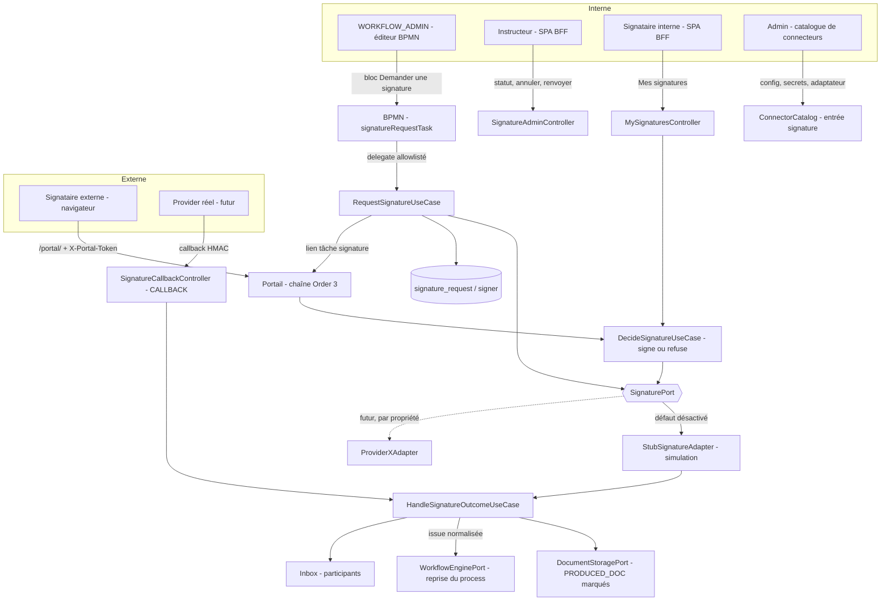
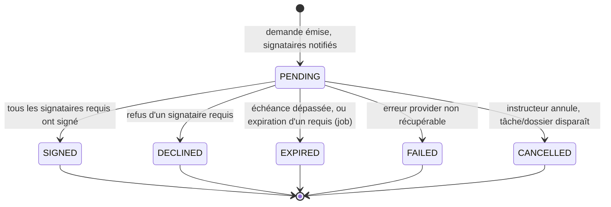

# System Design & Architecture — `signature-electronique`

> TODO §72. **Esquisse de Phase 1, mise à jour après la Phase 2** (2026-09-29) : intègre les
> décisions de [requirements](../requirements/2026-09-29-feature-signature-electronique.md)
> (`reviewed`) — signataires internes et externes, modes `PARALLEL` / `SEQUENTIAL`, requis /
> facultatifs, issue en variable de process. Tout ce qui est marqué **[Phase 3]** est une
> proposition à trancher. Nommage des classes et des colonnes indicatif.

## Architecture Overview



**Composants et responsabilités :**

- **`SignaturePort`** (sortant, domaine pur) : le contrat indépendant de tout fournisseur (voir
  « API Design »). Un seul adaptateur actif, choisi par propriété au démarrage.
- **`StubSignatureAdapter`** : simule le cycle complet, produit un document filigrané et une preuve
  factice ; jamais actif sans propriété explicite (D-SIGNATURE-STUB-GUARD).
- **Delegate `signatureRequestTask`** : ajouté à `AllowedBpmnDelegates` ; appelle le use case, pose
  l'identifiant de demande en variable de process, puis le process attend l'issue (D-SIGNATURE-TRIGGER,
  TRIGGER-VS-CONNECTOR).
- **Portail** : nouveau type de tâche externe « signature » (D-SIGNATURE-PORTAL-KIND) sur la chaîne
  existante ; écran de consultation, signature, refus.
- **Entrée de catalogue** : configuration, secrets et réception du callback du provider actif.
- **Idempotence et reprise** : l'issue est appliquée une seule fois (compare-and-set sur le statut).

**Choix technologiques :** Java 25 / Spring Boot 4.1, Flowable 8, PostgreSQL + Liquibase, Vue 3 /
PrimeVue pour l'écran instructeur, build Vite séparé du portail pour l'écran signataire, OpenPDF /
Flying Saucer pour le filigrane. Aucun nouveau composant d'infrastructure.

## Data Models

**[Phase 3] Décision structurante à trancher : table dédiée ou extension de `portal_link`.**
Esquisse par défaut (table dédiée, le portail existant reste inchangé) :

### Table `signature_request` (migration à numéroter)

| Colonne | Type | Notes |
|---|---|---|
| `id` | `uuid` PK | |
| `tenant_id` | `varchar(64)` | convention des autres tables |
| `dossier_id` | `uuid`, indexé | purge et écran instructeur |
| `process_instance_id`, `task_id` | `varchar(64)` | corrélation process |
| `source_element_id` | `uuid` | `PRODUCED_DOC` à signer |
| `source_digest` | `char(64)` | SHA-256 du document émis (immuabilité de la demande) |
| `provider_code` | `varchar(64)` | code de l'adaptateur (`stub`, futur code réel) |
| `provider_reference` | `varchar(256)` null | identifiant côté provider |
| `status` | `varchar(16)` | `PENDING`, `SIGNED`, `DECLINED`, `EXPIRED`, `FAILED`, `CANCELLED` |
| `simulated` | `boolean` not null | vrai pour le stub |
| `assurance_level` | `varchar(16)` null | informatif (D-SIGNATURE-LEVEL reportée) |
| `mode` | `varchar(12)` | `PARALLEL` ou `SEQUENTIAL` (D-SIGNATURE-ORDER) |
| `deadline_at` | `timestamptz` not null | échéance de la demande, plafonnée par le tenant (D-SIGNATURE-DEADLINE) |
| `created_at`, `completed_at` | `timestamptz` | |
| `created_by` | `varchar(128)` | acteur ou `flowable-task-created` |
| `version` | `bigint` | verrou optimiste (double issue, callback rejoué) |

### Table `signature_signer`

| Colonne | Type | Notes |
|---|---|---|
| `id` | `uuid` PK | identité externe `signature:<id>` |
| `request_id` | `uuid` FK, indexé | |
| `position` | `int` | rang ; significatif en `SEQUENTIAL` |
| `kind` | `varchar(10)` | `EXTERNAL` ou `INTERNAL` (D-SIGNATURE-SIGNER-KIND) |
| `required` | `boolean` | requis ou facultatif (D-SIGNATURE-REQUIRED) |
| `user_id` | `varchar(128)` null | identifiant utilisateur pour un signataire `INTERNAL` |
| `display_name` | `varchar(200)` | |
| `email` | `varchar(320)` null | **donnée personnelle** (`EXTERNAL`), supprimée à la purge |
| `role` | `varchar(64)` null | |
| `token_hash` | `char(64)` null, unique | SHA-256 du jeton, comme `portal_link` |
| `status` | `varchar(16)` | `WAITING` (pas son tour), `PENDING`, `SIGNED`, `DECLINED`, `EXPIRED`, `REVOKED` |
| `expires_at`, `decided_at` | `timestamptz` | `expires_at` ≤ `deadline_at` |
| `decline_reason` | `varchar(500)` null | texte libre borné |

### Éléments de dossier

Document signé et preuve = `DossierElement` de type `PRODUCED_DOC` **marqués** (D-SIGNATURE-ELEMENT) :
métadonnées `signatureRequestId`, `signatureRole` (`SIGNED_DOCUMENT` | `SIGNATURE_PROOF`),
`simulated`. **[Phase 3]** forme exacte du marqueur (colonne JSON existante ou champ dédié) et filtre API.

### Machine à états d'une demande



### Domaine

- `SignatureRequest`, `Signer` (records), `SignatureStatus`, `SignerStatus`, `SignatureMode`,
  `SignerKind` (enums).
- `SignatureProgression` (fonction pure) : à partir de l'état des signataires, du mode et de
  l'indicateur requis, calcule l'issue de la demande et le prochain signataire à notifier ;
  cœur testé exhaustivement (tableau parallèle / séquentiel × requis / facultatif).
- `SignatureProviderCapabilities` : multi-signataires, ordre imposé, niveaux supportés, parcours
  hébergé chez le provider ou dans le portail, preuve fournie.
- `AccessContext.External` : le signataire **externe** est représenté par `signature:<signerId>` (à
  rapprocher de `portal:<linkId>`, D-PORTAL-ACTOR). Le signataire **interne** agit avec son
  `AccessContext.User` ; le contrôle de la demande (`signer.user_id` = utilisateur courant, son tour)
  s'ajoute au droit de lecture du dossier (A4).

## API Design

### Contrat `SignaturePort` (sortant)

```java
public interface SignaturePort {
    SignatureProviderCapabilities capabilities();
    SignatureSubmission request(SignatureRequestCommand command);   // création côté provider
    SignatureStatusView status(String providerReference);
    void cancel(String providerReference);
    SignedArtifacts fetchArtifacts(String providerReference);        // document signé + preuve
}
```

`SignatureRequestCommand` : document (octets + type + empreinte), signataires ordonnés (nom, adresse,
rôle), message, échéance, référence de corrélation. `SignatureOutcome` : `SIGNED`, `DECLINED`,
`EXPIRED`, `FAILED`, indépendant du vocabulaire du provider. **[Phase 3]** figer après le tableau de
correspondance avec 2 à 3 API publiques (D-SIGNATURE-CONTRACT-CHECK).

### API publique du portail (chaîne existante, sans session)

| Méthode + chemin | Rôle |
|---|---|
| `GET /api/portal/signature` | contexte : référence du dossier, libellé, document (aperçu ou lien de téléchargement borné), état du signataire |
| `GET /api/portal/signature/document` | flux du document à signer (uniquement celui de la demande) |
| `POST /api/portal/signature/sign` | consentement de signature (stub) ou redirection (provider) |
| `POST /api/portal/signature/decline` | refus avec motif optionnel |

Authentification : jeton dans le fragment d'URL, relu par la page et envoyé en en-tête
`X-Portal-Token` ; réponses uniformes en cas d'échec (pas d'oracle). **[Phase 3]** chemins exacts,
cohabitation avec `/api/portal/task`.

### API « Mes signatures » (signataire interne, chaîne BFF)

| Méthode + chemin | Rôle |
|---|---|
| `GET /api/signatures/mine` | demandes adressées à l'utilisateur courant (statut, à son tour ou non) |
| `GET /api/signatures/mine/{signerId}/document` | flux du document, uniquement pour ses propres demandes |
| `POST /api/signatures/mine/{signerId}/sign` · `/decline` | signer ou refuser (à son tour uniquement) |

Filtrage par identité authentifiée ; toute autre demande répond comme inexistante. **[Phase 3]**
chemins exacts et lien avec l'inbox.

### API interne instructeur (chaîne BFF)

| Méthode + chemin | Droit | Rôle |
|---|---|---|
| `GET /api/dossiers/{id}/signature-requests` | VIEW (adresse masquée sans EDIT) | liste et statuts |
| `POST /api/signature-requests/{id}/cancel` | EDIT sur le type | annuler |
| `POST /api/signature-requests/{id}/resend` | EDIT sur le type | renvoyer au signataire |

### Retour du provider (chaîne `Order(3)`, `CALLBACK`)

`POST /api/callbacks/signature/{connectorInstanceId}` : HMAC horodaté, `Idempotency-Key`, corps borné,
rate-limit pré-authentification ; mêmes garde-fous et correctifs que `flowable-callback`
(TODO §51/§53/§54). Le stub n'utilise pas cette route : il applique l'issue en interne.

### MCP

Exposition dans le même lot (principe P1, [analyse 46](../../../analysis%20doc/46-exposition-mcp-couche-low-code.md)) :
lecture du statut d'une demande et annulation ; **[Phase 3]** périmètre exact, en cohérence avec D6.

## Component Breakdown

### Backend — domaine (`com.flowforge.domain.signature`)

- `port.out` : `SignaturePort`, `SignatureRequestRepository`, `SignatureTokenPort` (réutilise le
  mécanisme de jeton du portail), `SignatureNotifierPort`.
- `port.in` : `RequestSignatureUseCase`, `DecideSignatureUseCase`, `HandleSignatureOutcomeUseCase`,
  `CancelSignatureRequestUseCase`, `ResendSignatureRequestUseCase`, `ExpireSignatureRequestsUseCase`.
- `usecase` : implémentations pures, sans Spring.

### Backend — infrastructure

- `infrastructure.signature.StubSignatureAdapter`, config `SignatureConfig` (sélection par propriété,
  garde du stub, contrôle du profil de production).
- Delegate `SignatureRequestTask` enregistré dans `AllowedBpmnDelegates`.
- Persistance JPA, migration Liquibase, job d'expiration (modèle `PortalLinkExpiryJob`).
- Contrôleurs portail, admin, callback ; entrée `ConnectorCatalog` (`signature`, capacité
  `CALLBACK`).
- Générateur de filigrane PDF pour le stub.

### Frontend

- Portail (build Vite séparé) : écran « Signature » (consultation du document, signer, refuser).
- SPA interne : vue « Mes signatures » (liste, document, signer, refuser) pour les signataires
  internes.
- SPA interne : panneau « Signatures » dans le détail du dossier (statuts, annuler, renvoyer,
  document signé et preuve, bandeau « SIMULATION »).
- Éditeur BPMN : marqueur du bloc signature (aligné sur LC1, **[Phase 3]**).

### Configuration

**[Phase 3]** propriété d'activation sur le patron `app.dossier.attachment.scan.type` (défaut
désactivé), second drapeau du stub en production (absent de `.env.example`), TTL par défaut et
plafond tenant, nombre maximal de signataires.

## Design Decisions

### Tranchées (Phase 1, voir requirements)

Port + adaptateur exposé comme connecteur ; simulation de bout en bout marquée ; tâche externe du
portail + statut dans le dossier ; delegate allowlisté appelant le port directement ; nouveau type de
tâche « signature » ; `PRODUCED_DOC` marqué ; refus de démarrer du stub en production sauf drapeau
explicite ; contrat validé contre des API publiques.

### Tranchées en Phase 2 (voir requirements)

Modes `PARALLEL` et `SEQUENTIAL` ; requis / facultatifs (SIGNED = tous les requis) ; en séquentiel
un facultatif qui refuse ou expire fait passer au suivant ; issue en variable de process
(`signatureOutcome`, `signatureRequestId`) ; un seul `PRODUCED_DOC` désigné par variable ; échéance
de demande unique, pas de relance automatique ; signataires internes et externes, vue « Mes
signatures » ; internes désignés par identifiant utilisateur (champ / variable) ; preuve = PDF
filigrané ; un lot à jalons internes.

### À trancher en Phase 3

- Table dédiée ou extension de `portal_link` (colonne `kind`) : réutilisation maximale du code
  contre isolation du modèle et du périmètre de sécurité.
- Mécanisme d'attente du process : `receiveTask` / `intermediateCatchEvent` corrélé par variable
  (patron `flowable-callback`) ou attente interne au moteur.
- Forme de l'issue normalisée exposée au BPMN et règles de routage.
- Marqueur BPMN du bloc signature (attribut `flowable:*` dédié, ou `formKey` réservé) et compatibilité
  avec l'allowlist (§57/§69).
- Critère de « profil de production » (profil Spring actif ou propriété dédiée).
- Format de la preuve du stub.

## Non-Functional Requirements

- **Sécurité :** jetons hachés et comparés en temps constant ; réponses uniformes ; aucun accès
  croisé entre demandes ; secrets chiffrés au repos ; le drapeau de simulation jamais dans les
  gabarits ; revue adversariale du portail rejouée sur le type « signature » ; SSRF : tout appel
  sortant d'un futur adaptateur passe par les garde-fous de `http-rest` SERVICE.
- **Performance :** document stocké via `DocumentStoragePort`, jamais chargé plusieurs fois en
  mémoire ; taille maximale du document à signer bornée.
- **Fiabilité :** idempotence de l'issue (compare-and-set) ; le job d'expiration tolère un retard ;
  un échec provider ne bloque jamais le process (issue `FAILED`).
- **Conformité :** aucune valeur juridique revendiquée ; marquage de simulation indélébile ;
  purge complète (demandes, signataires, liens, documents signés, preuves).
- **Observabilité :** compteurs Micrometer (demandes, issues, refus du stub en production,
  callbacks rejetés) ; journalisation sans jeton ni adresse en clair.

## Couverture des requirements

À compléter en Phase 3 (table US → composants), sur le modèle du lot portail.
