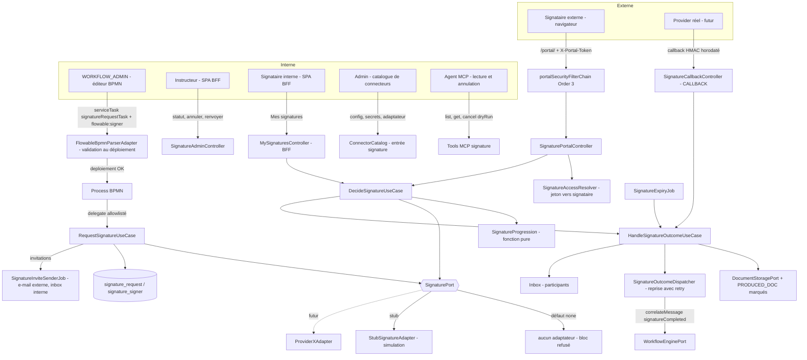
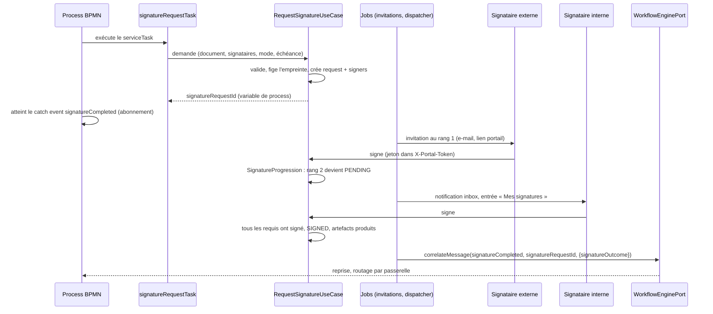
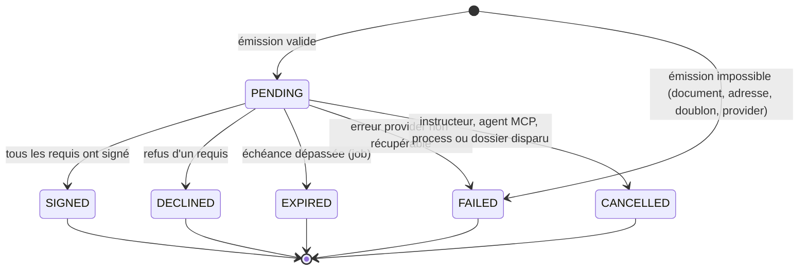

# System Design & Architecture — `signature-electronique`

> TODO §72. **Phase 3 (revue du design) close le 2026-09-29.** Base : les
> [requirements](../requirements/2026-09-29-feature-signature-electronique.md) (`reviewed`) et un
> relevé du code de `main` (portail, `WorkflowEnginePort`, delegates, parser BPMN, purge). Quatre
> décisions d'architecture **tranchées par l'utilisateur** (« Décisions Phase 3 »), le reste par
> alignement sur l'existant. Noms de classes et de colonnes : cibles de l'implémentation.

## Constats du code qui orientent le design

| # | Constat vérifié | Conséquence |
|---|---|---|
| **F1** | `PortalAccessResolver.resolve` exige une `userTask` Flowable **ouverte** (`PortalTaskLookupPort.findOpenTask`) ; tout le portail est bâti autour d'une tâche. Le process de signature **attend sur un message**, sans tâche. | Le signataire ne peut pas être une variante de `portal_link` sans modifier du code de sécurité livré : **tables et résolveur dédiés**. |
| **F2** | `WorkflowEnginePort.correlateMessage(messageName, correlationKey, value, variables)` existe et lève `CallbackNoMatchingInstanceException` si le process n'est pas (encore) abonné (D-CALLBACK-RACE). | Réutilisé pour la reprise ; mais une issue **produite avant l'abonnement** (échec à l'émission) exige un **répartiteur avec reprise** (voir D-SIGNATURE-DISPATCH). |
| **F3** | Les delegates existants se configurent par **variables de process** ; le portail par **attributs** `flowable:*` validés au déploiement (`FlowableBpmnParserAdapter`). Aucun parsing d'`extensionElements` n'existe aujourd'hui. | Le bloc signature suit le portail (validation au déploiement) et **introduit** le parsing d'un élément d'extension `flowable:signer`. |
| **F4** | `attachGeneratedDocumentTask` crée le `PRODUCED_DOC` mais ne pose **aucune** variable avec l'identifiant de l'élément ; la variable disponible est `generatedDocumentId` (= `storageRef`). | Le bloc désigne le document par une variable contenant le `storageRef` ; le use case retrouve l'élément `PRODUCED_DOC` du dossier par `storageRef` (il doit avoir été attaché avant). |
| **F5** | `DossierElement` porte déjà un champ `metadata` (`Map`). | Le marqueur de D-SIGNATURE-ELEMENT tient dans `metadata` : **aucune migration** sur `dossier_element`. |
| **F6** | Seul le profil `local` existe (`application-local.yml`) ; aucun profil `prod`. | La garde du stub se définit par **liste positive** de profils sûrs (voir D-SIGNATURE-GUARD-CRITERION). |
| **F7** | `flying-saucer-pdf` 10.5.0 (dépendance existante) embarque OpenPDF. | Filigrane et PDF de preuve sans nouvelle dépendance ; **à confirmer par un test dès M3** (API `PdfStamper` accessible). |
| **F8** | La purge de dossier appelle déjà `portalLinkRepository.deleteAllByDossierId`. | Même point d'extension pour `signature_*`. |

## Architecture Overview



**Séquence nominale (deux signataires, séquentiel) :**



**Composants et responsabilités :**

- **`SignaturePort`** (sortant, domaine pur) : contrat indépendant de tout fournisseur (voir « API
  Design »). Un seul adaptateur actif, choisi par propriété au démarrage.
- **`StubSignatureAdapter`** : simule le cycle complet ; jamais actif sans propriété explicite ;
  soumis à la garde de profil.
- **`RequestSignatureUseCase`** : appelé par le delegate ; valide, fige, crée, ne bloque jamais le
  process (erreur ⇒ demande `FAILED`).
- **`SignatureProgression`** (fonction pure) : calcule l'issue et le prochain signataire à partir
  du mode et de l'état des signataires — cœur testé exhaustivement.
- **`SignatureOutcomeDispatcher`** : reprend le process quand une demande est terminale, avec
  reprise sur `CallbackNoMatchingInstanceException`.
- **Portail** : contrôleur et résolveur dédiés sur la chaîne et l'intercepteur existants.
- **Entrée de catalogue** : configuration, secrets, callback du provider actif.

**Choix technologiques :** Java 25 / Spring Boot 4.1, Flowable 8, PostgreSQL + Liquibase, Vue 3 /
PrimeVue (SPA), build Vite séparé du portail, OpenPDF via Flying Saucer (F7). Aucun composant
d'infrastructure nouveau.

## Data Models

Migration Liquibase à numéroter (suivante disponible au moment de l'implémentation ; les deux
tables dans un seul fichier, variantes PostgreSQL / H2 comme `portal_link`).

### Table `signature_request`

| Colonne | Type | Notes |
|---|---|---|
| `id` | `uuid` PK | identifiant stable ; valeur de la variable `signatureRequestId` |
| `tenant_id` | `varchar(64)` | convention des autres tables |
| `dossier_id` | `uuid`, indexé | purge, écran instructeur |
| `process_instance_id` | `varchar(64)` | corrélation process |
| `activity_id` | `varchar(128)` | id du `serviceTask` (unicité, diagnostic) |
| `source_element_id` | `uuid` | `PRODUCED_DOC` à signer |
| `source_storage_ref` | `varchar(512)` | copie du `storageRef` au moment de l'émission |
| `source_digest` | `char(64)` | SHA-256 du document émis |
| `provider_code` | `varchar(64)` | code de l'adaptateur (`stub`, futur code réel) |
| `provider_reference` | `varchar(256)` null | identifiant côté provider |
| `mode` | `varchar(12)` | `PARALLEL` ou `SEQUENTIAL` |
| `status` | `varchar(16)` | `PENDING`, `SIGNED`, `DECLINED`, `EXPIRED`, `FAILED`, `CANCELLED` |
| `status_reason` | `varchar(48)` null | `REQUIRED_DECLINED`, `DEADLINE`, `DUPLICATE_SIGNER`, `NO_ADDRESS`, `PROVIDER_ERROR`, `TASK_GONE`, `CANCELLED_BY_USER`… |
| `simulated` | `boolean` not null | vrai pour le stub |
| `assurance_level` | `varchar(16)` null | informatif (D-SIGNATURE-LEVEL reportée) |
| `deadline_at` | `timestamptz` not null | échéance unique (D-SIGNATURE-DEADLINE) |
| `outcome_dispatched_at` | `timestamptz` null | non nul une fois le process repris (répartiteur) |
| `dispatch_attempts` | `int` not null default 0 | |
| `created_at`, `completed_at` | `timestamptz` | |
| `created_by` | `varchar(128)` | `flowable-delegate` ou `userId` |
| `version` | `bigint` | verrou optimiste |

**Index :** `idx_signature_request_dossier` ; `idx_signature_request_status_deadline`
`(status, deadline_at)` (job d'expiration) ; `idx_signature_request_dispatch`
`(status, outcome_dispatched_at)` (répartiteur) ; unique
`(process_instance_id, activity_id)` **tant que `PENDING`** (index partiel, technique de
`002-dossier-workflow-link-active-index`) — un rejeu du delegate ne crée pas de doublon.

### Table `signature_signer`

| Colonne | Type | Notes |
|---|---|---|
| `id` | `uuid` PK | identité externe `signature:<id>` |
| `tenant_id` | `varchar(64)` | |
| `request_id` | `uuid` FK, indexé | |
| `position` | `int` | rang (significatif en `SEQUENTIAL`) |
| `kind` | `varchar(10)` | `EXTERNAL` ou `INTERNAL` |
| `required` | `boolean` | requis ou facultatif |
| `user_id` | `varchar(128)` null | identifiant utilisateur (`INTERNAL`), indexé |
| `display_name` | `varchar(200)` | |
| `email` | `varchar(320)` null | **donnée personnelle** (`EXTERNAL`), supprimée à la purge |
| `token_hash` | `char(64)` null, **unique** | SHA-256 du jeton (`EXTERNAL`) ; nul avant l'envoi |
| `status` | `varchar(16)` | `WAITING`, `PENDING`, `SIGNED`, `DECLINED`, `EXPIRED`, `REVOKED` |
| `invite_sent_at`, `invite_attempts` | | file d'envoi (modèle `PortalInviteSenderJob`) |
| `decided_at` | `timestamptz` null | |
| `decline_reason` | `varchar(500)` null | texte libre borné, échappé à l'affichage |
| `version` | `bigint` | verrou optimiste (double soumission) |

Contrainte : une même personne au plus **une fois** par demande (A5) — unicité applicative sur
l'identité résolue (`lower(email)` ou `user_id`), **vérifiée à l'émission** (voir D-SIGNATURE-DUPLICATE).

### Éléments de dossier

Le document signé et la preuve sont des `DossierElement` `PRODUCED_DOC` dont `metadata` contient
`signatureRequestId`, `signatureRole` (`SIGNED_DOCUMENT` | `SIGNATURE_PROOF`) et `simulated`
(F5). Pas de migration. Le filtrage API se fait sur `metadata.signatureRole`.

### Machine à états d'une demande



Statut d'un signataire : `WAITING` (pas son tour, séquentiel) → `PENDING` → `SIGNED` | `DECLINED` |
`EXPIRED` | `REVOKED` (demande fermée avant sa décision).

### `SignatureProgression` — règles (fonction pure)

Entrées : mode, liste ordonnée `(required, status)`, événement (signature ou refus du signataire *i*).

1. **Signature** de *i* : *i* devient `SIGNED`.
2. **Refus** de *i* : si *i* est **requis** ⇒ demande `DECLINED`, tous les non décidés `REVOKED` ;
   si *i* est **facultatif** ⇒ *i* devient `DECLINED`, la demande continue.
3. Si **tous les requis sont `SIGNED`** ⇒ demande `SIGNED`, les non décidés `REVOKED`.
4. **`SEQUENTIAL`** : après toute décision qui ne ferme pas la demande, le premier `WAITING` de
   rang supérieur devient `PENDING` (notifié) ; en **`PARALLEL`** tous sont `PENDING` dès l'émission.
5. **Échéance** : à `deadline_at`, la demande encore `PENDING` passe `EXPIRED` et tous les non décidés
   `EXPIRED`. L'expiration est **une propriété de la demande, pas d'un signataire** (échéance unique,
   D-SIGNATURE-DEADLINE) : le cas « facultatif qui expire » se confond avec l'expiration de la demande.

## API Design

### Contrat `SignaturePort` (sortant)

```java
public interface SignaturePort {
    String code();                                                   // code de l'adaptateur
    SignatureProviderCapabilities capabilities();
    SignatureSubmission submit(SignatureSubmitCommand command);      // création côté provider
    SignatureProviderStatus status(String providerReference);
    void cancel(String providerReference);
    SignedArtifacts fetchArtifacts(String providerReference);        // document signé + preuve
}
```

- `SignatureSubmitCommand` : document (flux + type + empreinte), signataires ordonnés (nom,
  adresse ou identifiant, requis), mode, message, échéance, référence de corrélation.
- `SignatureProviderCapabilities` : `orderedSigning`, `optionalSigners`, `assuranceLevels`,
  `hostedSigningUrl` (le signataire signe chez le provider), `proofProvided`.
- Issue normalisée `SignatureOutcome` : `SIGNED`, `DECLINED`, `EXPIRED`, `FAILED`, `CANCELLED`.
- **Le stub applique ses issues en interne** ; un provider réel les fait remonter par le callback.
- **À figer par M0** (D-SIGNATURE-CONTRACT-CHECK) : forme définitive après le tableau de
  correspondance ; en particulier le traitement d'un provider qui ne supporte pas l'ordre imposé ou
  les facultatifs (le port refuse, ou FlowForge orchestre côté domaine — décision de M0).

### API publique du portail (chaîne existante, sans session)

Contrôleur dédié `SignaturePortalController`, mêmes règles que `PortalController` :

| Méthode + chemin | Rôle |
|---|---|
| `GET /api/portal/signature` | contexte : référence du dossier, libellé, état du signataire, échéance |
| `GET /api/portal/signature/document` | flux du document à signer (celui de la demande uniquement) |
| `POST /api/portal/signature/sign` | consentement (stub) ou URL de redirection (provider) |
| `POST /api/portal/signature/decline` | refus avec motif optionnel |

Jeton : fragment d'URL, relu par la page, envoyé en `X-Portal-Token` (D-PORTAL-CSRF-SESSION).
`SignatureAccessResolver` : jeton → signataire `PENDING` d'une demande `PENDING` non échue ;
**aucun identifiant client accepté** (anti-IDOR) ; tout échec lève la même exception (pas d'oracle).
L'intercepteur pré-authentification existant (limite par IP avant lecture du corps) est étendu au
nouveau contrôleur. Le résolveur ne consulte **pas** de tâche Flowable (F1).

### API « Mes signatures » (signataire interne, chaîne BFF)

| Méthode + chemin | Rôle |
|---|---|
| `GET /api/signatures/mine` | demandes adressées à l'utilisateur courant (statut, à son tour ou non) |
| `GET /api/signatures/mine/{signerId}/document` | flux du document, uniquement pour ses propres signataires |
| `POST /api/signatures/mine/{signerId}/sign` · `/decline` | signer ou refuser, à son tour |

Le contrôle porte sur `signer.user_id == utilisateur courant` **et** le droit de lecture du dossier
(A4) ; tout autre cas répond comme inexistant.

### API interne instructeur (chaîne BFF)

| Méthode + chemin | Droit | Rôle |
|---|---|---|
| `GET /api/dossiers/{id}/signature-requests` | VIEW (adresse masquée sans EDIT) | liste, statut par signataire |
| `POST /api/signature-requests/{id}/cancel` | EDIT sur le type | annuler |
| `POST /api/signature-requests/{id}/signers/{signerId}/resend` | EDIT sur le type | renvoyer l'invitation (nouveau jeton, ancien révoqué) |

### Retour du provider (chaîne `Order(3)`, capacité `CALLBACK`)

`POST /api/callbacks/signature/{connectorInstanceId}` : HMAC horodaté (`X-Webhook-Timestamp`,
fenêtre de 5 minutes), `Idempotency-Key`, corps borné, rate-limit après authentification (D-M6),
mêmes garde-fous que `flowable-callback` (TODO §51/§53/§54). Le stub n'utilise pas cette route.

### Mise en œuvre BPMN

Marqueur validé au déploiement (F3, D-SIGNATURE-BPMN-MARKER) :

```xml
<serviceTask id="demanderSignature" name="Demander la signature"
             flowable:delegateExpression="${signatureRequestTask}"
             flowable:signatureDocument="variable:generatedDocumentId"
             flowable:signatureMode="SEQUENTIAL"
             flowable:signatureDeadlineDays="14">
  <extensionElements>
    <flowable:signer source="dossierField:emailClient" kind="EXTERNAL" required="true" name="Client"/>
    <flowable:signer source="dossierField:gestionnaireId" kind="INTERNAL" required="false"/>
  </extensionElements>
</serviceTask>
<intermediateCatchEvent id="attendreSignature">
  <messageEventDefinition messageRef="signatureCompleted"/>
</intermediateCatchEvent>
```

- Compatibilité avec `BpmnExpressionSurfaceScanner` (§69) : aucun `${…}` dans les nouveaux
  attributs ni dans `name` ; seul `delegateExpression="${signatureRequestTask}"` (à ajouter à
  `AllowedBpmnDelegates`) et la `conditionExpression` de la passerelle restent des surfaces
  d'expression, déjà validées.
- `source` : `dossierField:<nom>` ou `variable:<nom>` (identifiant simple, lu **par nom littéral**,
  jamais évalué en UEL — TODO §69), comme `PortalRecipientSource`.
- `signatureDocument` : `variable:<nom>` dont la valeur est le `storageRef` d'un `PRODUCED_DOC`
  déjà attaché (F4) ; `dossierField:<nom>` est aussi accepté.
- Le delegate pose la variable **`signatureRequestId`** (chaîne). Le message capturé porte le
  nom fixe **`signatureCompleted`** ; la corrélation utilise `signatureRequestId` (plusieurs demandes
  dans un même process sans collision). À la reprise : `signatureOutcome` et `signatureRequestId`.
- Un routage typique : passerelle exclusive testant `${signatureOutcome == 'SIGNED'}` — expression
  déjà admise par l'allowlist des conditions.

**Validation au déploiement** (`FlowableBpmnParserAdapter`, nouvelle méthode
`extractSignatureBlocks`) : ≥ 1 signataire ; ≥ 1 requis ; `kind` ∈ {`EXTERNAL`, `INTERNAL`} ;
`source` bien formée ; **sources distinctes** ; mode valide (défaut `PARALLEL`) ; échéance entière
1–plafond ; `signatureDocument` présent ; nombre de signataires ≤ `app.signature.max-signers` ;
fonctionnalité activée ; **portail activé si un signataire `EXTERNAL` est déclaré** ; aucun autre
attribut ou élément inattendu. Tout écart ⇒ `InvalidBpmnException` explicite.

### Tools MCP (D-SIGNATURE-MCP)

`list_signature_requests` et `get_signature_request` (adresses masquées) ; `cancel_signature_request`
avec `dryRun`. Réutilisent les use cases REST (doctrine MCP atomique) ; **aucun tool d'émission** ni
d'écriture de configuration.

## Revue documentaire du contrat (M0, D-SIGNATURE-CONTRACT-CHECK)

> **Limite assumée.** L'accès réseau du conteneur de session bloque les sites des fournisseurs
> (`developers.yousign.com`, `developers.docusign.com` : proxy d'egress). Le tableau ci-dessous
> repose sur la **connaissance de leurs API publiques**, pas sur une relecture en ligne du jour.
> Chaque ligne est donc à **reconfirmer contre la documentation à jour au premier provider réel** ;
> les cases marquées ⚠ sont celles où mon niveau de certitude est le plus faible. Références
> retenues (par défaut, faute de choix de l'utilisateur) : **Yousign (API v3)**, **DocuSign
> eSignature (REST)**, **Universign** (moins détaillé, ⚠).

| Besoin du contrat | Yousign v3 | DocuSign eSignature | Traitement dans `SignaturePort` |
|---|---|---|---|
| Création de la demande | `signature_requests` (+ documents + signataires, puis activation) | `envelopes` (documents + recipients, statut `sent`) | `submit` |
| Corrélation FlowForge | `external_id` | `envelopeId` + champ personnalisé ⚠ | `SubmitCommand.requestId` transmis comme référence externe |
| Signataires ordonnés | option d'ordre au niveau de la demande | `routingOrder` croissant (séquentiel), même valeur (parallèle) | capacité `orderedSigning` ; `SEQUENTIAL` sans support ⇒ refus à l'émission (`MODE_UNSUPPORTED`) |
| Signataires facultatifs | pas de notion directe ⚠ (rôle approbateur ≠ facultatif) | pas de destinataire facultatif natif ⚠ | capacité `optionalSigners` ; bloc avec facultatifs sans support ⇒ refus (`OPTIONAL_UNSUPPORTED`) |
| Niveau d'assurance | niveau par signataire (simple, avancé, qualifié) | types de signature selon offre ⚠ | `requestedAssuranceLevel` (facultatif) ; `assuranceLevel` en retour, informatif |
| Envoi des invitations | mode de livraison configurable (dont aucun envoi) | signature intégrée sans e-mail possible | FlowForge envoie **sa propre invitation** (lien portail) ; l'adaptateur **désactive l'e-mail du fournisseur** |
| URL de signature | lien par signataire | URL de signature intégrée par signataire | `SignatureSubmission.signingUrls`, redirection depuis le portail (`hostedSigningUrl`) |
| Échéance | date d'expiration de la demande | expiration de l'enveloppe | `deadlineAt` transmis ; FlowForge expire aussi de son côté (job) |
| Issue | événements de demande (terminée, refusée, expirée…) | événements Connect (completed, declined, voided) | `parseCallback` ⇒ `SignatureOutcome` (terminée→`SIGNED`, refusée→`DECLINED`, expirée→`EXPIRED`, annulée→`CANCELLED`, erreur→`FAILED`) |
| Décision par signataire | événement par signataire | événements par destinataire | `signerDecisions` (facultatif dans l'événement) |
| Document signé | téléchargement du document signé | téléchargement des documents combinés | `fetchArtifacts().signedDocument` |
| Preuve | piste d'audit téléchargeable | certificat de réalisation | `fetchArtifacts().proof` |
| Annulation | annulation de la demande | annulation (`voided`) | `cancel` (au mieux) |
| Authenticité du callback | secret / signature HMAC des webhooks ⚠ | signature HMAC des webhooks Connect ⚠ | contrôleur de callback (HMAC horodaté du connecteur) ; **le schéma de signature propre à chaque fournisseur est géré par l'adaptateur** |

**Écarts et décisions de gel :**

1. **Ordre imposé et facultatifs ne sont pas universels.** Le contrat les déclare en capacités ;
   FlowForge **refuse à l'émission** une demande qu'un fournisseur ne peut pas honorer
   (`FAILED`, `MODE_UNSUPPORTED` / `OPTIONAL_UNSUPPORTED`) plutôt que de l'émuler côté domaine
   (orchestration signataire par signataire : possible plus tard, hors lot).
2. **Décisions par signataire en mode hébergé.** Quand le signataire signe chez le fournisseur,
   FlowForge n'en est informé que par callback : `SignatureCallbackEvent` porte l'issue et, si le
   fournisseur les donne, les décisions par signataire (pour l'affichage). L'issue de la demande
   reste celle du fournisseur ; `SignatureProgression` ne pilote alors que le stub.
3. **Invitation.** Un seul e-mail au signataire : celui de FlowForge (lien portail). L'adaptateur
   d'un fournisseur doit désactiver ses propres e-mails, sinon le signataire reçoit deux messages.
4. **Ajouts au port par rapport à l'esquisse :** `requestedAssuranceLevel`, `signingUrls`,
   `parseCallback` / `SignatureCallbackEvent`. Le reste (`code`, `capabilities`, `submit`, `status`,
   `cancel`, `fetchArtifacts`) est inchangé.
5. **Non couvert volontairement :** signatures avec champs positionnés dans le document, pièces
   jointes multiples, signature par lot, modèles du fournisseur (hors périmètre, un seul
   `PRODUCED_DOC` — D-SIGNATURE-DOCUMENT).

**Contrat gelé le 2026-09-29** (T0.4) sous réserve de la reconfirmation documentaire ci-dessus.

## Component Breakdown

### Backend — domaine (`com.flowforge.domain.signature`)

- `model` : `SignatureRequest`, `Signer`, `SignatureStatus`, `SignerStatus`, `SignatureMode`,
  `SignerKind`, `SignatureOutcome`, `SignerSource`, `SignatureBlockDefinition`,
  `SignatureProviderCapabilities`.
- `SignatureProgression`, `SignatureAccessResolver` (purs).
- `port.out` : `SignaturePort`, `SignatureRequestRepository`, `SignatureTokenPort` (délègue au
  mécanisme de jeton du portail), `SignatureSignerResolverPort` (adresse / utilisateur depuis
  champ ou variable), `SignatureInviteSenderPort`, `SignatureDocumentPort` (lecture / écriture des
  documents et empreinte), `SignatureAvailabilityPort`.
- `port.in` / `usecase` : `RequestSignatureUseCase`, `DecideSignatureUseCase`,
  `HandleSignatureOutcomeUseCase`, `DispatchSignatureOutcomesUseCase`,
  `CancelSignatureRequestUseCase`, `ResendSignatureInviteUseCase`,
  `ExpireSignatureRequestsUseCase`, `ListSignatureRequestsUseCase`, `ListMySignaturesUseCase`.
- `AccessContext.External` : le signataire externe est représenté par `signature:<signerId>`
  (D-PORTAL-ACTOR) ; règles `case External` mises à jour comme pour le portail.

### Backend — infrastructure

- `infrastructure.signature` : `StubSignatureAdapter`, `SignatureConfig` (sélection de l'adaptateur,
  garde de profil), `StubPdfFactory` (filigrane + PDF de preuve), `SignatureInviteSenderJob`,
  `SignatureOutcomeDispatcherJob`, `SignatureExpiryJob`, persistance JPA.
- Delegate `SignatureRequestTask` (`@Component("signatureRequestTask")`) + ajout à
  `AllowedBpmnDelegates`.
- `infrastructure.web.signature` : `SignaturePortalController`, `MySignaturesController`,
  `SignatureAdminController`, `SignatureCallbackController`, gestionnaires d'exceptions uniformes.
- Entrée `ConnectorCatalog` `signature` (capacité `CALLBACK`, `configSchema`, secrets `PASSWORD`).
- Tools MCP.

### Frontend

- **Portail** (`frontend/portal`, build `vite.portal.config.ts`) : écran « Signature » (consulter le
  document, signer, refuser, états invalide / signé / refusé / expiré neutres).
- **SPA** : vue « Mes signatures » ; panneau « Signatures » du détail du dossier (statuts par
  signataire, annuler, renvoyer, document signé et preuve, bandeau « SIMULATION ») ; libellés de
  l'éditeur BPMN pour le bloc (préparation de LC1).

### Configuration (`app.signature.*`)

| Propriété | Défaut | Rôle |
|---|---|---|
| `app.signature.provider` | `none` | `none` \| `stub` (futurs codes réels) ; `none` ⇒ aucun bean `SignaturePort`, bloc signature **refusé au déploiement** |
| `app.signature.stub.allow-outside-local` | `false` | second drapeau (D-SIGNATURE-STUB-GUARD) ; **absent de `.env.example` et des gabarits** |
| `app.signature.max-signers` | `10` | plafond de signataires par demande |
| `app.signature.default-deadline` / `max-deadline` | `14d` / `90d` | échéance par défaut et plafond tenant |
| `app.signature.dispatch-max-attempts` | `20` | reprises du répartiteur avant alerte |

## Design Decisions

### Tranchées par l'utilisateur (Phase 3, 2026-09-29)

| ID | Décision | Alternative écartée |
|---|---|---|
| **D-SIGNATURE-DATA-MODEL** | **Tables dédiées** `signature_request` / `signature_signer` et résolveur d'accès propre ; on réutilise jeton, limiteur, intercepteur, chaîne et build du portail. `portal_link` reste inchangé. | Extension de `portal_link` avec une colonne `kind` (toucherait du code de sécurité livré, F1). |
| **D-SIGNATURE-BPMN-MARKER** | **Attributs `flowable:*` + éléments `flowable:signer`**, validés au déploiement ; premier parsing d'`extensionElements`. | Configuration par variables de process, sans validation au déploiement. |
| **D-SIGNATURE-GUARD-CRITERION** | **Liste positive** : le stub démarre sans drapeau seulement si le profil `local` ou `test` est actif ; sinon il exige `app.signature.stub.allow-outside-local=true`, avec avertissement. | Propriété `app.environment=production` (une omission laisserait le stub démarrer). |
| **D-SIGNATURE-MCP** | **Lecture + annulation avec `dryRun`** ; aucun tool d'émission. | Lecture seule ; lecture + annulation + émission. |

### Tranchées par alignement sur l'existant (pas de nouvelle question produit)

| ID | Décision | Justification |
|---|---|---|
| **D-SIGNATURE-DISPATCH** | La reprise du process passe par un **répartiteur avec reprise** (`outcome_dispatched_at`, `dispatch_attempts`) : tentative immédiate après validation de l'issue, puis job périodique tant que `correlateMessage` lève `CallbackNoMatchingInstanceException`. | F2 : une issue produite avant l'abonnement du process (échec à l'émission) ne doit pas être perdue ; même esprit que D-CALLBACK-RACE et l'outbox. |
| **D-SIGNATURE-DOCUMENT-REF** | Le bloc désigne le document par une variable/champ contenant le `storageRef` d'un `PRODUCED_DOC` **déjà attaché** ; l'élément est retrouvé par `storageRef` dans le dossier ; absent ⇒ demande `FAILED` (`SOURCE_NOT_FOUND`). | F4. |
| **D-SIGNATURE-DUPLICATE** | Sources identiques refusées **au déploiement** ; identités **résolues** identiques détectées **à l'émission** ⇒ demande `FAILED` (`DUPLICATE_SIGNER`) + notification, process non bloqué. | Les identités dépendent de valeurs de dossier, inconnues au déploiement : précise A5. |
| **D-SIGNATURE-EXPIRY** | Une seule échéance de demande ; le cas « facultatif qui expire » se confond avec l'expiration de la demande. | Cohérence avec D-SIGNATURE-DEADLINE. |
| **D-SIGNATURE-PROGRESSION-SYNC** | La progression séquentielle est calculée **dans la transaction de décision** ; l'invitation du suivant est envoyée par le job d'invitations (externe) ou par notification inbox (interne). | Pas d'état intermédiaire ; envoi hors transaction comme `PortalInviteSenderJob`. |
| **D-SIGNATURE-EXTERNAL-NEEDS-PORTAL** | Un signataire `EXTERNAL` exige `app.portal.enabled=true` ; un bloc à signataires internes seuls fonctionne sans portail. | Les routes publiques n'existent que portail actif (D-PORTAL-ACTIVATION). |
| **D-SIGNATURE-NO-NEW-ELEMENTTYPE** | Marqueur dans `DossierElement.metadata` (F5). | D-SIGNATURE-ELEMENT. |
| **D-SIGNATURE-PDF** | Filigrane et PDF de preuve via Flying Saucer / OpenPDF ; un spike d'M3 confirme l'API avant tout code. | F7. |
| **D-SIGNATURE-CANCEL-PROPAGATION** | Annulation ou disparition (tâche, process, dossier) : demande `CANCELLED`, signataires `REVOKED`, `SignaturePort.cancel` appelé au mieux, jamais bloquant. | Cas limites des requirements. |
| **D-SIGNATURE-TOKEN** | Jeton de signataire externe : mêmes caractéristiques que le portail (256 bits, seul le hash est stocké, comparaison en temps constant) via le même `PortalTokenPort`. | Réutilisation, aucune nouvelle primitive cryptographique. |
| **D-SIGNATURE-ACTOR** | Audit : `signature:<signerId>` (externe) ou `userId` (interne) dans `decided_by` / journaux ; la preuve du stub référence l'identité masquée. | US-9. |

### Corrections apportées aux requirements par cette revue

- **A5 précisée** (doublons) : refus au déploiement sur sources identiques, échec `FAILED` à l'émission
  sur identités résolues identiques (D-SIGNATURE-DUPLICATE).
- **D-SIGNATURE-DOCUMENT précisée** : la « variable » contient le `storageRef` d'un `PRODUCED_DOC`
  attaché, pas un identifiant d'élément (F4).
- **D-SIGNATURE-SEQ-OPTIONAL précisée** : l'expiration est un fait de la demande (D-SIGNATURE-EXPIRY).

## Non-Functional Requirements

- **Sécurité :** jetons hachés, comparaison en temps constant ; réponses uniformes ; aucune route hors
  `/portal/**` ; limite par IP avant lecture du corps ; corps borné ; IDOR testés (autre demande,
  autre signataire, autre dossier) ; secrets chiffrés au repos ; le second drapeau du stub absent des
  gabarits ; revue adversariale du portail rejouée sur le nouveau contrôleur ; SSRF : tout appel
  sortant d'un futur adaptateur passe par les garde-fous de `http-rest` SERVICE ; échappement du
  motif de refus ; aucun jeton ni adresse en clair dans les journaux ni les métriques.
- **Performance :** document lu en flux depuis `DocumentStoragePort`, jamais dupliqué en mémoire ;
  taille maximale du document à signer bornée (propriété) ; index sur `(status, deadline_at)` et
  `(status, outcome_dispatched_at)` ; jobs paginés.
- **Fiabilité :** compare-and-set sur les statuts (`version`) ; idempotence de l'issue et du callback ;
  répartiteur avec reprise (D-SIGNATURE-DISPATCH) ; le job d'expiration tolère le retard ; un échec
  provider ne bloque jamais le process (`FAILED`).
- **Conformité :** aucune valeur juridique revendiquée ; marquage de simulation indélébile (filigrane,
  `simulated`, bandeau) ; purge complète (demandes, signataires, adresses, documents signés, preuves) ;
  mono-réplique (limites en mémoire JVM, pas de Redis).
- **Observabilité :** compteurs Micrometer (`flowforge.signature.requests`, issues par type,
  `flowforge.signature.stub.blocked`, callbacks rejetés, `dispatch.retries`) ; journaux ECS sans donnée
  personnelle ; alerte si `dispatch_attempts` dépasse le plafond.
- **Compatibilité :** aucun changement de contrat pour les endpoints, tables et éléments existants ;
  golden OpenAPI régénéré pour les seuls nouveaux chemins.

## Couverture des requirements

| Exigence | Couvert par |
|---|---|
| US-1 bloc BPMN, validation au déploiement | D-SIGNATURE-BPMN-MARKER, `extractSignatureBlocks`, D-SIGNATURE-EXTERNAL-NEEDS-PORTAL |
| US-2 / US-3 signataire externe, lien neutre | `SignaturePortalController`, `SignatureAccessResolver`, D-SIGNATURE-TOKEN |
| US-4 statut par signataire, annuler, renvoyer | `SignatureAdminController`, `SignatureRequest`/`Signer` |
| US-5 document signé et preuve distincts | D-SIGNATURE-NO-NEW-ELEMENTTYPE, `metadata.signatureRole`, D-SIGNATURE-PDF |
| US-6 issue normalisée | D-SIGNATURE-DISPATCH, variable `signatureOutcome`, message `signatureCompleted` |
| US-7 notifications inbox | `HandleSignatureOutcomeUseCase`, `SignatureNotifierPort` |
| US-8 configuration du provider, avertissement du stub | entrée `ConnectorCatalog`, `SignatureConfig`, D-SIGNATURE-GUARD-CRITERION |
| US-9 audit | D-SIGNATURE-ACTOR, journaux, preuve |
| US-10 signataire interne | `MySignaturesController`, `ListMySignaturesUseCase`, A4 |
| D-SIGNATURE-ORDER / REQUIRED / SEQ-OPTIONAL | `SignatureProgression` (règles 1–5) |
| D-SIGNATURE-DEADLINE | `deadline_at`, `SignatureExpiryJob`, D-SIGNATURE-EXPIRY |
| D-SIGNATURE-STUB-GUARD | `SignatureConfig`, propriétés, compteur `stub.blocked` |
| D-SIGNATURE-CONTRACT-CHECK | milestone M0, forme finale de `SignaturePort` |
| D-SIGNATURE-DELIVERY (jalons internes) | planning : jalons 1 à 3 |
| Purge | F8, extension de `ProcessPurgeOutboxUseCaseImpl` |
| MCP | D-SIGNATURE-MCP |
| Critères de succès (tests, docs) | testing et planning |

**Exigences non couvertes :** aucune. **Points volontairement laissés à M0 :** forme finale du
port pour les providers sans ordre imposé ni facultatifs.
