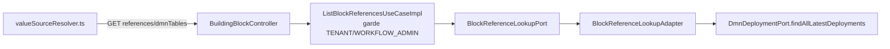

# Design — `lc1-suite-palette-dmn`

## Phase 3 — revue du design (faits vérifiés dans le code)

- `DmnDeploymentPort.findAllLatestDeployments(tenantId)` existe déjà (port `out`, utilisé par `ListDecisionTablesUseCaseImpl`
  et l'outil MCP `list_decision_tables`) : **aucun nouveau port**.
- `ListBlockReferencesUseCaseImpl.SERVED_SOURCES` contient les sources servies ; la garde est
  `requireTenantOrWorkflowAdmin` (les mêmes rôles que l'éditeur BPMN et que `/api/dmn-decision-deployments/**`).
- `BlockReferenceLookupAdapter` (infrastructure) implémente `BlockReferenceLookupPort` ; `BlockReferenceVerifier` ne vérifie
  pas `dmnTables` (la clé DMN est vérifiée par `DeployBpmnProcessUseCaseImpl`, précédent de §73).
- Le SPA résout les sources dans `valueSourceResolver.ts` (`SERVER_SOURCES`) ; toute source inconnue retombe en saisie libre.

## Architecture

## Changements

| Couche | Changement |
|---|---|
| domaine | `SERVED_SOURCES` += `dmnTables` ; javadoc du port mise à jour |
| infrastructure | `BlockReferenceLookupAdapter` reçoit `DmnDeploymentPort` ; cas `dmnTables` : tri par clé, `{clé, "clé (vN)"}` |
| frontend | `SERVER_SOURCES` += `dmnTables` |
| contrat | endpoint inchangé (même chemin, même schéma `{value,label}`) — OpenAPI dorée stable |
| MCP | aucun nouvel outil : `list_decision_tables` couvre déjà la liste pour les clients MCP (principe P1 satisfait) |

## Décisions de design

Journal `docs/roadmap-goal/DECISIONS.md` : D-LC1S-SOURCE (endpoint de références plutôt que nouvelle API REST),
D-LC1S-LABEL (version affichée, clé stockée), D-LC1S-EXISTS (pas de double vérification d'existence).

## Sécurité

Même garde que les trois sources existantes ; réponse minimale ; tenant imposé par l'instance (`app.tenant.id`), jamais par
la requête.
