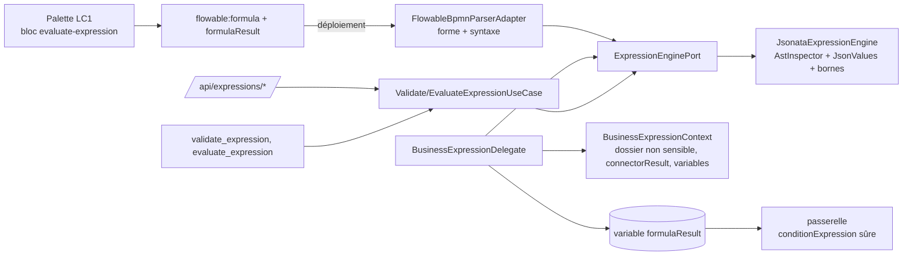

# Design — `lc2-langage-expression-metier`

## Phase 3 — faits vérifiés (pas supposés)

- **Bibliothèque** `com.dashjoin:jsonata:0.9.10` (« JSONata Java reference port », Apache 2.0, mise à jour 2026-05-06,
  compilée pour JDK 25) : disponible sur Maven Central. Apporte `Timebox` (délai + profondeur), un intervalle natif plafonné à
  1e6, et `$eval` / `$random` / `$now` / `$millis` / `$pad` — à neutraliser. **Écarts avec l'analyse** :
  - `outputConvertNulls` est actif par défaut : un `null` explicite devenait indiscernable d'un résultat absent → désactivé.
  - Les intervalles sont paresseux (`RangeList`) : pas de bombe mémoire par `[1..n]`, la garde d'allocation reste utile
    (50 000 éléments d'un `$map` = ~106 Mo mesurés).
  - Une regex JSONata est compilée en `java.util.regex` : le retour arrière **n'est pas interruptible** par le `Timebox`
    coopératif (vérifié : il ne contrôle que l'entrée/sortie d'évaluation) → regex littérales refusées.
  - L'arbre (`Jsonata.ast`, `Parser.Symbol`) est package-private : inspection par une classe-pont dans le package de la
    bibliothèque (vérifiée à la compilation, pas de réflexion).
- **Attribut natif** `flowable:resultVariable` (alias de `resultVariableName`) est absorbé par le convertisseur BPMN : d'où
  l'attribut `flowable:formulaResult`. `flowable:expression` reste une surface UEL refusée (§69).
- **Grammaire de condition** (`assertSafeConditionExpression`) exige au moins un opérateur : `${v == true}`, pas `${v}`.
- `DeployedActivityParameters.get` retombe sur la variable de même nom : **interdit pour la formule** (une variable posée à la
  complétion d'une tâche deviendrait du code) → `getLiteral`.
- `DossierFieldRedactor.withoutSensitiveKeys` existe déjà pour les traitements système partagés : réutilisé.

## Architecture

| Couche | Élément |
|---|---|
| domaine | `domain/expression/{model,port,usecase}` : `ExpressionLimits`, `ExpressionResult`, exceptions, `ExpressionEnginePort`, use cases gardés `requireTenantOrWorkflowAdminOrApiService` |
| infrastructure | `infrastructure/expression/{JsonataExpressionEngine, JsonValues}`, `com.dashjoin.jsonata.AstInspector` (pont) |
| Flowable | `BusinessExpressionDelegate` (`businessExpressionTask`), `BusinessExpressionContext`, `DeployedActivityParameters.getLiteral` |
| parseur | `FlowableBpmnParserAdapter` valide la syntaxe ; `BlockAttributeRules` la forme (`formulaResult` : identifiant, non réservé, ≠ nom de paramètre de brique ; formule littérale obligatoire) |
| catalogue | bloc `evaluate-expression` (12ᵉ), delegate allowlisté |
| web / MCP | `ExpressionController`, `ValidateExpressionTool`, `EvaluateExpressionTool` |
| config | `ExpressionProperties` (`app.expression.*`), `ExpressionConfig` |

## Défenses (toutes testées)

Statique : longueur, nœuds/profondeur d'arbre, regex, fonctions interdites, `${`/`#{`, contrôle. Dynamique : délai, profondeur
d'évaluation, mémoire allouée (`ThreadMXBean`), plafond de `$pad`. Données : contexte copié en JSON pur (cycles, clés,
profondeur, taille), résultat normalisé et borné, `now` injecté. ArchUnit : seule `infrastructure.expression` touche la
bibliothèque ; elle ne touche ni Flowable ni aucun évaluateur UEL.

## Décisions de design

Journal `docs/roadmap-goal/DECISIONS.md` (D-EXPR-*). Risques résiduels notés : garde mémoire propre à HotSpot (désactivée
sinon) ; classe-pont en package scindé (à réexaminer à chaque montée de version de la bibliothèque).
