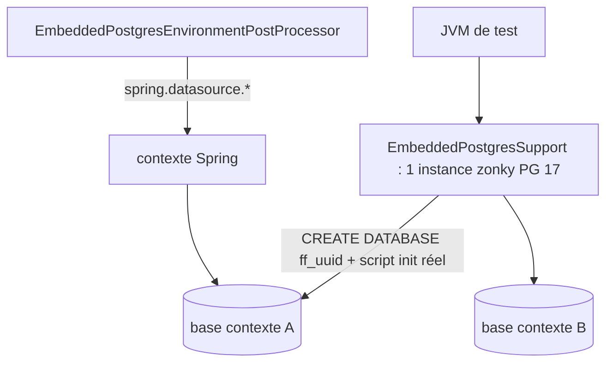

# Design — `zonky-embedded-postgres`

## Tests

- `src/test/java/com/flowforge/support/EmbeddedPostgresSupport` remplace `PostgresTestContainerSupport`
  (même API : `createSchema`, `migrateSchema`, `dataSourceForSchema`, `jdbcUrl`…, plus
  `newApplicationDatabase()` et le fallback `FLOWFORGE_TEST_PG_URL`).
- `EmbeddedPostgresEnvironmentPostProcessor` (enregistré dans `src/test/resources/META-INF/spring.factories`) :
  base fraîche par contexte Spring ; `test.embedded-postgres.enabled=false` pour s'en passer.
- `max_connections=800`, `fsync=off` (données jetables) ; pools Hikari réduits (4) car de nombreux
  contextes restent en cache dans la même JVM.
- Le `search_path` vient d'`application.yml` (`connection-init-sql`), comme en production : plus
  d'override de test.

## Mode démo/QA persistant (`-Pembedded-db` + profil Spring `embedded-db`)

- `src/main` (toujours compilé) : `EmbeddedDbSettings`, contrat `EmbeddedDbLauncher`,
  `EmbeddedDbEnvironmentPostProcessor` (aucune référence à zonky). Il refuse un profil
  `prod`/`production`, ne gère que `tenant_dev`, découvre le lanceur par `ServiceLoader`
  (message clair si le jar n'en contient pas) et enregistre l'arrêt de la base comme singleton Spring
  créé en premier, donc **détruit en dernier** (après DataSource et Flowable).
- `src/embedded` (profil Maven uniquement, via `build-helper-maven-plugin`) : `ZonkyEmbeddedDbLauncher`.
  `src/embedded-test` : ses tests. Le script `docker/postgres/init/01-init-tenant-schema.sql` est copié
  dans `db/embedded/` par le profil (une seule source SQL avec docker-compose).
- Répertoire `APP_EMBEDDED_DB_DATA_DIR` (défaut `~/.flowforge/embedded-db`) : `pgdata/`,
  `app-role-password` (secret généré, 0600, remplace le mot de passe de démo → passe le contrôle
  `SecretsEnvironmentPostProcessor`), `embedded-db.lock` (instance unique).
- Garde-fous : verrou d'instance, refus d'un cluster d'une autre version majeure (`PG_VERSION`),
  détection d'un postmaster orphelin (`postmaster.pid`), arrêt « fast ».
- Exploitation : `scripts/embedded-db.sh status|backup|restore|dump|reset`.
- Sécurité : écoute 127.0.0.1 uniquement, mais zonky initialise en auth `trust` → machine ou
  conteneur de démo non partagé.

## Alternatives écartées

Supabase / PostgreSQL managé pour la CI (non hermétique, pas de parité des rôles) ; H2 conservé pour la
majorité des tests (maintient l'émulation) ; zonky en dépendance de production (alourdit le jar : 174 Mo →
366 Mo avec les binaires de toutes les plateformes).
