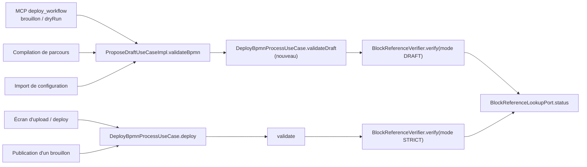
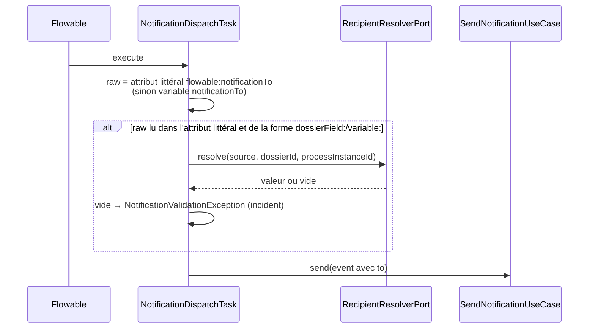

# Design — notifier-dossier-et-brouillons

Trois volets indépendants : chacun a sa propre surface et peut être livré et testé seul.

## Volet A — §8 : références des brouillons (existence sans statut)

**Port (domaine).** `BlockReferenceLookupPort` gagne
`ReferenceStatus status(String tenantId, String source, String value)`, où `ReferenceStatus` vaut `ACTIVE`, `INACTIVE` ou
`MISSING`. `exists(...)` reste disponible, défini comme `status(...) == ACTIVE`, pour ne pas toucher aux appelants actuels.
Les commentaires du port et de l'adaptateur sont mis à jour.

**Adaptateur.** Table de correspondance de `BlockReferenceLookupAdapter.status` :

| Source | ACTIVE | INACTIVE | MISSING |
|---|---|---|---|
| `documentTemplates` | au moins une version `ACTIVE` | des versions existent, aucune active (brouillon, archivé…) | aucune version |
| `connectorInstances` | activée, type connu de rôle service | désactivée, type connu de rôle service | inconnue, type inconnu ou rôle non service |
| `notificationWebhooks` | activé, non supprimé | désactivé, non supprimé | inconnu ou supprimé (`deletedAt`) |
| `dossierTypes` | `active()` | `!active()` | inconnu |
| `workflowTypes`, `dmnTables` | existe | — | n'existe pas |

**Vérificateur (domaine).** `BlockReferenceVerifier.verify(processKey, config, usages, Mode mode)` renvoie la liste des
références `INACTIVE` (`InactiveBlockReference(activityId, parameter, source, value)`) :
- `MISSING` → `UnknownBlockReferenceException`, quel que soit le mode (message inchangé) ;
- `INACTIVE` → exception en mode `STRICT` (même message qu'aujourd'hui) ; ajoutée à la liste en mode `DRAFT` ;
- `workflowStatuses` et `workflowTypes == processKey` : logique actuelle, toujours `ACTIVE` ou `MISSING`.

La surcharge à trois arguments est conservée et délègue en mode `STRICT`.

**Use cases.**
- `DeployBpmnProcessUseCase` gagne `List<InactiveBlockReference> validateDraft(byte[] xml, Optional<WorkflowTypeConfig>)` :
  mêmes contrôles que `validate` (DMN, portail, signature, références), sauf les références vérifiées en mode `DRAFT`.
  `validate` reste strict et sert toujours à `deploy` et à la publication.
- `ProposeDraftUseCase.validateBpmn` renvoie désormais `List<InactiveBlockReference>` (aujourd'hui `void`).
  `Proposal` gagne un champ `inactiveReferences` (liste vide pour un DMN). `proposeBpmn` relaie la liste.
- Appelants à adapter :
  - `DeployWorkflowTool` : le `dryRun` et la proposition exposent la liste ;
  - `CompileParcoursUseCaseImpl` : ajoute un avertissement par référence inactive dans sa liste `warnings` existante
    (`List<String>`). Le contrat REST `CompileResponse` et le golden OpenAPI ne changent pas ;
  - `ImportConfigurationUseCaseImpl` : ignore la liste. Le rapport d'import n'est pas modifié dans ce lot.

**Résultat MCP.** `DraftToolResults.of` ajoute `inactiveReferences` (liste de `{activityId, parameter, source, value}`) quand
elle n'est pas vide, avec un message : « Ces ressources existent mais ne sont pas actives : la publication sera refusée tant
qu'un humain ne les a pas activées. » Le statut reste `DRAFT_PENDING_PUBLICATION` ou `VALID`. En publication directe, la
publication stricte qui suit échoue comme aujourd'hui, et le brouillon reste enregistré (comportement existant de
`publishBpmn`).

**Décision D-DRAFT-REF-STATUS.** Seul le statut est assoupli, pour toutes les sources. L'existence, le rôle et la suppression
restent contrôlés.
- Alternative écartée : ne rien vérifier sur un brouillon. Une faute de frappe ne serait alors détectée qu'à la publication,
  par un humain.
- Alternative écartée : n'assouplir que les modèles. Le même blocage existe pour un type de dossier ou un webhook créé dans le
  même mouvement.

## Volet B — §3 : destinataire de « Notifier » depuis le dossier

**Grammaire partagée (D-NOTIF-REUSE-PORTAL-SOURCE).** On réutilise **tels quels** `PortalRecipientSource` (`parse`,
`Kind {DOSSIER_FIELD, PROCESS_VARIABLE}`) et `PortalRecipientResolverPort` / `PortalRecipientResolverAdapter`. Cet adaptateur
est déjà dans la liste blanche ArchUnit `DOSSIER_FIELDS_READ_ALLOWLIST`, et lit une seule clé, jamais renvoyée au navigateur.
On met seulement à jour leurs commentaires pour dire qu'ils servent aussi à « Notifier ». Le renommage en `ValueSourceRef` est
écarté : 19 fichiers touchés pour un gain purement nominal.

**Déploiement (`BlockAttributeRules.check`, cas `TEXT`).** Pour `notificationTo` : si la valeur commence par `dossierField:` ou
`variable:`, `ValueSourceRef.parse` doit réussir. Sinon `InvalidBpmnException` : « … must be dossierField:<name>,
variable:<name> or a literal address ». Une valeur sans préfixe reste un littéral libre, comme aujourd'hui. Le type
`ParameterType.TEXT` est conservé, donc le catalogue, le golden OpenAPI et le panneau de la palette ne changent pas. Seul le
texte d'aide du paramètre change : « Adresse littérale, dossierField:<champ> ou variable:<nom>. »

**Exécution (`NotificationDispatchTask`).**
- La source n'est résolue que si la valeur vient de l'**attribut littéral déployé** (`DeployedActivityParameters.getLiteral`).
  Une variable de process `notificationTo` qui contient `dossierField:x` reste un littéral, ce qui la rend invalide comme
  adresse.
- **Décision D-NOTIF-SOURCE-LITERAL.** Une variable posée au démarrage ou à la complétion d'une tâche est contrôlée par un
  utilisateur. Elle ne doit pas pouvoir rediriger l'envoi vers la valeur d'un autre champ du dossier (revue adversariale I1,
  même doctrine que `DeployedActivityParameters`).
- Champ du dossier : lu à jour par `dossierRepository.findById(dossierId)` (variable plateforme `dossierId`), comme pour le
  portail. `dossierFields`, un instantané, n'est pas utilisé.
- Valeur résolue absente, nulle ou vide après `strip` : `NotificationValidationException("notificationTo source
  dossierField:email resolved to an empty value")`. Le message nomme la source, jamais une valeur. La tâche échoue et crée un
  incident.
- Valeur non textuelle (liste, nombre) : `toString()` n'est pas appliqué. On refuse avec le même type d'exception
  (« not a text value »).

**Pourquoi pas un nouveau `ParameterType`.** Un type `RECIPIENT` modifierait l'enum exposé au SPA et dans l'OpenAPI, ainsi que
le rendu du panneau, pour un seul paramètre. La règle par nom dans le cas `TEXT` existe déjà pour `formulaResult` et
`fieldMapping`.

## Volet C — variables de démarrage dans le dialogue

**Composant.** `StartWorkflowDialog.vue` gagne une section repliée « Variables de démarrage » (`
`, fermée par
défaut). Elle contient une liste de lignes `{ name, value }`, un bouton « Ajouter une variable » et un bouton de suppression
par ligne.

**Validation côté client** (fonction pure `validateStartVariables(rows)` dans `frontend/src/components/workflow/startVariables.ts`,
testée par Vitest) :
- les lignes dont le nom et la valeur sont vides sont ignorées ;
- nom : `^[A-Za-z_][A-Za-z0-9_]*$` ;
- noms réservés : `dossierId`, `dossierWorkflowLinkId`, `tenantId`, `dossierFields`, `connectorResult`. Ce sont les mêmes que
  `WorkflowVariables.RESERVED` côté serveur, qui reste l'autorité ;
- doublons refusés ;
- valeur : texte, envoyée telle quelle (pas de `trim` sur la valeur, mais `trim` sur le nom) ;
- erreurs affichées sous la ligne concernée. Le bouton « Démarrer » reste actif, mais `submit` ne part pas tant qu'il y a une
  erreur.

**Contrat d'événement.** `emit('start', key, variables: Record<string, string>)`. Le parent (fiche dossier) passe `variables` à
`startDossierWorkflow(id, key, variables, idempotencyKey)`, qui l'accepte déjà. Sans variable, on envoie `{}`, comme aujourd'hui.

**i18n.** Clés `workflow.startDialog.variables.*` (titre, ajouter, supprimer, nom, valeur, erreurs) en français et dans les
autres locales présentes.

**Sécurité.** Le serveur refuse déjà les clés réservées (`WorkflowVariables.assertNoReservedKeys`). Le contrôle client sert
seulement le confort. Une variable de démarrage ne peut pas remplacer un attribut littéral de brique, puisque l'attribut a
priorité (`DeployedActivityParameters`). Ce point est rappelé dans le guide utilisateur.

## Données, API, migrations

- Aucune migration Liquibase. Le golden OpenAPI REST ne change pas.
- Le schéma de sortie MCP `deploy_workflow` gagne `inactiveReferences`, un champ optionnel ajouté.
- `ProposeDraftUseCase.validateBpmn` change de type de retour (domaine interne).

## Sécurité et performance

- Volet A : une requête de plus par référence, pour lire un statut au lieu d'un booléen. Le coût est identique.
- Volet B : une lecture du dossier par envoi, quand la source est `dossierField:`. L'adresse n'est jamais journalisée.
- Volet C : aucune nouvelle surface serveur.

## Documentation

- `GUIDE-CONCEPTION-BPMN.md` : sources de `notificationTo`, règle « brouillon = existence, publication = actif ».
- `GUIDE-UTILISATEUR.md` : section « Démarrer un workflow », variables de démarrage.
- `docs/specs/15-serveur-mcp.md` : `inactiveReferences` dans la réponse de `deploy_workflow`.
- `exemples/autorisation-riverain/` (après le merge de la PR #172) : passer à `notificationTo="dossierField:email"`, supprimer
  la variable de démarrage et mettre à jour DIFFICULTES §3 et §8.
- `TODO.md` §93, `CHANGELOG.md`, `DEFERRED-FEATURES.md` §7 (statuts).
