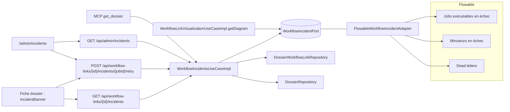

# Design — incidents-visibles-dossier

## Domaine

- `domain.workflow.model.WorkflowIncident(jobId, processInstanceId, activityId, activityName, IncidentState state,
  Instant since, int retriesLeft, String message)` est un record. `withoutMessage()` renvoie une copie avec
  `message = null`.
- `IncidentState { RETRYING, INCIDENT }`.
- `domain.workflow.model.TenantIncident(WorkflowIncident incident, UUID linkId, UUID dossierId, String dossierReference,
  String processDefinitionKey)` sert à l'écran de supervision.
- Exceptions :
  - `WorkflowIncidentNotFoundException`, traduite en 404 ;
  - `IncidentNotRetryableException`, traduite en 409 (job encore en tentatives automatiques).
- Port de sortie `domain.workflow.port.out.WorkflowIncidentPort` :
  - `List<WorkflowIncident> listByProcessInstance(String processInstanceId, String tenantId)` ;
  - `List<WorkflowIncident> listByTenant(String tenantId, int limit)`, les plus récents d'abord, avec une borne ;
  - `Optional<WorkflowIncident> find(String jobId, String tenantId)` ;
  - `void retry(String jobId, String tenantId, int retries)`.
- Port d'entrée `domain.workflow.port.in.WorkflowIncidentsUseCase` et `usecase.WorkflowIncidentsUseCaseImpl` :
  - `listForLink(UUID linkId, User actor)`. Garde identique à `getTasks` (participants, éditeurs, TA/WA). Le message
    n'est conservé que pour TA/WA (D-INCIDENT-MESSAGE) ;
  - `retry(UUID linkId, String jobId, User actor)`. TA/WA seulement, sinon `AccessDeniedException`. Le job doit
    appartenir à l'instance du lien, sinon 404 (pas de rejeu « par devinette » d'un job d'une autre exécution). Il doit
    être `INCIDENT`, sinon 409. Le rejeu se fait avec `RETRIES_ON_RETRY = 3` ;
  - `listForTenant(User actor, PageQuery query)`. TA/WA seulement. Enrichi par
    `DossierWorkflowLinkRepository.findByProcessInstanceId` et `DossierRepository` (référence). Les jobs sans lien sont
    ignorés. Pagination en mémoire sur au plus `TENANT_SCAN_LIMIT = 1000` échecs (D-INCIDENT-SCAN) ;
  - `listForDossierSystem(UUID dossierId)` pour MCP. Échecs de toutes les exécutions du dossier, sans message.
- Diagramme : `WorkflowLinkVisualizationUseCaseImpl.getDiagram` ajoute aux `failedIds` les `activityId` des échecs de
  l'instance (D-INCIDENT-DIAGRAM). `WorkflowDiagramView` gagne `withFailed(Collection<String>)`.

## Adaptateur Flowable

`infrastructure.flowable.FlowableWorkflowIncidentAdapter` (`ManagementService`), toujours filtré par `jobTenantId` :

| Source | Requête | État | Tentatives |
|---|---|---|---|
| Job exécutable en échec | `createJobQuery().withException()` | `RETRYING` | `getRetries()` |
| Minuteur en échec | `createTimerJobQuery().withException()` | `RETRYING` | `getRetries()` |
| Dead letter | `createDeadLetterJobQuery()` | `INCIDENT` | 0 |

- `activityId = job.getElementId()`, `activityName = job.getElementName()`. Si le nom est absent, on reprend l'identifiant.
- `since = job.getCreateTime()`. Flowable ne conserve pas d'horodatage d'échec distinct ; la date affichée est donc
  celle de l'état courant du job (« depuis »).
- `message = job.getExceptionMessage()`, tronqué à 300 caractères.
- `retry` appelle `managementService.moveDeadLetterJobToExecutableJob(jobId, retries)`.

## Web

- `WorkflowLinkVisualizationController` :
  - `GET /api/workflow-links/{linkId}/incidents` renvoie une liste `IncidentResponse` (`message` omis si nul,
    `@JsonInclude(NON_NULL)`) ;
  - `POST /api/workflow-links/{linkId}/incidents/{jobId}/retry` répond 204 et journalise
    `SecurityAuditLog.incidentRetried(request, auth, linkId, jobId)` (INFO, sans le message).
- `AdminIncidentController` : `GET /api/admin/incidents?page&size` renvoie l'enveloppe paginée standard de
  `TenantIncidentResponse`.
- `WorkflowExceptionHandler` ajoute 404 pour `WorkflowIncidentNotFoundException` et 409 pour
  `IncidentNotRetryableException`.
- Le golden OpenAPI est régénéré.

## MCP

`GetDossierTool.Result` gagne `incidents` (liste `{workflowLinkId, activityId, activityName, state, since,
retriesLeft}`), sans message. La description de l'outil est mise à jour.

## Frontend

- `api/incidents.ts` : `listLinkIncidents(linkId)`, `retryIncident(linkId, jobId)`, `listTenantIncidents(page, size)`.
  Les types vont dans `api/types.ts`.
- `components/workflow/IncidentBanner.vue`, dans `DossierDetailView` au-dessus du diagramme de l'exécution courante :
  - une ligne par échec : étape, état (« Nouvelle tentative prévue (n restantes) » ou « Incident »), date ;
  - message visible s'il est présent ;
  - bouton « Rejouer » si `INCIDENT` et rôle TA/WA. **Sans `window.confirm`** : l'action est sûre et réversible, et
    la recette a montré que les fenêtres natives bloquent certains navigateurs ;
  - après le rejeu, le diagramme et le bandeau sont rechargés.
- `views/admin/IncidentsAdminView.vue` : route `/admin/incidents` (`meta.roles` TA/WA), entrée « Incidents » dans le
  menu Admin. Tableau paginé : référence du dossier (lien), workflow, étape, état, date, tentatives, message, action
  « Rejouer ».
- i18n fr/en : `incidents.*`.

## Décisions

- **D-INCIDENT-MESSAGE.** Le message n'est renvoyé qu'à TA/WA. Il peut contenir des données métier selon la brique
  (connecteur…). Les autres voient l'état. MCP ne le reçoit jamais.
- **D-INCIDENT-DIAGRAM.** Les deux états marquent l'étape en erreur dans le diagramme. La distinction se lit dans le
  bandeau.
- **D-INCIDENT-SCAN.** Liste du tenant bornée à 1000 échecs, triés par date décroissante. Au-delà, un indicateur
  `truncated` est renvoyé. Ce n'est pas une table de plus : les jobs restent la source de vérité.
- **D-INCIDENT-RETRY-SCOPE.** Le rejeu passe par le lien de workflow, pour vérifier que le job appartient à cette
  exécution du tenant. On n'expose pas de `POST /api/admin/incidents/{jobId}/retry` nu.

## Sécurité

- Isolation par tenant : toutes les requêtes Flowable sont filtrées par `jobTenantId`. Le lien est chargé par tenant.
- 404 pour un job d'une autre exécution, plutôt que 403 : on n'indique pas son existence.
- Aucun message d'exception dans les logs d'audit ni dans les réponses aux non-admins.

## Documentation

- `GUIDE-UTILISATEUR.md` : bandeau incident sur la fiche, écran Admin → Incidents, rôles §0.
- `GUIDE-CONCEPTION-BPMN.md` §6c : l'incident d'une brique asynchrone est visible et rejouable.
- `docs/specs/15-serveur-mcp.md` : `incidents` dans `get_dossier`.
- `DIFFICULTES.md` §11 de l'exemple (après le merge de la #175), `DEFERRED-FEATURES.md` §7, `TODO.md` §94, `CHANGELOG.md`.
