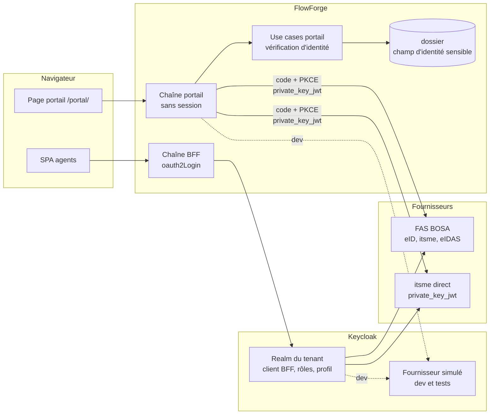
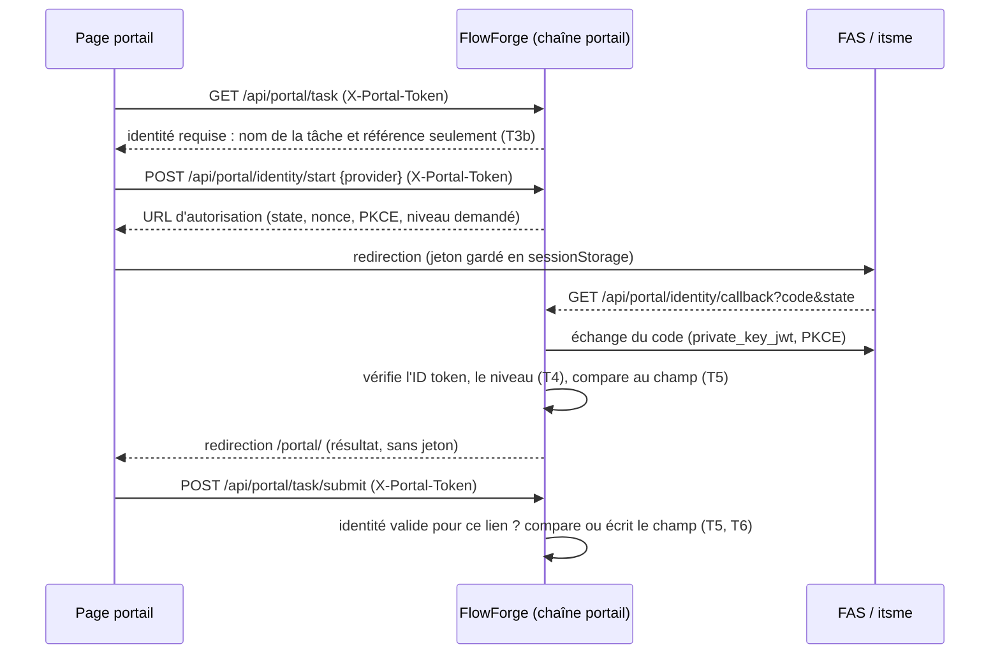

# Conception — `authentification-belge` (issue #210)

> Brouillon, aligné sur la revue de phase 2 du 2026-10-24. La phase 3 tranche les points listés en fin des exigences.

## Vue d'ensemble

Deux branchements distincts sur les mêmes fournisseurs (deux clients enregistrés par tenant chez chacun) :
1. **Agents** : identity brokering Keycloak standard. Dans FlowForge, seul change l'enregistrement dans l'annuaire (A6) :
   le BFF voit toujours un ID token du realm du tenant, avec `tenant_id` et `realm_access.roles`.
2. **Tiers** : la chaîne portail est elle-même cliente OIDC (code d'autorisation, PKCE, `private_key_jwt`), sans Keycloak
   ni compte. Elle rattache l'identité vérifiée au lien, puis la soumission la compare au champ d'identité du dossier ou
   l'y écrit.

## Agents — Keycloak

- **Realm par tenant (K1).** `provision-tenant.sh --instance-dir` génère `<tenant>.realm.json`, à importer, ou un
  script `kcadm` idempotent (choix en phase 3) contenant :
  - le client BFF avec ses deux mappers (`realm_access.roles` et `tenant_id`, dans l'ID token) ;
  - les quatre rôles ;
  - le profil utilisateur, avec `tenant_id` réservé à l'admin ;
  - les fournisseurs demandés (`--idp fas`, `--idp itsme`) ;
  - le flux de première connexion et le mode de mot de passe (`--password-login both|idp-only`).
- **Fournisseurs (K2, K3).** Deux gabarits OIDC :
  - `fas` : `clientAuthMethod` à confirmer auprès de BOSA ;
  - `itsme` : `private_key_jwt`, scopes et claims itsme, validation des signatures, PKCE.
  Les secrets et métadonnées sont des variables du fichier `<tenant>.env`, jamais dans le dépôt.
- **Mappers des fournisseurs.** Prénom et nom vers le profil. Le NRN n'est **pas** mappé vers le compte d'un agent
  (A5). Aucun mapper ne pose `tenant_id`.
- **Première connexion (A2, A3).** Flux `first broker login` de Keycloak : création du compte, sans `tenant_id` ni rôle
  (`default-roles-<realm>` vidé des rôles FlowForge), ou rattachement à un compte existant après ré-authentification.
  Le compte créé est refusé par `TenantResolutionFilter` jusqu'à sa validation par un admin.
- **Annuaire (A6, défaut existant).** `KnownUserRecordingSuccessHandler` vérifie le `tenant_id` avant d'enregistrer :
  en cas d'écart, il n'enregistre rien, invalide la session et répond 403 comme `TenantResolutionFilter`. Une seule
  règle partagée, qui reste à placer en phase 3.
- **Mot de passe (A4).** En mode `idp-only`, le formulaire de mot de passe est retiré du flux `browser`, et un flux
  dédié au compte de secours reste joignable par une URL documentée. Mécanisme exact à trancher en phase 3.
- **Simulateur (K4).** Un realm `fas-simulateur` dans `docker/keycloak/import/` joue le fournisseur : des utilisateurs de
  test portent un NRN, un nom et un niveau. Il a deux clients, qui exigent tous deux `private_key_jwt` : celui du realm de
  dev `flowforge` (JWKS du realm), qui le déclare comme fournisseur, et celui du portail de dev (JWKS de l'instance,
  T11).

## Tiers — portail

### Déclaration BPMN

- Un nouvel attribut littéral sur la tâche externe, `flowable:portalIdentityField="dossierField:<champ>"`, vaut
  exigence d'authentification forte (T1, T2). Grammaire réduite de `PortalRecipientSource`, `dossierField:` seulement.
- `PortalTaskDefinition` reçoit `identityField` (nullable). Validation au déploiement :
  - syntaxe ;
  - réglage E1 allumé ;
  - au moins un fournisseur tiers configuré (E2).
  `STRING` et `sensitive` sont revérifiés à l'exécution.

### Flux

- **Tentative** (`state`) : identifiant aléatoire stocké haché, avec le lien, le `nonce`, le vérificateur PKCE et une
  expiration courte (environ 10 minutes). À usage unique. Le jeton du lien ne passe jamais dans l'URL de retour.
- **Identité vérifiée** (T9) : rattachée au lien, avec :
  - le NRN chiffré, réutilisant le chiffrement des secrets de connecteur ;
  - le nom, le fournisseur et le niveau ;
  - une expiration (environ 30 minutes, à fixer en phase 3).
  Effacée à la soumission, à la révocation, à l'expiration et à la purge. Table nouvelle, ou colonnes de `portal_link` :
  phase 3.
- **Soumission** (`SubmitPortalTaskUseCaseImpl`) : si la tâche a un champ d'identité, l'identité doit être présente et
  valide. Ensuite, dans la transaction existante :
  - relecture du champ ;
  - égalité (T5), écriture si vide (T6) ou refus ;
  - trace (T8) ;
  - complétion.
  L'écriture passe par `DossierRepository.save` en contexte système : l'unicité, l'historique et la synchronisation
  s'appliquent.
- **Domaine.** `NationalRegisterNumber` (normalisation, N3), `VerifiedIdentity`, `IdentityAssuranceLevel` (substantiel,
  élevé ; faible refusé), et la règle `IdentityMatch` (conforme, premier enregistrement, sans NRN, non conforme). Le port
  `PortalIdentityProviderPort` (URL d'autorisation, échange du code) est implémenté en infrastructure avec Spring Security
  OAuth2 Client : une `ClientRegistration` par fournisseur, `private_key_jwt` par
  `NimbusJwtClientAuthenticationParametersConverter`, ID token validé par la JWKS du fournisseur, sans `oauth2Login` ni
  session. Les noms de claims et les valeurs de niveau viennent de la configuration du fournisseur (K5).
- **Clé et JWKS (T11).** Clé RSA de l'instance fournie par la configuration (fichier PEM ou variable, comme les autres
  secrets) ; partie publique servie par `GET /api/portal/identity/jwks`, publique, dans la chaîne portail. Rotation : deux
  clés publiées pendant la transition (phase 3).
- **Contenu avant l'authentification (T3b).** `GET /api/portal/task` renvoie, tant que l'identité manque, le nom de la
  tâche, la référence du dossier et les fournisseurs proposés, sans instructions, formulaire ni pièces. Dépôt et
  soumission : refus neutre.
- **Émission du lien (T2).** `IssuePortalLinkUseCaseImpl` vérifie le champ d'identité (`STRING`, `sensitive`, déclaré) :
  sinon `NOT_SENT` avec `INVALID_IDENTITY_FIELD` et `notifyNotSent`.
- **Refus neutre (T10)** : même réponse que `PortalAccessDeniedException`. Le motif réel est journalisé sans NRN
  (`SecurityAuditLog`).

## Activation et configuration

- `app.portal.strong-auth.enabled` (défaut `false`), plus, par fournisseur (`fas`, `itsme`) : `issuer`, `client-id`,
  noms de claims et niveaux, et la clé de l'instance. Démarrage refusé si c'est activé sans fournisseur ou sans clé ;
  activé sans portail = erreur de configuration.
- `DeployBpmnProcessUseCaseImpl` refuse un `portalIdentityField` quand le réglage est éteint (E2), sur le modèle du
  portail éteint (D-PORTAL-ACTIVATION).

## Sécurité et performance

- NRN (N1, N2) : n'apparaît en clair que dans le champ sensible du dossier ; chiffré dans l'identité vérifiée, détruite
  au plus tard à l'expiration. Le test dédié parcourt les logs capturés, l'outbox, les variables de process et l'audit.
- Rejeu : `state` à usage unique, `nonce` vérifié, PKCE, vérification de l'émetteur et de l'audience de l'ID token,
  expiration courte.
- Lien volé : le voleur ne voit que le nom de la tâche et la référence (T3b) ; sans l'identité attendue, rien d'autre
  n'est accessible (T5).
- Comptes : aucun compte Keycloak pour un tiers ; un compte d'agent créé par un inconnu reste refusé sans `tenant_id`.
- Débit : `start` et `callback` passent par `PortalPreAuthInterceptor` (limite par IP), comme les routes existantes.
- Coût : un échange de code et une validation de JWT par authentification ; aucun coût pour les tâches sans champ
  d'identité.

## Documentation impactée

`docs/specs/03-authentification.md`, `docs/specs/02-multi-tenant.md` (realm par tenant), `docs/specs/26-portail-externe.md`,
`docs/guides/DEPLOIEMENT.md` (§5, §6, §9 et nouvelle section fournisseurs belges), `docs/guides/GUIDE-CONCEPTION-BPMN.md`
(tâche externe à authentification forte), `docs/guides/GUIDE-UTILISATEUR.md`, registre (nouveau point §103) et
`identifiants.md`.
