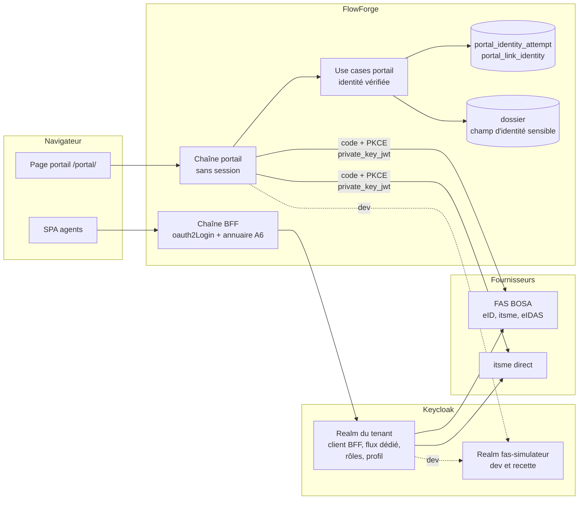

# Conception — `authentification-belge` (issue #210)

> Revue de phase 3 du 2026-10-24 : forme du realm généré, mode « fournisseurs seuls », stockage, durée, choix du
> fournisseur et preuve Keycloak tranchés par l'utilisateur. Les décisions sont listées en fin de document.

## Vue d'ensemble



Deux branchements sur les mêmes fournisseurs, donc deux clients enregistrés par fournisseur et par tenant :

1. **Agents** : identity brokering Keycloak standard. Dans FlowForge, seul l'enregistrement dans l'annuaire change (A6).
   Le BFF voit toujours un ID token du realm du tenant, avec `tenant_id` et `realm_access.roles`.
2. **Tiers** : la chaîne portail est elle-même cliente OIDC (code d'autorisation, PKCE, `private_key_jwt`), sans
   Keycloak ni compte. Elle rattache une identité vérifiée au lien ; la soumission la compare au champ d'identité ou l'y
   écrit.

## Agents — Keycloak

### Realm généré (D-BEAUTH-PROVISION)

`provision-tenant.sh --instance-dir <dossier> --port <port>` reçoit trois nouvelles options :

- `--realm-per-tenant` : défaut en production, documenté ;
- `--idp fas`, `--idp itsme` : répétables ;
- `--password-login both|idp-only` : défaut `both`.

Il écrit alors deux fichiers, et refuse comme aujourd'hui d'écraser des fichiers existants :

- **`<tenant>.realm.json`** — déclaratif et sans secret. Realm `flowforge-<tenant>`, `sslRequired: external`. Contenu :
  - le client BFF (`mon-app`), avec les mappers `realm_access.roles` et `tenant_id` dans l'ID token, et l'URI de
    redirection exacte de l'instance ;
  - les quatre rôles, et `default-roles-<realm>` sans aucun rôle FlowForge ;
  - le profil utilisateur, avec `tenant_id` en lecture et écriture réservées à l'admin ;
  - l'inscription libre et la réinitialisation de mot de passe désactivées en mode `idp-only` ;
  - les fournisseurs choisis, avec leurs mappers : prénom et nom seulement, ni NRN (A5) ni `tenant_id` (A2) ;
  - le flux `first broker login` standard : création, ou rattachement après ré-authentification ;
  - en mode `idp-only`, le flux `browser-fournisseurs` et sa surcharge sur le client BFF.
- **`<tenant>.keycloak.sh`** — idempotent :
  1. crée le realm depuis le JSON s'il est absent, sinon fait un import partiel (`ifResourceExists=SKIP`) ;
  2. pose les secrets et métadonnées des fournisseurs depuis l'environnement (`FAS_CLIENT_ID`, `FAS_CLIENT_SECRET` ou
     clé, `ITSME_CLIENT_ID`, issuers) ;
  3. crée le client M2M actuel ;
  4. en mode `idp-only`, crée l'admin de secours (mot de passe temporaire et OTP obligatoire), sans rôle FlowForge.

`OIDC_ISSUER_URI` et `KEYCLOAK_REALM` du `<tenant>.env` pointent vers ce realm. Sans `--realm-per-tenant`, le
comportement actuel (realm partagé) est inchangé.

### Fournisseurs

| Gabarit | Authentification du client | Notes |
|---|---|---|
| `fas` | `client_secret` ou `private_key_jwt` (selon l'enregistrement BOSA) | URL de découverte de l'intégration ou de la production, choisie par variable ; scope et `acr_values` réglables |
| `itsme` | `private_key_jwt` (clé du realm) | ID token signé et chiffré ; scopes itsme ; claims réglables (K5) |

URI à enregistrer chez le fournisseur : `https://<keycloak>/realms/flowforge-<tenant>/broker/<alias>/endpoint`.

### Mode « fournisseurs seuls » (D-BEAUTH-IDP-ONLY)

Le flux `browser-fournisseurs` enchaîne `Cookie`, puis le formulaire de choix du fournisseur (`identity-provider-redirector`
sans fournisseur par défaut, la page de connexion n'affichant que les boutons). Il est attaché au client BFF par la
surcharge de flux par client (`authenticationFlowBindingOverrides.browser`). La console d'administration du realm garde le
flux `browser` standard : l'admin de secours y entre par mot de passe et OTP pour corriger Keycloak si FAS est en panne,
mais pas dans FlowForge. Le flux exact (exécutions et exigences) est validé par la recette Keycloak.

### Annuaire (A6, défaut existant)

`TenantMembership` (infrastructure/tenant) porte la règle « claim `tenant_id` présent et égal à `app.tenant.id` ».
`TenantResolutionFilter` et `KnownUserRecordingSuccessHandler` l'utilisent tous deux. Dans le second, en cas d'écart,
l'utilisateur n'est pas enregistré, l'événement est journalisé (`SecurityAuditLog.tenantMismatch`), la session est
invalidée et la réponse est un 403.

### Simulateur (K4)

Le realm `fas-simulateur`, importé par `docker-compose` (`docker/keycloak/import/fas-simulateur-realm.json`), contient :

- des utilisateurs de test, chacun avec NRN, prénom, nom et niveau (attributs) : NRN connu, NRN différent, niveau
  faible, identité eIDAS sans NRN ;
- des mappers qui émettent ces attributs sous les noms de claims par défaut de FAS (K5) ;
- deux clients `private_key_jwt` : `keycloak-flowforge` (JWKS du realm de dev `flowforge`, qui le déclare comme
  fournisseur `fas`) et `portail-dev` (JWKS de l'instance de dev, T11).

## Tiers — portail

### Déclaration BPMN

- `flowable:portalIdentityField="dossierField:<champ>"` sur une tâche externe : il vaut exigence d'authentification
  forte (T1, T2). Grammaire de `PortalRecipientSource` réduite à `dossierField:` (`PortalIdentityField.parse`).
- `PortalTaskDefinition` reçoit `identityField` (nullable). Le parseur Flowable lit l'attribut littéral ;
  `DeployBpmnProcessUseCaseImpl` refuse si l'authentification forte est éteinte ou sans fournisseur (E2).
- À l'émission (`IssuePortalLinkUseCaseImpl`), le champ doit être déclaré, `STRING` et `sensitive`. Sinon `NOT_SENT`
  (`INVALID_IDENTITY_FIELD`) et `notifyNotSent` (T2). La tâche porte l'exigence via `portal_link.identity_field`, pour que
  les routes du portail sachent qu'une identité est requise.

### Flux et preuve d'identité (D-BEAUTH-PROOF)

```mermaid
sequenceDiagram
  participant P as Page portail
  participant F as FlowForge (chaîne portail)
  participant I as FAS / itsme
  P->>F: GET /api/portal/task (X-Portal-Token)
  F-->>P: identityRequired, taskName, dossierReference, providers (T3b)
  P->>F: POST /api/portal/identity/start {provider} (X-Portal-Token)
  F->>F: tentative : state, nonce, PKCE (10 min, usage unique)
  F-->>P: URL d'autorisation
  P->>I: redirection
  I-->>F: GET /api/portal/identity/callback?code&state
  F->>I: échange du code (private_key_jwt, PKCE)
  F->>F: ID token : signature, iss, aud, nonce, exp, niveau (T4), NRN (N3)
  F->>F: correspondance avec le champ (T5, T7) ; non conforme : refus
  F-->>P: 302 /portal/#identity:<preuve> (ou #identity-refused)
  P->>F: GET /api/portal/task, POST attachments, POST submit (X-Portal-Identity)
  F->>F: preuve valide ? relecture du champ, comparaison ou écriture (T5, T6)
```

- La page ne stocke rien (D-PORTAL-CSRF-SESSION) : le jeton du lien vit en mémoire jusqu'à la redirection. Au retour, la
  **preuve** (256 bits, aléatoire, hachée en base) arrive dans le fragment, est effacée de la barre d'adresse et sert
  ensuite seule de justificatif (`X-Portal-Identity`).
- La preuve est liée au lien : `PortalAccessResolver` la résout en lien vivant, comme un jeton. Une identité vérifiée sur
  un appareil ne profite donc pas à un autre porteur du même lien.
- Rechargement de la page : preuve perdue, le tiers rouvre le lien et se ré-authentifie (même règle qu'aujourd'hui pour
  le jeton).
- Erreur ou annulation chez le fournisseur, `state` inconnu, expiré ou rejoué, niveau insuffisant, non-conformité :
  redirection vers `#identity-refused`, page de refus neutre (T10). Le motif est journalisé sans NRN.

### Domaine (`domain.workflow.portal`)

| Élément | Rôle |
|---|---|
| `NationalRegisterNumber` | normalisation (N3), `toString` masqué |
| `IdentityAssuranceLevel` | `LOW`, `SUBSTANTIAL`, `HIGH` ; `isAccepted()` vrai pour les deux derniers (T4) |
| `VerifiedIdentity` | fournisseur, niveau, prénom, nom, NRN optionnel |
| `IdentityMatch` | `CONFORME`, `PREMIER_ENREGISTREMENT`, `SANS_NRN`, `NON_CONFORME` : `of(expected, verified)` (T5-T7) |
| `IdentityVerification` | trace : fournisseur, niveau, prénom, nom, résultat, date (T8), sans NRN |
| `PortalIdentityProviderPort` (out) | URL d'autorisation, échange du code → `VerifiedIdentity` |
| `PortalIdentityRepository` (out) | tentatives et identités vérifiées |
| `StartPortalIdentityUseCase`, `CompletePortalIdentityUseCase` (in) | `start`, `callback` |

`SubmitPortalTaskUseCaseImpl` et `AddPortalAttachmentUseCaseImpl` exigent l'identité quand le lien a un champ
d'identité. À la soumission, dans la transaction existante :

1. relecture du dossier et `IdentityMatch.of` (le champ a pu changer depuis l'authentification) ;
2. sur `PREMIER_ENREGISTREMENT`, écriture du NRN par `DossierRepository.save` en contexte système (historique, unicité,
   recalcul des règles) ;
3. trace `IdentityVerification` ;
4. suppression de l'identité ;
5. complétion.

`GetPortalTaskUseCaseImpl` renvoie la vue réduite (T3b) tant que l'identité manque.

### Persistance — changeSet `038` (D-BEAUTH-STORE)

| Table | Colonnes |
|---|---|
| `portal_identity_attempt` | `id`, `tenant_id`, `state_hash` (unique), `portal_link_id` (FK `portal_link`, `on delete cascade`), `provider`, `nonce`, `pkce_verifier_enc`, `created_at`, `expires_at`, `consumed_at` |
| `portal_link_identity` | `portal_link_id` (PK, FK `on delete cascade`), `tenant_id`, `proof_hash` (unique), `provider`, `assurance_level`, `given_name`, `family_name`, `nrn_enc` (nullable), `match_result`, `verified_at`, `expires_at` |
| `portal_link` | nouvelle colonne `identity_field` (nullable) |
| `task_question_answer` | nouvelle colonne `identity_verification` (jsonb, nullable) |

- Chiffrement (`pkce_verifier_enc`, `nrn_enc`) par le chiffrement des secrets de connecteur (`EnvMasterKeyCipher`,
  `APP_CONNECTOR_MASTER_KEY`), derrière un port du domaine portail. Aucun NRN en clair hors du champ du dossier.
- Une seule identité par lien : une nouvelle authentification remplace l'ancienne.
- Nettoyage : la révocation, l'expiration et le renvoi d'un lien suppriment son identité ; la purge du dossier supprime
  ses liens, donc ses tentatives et identités par cascade. Le job d'expiration du portail supprime aussi les tentatives
  et identités échues.

### Durée (D-BEAUTH-TTL)

`app.portal.strong-auth.identity-ttl` : défaut 60 minutes, plafonné à 4 heures (démarrage refusé au-delà). Tentative :
10 minutes, fixe.

### Choix du fournisseur (D-BEAUTH-PROVIDER-CHOICE)

`GET /api/portal/task` renvoie `providers` dans l'ordre configuré, chacun avec son identifiant et son libellé :
`fas` → « eID, itsme et autres (FAS) », `itsme` → « itsme ». Un seul bouton si un seul fournisseur est configuré. Pas de
réglage par tâche.

### Adaptateur OIDC (infrastructure)

- Une `ClientRegistration` par fournisseur (`app.portal.strong-auth.providers.<id>` : `issuer-uri`, `client-id`, scopes,
  `acr-values`, noms de claims, correspondance des niveaux). URI de redirection :
  `{baseUrl}/api/portal/identity/callback`.
- Échange du code par `RestClientAuthorizationCodeTokenResponseClient` avec
  `NimbusJwtClientAuthenticationParametersConverter` (`private_key_jwt`). ID token validé par `NimbusJwtDecoder` sur la
  JWKS du fournisseur. Un ID token chiffré (itsme) est déchiffré avec la clé de chiffrement de l'instance.
- Clés de l'instance (T11) : `APP_PORTAL_IDENTITY_SIGNING_KEY_FILE` et, pour itsme,
  `APP_PORTAL_IDENTITY_ENCRYPTION_KEY_FILE` (PEM, RSA ≥ 2048), plus un identifiant de clé. Une clé précédente optionnelle
  reste publiée pendant une rotation. `GET /api/portal/identity/jwks` sert les seules parties publiques.

## Activation et configuration (E1, E2)

- `app.portal.strong-auth.enabled` (défaut `false`). Démarrage refusé si c'est activé sans portail, sans fournisseur ou
  sans clé de signature.
- Routes `identity/*` et JWKS déclarées dans `PortalSecurityConfig`, uniquement quand le réglage est allumé : sinon,
  aucune route.
- `DeployBpmnProcessUseCaseImpl` refuse `portalIdentityField` si le réglage est éteint (E2), sur le modèle du portail
  éteint (D-PORTAL-ACTIVATION).

## Sécurité et performance

- **NRN (N1, N2).** En clair seulement dans le champ sensible du dossier ; chiffré dans `portal_link_identity`, effacé à
  la soumission et au plus tard à l'expiration ; jamais dans les journaux, l'audit, l'outbox, les variables de process
  ni les webhooks (test dédié sur les journaux capturés et les tables).
- **Rejeu.** `state` à usage unique (marqué consommé en compare-and-set), `nonce` et PKCE vérifiés ; émetteur, audience,
  expiration et signature de l'ID token contrôlés ; code échangé une seule fois.
- **Lien volé.** Le voleur ne voit que le nom de la tâche et la référence (T3b) ; il ne peut ni déposer ni soumettre
  sans l'identité attendue. Une preuve obtenue sur un appareil ne sert pas à un autre.
- **Comptes.** Aucun compte Keycloak pour un tiers ; un compte d'agent créé par un inconnu reste refusé sans
  `tenant_id`.
- **Débit.** `start`, `callback` et `jwks` passent par `PortalPreAuthInterceptor` (limite par IP).
- **CSP.** La page portail ne fait qu'une navigation de premier niveau vers le fournisseur : aucune directive CSP à
  ouvrir.
- **Coût.** Un échange de code et une validation de JWT par authentification ; rien pour les tâches sans champ
  d'identité.

## Tests et preuves (D-BEAUTH-KC-SMOKE)

- Domaine et use cases : unitaires.
- Adaptateur OIDC et chaîne portail : IT avec un émetteur OIDC en mémoire (clé RSA générée, JWKS, endpoint de jeton qui
  vérifie l'assertion `private_key_jwt`).
- Keycloak : `scripts/keycloak-realm-smoke.sh` démarre Keycloak 26.7.1 (distribution zip avec le JDK 21, ou Docker s'il
  est disponible). Il applique le realm généré et le simulateur, puis vérifie avec `curl` :
  - connexion par le simulateur, et compte créé sans `tenant_id` ;
  - absence de claim NRN dans l'ID token ;
  - mode `idp-only` sans formulaire de mot de passe pour le client BFF ;
  - admin de secours dans la console.
  Lancé et consigné dans la session ; tests Java sur la structure du JSON généré en complément.

## Décisions de la phase 3

| Identifiant | Décision | Écarté |
|---|---|---|
| D-BEAUTH-PROVISION (utilisateur) | JSON déclaratif + script idempotent qui l'applique et pose les secrets | `kcadm` seul (flux illisibles) ; keycloak-config-cli (dépendance) |
| D-BEAUTH-IDP-ONLY (utilisateur) | Flux sans mot de passe attaché au client BFF ; console du realm pour l'admin de secours | Comptes sans mot de passe (simple convention) ; redirection automatique (incompatible avec deux fournisseurs) |
| D-BEAUTH-STORE (utilisateur) | Deux tables, cascade depuis `portal_link`, changeSet `038` | Jetons signés côté navigateur (pas d'usage unique) ; colonnes de `portal_link` |
| D-BEAUTH-TTL (utilisateur) | 60 min par défaut, réglable, plafond 4 h | 30 min fixes ; durée du lien |
| D-BEAUTH-PROVIDER-CHOICE (utilisateur) | Un bouton par fournisseur configuré, ordre de l'instance | Choix par tâche ; un seul fournisseur |
| D-BEAUTH-KC-SMOKE (utilisateur) | Script de recette sur un vrai Keycloak + tests de structure | IT Testcontainers (jamais exécuté sans Docker) ; structure seule |
| D-BEAUTH-PROOF (sans arbitrage) | Preuve d'identité remise dans le fragment, seul justificatif ensuite | `sessionStorage` (contredit D-PORTAL-CSRF-SESSION) |

Reprises des phases 1 et 2 (à inscrire au registre §103) : D-BEAUTH-AUDIENCE (agents et tiers), D-BEAUTH-PROVIDERS (FAS
et itsme direct), D-BEAUTH-REALM (un realm par tenant), D-BEAUTH-FIRST-LOGIN (compte sans `tenant_id` ni rôle),
D-BEAUTH-PASSWORD (réglable par tenant), D-BEAUTH-PORTAL-CLIENT (client OIDC direct), D-BEAUTH-PREVIEW (nom et référence
seulement), D-BEAUTH-NRN-FIELD (champ cible : vide écrit, rempli attendu), D-BEAUTH-LOA (substantiel ou élevé),
D-BEAUTH-ACTIVATION (opt-in, refus au déploiement), D-BEAUTH-VALIDATION (simulateur, recette réelle dans #192).

## Documentation impactée

- Specs : `docs/specs/03-authentification.md`, `docs/specs/02-multi-tenant.md` (realm par tenant),
  `docs/specs/26-portail-externe.md`, `docs/specs/13-modele-physique.md` (changeSet `038`).
- `docs/guides/DEPLOIEMENT.md` : §4, §5, §6, §9, et une nouvelle section « fournisseurs belges » (conditions FAS et
  itsme, deux clients par tenant, autorisation du Registre national, procédure de migration).
- Autres guides : `docs/guides/GUIDE-CONCEPTION-BPMN.md` (tâche externe à authentification forte),
  `docs/guides/GUIDE-UTILISATEUR.md`.
- Registre : nouveau point §103, et `identifiants.md`.
