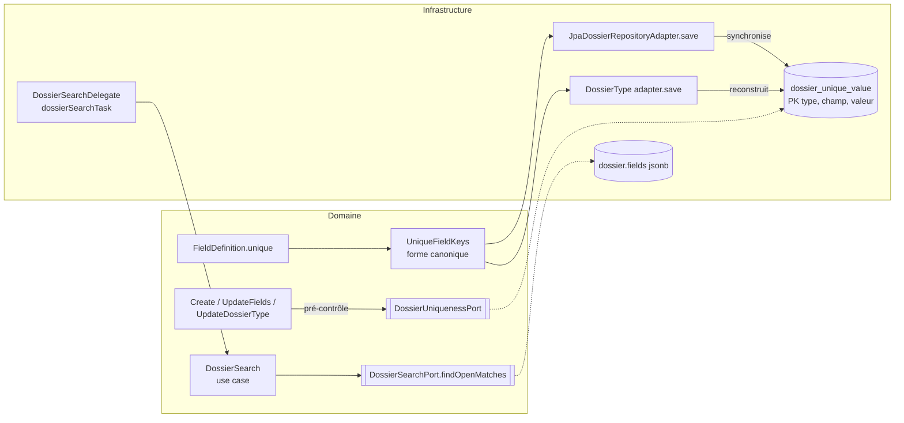

# Conception — `unicite-champ-dossier` (issue #184)

> Proposition à valider en phase 3. Les identifiants `D-…` marqués ⚠ sont des choix à confirmer.

## Vue d'ensemble



Deux garde-fous pour l'unicité :
1. **Pré-contrôle dans le domaine**, pour une erreur lisible (`UNIQUE` + référence existante), groupée avec les autres
   erreurs de champ.
2. **Contrainte en base** (clé primaire de `dossier_unique_value`), pour les accès concurrents et toute écriture qui ne
   passerait pas par un use case.

## Modèle domaine

- `FieldDefinition` reçoit `Boolean unique` (null → faux, comme `searchable`). Le constructeur refuse : un type hors
  `UNIQUE_TYPES = {STRING, NUMBER, DATE}`, un champ `sensitive`, un sous-champ de groupe (U2, U3). Un champ calculé est
  accepté (U4).
- `UniqueFieldKeys` (domaine, pur) : `Set<UniqueKey> of(List<FieldDefinition> defs, Dossier dossier)`.
  - Vide si le statut bloque les mutations (`CLOTURE`, `ARCHIVE`) — U5.
  - Une clé par champ unique dont la valeur est non vide — U7.
  - Valeur canonique — U6 : texte tel quel ; nombre `BigDecimal.stripTrailingZeros().toPlainString()` ; date ISO
    `yyyy-MM-dd`.
- Erreur : `FieldValidationError(field, "UNIQUE", message)`. Le message cite le libellé et la référence du dossier
  existant.

## Persistance

**ChangeSet `037-dossier-unique-value`** :

| Colonne | Type | Rôle |
|---|---|---|
| `dossier_type_code` | varchar | type |
| `field_name` | varchar | champ |
| `field_value` | varchar(1000) | valeur canonique |
| `dossier_id` | uuid | FK `dossier(id)` `ON DELETE CASCADE` (purge) |

Clé primaire `(dossier_type_code, field_name, field_value)` ; index sur `dossier_id`. Le tenant est le schéma, la colonne
`tenant_id` est inutile (décision n° 13). Une valeur plus longue que 1 000 caractères est refusée par la validation du
champ unique.

**Synchronisation à l'enregistrement d'un dossier** (`JpaDossierRepositoryAdapter.save`, même transaction) :
1. Charger les définitions du type du dossier, verrou `FOR SHARE` sur la ligne `dossier_type` (voir D-UNIQUE-TYPE-LOCK).
2. Si aucun champ unique et aucune ligne existante : rien à faire (coût nul pour les types sans unicité).
3. Sinon : supprimer les lignes du dossier, puis `INSERT … ON CONFLICT DO NOTHING RETURNING` les clés de
   `UniqueFieldKeys`. Une clé non insérée = doublon : lire le dossier qui la détient (la transaction reste valide grâce à
   `ON CONFLICT`) et lever `DossierFieldValidationException(UNIQUE)`, ce qui annule toute la transaction.

Toutes les écritures passent par `DossierRepository.save` (vérifié en phase 2 : aucune requête SQL directe sur
`dossier`) : création, PATCH (y compris le formulaire de tâche `dossier-fields`), `fieldMappingTask`, dossier enfant,
import, MCP, changement de statut. La clôture supprime les clés et libère la valeur.

**Reconstruction à l'enregistrement d'un type** (adaptateur du `DossierTypeRepository`, même transaction) :
supprimer les lignes des champs qui ne sont plus uniques, insérer celles des champs devenus uniques, pour les dossiers
ouverts du type. Un conflit à ce stade signifie qu'un doublon a échappé au pré-contrôle : refus (409, comme
`DossierTypeSchemaIncompatibleException`).

## Pré-contrôles (domaine)

- Port `DossierUniquenessPort.findHolders(String typeCode, Set<UniqueKey> keys, UUID excludeDossierId)` →
  `Map<UniqueKey, String reference>`.
- `CreateDossierUseCaseImpl` et `UpdateDossierFieldsUseCaseImpl` : après normalisation, calculer les clés, appeler le
  port, ajouter une erreur `UNIQUE` par conflit aux erreurs de validation.
- `UpdateDossierTypeUseCaseImpl` : si l'ensemble des champs uniques change, `CheckDossierTypeSchemaCompatibility`
  recherche les doublons parmi les dossiers ouverts (calcul en Java avec `UniqueFieldKeys`, sur les dossiers déjà
  chargés par le contrôle de compatibilité) et refuse avec les valeurs en double et des références d'exemple (U10). La
  promotion de configuration passe par ce même use case (U12).

## Brique `dossierSearchTask`

```xml
<serviceTask id="voisins" name="Demandes en cours du même demandeur"
             flowable:delegateExpression="${dossierSearchTask}"
             flowable:searchCriteria="email = dossierField:email"
             flowable:searchCountResult="nbDemandes"
             flowable:searchFirstReferenceResult="premiereDemande"/>
```

- `searchCriteria` : 1 à 3 lignes `champ = dossierField:<champ>` ou `champ = variable:<nom>`.
- Déploiement (`FlowableBpmnParserAdapter`, `BlockAttributeRules`) : syntaxe des lignes, nombre de critères, noms de
  sortie valides et non réservés (§99), attributs de sortie obligatoires. Le type du dossier n'est pas connu au
  déploiement : le caractère cherchable des champs est vérifié à l'exécution.
- Exécution (`DossierSearchDelegate` → use case domaine `SearchSimilarDossiersUseCase`) :
  - charger le dossier courant et son type ; chaque champ critère doit être `searchable`, et chaque source
    `dossierField:` un champ déclaré non sensible (R8), sinon `FlowableException` → incident rejouable (R6) ;
  - résoudre les sources ; une source vide → nombre 0, référence vide, sans requête ;
  - `DossierSearchPort.findOpenMatches(typeCode, predicates, excludeDossierId)` → `(long count, String firstReference)`,
    `ORDER BY created_at, id LIMIT 1` + `count(*)`, prédicats d'égalité réutilisant le code de la recherche D2 (§81) ;
  - écrire les deux variables (référence `null` si aucun résultat).
- Catalogue `BuildingBlockCatalog` : bloc `dossier-search`, catégorie `DOSSIER`, trois paramètres texte. La palette SPA
  est générée depuis le catalogue ; `blockDiagnostics` reçoit les règles côté client.
- MCP : le catalogue est déjà exposé aux outils de conception ; `define_dossier_type` décrit `unique`.

## API et SPA

- `FieldDefinition` JSON : propriété `unique` (golden OpenAPI mis à jour).
- Refus `UNIQUE` : **400** `Dossier field validation failed`, `errors[]` avec `code: "UNIQUE"` (D-UNIQUE-HTTP ⚠).
- SPA : case « Valeur unique » dans `FieldDefinitionDefsEditor.vue` (désactivée hors `STRING/NUMBER/DATE` et pour un champ
  sensible), règles dans `validateFieldDefinitions.ts`, type dans `api/types.ts`, messages fr/en. Le formulaire de
  dossier affiche déjà `errors[]` par champ : vérifier le rendu du code `UNIQUE`.

## Décisions

| Identifiant | Choix | Alternatives écartées |
|---|---|---|
| D-UNIQUE-SCOPE | Dossiers du même type non `CLOTURE`/`ARCHIVE` | toujours ; réglable par champ |
| D-UNIQUE-EXISTING | Refus de la mise à jour du type en présence de doublons | tolérance des doublons existants |
| D-UNIQUE-COMPARE | Égalité stricte sur la forme canonique | insensible à la casse et aux espaces |
| D-UNIQUE-STORE ⚠ | Table `dossier_unique_value` tenue à l'enregistrement | index unique partiel par champ (DDL à l'exécution, interdit) ; verrou consultatif + requête (pas de garantie déclarative, plus difficile à prouver) |
| D-UNIQUE-TYPE-LOCK ⚠ | `FOR SHARE` sur le type à l'enregistrement d'un dossier | aucun verrou : un dossier enregistré pendant qu'on active `unique` échapperait à la reconstruction |
| D-UNIQUE-HTTP ⚠ | 400 avec `errors[].code = UNIQUE` | 409 (nouveau traitement côté SPA et MCP) |
| D-SEARCH-BLOCK-SCOPE | Type courant, non clôturés, hors dossier courant, égalité | type cible déclaré ; tous opérateurs |
| D-SEARCH-BLOCK-OUTPUT | Nombre + référence du plus ancien | nombre seul ; liste |

## Sécurité et performance

- Oracle : `unique` interdit sur un champ sensible ; la brique n'accepte que des champs `searchable` (donc non sensibles)
  et ne renvoie qu'un nombre et une référence (R7).
- Le refus `UNIQUE` révèle une référence de dossier du même type : celui qui écrit a déjà le droit d'édition sur ce type
  (`DossierAccessPolicy.assertCanEditType`). Le MCP applique la même politique.
- Coût : une lecture du type par enregistrement de dossier (déjà en cache JPA de premier niveau pour les use cases qui
  l'ont chargé) ; écriture dans la table seulement pour les types qui ont un champ unique. Brique : une requête sur
  l'index GIN `jsonb_path_ops` (changeSet 030) restreinte au type.
- Purge : `ON DELETE CASCADE`.
- ArchUnit : `UniqueFieldKeys` et le use case de la brique rejoignent `DOSSIER_FIELDS_READ_ALLOWLIST`. Justification :
  ils ne lisent que des champs non sensibles (unique et cherchable l'excluent) et n'en renvoient aucune valeur à un
  navigateur.

## Documentation impactée

`docs/specs/04-dossiers.md` (Implémentation), `docs/specs/13-modele-physique.md`, `docs/guides/GUIDE-UTILISATEUR.md`
(éditeur de schéma, erreur), `docs/guides/GUIDE-CONCEPTION-BPMN.md` (§7 et nouvelle section), registre §102 et
`docs/decisions/identifiants.md`, `exemples/autorisation-riverain/` (README, DIFFICULTES §1, type-dossier, questions,
générateur BPMN si la case de vérification y est référencée).
