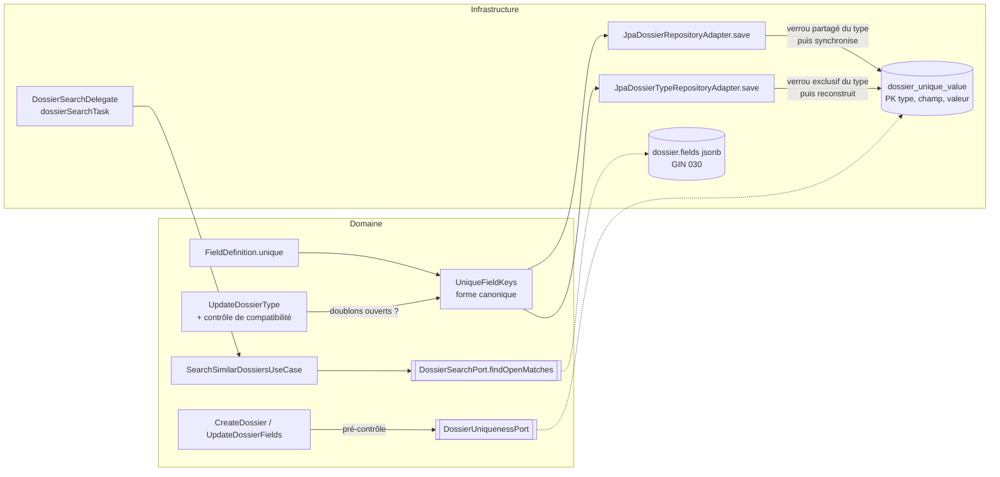

# Conception — `unicite-champ-dossier` (issue #184)

> Revue de phase 3 du 2026-10-24 : D-UNIQUE-STORE, D-UNIQUE-TYPE-LOCK et D-UNIQUE-HTTP tranchés par l'utilisateur.

## Vue d'ensemble



Deux garde-fous pour l'unicité :
1. **Pré-contrôle dans le domaine** : erreur lisible (`UNIQUE` + référence du dossier existant), groupée avec les autres
   erreurs de champ.
2. **Contrainte en base** (clé primaire de `dossier_unique_value`) : accès concurrents et toute écriture, use case ou non.

## Modèle domaine

- `FieldDefinition` reçoit `Boolean unique` (null → faux, comme `searchable`). Le constructeur refuse un type hors
  `UNIQUE_TYPES = {STRING, NUMBER, DATE}`, un champ `sensitive`, un sous-champ de groupe (U2, U3). Un champ calculé est
  accepté (U4).
- `UniqueKey(String field, String value)` et `UniqueFieldKeys.of(List<FieldDefinition> defs, Dossier dossier)` (pur) :
  - vide si `status.blocksMutation()` (`CLOTURE`, `ARCHIVE`) — U5 ;
  - une clé par champ unique dont la valeur est non vide — U7 ;
  - valeur canonique — U6 : texte tel quel ; nombre `new BigDecimal(…).stripTrailingZeros().toPlainString()` ; date
    ISO `yyyy-MM-dd`.
- `DossierFieldValidator` : une valeur de champ unique de plus de 500 caractères → erreur `TOO_LONG` (U13).
- `FieldDefinition` : `unique` refusé sur un nom de champ de plus de 100 caractères (borne de la clé en base).
- `FieldValidationError` gagne un composant facultatif `reference` (constructeur à trois arguments conservé, `null` par
  défaut). Une erreur d'unicité : `(field, "UNIQUE", message, referenceExistante)`.

## Persistance

**ChangeSet `037-dossier-unique-value`** :

| Colonne | Type | Rôle |
|---|---|---|
| `tenant_id` | varchar(64) not null | convention des tables du schéma (cf. 036) |
| `dossier_type_code` | varchar(64) not null | type (même longueur que `dossier.dossier_type_code`) |
| `field_name` | varchar(100) not null | champ |
| `field_value` | varchar(500) not null | valeur canonique |
| `dossier_id` | uuid not null | FK `dossier(id)` `ON DELETE CASCADE` (purge) |

Clé primaire `(tenant_id, dossier_type_code, field_name, field_value)` ; index sur `dossier_id`. Les bornes gardent la clé
sous la limite d'une entrée B-tree PostgreSQL (≈ 2 700 octets, valeur UTF-8 jusqu'à 4 octets par caractère) : d'où
U13 (500 caractères) et un nom de champ unique limité à 100 caractères (refus dans `FieldDefinition`).

**Verrou consultatif par type** (D-UNIQUE-TYPE-LOCK) : clé `hashtext(current_schema() || ':' || code_du_type)` dans un
espace de clés propre à la fonctionnalité (`pg_advisory_xact_lock_shared(ns, key)` / `pg_advisory_xact_lock(ns, key)`).
Le schéma entre dans la clé parce que les verrous consultatifs valent pour toute la base. Une collision de hachage entre
deux types ne coûte qu'une attente, jamais une erreur. Les verrous sont libérés à la fin de la transaction.

**Enregistrement d'un dossier** (`JpaDossierRepositoryAdapter.save`, même transaction que l'écriture) :
1. Verrou consultatif **partagé** sur le type du dossier. Les enregistrements ne s'attendent jamais entre eux.
2. Lire les définitions du type (requête fraîche, après le verrou).
3. Si le type n'a aucun champ unique et que le dossier n'a aucune ligne : terminé.
4. Sinon : supprimer les lignes du dossier, puis `INSERT … ON CONFLICT DO NOTHING RETURNING` les clés de
   `UniqueFieldKeys`. Une clé non insérée = doublon : lire le dossier qui la détient (la transaction reste valide grâce à
   `ON CONFLICT`) et lever `DossierFieldValidationException(UNIQUE)`, ce qui annule toute la transaction.

Vérifié en phase 2 : toutes les écritures passent par `DossierRepository.save` (aucune requête SQL directe sur
`dossier`) : création, PATCH (dont le formulaire de tâche `dossier-fields`), `fieldMappingTask`, dossier enfant,
déclencheurs (webhook, Kafka, Service Bus, IMAP/Graph, SFTP), MCP, changement de statut. La clôture supprime les clés et
libère la valeur.

**Enregistrement d'un type** (`JpaDossierTypeRepositoryAdapter.save`, même transaction) :
1. Verrou consultatif **exclusif** sur le type : il attend la fin des enregistrements de dossiers en cours et bloque les
   suivants jusqu'au commit.
2. Si l'ensemble des champs uniques change : supprimer les lignes des champs qui ne sont plus uniques, puis insérer
   celles des champs devenus uniques pour les dossiers ouverts du type (`UniqueFieldKeys`, mêmes règles qu'en écriture).
3. Un conflit à ce stade = doublon créé entre le pré-contrôle et le verrou : `DossierTypeSchemaIncompatibleException`
   (409, comme aujourd'hui), rien n'est écrit.

## Pré-contrôles (domaine)

- Port `DossierUniquenessPort.findHolders(String typeCode, Set<UniqueKey> keys, UUID excludeDossierId)` →
  `Map<UniqueKey, String reference>` (lecture de la table, sans verrou).
- `CreateDossierUseCaseImpl` et `UpdateDossierFieldsUseCaseImpl` : après normalisation, calculer les clés, appeler le
  port, ajouter une erreur `UNIQUE` par conflit aux erreurs de validation (une seule réponse pour toutes les erreurs).
- `CheckDossierTypeSchemaCompatibilityUseCaseImpl` : quand le schéma proposé rend un champ unique, regrouper les
  dossiers ouverts déjà chargés par clé ; tout groupe de plus d'un dossier rend le schéma incompatible. Le résultat porte
  les valeurs en double et des références d'exemple (U10). `UpdateDossierTypeUseCaseImpl` et la promotion
  (`ImportConfigurationUseCaseImpl`, qui passe par `UpdateDossierTypeUseCase`) en héritent (U12).

## Brique `dossierSearchTask`

```xml
<serviceTask id="voisins" name="Demandes en cours du même demandeur"
             flowable:delegateExpression="${dossierSearchTask}"
             flowable:searchCriteria="email = dossierField:email"
             flowable:searchCountResult="nbDemandes"
             flowable:searchFirstReferenceResult="premiereDemande"/>
```

- `searchCriteria` : 1 à 3 lignes `champ = dossierField:<champ>` ou `champ = variable:<nom>`.
- Déploiement (`FlowableBpmnParserAdapter`, `BlockAttributeRules`) : syntaxe des lignes, nombre de critères, sorties
  obligatoires, valides et non réservées (§99). Le type du dossier n'étant pas connu au déploiement, le caractère
  cherchable des champs est vérifié à l'exécution.
- Exécution (`DossierSearchDelegate` → `SearchSimilarDossiersUseCase`, domaine, appelant système) :
  - charger le dossier courant et son type ; chaque champ critère doit être `searchable` ; chaque source `dossierField:`
    un champ déclaré non sensible (R8). Sinon `FlowableException` → incident rejouable (R6) ;
  - résoudre les sources ; une source vide → nombre 0, référence `null`, sans requête ;
  - `DossierSearchPort.findOpenMatches(typeCode, predicates, excludeDossierId)` → `(long count, String firstReference)` :
    `count(*)` et `ORDER BY created_at, id LIMIT 1`, statut hors `CLOTURE`/`ARCHIVE`, prédicats d'égalité de la recherche
    D2 (§81) ;
  - écrire les deux variables.
- Catalogue `BuildingBlockCatalog` : bloc `dossier-search`, catégorie `DOSSIER`, trois paramètres texte. La palette SPA
  est générée depuis ce catalogue (`BuildingBlockController`, `catalogClient.ts`) ; `blockDiagnostics` reprend les
  règles côté client.
- MCP : le catalogue est déjà exposé aux outils de conception ; la description de `define_dossier_type` mentionne
  `unique`.

## API et SPA

- `FieldDefinition` JSON : propriété `unique` (golden OpenAPI mis à jour).
- Doublon (D-UNIQUE-HTTP) : **400** `Dossier field validation failed`, `errors[]` avec `field`, `code: "UNIQUE"`,
  `message`, `reference`. Le MCP (`create_dossier`) renvoie le même détail.
- Type incompatible : 409 existant, enrichi des valeurs en double.
- SPA, **constat de phase 3** : les écrans n'affichent aujourd'hui que `detail` (« Dossier field validation failed »),
  jamais `errors[]`. Ce lot ajoute :
  - un utilitaire qui extrait `errors[]` d'un `ProblemDetail` (`api/http.ts`, type `FieldError` dans `api/types.ts`,
    avec `code` et `reference`) ;
  - l'affichage sous chaque champ dans `DynamicFields.vue`, utilisé par `CreateDossierView.vue`,
    `DossierFieldsTaskForm.vue` et l'écran « corriger » (`DossierFieldsEditor.vue` branché par
    `DossierDetailView.vue`) ; message traduit pour `UNIQUE` (« Déjà utilisé par le dossier {reference} »), message
    serveur pour les autres codes ; le `detail` anglais n'est repris que si le corps n'a pas `errors[]` ;
  - la bannière (création, tâche, fiche) réservée à un champ masqué ou inconnu, phrase traduite avec le libellé ;
    chaque formulaire de tâche porte la sienne. Quand ses erreurs deviennent toutes visibles, il la retire. Après un
    PATCH accepté, il ne republie que les erreurs dont le champ est absent du correctif, et la retire s'il n'en reste
    aucune. Un correctif vide, ou une erreur hors schéma non mentionnée, la laisse en place ;
  - la case « Valeur unique » dans `FieldDefinitionDefsEditor.vue` (désactivée hors `STRING/NUMBER/DATE` et pour un
    champ sensible, avec la raison en texte visible reliée par `aria-describedby`), les règles dans
    `validateFieldDefinitions.ts`, les messages fr/en ;
  - le refus de mise à jour du type (`DossierTypesAdminView.vue`) : un paragraphe pour `detail`, une liste pour les
    doublons, valeur non découpée, au plus 20 références affichées avec le total. Le serveur borne aussi les
    références par valeur (`DossierUniqueKeys`, 20) ; le nombre de dossiers incompatibles compte tous les détenteurs.

## Décisions

| Identifiant | Choix | Alternatives écartées |
|---|---|---|
| D-UNIQUE-SCOPE | Dossiers du même type non `CLOTURE`/`ARCHIVE` | toujours ; réglable par champ |
| D-UNIQUE-EXISTING | Refus de la mise à jour du type en présence de doublons | tolérance des doublons existants |
| D-UNIQUE-COMPARE | Égalité stricte sur la forme canonique | insensible à la casse et aux espaces |
| D-UNIQUE-STORE | Table `dossier_unique_value` tenue à l'enregistrement | verrou consultatif + requête (garantie qui dépend de chaque chemin) ; index unique partiel par champ (DDL à l'exécution, interdit) |
| D-UNIQUE-TYPE-LOCK | Verrou consultatif par type : partagé à l'enregistrement d'un dossier, exclusif à celui du type | `FOR SHARE` sur la ligne du type (point chaud multixact) ; aucun verrou + contrôle différé (garantie non absolue) |
| D-UNIQUE-HTTP | 400, `errors[]` avec `code: UNIQUE` et `reference` ; le SPA affiche les erreurs par champ | 409 dédié (second format) ; message général seulement |
| D-SEARCH-BLOCK-SCOPE | Type courant, non clôturés, hors dossier courant, égalité | type cible déclaré ; tous opérateurs |
| D-SEARCH-BLOCK-OUTPUT | Nombre + référence du plus ancien | nombre seul ; liste |

## Sécurité et performance

- Oracle : `unique` interdit sur un champ sensible ; la brique n'accepte que des critères `searchable` (donc non
  sensibles) et des sources non sensibles (R8), et ne renvoie qu'un nombre et une référence (R7).
- Le refus `UNIQUE` révèle une référence de dossier du même type : celui qui écrit a déjà le droit d'édition sur ce type
  (`DossierAccessPolicy.assertCanEditType`). Même politique en MCP.
- Coût par enregistrement de dossier : un verrou consultatif partagé (mémoire) et une lecture des définitions du type ;
  écriture dans la table seulement pour les types qui ont un champ unique. Mise à jour d'un type : bloque brièvement les
  enregistrements de ce type seulement. Brique : une requête sur l'index GIN `jsonb_path_ops` (changeSet 030), restreinte
  au type.
- Déclencheurs entrants : un doublon suit le chemin d'échec existant d'une erreur de validation (webhook 400 ; Kafka,
  Service Bus, IMAP/Graph, SFTP : traitement d'échec actuel). Un message rejoué après succès est désormais refusé au lieu
  de créer un doublon.
- Purge : `ON DELETE CASCADE`.
- ArchUnit : `UniqueFieldKeys` et `SearchSimilarDossiersUseCase` rejoignent `DOSSIER_FIELDS_READ_ALLOWLIST`, avec cette
  justification : ils ne lisent que des champs non sensibles et n'en renvoient aucune valeur à un navigateur.

## Documentation impactée

`docs/specs/04-dossiers.md` (Implémentation), `docs/specs/13-modele-physique.md`, `docs/guides/GUIDE-UTILISATEUR.md`
(éditeur de schéma, erreurs de champ), `docs/guides/GUIDE-CONCEPTION-BPMN.md` (§7 et nouvelle section), registre §102 et
`docs/decisions/identifiants.md`, `openapi/` (golden), `exemples/autorisation-riverain/` (README, DIFFICULTES §1,
type-dossier, questions, générateur BPMN si la case de vérification y est référencée).
