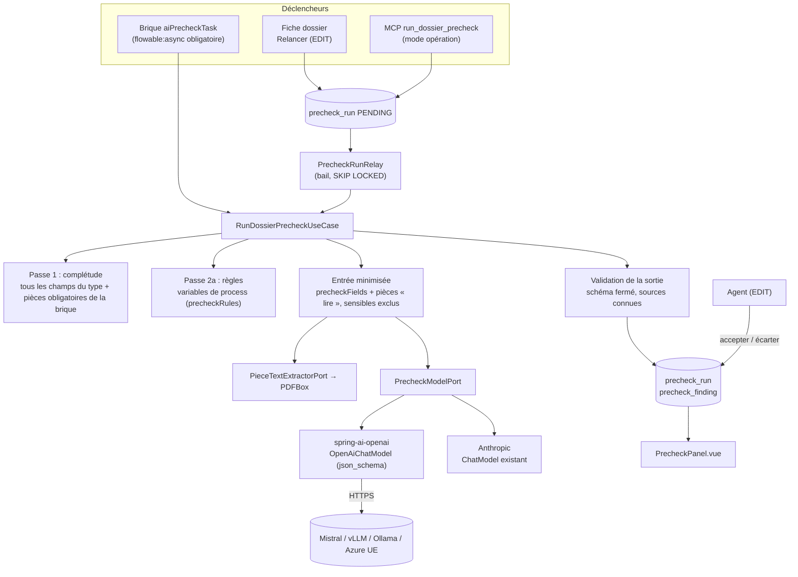

# Pré-vérification IA des dossiers — conception

> **Statut :** phase 3 close (2026-10-25). Décisions de l'utilisateur **C1 à C8** ; hypothèses de conception **HC1 à
> HC12**, restituées avec la conception. Exigences : P1 à P13 et R1 à R7 du document d'exigences.

## Architecture Overview

**Paquets** (hexagonal, ArchUnit) :

- `domain/dossier` : types de pièces (`PieceType`, sur `DossierType`), classement d'une pièce (lot P).
- `domain/precheck` : `PrecheckSpec` (+ parseur), `PrecheckInput`, `PrecheckRun`, `PrecheckFinding`, `ModelOutput` ;
  use cases `RunDossierPrecheckUseCase`, `RequestDossierPrecheckUseCase` (file), `GetDossierPrechecksUseCase`,
  `DecidePrecheckFindingUseCase`, `ExportPrecheckRunUseCase` ; ports `PrecheckModelPort`, `PieceTextExtractorPort`,
  `PrecheckRunRepository`, `PrecheckBudgetPort`, `PrecheckAvailabilityPort`.
- `infrastructure/precheck` : `PrecheckProperties` (`app.precheck.*`), adaptateurs du modèle, `PdfBoxPieceTextExtractor`,
  `JdbcPrecheckRunRepository`, `PrecheckRunRelay`, `PrecheckConfig`.
- `infrastructure/flowable` : `AiPrecheckDelegate` (`@Component("aiPrecheckTask")`).
- `infrastructure/web/precheck` : `DossierPrecheckController` ; `infrastructure/mcp/tool` : deux outils.
- Frontend : `PrecheckPanel.vue`, choix du type au dépôt, éditeur des types de pièces, portail.

## Décisions de conception

### Choisies par l'utilisateur (C)

| # | Sujet | Décision |
|---|---|---|
| C1 (O3) | Adaptateur | **`spring-ai-openai` 2.0.1** (`OpenAiChatModel`, `responseFormat` JSON_SCHEMA) pour les fournisseurs compatibles OpenAI ; Anthropic par le `ChatModel` existant, sortie validée côté serveur |
| C2 | Lancement manuel | **File persistée avec bail** (modèle `notification_outbox`) : exécution `PENDING`, relais planifié, `SKIP LOCKED`, reprise à l'expiration du bail, `FAILED` après 2 tentatives |
| C3 | Devenu sensible | Contrôle au déploiement **et** à chaque exécution : un champ ou type de pièce devenu sensible n'est pas envoyé, un constat `À VÉRIFIER` le signale, l'exécution continue |
| C4 | Syntaxe | Attributs multilignes `clé = valeur`, validés ligne par ligne (numéro de ligne dans l'erreur) |
| C5 | Variable de résultat | **Déterministe seulement** : un routage ne dépend jamais du modèle (RGPD art. 22) |
| C6 | Complétude | **Tous les champs du type** (obligatoires et `requiredByRule`, sensibles compris en présence seulement) + pièces `obligatoire` de la brique |
| C7 | Plafonds par défaut | 1 000 000 jetons/jour/instance ; 10 pièces lues ; 30 pages et 30 000 caractères par pièce, 100 000 au total ; 20 questions ; 2 000 jetons de sortie ; délai 120 s |
| C8 | Ordre | Lots **P**, A, B, C, D |

### Hypothèses de conception (HC)

- **HC1 — Dépendances de C1.** `spring-ai-openai` tire `openai-java-core` (Kotlin, `okhttp` 4.12), `azure-identity`.
  Lot A : exclure `azure-identity` si l'appel Azure par clé n'en dépend pas (vérifié par un test) ; même exclusion de
  `kotlin-stdlib-common` 1.9.10 que pour Anthropic ; `-Psecurity-scan` à passer avant la PR. Redirections : client HTTP
  sans suivi (comme `NoRedirectHttpClient`) si le SDK le permet, sinon risque documenté.
- **HC2 — Prompt versionné.** Ressource `precheck/prompt-v1.md` (système) ; `prompt_version = "v1"` dans l'exécution ;
  tout changement de texte = nouvelle version. Les pièces sont encadrées par une **borne aléatoire par exécution**
  (`<<<PIECE-<nonce> key=…>>> … <<<END-<nonce>>>>`) et le prompt dit que leur contenu est une donnée.
- **HC3 — Schéma de sortie fermé** (`additionalProperties: false`) : `summary` (≤ 800 caractères), `findings` (≤ 30) :
  `kind` ∈ {`MISSING`, `INCONSISTENT`, `TO_CHECK`, `OK`}, `sourceType` ∈ {`FIELD`, `PIECE`, `QUESTION`}, `sourceRef`,
  `message` (≤ 300), `confidence` ∈ [0, 1]. Le modèle ne produit jamais de constat `RULE` ni déterministe. `sourceRef`
  hors de l'entrée envoyée → constat ignoré (compté dans `discarded`). Sortie non analysable → exécution `FAILED`.
- **HC4 — Grammaire de `precheckRules`** (10 lignes au plus) :
  `variable:<nom> <condition> => <TYPE> : <message>` ; condition ∈ `est vrai`, `est faux`, `est vide`,
  `n'est pas vide`, `> N`, `< N`, `= N`, `= "texte"` ; TYPE ∈ `MANQUANT`, `INCOHERENCE`, `A_VERIFIER`. Variable absente
  → constat `À VÉRIFIER` « règle non évaluée ». Variable réservée (`BlockAttributeRules.RESERVED_VARIABLES`) refusée.
- **HC5 — Exécution par la brique.** Dans le job asynchrone Flowable ; l'exécution et ses constats sont écrits dans une
  **transaction séparée** (`REQUIRES_NEW`) : en cas d'échec du modèle, l'exécution `FAILED` et ses constats
  déterministes restent, puis l'exception fait l'incident (§94). La contrainte « une exécution en cours par dossier »
  ne vaut que pour la file (C2) : la brique n'attend pas.
- **HC6 — Variable de résultat** (`precheckResult`, facultative, nom validé comme `formulaResult`) :
  `{ "status": "SUCCEEDED"|"FAILED", "missing": n, "inconsistent": n, "runId": "…" }`, comptes **déterministes**.
- **HC7 — Types de pièces** : colonne `piece_types` (JSONB) sur `dossier_type`, changeSet **039** (lot P) ;
  `[{ key, label, sensitive }]`, 30 au plus, clé `^[a-z][a-zA-Z0-9_]{0,59}$`, libellé ≤ 100. Élément `ATTACHMENT` :
  métadonnée `pieceKey`. Exportés et importés par la promotion de configuration (spec 35). Retrait d'un type : éléments
  orphelins = non classés (H9).
- **HC8 — Reclassement** : `PUT /api/dossiers/{id}/elements/{elementId}/piece-type` `{ "pieceKey": "…" | null }`, EDIT,
  `ATTACHMENT` seulement ; inscrit à l'historique du dossier (ancien et nouveau type, qui, quand).
- **HC9 — Tables de la pré-vérification** : changeSet **040** (lot B) ; index unique partiel « une exécution `PENDING`
  ou `RUNNING` par dossier » pour les lancements de la file ; cascade à la purge du dossier.
- **HC10 — Export** : `GET …/prechecks/{runId}/export`, `TENANT_ADMIN`, JSON (exécution, constats, décisions) ; aucune
  entrée en clair (H4).
- **HC11 — MCP** : `run_dossier_precheck` et `get_dossier_precheck`, `Mode.OPERATION` dans `McpToolModes`, acteur de
  `McpAccessContextFactory`, EDIT pour lancer (H7) ; absents du catalogue de l'assistant (test D-ASSIST-TOOLS).
- **HC12 — Portail** : attribut `portalPieceTypes` (liste de clés) sur la tâche externe, validé au déploiement contre
  la syntaxe et à l'exécution contre le type ; l'envoi du portail accepte un `pieceKey` facultatif de cette liste.

## Data Models

**Spécification de la brique** (C4) :

| Attribut | Obligatoire | Contenu |
|---|---|---|
| `precheckPieces` | non | `clé : obligatoire[, lire]` ou `clé : lire` ; 10 lectures au plus (C7) |
| `precheckFields` | non | Liste de champs envoyés au modèle, séparés par des virgules ; sensibles refusés au déploiement (types liés) |
| `precheckQuestions` | non | `clé = question`, 20 au plus, question ≤ 300 caractères |
| `precheckRules` | non | HC4 |
| `precheckResult` | non | Nom de variable (HC6) |

Au moins une pièce, une question ou une règle. Sans `lire` ni question ni champ, aucun appel au modèle (passe
déterministe seule). Attributs littéraux seulement (`LITERAL_ONLY_DELEGATES`).

**`precheck_run`** : `id`, `dossier_id`, `trigger` (`WORKFLOW`, `MANUAL`, `MCP`), `requested_by`, `workflow_link_id`
(null hors brique), `spec_json`, `status` (`PENDING`, `RUNNING`, `SUCCEEDED`, `FAILED`), `attempts`, `lease_until`,
`failure` (motif générique), `provider`, `model`, `prompt_version`, `input_sha256`, `summary`, `tokens_in`,
`tokens_out`, `discarded`, `created_at`, `finished_at`.

**`precheck_finding`** : `id`, `run_id`, `ordinal`, `kind`, `origin` (`DETERMINISTIC`, `MODEL`), `source_type` (`FIELD`,
`PIECE`, `RULE`, `QUESTION`), `source_ref`, `message`, `confidence` (null si déterministe), `decision` (`ACCEPTED`,
`DISMISSED`, null), `decided_by`, `decided_at`.

**Budget** : jetons du jour = somme `tokens_in + tokens_out` des exécutions du jour (pas de table dédiée).

## API Design

| Route | Droit | Effet |
|---|---|---|
| `GET /api/dossiers/{id}/prechecks` | lecture | Exécutions (récentes d'abord, 20) et constats |
| `POST /api/dossiers/{id}/prechecks` | EDIT | Relance avec la `spec_json` de la dernière exécution ; 202 ; 409 si aucune exécution ou une déjà en cours |
| `PUT /api/dossiers/{id}/prechecks/{runId}/findings/{findingId}/decision` | EDIT | `ACCEPTED`, `DISMISSED` ou null (annuler) |
| `GET /api/dossiers/{id}/prechecks/{runId}/export` | TENANT_ADMIN | Journal JSON |
| `PUT /api/dossiers/{id}/elements/{elementId}/piece-type` | EDIT | Reclassement (lot P) |
| `POST /api/dossiers/{id}/elements/attachment` | existant | + paramètre facultatif `pieceKey` (lot P) |

Fonction désactivée : contrôleur de la pré-vérification et outils MCP absents (`@ConditionalOnProperty`) ; les routes du
lot P sont toujours présentes (utiles sans IA).

## Component Breakdown

| Lot | Contenu | changeSet |
|---|---|---|
| P | Types de pièces : modèle, validation, compatibilité, promotion, API, éditeur, dépôt, reclassement, portail | 039 |
| A | `app.precheck.*`, `PrecheckModelPort` et adaptateurs (C1, HC1), budget, `PieceTextExtractorPort` + PDFBox, faux fournisseur | — |
| B | Spécification et parseur, passes 1 et 2a, entrée minimisée, prompt, validation, tables, délégué, relais, REST, MCP | 040 |
| C | `PrecheckPanel.vue`, i18n, Vitest, Playwright | — |
| D | Spec `48-preverification-ia.md`, registre, guides, exemple riverain, jeu d'évaluation, revue adversariale | — |

## Non-Functional Requirements

- **Sécurité** : un appel, sans outils ; schéma fermé ; borne aléatoire autour des pièces ; HTTPS hors boucle locale ;
  clé jamais journalisée ; erreur du fournisseur jamais relayée ; constats sans valeur sensible ; test « sensible nulle
  part » sur les requêtes reçues par le faux fournisseur.
- **Coût et taille** : C7 ; dépassement du budget = incident (brique) ou `FAILED` (file).
- **Fiabilité** : brique : 3 tentatives du moteur puis incident ; file : bail de 5 min, 2 tentatives.
- **Traçabilité** : H4, HC10 ; purge avec le dossier.
- **Écartés** : boucle d'agent avec outils, OCR, Tika, client REST direct (C1), exécuteur en mémoire (C2), échec sur
  champ devenu sensible (C3), attribut JSON unique (C4), variable de résultat avec les constats du modèle (C5).
