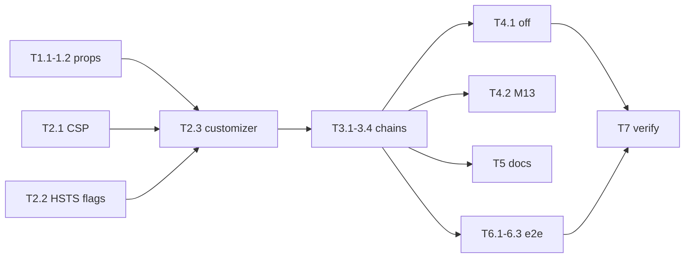

# Project Planning & Task Breakdown — `headers-http-globaux` (lot A4)

## Phase 4: Create Initial Plan

Plan **reviewed** 2026-09-20. Phase 5 **exécutée** 2026-09-20 : T1.1–T7.2 `done`.
Phase 7 **checked** 2026-09-20. Phases 8–9 **closes** 2026-09-20 :
couverture vérifiée, revue holistique sans blocking. Cycle SDD terminé.

## Milestones

- [x] **M1** Properties kill switch (T-PROP-*)
- [x] **M2** `SecurityHeadersCustomizer` + constante CSP / HSTS profil
- [x] **M3** Câblage des 4 chaînes + preuves MockMvc / actuator
- [x] **M4** Kill switch `false` (contexte Spring dédié) + M13
- [x] **M5** Docs ops (`.env.example`, GETTING-STARTED, DEPLOIEMENT) + CHANGELOG
- [x] **M6** Playwright CSP (injection document) + régression FE
- [x] **M7** `./mvnw verify` + Jacoco classes du lot

## Task Breakdown

### M1 — Bind `app.security.headers.enabled`

- [x] **T1.1** `SecurityHeadersProperties` record (`@DefaultValue("true")`)
      + `SecurityHeadersPropertiesTest` Binder (défaut true / override
      false). **Deps :** aucune. **Scénarios :** T-PROP-DEFAULT,
      T-PROP-OFF.
- [x] **T1.2** `application.yml` :
      `app.security.headers.enabled: ${APP_SECURITY_HEADERS_ENABLED:true}`.
      **Pas** d’override `false` dans `application-local.yml`
      (D-LOCAL-HEADERS). **Deps :** T1.1.

### M2 — Customizer (TDD, pas encore branché sur les 4 chains)

- [x] **T2.1** Constante publique `CONTENT_SECURITY_POLICY` = D-CSP-STRING
      A (une seule source de vérité). Test d’égalité exacte.
      **Deps :** aucune. **Scénarios :** T-CSP-VALUE.
- [x] **T2.2** `hstsEnabled(Environment)` : false si
      `matchesProfiles("local")` ou `"test"` ; true sinon. Tests unitaires
      des 3 cas (T-HSTS-LOCAL, T-HSTS-TEST, T-HSTS-PROD). La valeur HSTS
      (`max-age=31536000`, `includeSubDomains`, pas `preload`) est
      assertée ici — MockMvc sous profil `test` ne peut pas émettre
      HSTS (D-HSTS). **Deps :** T2.1.
- [x] **T2.3** `SecurityHeadersCustomizer.apply(HttpSecurity)` :
      `enabled=false` → return immédiat (D-SWITCH-OFF A) ; sinon
      `headers()` CSP / XFO DENY / nosniff / Referrer-Policy + HSTS
      conditionnel. Test unitaire du no-op si possible ; preuve
      d’émission = M3. **Deps :** T1.1, T2.2. **Scénarios :**
      T-SWITCH-OFF (branche code).

### M3 — Câblage `SecurityConfig` + preuves par chaîne

Injecter le customizer dans **les 4** `@Bean` ; étendre
`@EnableConfigurationProperties`.

- [x] **T3.1** BFF `GET /api/auth/me` + `oidcLogin` : CSP exacte, XFO=DENY,
      nosniff, Referrer-Policy, **pas** HSTS (profil test). Étendre
      `BffSecurityTest` ou nouveau `SecurityHeadersApiTest`.
      **Deps :** T2.3. **Scénarios :** T-CHAIN-BFF, T-HSTS-ABSENT-TEST.
- [x] **T3.2** Webhook + callback anonymes : mêmes en-têtes ; statut
      contrôleur inchangé (404). Réutiliser le pattern
      `WebhookAndCallbackRoutesSecurityTest` (vraie chaîne, pas
      `standaloneSetup`). **Deps :** T2.3. **Scénarios :**
      T-CHAIN-WEBHOOK, T-CHAIN-CALLBACK.
- [x] **T3.3** M2M `POST /api/m2m/mcp` + `jwt()` `API_SERVICE` : mêmes
      en-têtes hors HSTS. **Deps :** T2.3. **Scénarios :** T-CHAIN-M2M.
- [x] **T3.4** Actuator port management : étendre
      `ObservabilityActuatorIT` (`MANAGEMENT_PORT=0`, `HttpClient` sur
      `@LocalManagementPort`) — headers CSP/XFO/nosniff sur
      `/actuator/health/liveness`. **Deps :** T2.3. **Scénarios :**
      T-CHAIN-ACTUATOR.

### M4 — Kill switch + non-régression preview

- [x] **T4.1** Classe de test dédiée
      `@TestPropertySource(properties = "app.security.headers.enabled=false")`
      : BFF authentifié **sans** la CSP A4 (D-SWITCH-OFF A — les défauts
      Spring peuvent rester). **Deps :** T3.1. **Scénarios :** T-CHAIN-OFF.
- [x] **T4.2** Relancer `DocumentPreviewApiTest` (déjà M13) — ne pas
      modifier `PREVIEW_CSP`. **Deps :** T3.1. **Scénarios :**
      T-PREVIEW-M13.

### M5 — Docs ops

Diff GETTING-STARTED **minimal** (B1 en parallèle).

- [x] **T5.1** `.env.example` : commentaire +
      `# APP_SECURITY_HEADERS_ENABLED=true` (à côté du cookie secure).
- [x] **T5.2** GETTING-STARTED : une ligne / entrée de table pour le
      kill switch (défaut true ; ne pas le mettre à false en local).
- [x] **T5.3** DEPLOIEMENT.md : l’app émet HSTS 1 an + includeSubDomains
      hors local/test ; ne pas poser un HSTS proxy **plus court**.
      `forward-headers-strategy` déjà documenté.
- [x] **T5.4** `CHANGELOG.md` `[Non publié]` / Sécurité — entrée PR #128
      (une phrase). TODO §62 / FILE-ATTENTE à clore en Phase 9, pas ici.
      **Scénarios :** success criteria docs.

### M6 — Playwright

**Constat :** `playwright.config.ts` sert le SPA via Vite preview
`:4173`, **pas** Spring. Sans injection, E2E-HDR ne verrait jamais la
CSP A4. **A-E2E-CSP-INJECT** (hypothèse de planning, pas une D-*) :
ajouter la constante CSP sur les réponses **document** HTML dans les
deux tests HDR, pour simuler la chaîne BFF prod.

- [x] **T6.1** `E2E-HDR-1` : injection CSP → ouvrir supervision (ou
      `/admin/bpmn-editor` si le shell admin est déjà mocké) → page
      rendue, **zéro** `securitypolicyviolation` / log console
      `Content-Security-Policy`. **Scénarios :** T-E2E-SPA.
- [x] **T6.2** `E2E-HDR-2` : même injection + parcours preview HTML/PDF
      (réutiliser le setup d’`E2E-20`) — iframes toujours visibles.
      **Scénarios :** T-E2E-PREVIEW.
- [x] **T6.3** `cd frontend && npm run test` + `npm run test:e2e`
      (régression complète). **Deps :** T6.1, T6.2.

Si T6.1 révèle une violation réelle : élargir D-CSP-STRING **dans ce
cycle** avec la preuve console, documenter dans le design ; **interdit**
de basculer en Report-Only (D-CSP-POLICY = B).

### M7 — Preuve globale

- [x] **T7.1** `./mvnw verify` (Jacoco LINE/BRANCH bundle tenus).
      **Deps :** M1–M4.
- [x] **T7.2** Jacoco **classe par classe** sur
      `SecurityHeadersProperties`, `SecurityHeadersCustomizer`,
      `SecurityConfig` (branches enabled / profil). **Deps :** T7.1.

## Couverture testing → tasks

| Scénario | Tâche |
|---|---|
| T-PROP-DEFAULT / T-PROP-OFF | T1.1 |
| T-CSP-VALUE | T2.1 |
| T-HSTS-LOCAL / TEST / PROD | T2.2 |
| T-SWITCH-OFF | T2.3 + T4.1 |
| T-CHAIN-BFF / T-HSTS-ABSENT-TEST | T3.1 |
| T-CHAIN-WEBHOOK / CALLBACK | T3.2 |
| T-CHAIN-M2M | T3.3 |
| T-CHAIN-ACTUATOR | T3.4 |
| T-CHAIN-OFF | T4.1 |
| T-PREVIEW-M13 | T4.2 |
| T-E2E-SPA | T6.1 |
| T-E2E-PREVIEW | T6.2 |
| Régression Playwright / Vitest | T6.3 |
| verify + Jacoco | T7.1, T7.2 |

Aucun scénario orphelin.

## Dependencies

Séquencement Phase 5 : M1 → M2 → M3 → M4 ; M5 et M6 parallélisables
après M3 ; M7 en dernier.

Phase 5 exécutée dans cet ordre. Aucune tâche nouvelle découverte.
Écart hors lot : `EvaluateDossierRetentionUseCaseImplTest` (horloge).

## Timeline & Estimates

Pas d’estimations calendaires. Lot infra borné : ~1 classe properties,
1 customizer, câblage SecurityConfig, 1–2 classes de test API, 2 e2e,
docs courtes.

## Risks & Mitigation

| Risque | Mitigation |
|---|---|
| Playwright Vite ≠ Spring → faux E2E CSP | A-E2E-CSP-INJECT (T6.1/T6.2) |
| `unsafe-eval` bpmn-js 18 non détecté en MockMvc | T6.1 sur `/admin/bpmn-editor` si le mock admin le permet ; sinon supervision + élargir si console rouge |
| Profil `test` empêche de voir HSTS en MockMvc | T2.2 unitaire sur `hstsEnabled` ; T3.1 assert absence ; `SecurityHeadersHstsApiTest` customizer prod `@Primary` (A4-HSTS-001) |
| T4.1 second contexte Spring coûteux | Classe de test dédiée, un seul cas |
| Collision GETTING-STARTED avec B1 | T5.2 = **une** variable, pas Compose |
| API HeadersConfigurer Spring Security 7 | Vérifier à la compilation T2.3 ; pas d’API maison |

## Resources Needed

- JDK / `./mvnw` ; `frontend` npm (Vitest + Playwright Chromium).
- Pas Docker, pas Kafka.
- Surface git : `infrastructure.security`, `infrastructure.config`,
  `application.yml`, tests listés, `frontend/e2e`, `.env.example`,
  GETTING-STARTED, DEPLOIEMENT, CHANGELOG. **Interdit :** Compose,
  CSRF, `ConnectorCatalog`, `GUIDE-UTILISATEUR.md`.
