# Modèle physique de données consolidé

> Vue consolidée en lecture seule des 17 tables métier réellement
> définies dans les changelogs Liquibase. **Les changelogs
> (`src/main/resources/db/changelog/changes/*.yaml`) restent l'unique
> source de vérité exécutable** — ce document ne duplique pas leur DDL,
> il en donne une vue d'ensemble. En cas de divergence future entre ce
> document et les changelogs, les changelogs ont raison.
>
> Un seul schéma par tenant (décision n° 13, voir
> [02-multi-tenant.md](02-multi-tenant.md)) — pas de schéma `platform`
> aujourd'hui. Voir la section « Répartition tenant / `platform` »
> plus bas pour le détail.

---

## ERD — 17 tables, groupées par domaine fonctionnel

Le regroupement ci-dessous est un regroupement de lecture (par domaine
fonctionnel) — toutes les tables vivent dans le **même schéma
physique** du tenant courant, il n'y a pas de séparation de schéma
entre ces groupes.

```mermaid
erDiagram
    %% --- Dossiers ---
    DOSSIER {
        uuid id PK
        varchar tenant_id
        varchar reference
        varchar dossier_type_code
        varchar status
        json fields
        uuid current_workflow_link_id "FK logique -> DOSSIER_WORKFLOW_LINK.id"
        bigint version
    }
    DOSSIER_TYPE {
        uuid id PK
        varchar tenant_id
        varchar code
        varchar workflow_key
        boolean active
        json field_definitions
    }
    DOSSIER_TYPE_ACL {
        uuid id PK
        varchar tenant_id
        varchar dossier_type_code "FK logique -> DOSSIER_TYPE.code"
        varchar subject_user_id
        varchar permission
    }
    DOSSIER_ELEMENT {
        uuid id PK
        uuid dossier_id "FK logique -> DOSSIER.id"
        varchar tenant_id
        varchar type
        varchar storage_ref
        json metadata
    }
    DOSSIER_RELATION {
        uuid id PK
        varchar tenant_id
        uuid source_dossier_id FK
        uuid target_dossier_id FK
        varchar type
        varchar idempotency_key
    }

    %% --- Workflow ---
    DOSSIER_WORKFLOW_LINK {
        uuid id PK
        uuid dossier_id "FK logique -> DOSSIER.id"
        varchar tenant_id
        varchar process_instance_id
        varchar process_definition_key
        integer sequence
        varchar status
        timestamp ended_at
    }
    WORKFLOW_TYPE_CONFIG {
        uuid id PK
        varchar tenant_id
        varchar workflow_key
        json status_definitions
        json allowed_dossier_statuses
    }
    WORKFLOW_IDEMPOTENCY {
        varchar tenant_id
        uuid dossier_id "FK logique -> DOSSIER.id"
        varchar idempotency_key
        uuid link_id "FK logique -> DOSSIER_WORKFLOW_LINK.id"
    }
    OUTBOX_EVENT {
        uuid event_id PK
        varchar event_type
        json payload
        varchar status
        integer attempts
    }

    %% --- Connecteurs ---
    CONNECTOR_INSTANCE {
        uuid id PK
        varchar tenant_id
        varchar name
        varchar connector_type
        json config
        timestamp deleted_at
    }
    TENANT_CONNECTOR_DEK {
        varchar tenant_id PK
        varchar dek_wrapped
        integer key_version
    }
    WEBHOOK_IDEMPOTENCY {
        uuid instance_id "FK logique -> CONNECTOR_INSTANCE.id"
        varchar idem_key
        integer response_status
    }

    %% --- Documents ---
    DOCUMENT_TEMPLATE {
        uuid id PK
        varchar tenant_id
        varchar template_key
        varchar variant_key
        varchar locale
        integer version
        varchar status
        clob html_content
    }

    %% --- Notifications ---
    NOTIFICATION_OUTBOX {
        uuid id PK
        varchar tenant_id
        varchar channel
        varchar status
        json payload_json
        integer attempts
    }
    NOTIFICATION_WEBHOOK {
        uuid id PK
        varchar tenant_id
        varchar name
        varchar target_url
        varchar secret_ciphertext
        timestamp deleted_at
    }

    %% --- Rétention / purge ---
    TENANT_RETENTION_SETTINGS {
        varchar tenant_id PK
        int default_retention_days
    }
    PURGE_OUTBOX {
        uuid id PK
        uuid dossier_id "FK logique -> DOSSIER.id, unique"
        varchar event_type
        varchar status
    }

    DOSSIER_RELATION }o--|| DOSSIER : "source_dossier_id (FK DB)"
    DOSSIER_RELATION }o--|| DOSSIER : "target_dossier_id (FK DB)"
```

**Seules 2 clés étrangères sur 17 tables sont contraintes au niveau
base** (`addForeignKeyConstraint` dans les changelogs) : les deux
`dossier_relation.source_dossier_id`/`target_dossier_id` vers
`dossier.id`. **Toutes les autres relations inter-tables visibles
ci-dessus (`dossier_id`, `current_workflow_link_id`, `link_id`,
`dossier_type_code`, `instance_id`…) sont des clés étrangères
logiques, non contraintes par le SGBD.** Ce n'est pas un oubli — c'est
cohérent avec l'architecture hexagonale du projet (le domaine
n'expose pas de dépendance à un schéma relationnel rigide) — mais cela
signifie que l'intégrité référentielle sur ces colonnes est garantie
par le code applicatif, pas par PostgreSQL.

---

## Index uniques partiels critiques

Quatre index uniques **partiels** (avec condition `WHERE`, ou son
équivalent par colonnes générées) protègent chacun un invariant métier
précis :

| Index | Table | Condition | Invariant métier protégé |
|---|---|---|---|
| `uq_dossier_workflow_link_active` | `dossier_workflow_link` | `WHERE ended_at IS NULL` | **Un seul workflow actif à la fois par dossier.** C'est l'invariant dont la violation sous concurrence a produit un bug réel corrigé dans `fiabilisation-tests-plateforme` : une collision de réservation levait une `DataIntegrityViolationException` brute au lieu d'être traduite en `WorkflowAlreadyRunningException`, traitée à tort comme un échec transitoire retryable. |
| `uq_template_active` | `document_template` | `WHERE status = 'ACTIVE'` sur `(tenant_id, template_key, variant_key, locale)` | Une seule version **active** par (tenant, clé, variante, locale) de template document — les versions inactives/archivées ne sont pas concernées par cette contrainte (`uq_template_version`, non partiel, garantit en plus l'unicité du numéro de version). |
| `uq_connector_instance_tenant_name_active` | `connector_instance` | `WHERE deleted_at IS NULL` | Nom de connecteur unique par tenant parmi les instances non supprimées (soft-delete) — un nom peut être réutilisé après suppression. |
| `uq_notification_webhook_tenant_name_active` | `notification_webhook` | `WHERE deleted_at IS NULL` | Nom de webhook unique par tenant parmi les webhooks non supprimés — même logique de soft-delete que ci-dessus. |

Les trois derniers suivent le même patron : un index unique **partiel**
plutôt qu'une contrainte unique classique, précisément pour permettre
la réutilisation d'un nom après suppression logique (`deleted_at`) ou
changement de statut (`status`), sans avoir à purger physiquement la
ligne devenue inactive.

---

## Répartition tenant / `platform`

**État réel (pas celui que TODO §25 supposait avant cette
feature) :** les 17 tables ci-dessus vivent **toutes dans le schéma
unique du tenant courant** (`app.tenant.id`, fixé une fois au
démarrage de l'instance — décision n° 13). **Aucun schéma `platform`
n'existe dans le code de ce projet.**

`02-multi-tenant.md` mentionne qu'une table `platform.tenant_migration_status`
« peut néanmoins être conservée à titre d'observabilité inter-tenants »
pour un futur tableau de bord d'exploitation — **c'est une option
documentée, pas une décision actée ni une table existante.** Elle
n'apparaît dans aucun changelog. Si elle est implémentée un jour, ce
sera le seul cas d'un schéma `platform` distinct du schéma tenant dans
ce projet ; jusque-là, la répartition tenant/`platform` se résume à
« tout est dans le schéma tenant ».

---

## Tables notables

- **`dossier_type_acl`** (décision n° 20, [04-dossiers.md](04-dossiers.md)) —
  porte le contrôle d'accès au niveau type de dossier
  (`AccessContext` + policy d'autorisation). `uq_dossier_type_acl_subject`
  (`tenant_id, dossier_type_code, subject_user_id`) garantit une seule
  entrée ACL par (tenant, type de dossier, sujet) — pas de doublon de
  permission pour le même utilisateur sur le même type.
- **`tenant_connector_dek`** (décision n° 4, [06-connecteurs.md](06-connecteurs.md)) —
  chiffrement en enveloppe : une DEK (Data Encryption Key) par tenant,
  chiffrée par la KEK externe, stockée sous forme wrappée
  (`dek_wrapped`). `tenant_id` est directement la clé primaire — une
  seule DEK active par tenant ; `key_version` porte la rotation (job
  explicite, jamais automatique).
- **`outbox_event`** — relais événementiel générique (pattern outbox).
  À noter : ce même patron (colonnes `status`/`attempts`/`last_error`,
  reprise idempotente) est **répété trois fois** dans le schéma
  (`outbox_event`, `notification_outbox` pour les notifications,
  `purge_outbox` pour la purge de stockage) plutôt que factorisé en une
  seule table générique — observation factuelle, pas un défaut à
  corriger dans cette feature documentaire.
- **`dossier_unique_value`** (TODO §102, changeSet `037`, [04-dossiers.md](04-dossiers.md)) —
  valeurs des champs `unique` tenues par les dossiers non clôturés. Clé
  primaire `(tenant_id, dossier_type_code, field_name, field_value)` :
  une valeur canonique n'appartient qu'à un dossier ouvert du type, même
  sous écritures concurrentes. Tenue par `DossierRepository.save` sous
  verrou consultatif partagé du type, reconstruite à l'enregistrement du
  type sous verrou exclusif ; `dossier_id` en `ON DELETE CASCADE`. C'est
  l'équivalent d'un index unique partiel sur une valeur JSONB, sans DDL
  à l'exécution.
- **`portal_identity_attempt`, `portal_link_identity`** (TODO §103, changeSet `038`,
  [26-portail-externe.md](26-portail-externe.md#5-authentification-forte-du-tiers-todo-103)) — authentification forte
  d'un tiers du portail. La tentative garde le hash du `state`, le `nonce` et le vérificateur PKCE chiffré, à usage
  unique (`consumed_at` posé en compare-and-set) et dix minutes. L'identité vérifiée (une par lien, clé primaire
  `portal_link_id`) garde le hash de la preuve remise au navigateur et le NRN chiffré jusqu'à la soumission, qui les
  efface : il ne reste que la trace (fournisseur, niveau, nom, résultat). Les deux tables sont en `ON DELETE CASCADE`
  depuis `portal_link`, donc purgées avec le dossier.

---

## Tables Flowable (`ACT_*`)

Le moteur Flowable (`flowable-spring-boot-starter`,
[05-workflow-engine.md](05-workflow-engine.md)) gère lui-même son
propre jeu de tables (`ACT_RE_*`, `ACT_RU_*`, `ACT_HI_*`, `ACT_GE_*`…)
dans le même schéma physique que le tenant, via son propre mécanisme
de migration interne (`flowable.database-type: postgres`) — **ces
tables ne sont pas créées par les changelogs FlowForge** et ne sont
pas énumérées ici : ce sont des dizaines de tables internes propres à
la librairie, dont le détail est déjà documenté par Flowable
lui-même. Voir [05-workflow-engine.md](05-workflow-engine.md) pour le
détail du déploiement et de la visualisation des instances de
processus.

---

## Écart de documentation corrigé

TODO §25 (avant cette feature) demandait de documenter un
`TenantRegistry` (« registre des tenants actifs ») avec sa politique
de rafraîchissement de cache, ainsi que des changelogs Liquibase avec
contextes `tenant-init`/`tenant-migration` séparés.

**Ni l'un ni l'autre n'existe dans le code actuel**, et ce n'est pas un
oubli : la décision n° 1 du TODO porte une note de mise à jour
explicite disant que le registre des tenants actifs consulté à chaque
résolution « n'a plus lieu d'être » depuis la décision n° 13 (une
instance Spring Boot dédiée par tenant, schéma fixé une fois au
démarrage — voir [02-multi-tenant.md](02-multi-tenant.md), section
« Bootstrap et migration Liquibase »). Un seul changelog unifié
(`db.changelog-master.yaml`) est appliqué à chaque démarrage
d'instance ; le suivi natif de Liquibase (`DATABASECHANGELOG`)
applique déjà uniquement les changesets manquants, que le schéma soit
neuf ou déjà à jour — les deux cas (« init » et « migration ») sont
couverts par la même exécution, sans distinction de contexte
nécessaire.

TODO §25 n'avait jamais été mis à jour après cette note de la
décision n° 1 — un lecteur repartant du TODO seul aurait pu documenter
un mécanisme obsolète comme s'il était toujours d'actualité. Ce
document reflète l'architecture réellement en place.
