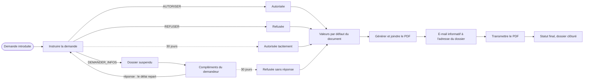

# Exemple — demande d'autorisation riverain pour un véhicule

Flux FlowForge entièrement **configuré, sans développement** :
1. une demande est introduite (portail externe ou agent) ;
2. un gestionnaire l'instruit sous 30 jours ;
3. il autorise, refuse ou demande des informations complémentaires (le dossier passe alors en attente) ;
4. si personne ne décide dans le délai, l'autorisation est accordée d'office ;
5. un document de décision reprenant toute la demande est produit et transmis au demandeur.

Les limites rencontrées et leurs contournements sont décrits dans [DIFFICULTES.md](DIFFICULTES.md).
Ce sont notamment : l'unicité de la plaque, l'absence de pièce jointe dans les e-mails, le portail
désactivé et le moteur de modèles strict.

## Contenu

| Fichier | Rôle |
|---|---|
| `config/type-dossier.json` | Type de dossier `AUTORISATION_RIVERAIN` (champs, clé d'unicité calculée) |
| `config/questions.json` | Les 4 questionnaires de tâches (instruction, compléments × 2, transmission) |
| `config/workflow-config.json` | Statuts du workflow et statuts de dossier autorisés |
| `config/modele-document.json` + `template-decision.html` | Modèle du document de décision |
| `autorisation-riverain-sans-portail.bpmn20.xml` | Processus déployable sur une instance **sans** portail |
| `autorisation-riverain.bpmn20.xml` | Processus cible, avec complément par le **portail** externe |
| `generer-bpmn.py` | Génère les deux BPMN (sémantique et mise en page) ; à modifier plutôt que les XML |
| `config/connecteur-portail.exemple.json` | Connecteur webhook pour un portail de dépôt externe (**non créé**) |
| `config/exemple-dossier.json` | Jeu de données de recette |

## Déroulé



Le minuteur de 30 jours est **interrompant** : si l'agent n'a pas validé la tâche à temps, elle est
annulée et l'issue « autorisée tacitement » s'applique.

## Choix retenus

| Question | Choix |
|---|---|
| Unicité de la plaque | Clé calculée `plaqueNormalisee` (pays + plaque normalisée), cherchable ; vérification déclarée par l'agent |
| Délai | 30 jours calendaires ; repart pour 30 jours complets à chaque retour du demandeur |
| Compléments | Demandeur via le portail (cible) ; sinon e-mail et saisie par l'agent |
| Silence du demandeur | Refus motivé après 30 jours, avec le même document |
| Document | Un modèle unique ; le texte varie selon l'issue (`AUTORISEE`, `AUTORISEE_TACITEMENT`, `REFUSEE`, `REFUSEE_SANS_REPONSE`) |
| E-mail | Informatif automatique à l'adresse saisie dans le dossier (`notificationTo="dossierField:email"`, relue à l'envoi), envoyé en **asynchrone** : une adresse mal saisie crée un incident sans bloquer l'agent. Plus une tâche de transmission manuelle du PDF (pas de pièce jointe possible) |
| Décision au dossier | Champs `decision`, `dateDecision` et `motifDecision`, renseignés par le workflow (`decision` est cherchable) |
| Statuts du dossier | `EN_COURS` au démarrage, `SUSPENDU` en attente d'informations, `CLOTURE` à la fin |

Statuts du workflow : `DEPOSEE` (initial), `EN_INSTRUCTION`, `EN_ATTENTE_INFOS`, puis `AUTORISEE`,
`AUTORISEE_TACITEMENT` ou `REFUSEE` (issue `COMPLETED`).

## État sur l'instance (`tenant_dev`, relevé le 2026-10-18)

| Élément | État |
|---|---|
| Type de dossier `AUTORISATION_RIVERAIN` | Créé, actif |
| Questionnaires `instruction-…`, `complement-…`, `complement-recu-…`, `transmission-decision-riverain` | Créés |
| Modèle `decision-autorisation-riverain` | Activé |
| Workflow `autorisationRiverain` (variante sans portail) | **Brouillon périmé**, proposé le 2026-10-13 avant la PR #174 (adresse passée en variable de démarrage, passerelle `emailConnu`). À remplacer par la version actuelle de `autorisation-riverain-sans-portail.bpmn20.xml` (étape 1 ci-dessous) avant de publier |
| Connecteur du portail | Non créé (secret à définir) |

## Mise en service

1. **Enregistrer le workflow en brouillon** avec `config/workflow-config.json` et
   `autorisation-riverain-sans-portail.bpmn20.xml`, via l'outil MCP `deploy_workflow` ou l'éditeur BPMN.
   Avec le portail activé (`APP_PORTAL_ENABLED=true`, `APP_PORTAL_PUBLIC_BASE_URL`), prendre
   `autorisation-riverain.bpmn20.xml` à la place. Le modèle de document peut être encore en brouillon :
   la réponse le signale dans `inactiveReferences` (TODO §93). Le brouillon remplace celui du même
   auteur ; s'il a été écrit par quelqu'un d'autre, passer `replaceExistingDraft=true`.
2. **Activer le modèle de document** `decision-autorisation-riverain` dans l'administration des modèles.
   C'est un geste humain, impossible par MCP.
3. **Publier le brouillon** depuis l'écran « Brouillons à publier ». La publication est refusée tant que
   le modèle n'est pas actif.
4. *(Facultatif)* Créer le connecteur du portail à partir de `config/connecteur-portail.exemple.json`,
   avec un vrai secret.
5. Vérifier qu'un serveur d'envoi d'e-mails est configuré sur l'instance (canal `EMAIL`).

## Recette

1. Dans `generer-bpmn.py`, passer `DELAI` à `"PT5M"` puis exécuter `python generer-bpmn.py`.
   Les deux délais passent ainsi à 5 minutes.
2. Créer le dossier de `config/exemple-dossier.json` et démarrer le workflow, depuis la fiche dossier,
   l'API ou `start_workflow`. Aucune variable n'est nécessaire : l'adresse est lue dans le champ `email`.
3. Parcourir les quatre issues :
   - autoriser ;
   - refuser avec un motif ;
   - demander des informations, puis répondre ;
   - demander des informations, puis laisser expirer.

   Laisser aussi expirer l'instruction.
4. Pour chaque issue, contrôler :
   - le PDF joint au dossier ;
   - les champs `decision`, `dateDecision` et `motifDecision` ;
   - l'e-mail (Mailpit en local : `http://localhost:8025`) ;
   - la tâche de transmission ;
   - le statut final.
5. Doublon : créer un second dossier avec la plaque `1 abc 123` et rechercher
   `plaqueNormalisee = BE-1ABC123`. Les deux dossiers doivent remonter.
6. Remettre `DELAI` à `"P30D"` avant la mise en production.

```bash
python generer-bpmn.py
```
