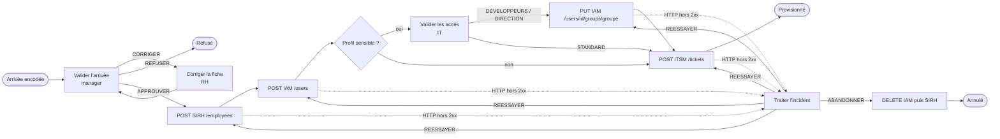

# Exemple — arrivée d'un collaborateur (orchestration technique)

Cas d'usage **orchestration technique** : un workflow Myrmacta coordonne plusieurs applications REST, et des validations
humaines (formulaires de tâche) décident de la suite. Le flux est entièrement **configuré, sans développement**
([registre §112](../../docs/decisions/112-orchestration-technique-requete-construite-par-le-bpmn.md),
[§126](../../docs/decisions/126-champs-managed-by-workflow.md)) :

1. les RH encodent l'arrivée (dossier `ONBOARDING_COLLABORATEUR`) ;
2. le manager valide, renvoie la fiche pour correction ou refuse ;
3. Myrmacta crée la fiche dans le **SIRH**, puis le compte dans l'**IAM** avec le matricule rendu par le SIRH ;
4. pour un profil sensible (développeur, direction), l'**IT valide les accès** et choisit le groupe IAM à accorder
   (développeurs, direction) ou s'en tient aux accès standard ;
5. Myrmacta commande le poste de travail dans l'**ITSM**, puis clôture le dossier ;
6. si une application répond en erreur, une personne choisit de **réessayer** ou d'**abandonner**. L'abandon supprime ce qui
   a déjà été créé (compensation par `DELETE`).

Chaque requête est écrite dans le BPMN (`flowable:connectorRequest`, expression JSONata bornée) à partir des champs du dossier.
Les identifiants rendus par les applications sont écrits dans des champs **`managedByWorkflow`** du dossier (brique
« Enregistrer des valeurs dans le dossier ») : ils sont lisibles par `dossier.fields` dans les expressions, y compris pour
les `PUT` / `DELETE` de compensation, et **refusés** à la création, au `PATCH` et dans les formulaires de saisie.

## Contenu

| Fichier | Rôle |
|---|---|
| `config/type-dossier.json` | Type `ONBOARDING_COLLABORATEUR` : champs saisis par les RH, champs « Provisioning » `managedByWorkflow` |
| `config/questions.json` | Les 3 questionnaires : validation du manager, validation des accès, incident technique |
| `config/workflow-config.json` | Statuts du workflow et statuts de dossier autorisés |
| `config/connecteurs.json` | Les 3 connecteurs `http-rest` « service seul » (SIRH et ITSM à en-tête statique, IAM en OAuth2) |
| `config/exemple-dossier.json` | Jeu de données de recette |
| `onboarding-collaborateur.bpmn20.xml` | Processus déployable, généré |
| `generer-bpmn.py` | Génère le BPMN (sémantique et mise en page) ; à modifier plutôt que le XML |

## Déroulé

Pour chaque appel, le motif est le même :

1. « Appeler un connecteur » en **asynchrone**, avec la requête construite dans le BPMN ;
2. « Évaluer une expression » : `connectorResult.status >= 200 and connectorResult.status < 300` ;
3. une passerelle : en cas de succès, « Enregistrer des valeurs dans le dossier » écrit le ou les champs gérés
   (`matriculeSirh = connectorResult.json.id`, …) ; sinon `etapeEnEchec` puis l'incident.

L'appel suivant relit `dossier.fields.matriculeSirh` (ou `identifiantIam` / `loginIam`) : c'est ainsi qu'un identifiant
passe d'une application à l'autre, sans variable de process technique.

## Les requêtes

| Étape | Requête produite par `connectorRequest` | Réponse recopiée |
|---|---|---|
| SIRH | `POST /employees`, corps : identité, fonction, département, date d'arrivée, manager, référence du dossier | `matriculeSirh = json.id` |
| IAM | `POST /users`, corps : login calculé, nom, `employeeNumber = dossier.fields.matriculeSirh`, compte désactivé | `identifiantIam = json.id`, `loginIam = json.username` |
| Groupe | `PUT /users/{id}/groups/{groupe}`, `id = dossier.fields.identifiantIam`, groupe choisi par l'IT (`variables.niveauAcces`) | `accesEtendus = true` |
| ITSM | `POST /tickets`, corps : profil, titre, échéance, `requestedFor = dossier.fields.loginIam`, référence du dossier | `ticketMateriel = json.number` |
| Compensation | `DELETE /users/{id}` puis `DELETE /employees/{id}`, seulement si le champ géré correspondant existe | `journalCompensation` |

Les chemins sont relatifs à la `baseUrl` de chaque connecteur. Les valeurs de `pathParams` sont encodées en un seul segment ;
une valeur qui contient `/` ou `\`, ou qui se réduit à des points (`..`, `..;x`), est refusée. Changer d'environnement (recette, production) revient à changer
la `baseUrl` des connecteurs, pas le BPMN.

## Choix retenus

| Question | Choix |
|---|---|
| Appels | Asynchrones : la validation humaine qui précède rend la main tout de suite. Une panne réseau ou un délai dépassé crée un incident rejouable (bandeau sur la fiche, rejeu par un administrateur). Le contrôle qui suit chaque appel est lui aussi asynchrone : un échec après l'appel (réponse sans identifiant, conflit d'écriture du dossier) relance le contrôle, jamais le `POST` |
| Statut HTTP en erreur | N'échoue pas l'activité : il est noté dans `dernierIncident` (étape, statut, début de la réponse) et soumis à une personne |
| Réessayer | Rejoue l'appel en échec, pas les précédents (`etapeEnEchec`). Un `POST` qui a pu aboutir malgré une réponse en erreur se protège côté application (clé d'idempotence, recherche préalable) |
| Abandonner | Supprime le compte IAM puis la fiche SIRH s'ils existent ; le ticket ITSM n'est jamais créé avant l'abandon (il est la dernière étape) |
| Validation IT | Seulement pour les profils `DEVELOPPEUR` et `DIRECTION` (expression sur le dossier). Le **groupe** accordé est la réponse de l'IT, pas le profil de la fiche : changer le profil après la validation ne change pas le groupe. Un profil passé à `STANDARD` saute la validation, et donc tout accès étendu |
| Identifiants techniques | Champs `managedByWorkflow` (TODO §126) : écrits seulement par `fieldMappingTask` ; cibles des `PUT` / `DELETE` |
| Limite | Sans assignation par groupe ([#190](https://github.com/superjojo79/Myrmacta/issues/190)), toute personne qui a le droit EDIT sur le type peut prendre la tâche « Valider les accès » : réservez ce droit aux bonnes personnes |
| Champs sensibles | Aucun dans cet exemple : un champ sensible n'est jamais lisible par l'expression, donc jamais envoyé |
| Connecteurs | « Service seul » (`webhookEnabled = false`) : aucun webhook entrant n'est ouvert sur ces instances |

Statuts du workflow : `EN_VALIDATION` (initial), `EN_PROVISIONING`, `EN_INCIDENT`, puis `PROVISIONNE` (issue
`COMPLETED`), `REFUSE` ou `ANNULE` (issue `CANCELLED`).

## Mise en service

1. **Créer les trois connecteurs** dans Admin → Connecteurs à partir de `config/connecteurs.json` : type `http-rest`,
   `webhookEnabled` décoché, la `baseUrl` réelle de chaque application, puis le secret (en-tête statique ou OAuth2). Noter
   l'identifiant de chacun.
2. **Générer le BPMN** : `python generer-bpmn.py --sirh <uuid> --iam <uuid> --itsm <uuid>`.
3. **Importer** le type de dossier, les questionnaires, la configuration de workflow et déployer le BPMN.

## Scénarios de recette

| Id | Scénario | Attendu |
|---|---|---|
| O1 | Corriger, puis approuver ; profil développeur, l'IT accorde DEVELOPPEURS, puis le profil de la fiche passe à DIRECTION | Aucun appel avant l'approbation ; 4 appels dans l'ordre ; matricule SIRH transmis à l'IAM ; en-tête propre à chaque application ; groupe `developpeurs` malgré le profil modifié ; champs « Provisioning » remplis ; dossier clôturé |
| O2 | IAM puis ITSM en erreur ; réessayer l'IAM ; abandonner après l'ITSM ; tenter de forger les identifiants avant l'abandon | PATCH refusé (`MANAGED_BY_WORKFLOW`) ; `DELETE` sur les vrais identifiants workflow |
| O3 | Création avec `identifiantIam` / `matriculeSirh` fournis | 400 `MANAGED_BY_WORKFLOW` |

Test automatisé : `OnboardingOrchestrationExampleIT`.
